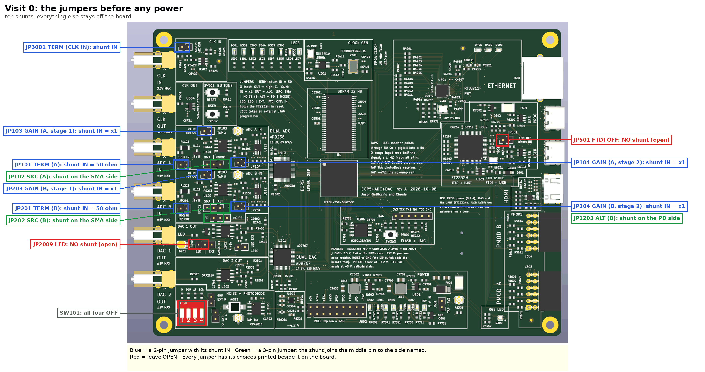
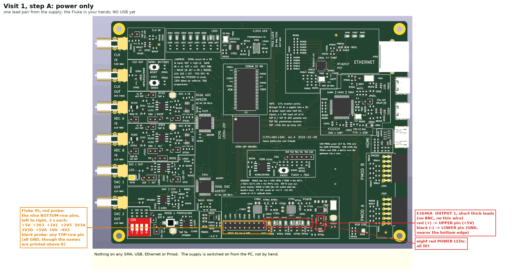
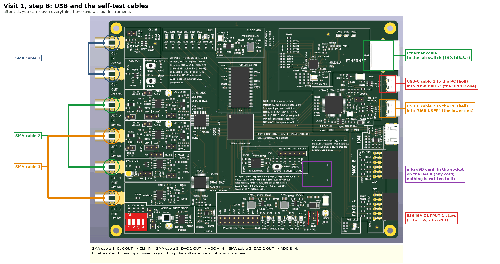
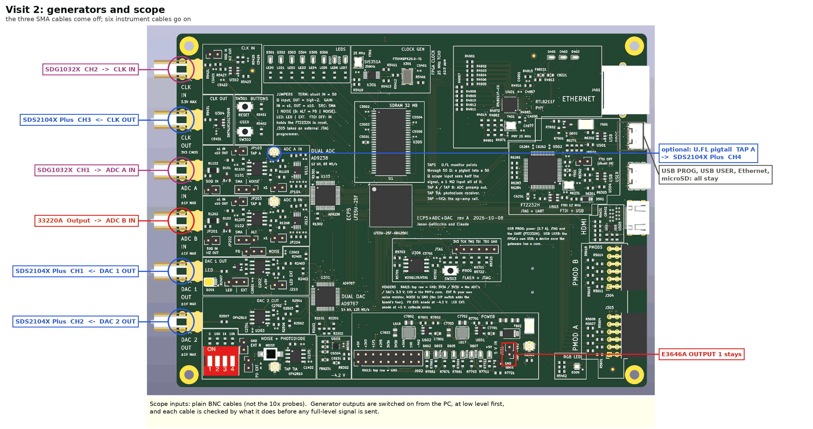
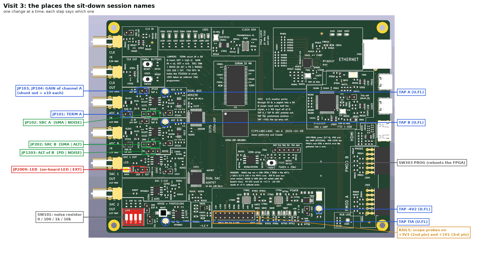

# ECP5-2ADC-2DAC rev A: the bring-up

The boards arrived 2026-11-05 (JLCPCB: 5 PCBs, 2 assembled, build 34 of 2026-10-09).  Nothing has been powered yet.
**Where the bring-up stands today, and the next thing Jason does, is always in [`bringup/STATUS.md`](bringup/STATUS.md)**
(`python3 bringup/bench.py where` prints it).

This file has two parts.  **The visits** (below) are what Jason does: five short physical configurations, each with a
picture, the exact cables, and the words to type in the chat when it is cabled.  Between visits the session works
alone, for as long as it takes, on what is plugged in.  **The stages** (after the visits) are the measurements
themselves with their pass conditions, the reference the visits point into.  The rule of the bench (`CLAUDE_PCB.md`
section 9) holds throughout: **plug in; do not solder or hold a probe** (two steps of visit 3 are the exceptions, and
say so).

Rewritten around visits on 2026-11-15 (Prompt 99): the lab time is the scarce thing, so the plan is ordered by cable
changes, not by subsystem, and the board tests itself wherever it can.  Three short SMA cables (DAC 1 OUT to ADC A IN,
DAC 2 OUT to ADC B IN, CLK OUT to CLK IN) turn its own converters and counters into the instruments, so everything but
absolute calibration runs with a power supply and two USB cables.

| thing | where |
|---|---|
| where we are, what is cabled now, what is next | [`bringup/STATUS.md`](bringup/STATUS.md) |
| this procedure | `BRINGUP.md` (this file); the pictures: `bringup/figs/` (`python3 bringup/make_figs.py`) |
| running it | [`bringup/`](bringup/README.md): `bench.py` (every visit is a command), `BRINGUP_LOG.md`, `REVB.md`; raw data in `bringup/data/` (not in git) |
| the gateware it uses | [`gateware/bringup/`](gateware/bringup/README.md): `build/blink.bit`, `build/bringup.bit`, `host/ecp5bu.py`; simulated in iverilog (`make sim`, `make test`), and the bench procedures themselves are run against the simulated board (`bench.py --sim`, `host/cosim.py`); not yet run on silicon |
| the instruments | `~/lab-instrument-control`: E3646A, Fluke 45, SDS2104X Plus, SDG1032X, 33220A; `bench_config.json` holds the addresses; `bench_claims.py` there records which project holds which channel |
| what the board is | [`README.md`](README.md); the reviews' open questions for the first board: `DESIGN_REVIEW_RESPONSE.md` section 6 (R2-11, R2-12), stage 8 below |

## What to have on the bench

| thing | for | have |
|---|---|---|
| **Agilent E3646A**, output 1, with two leads ending in 2.54 mm female pins (or mini-grabbers) | visit 1 on: the board's 5 V through J601, with the current read back and the switch under the PC's control | have; the lead: make |
| **Fluke 45** with its two probes | visit 1: the nine rails | have |
| **2 USB-C cables** to the PC (`bell`) | visit 1 on: USB PROG (JTAG, serial) and USB USER | have |
| **3 SMA male-male cables**, 10-30 cm | visit 1: the self-test cabling | have (the Icepi demo's) |
| an **Ethernet cable** to the lab switch (the 192.168.8.x one `bell` is on) | visit 1 on | have |
| a **microSD card**, any (it is only read) | visit 1 on | have |
| **SDS2104X Plus**, **SDG1032X**, **33220A**, and **6 BNC cables with SMA-male ends** (or BNC cables and SMA-BNC adapters) | visit 2 | have |
| a **U.FL-to-SMA pigtail** (Hirose U.FL-LP-088, 100-200 mm; 30 matings) | visits 2-3: the four taps | buy if none |
| 2 scope probes with hook tips, 3 female-female jumper wires | visit 3: the power-on sequence on the RAILS header | have |
| a monitor with a **mini-HDMI** (type C) cable; 8 male-male jumper wires | visit 3: HDMI, the Pmod loop (both optional) | check |
| a loupe or the phone's macro camera; the IR thermometer or camera | visits 0 and 3 | have |
| jumper shunts, 10 | visit 0 | have |

## The visits

One board at a time: **board A** through visits 0-3, then **board B** through visits 0 and 1 (`--board B`).  After every
visit the session says in the chat what it found, what it is doing next alone, and what the next visit is;
`bringup/STATUS.md` says the same for whoever sits down cold.  The words in **bold quotes** are what to type in the chat.

### Visit 0: unwrap, mark, look, set the jumpers (15 min, at a desk, no instruments, no power)

1. Unwrap.  Mark the two assembled boards **A** and **B** with a pen on the back.  Count the three bare boards.
2. Photograph each assembled board, top and back, straight down in good light, plus one close-up of the lower right
   corner of the top (J601, the fuses, the POWER LEDs) and one of the left edge (the analog strips).  Paste the photos
   into the chat: the session checks them against the assembly drawings (polarity marks, pin-1 dots, missing parts)
   and names anything it wants looked at with the loupe.  Stage 0.2 below is the full list.
3. Set the shunts as in the picture (the table under "Jumpers" below is the same thing in words).  JP2009 and JP501
   stay open; SW101 all off.  (JP501, FTDI OFF beside the FT2232H, holds the FT2232H in reset if a shunt is on it.
   Board A came with none: the session read one into a photo, and a header's pins seen at a slant look bridged.)
4. Type **"v0 done"**, with anything that looked wrong.

### Visit 1, step A: power only (5 min at the bench)

1. E3646A **output 1**: the red (+) lead to the pin of **J601 "5 V IN"** printed **+5V** (the upper pin, toward the
   board's middle; J601 pin 2), the black (-) lead to the pin printed **GND** (the lower pin, nearer the bottom edge;
   pin 1, the square pad).  Nothing else on the board: no USB, no SMA, no Ethernet.  Leave the supply's own output switch
   alone: the PC switches it.  The supply's RS-232 adapter is in the PC.  **Short, thick leads straight from the supply's
   terminals to J601**, not through a BNC cable or thin wire: on board A (2026-11-16) a BNC cable and thin wire lost
   0.47 V at 0.385 A (5.00 V at the supply, 4.52 V at J601), and the configured board draws nearly twice that.
2. The Fluke 45's RS-232 adapter in the PC; its probes within reach, set down, touching nothing.
3. Type **"v1a ready"**.  The session claims the supply for this board, raises the input in four steps (1.0, 2.5, 4.0,
   5.0 V with a low current limit) and stops at the first sign of a short.  Then it leaves 5.0 V on and says so.
4. Look: the **eight red POWER LEDs** by the RAILS header, all lit?  Say which are dark.
5. Type **"rails go"** and within 15 seconds start the walk: black probe on any pin of the RAILS header's **top row**
   (all ground, **although the rail names are printed above it**: the names belong to the row below), red probe on
   each pin of the **bottom row** (the row farther from the names), left to right, **three seconds each**, lifting clear
   between pins: +5V, +3V3, +1V1, +2V5, 3V3A, 3V3D, +5VA, 1V0, -4V2.  The PC reads the Fluke the whole time and takes
   each steady reading as the next rail; nothing needs typing.  It says which rails passed.
6. Touch the board for anything hot (the two bucks, U604 by the ADC and the PHY are allowed warm).

### Visit 1, step B: USB and the self-test cables (5 min; then you can leave)

With the supply still on:

1. **USB-C cable 1** from the PC into **USB PROG** (the upper USB-C).
2. **USB-C cable 2** from the PC into **USB USER** (the lower USB-C).
3. **Three SMA cables**: CLK OUT to CLK IN; DAC 1 OUT to ADC A IN; DAC 2 OUT to ADC B IN.  (If the two DAC cables end
   up crossed, leave them: the software finds which is where.)
4. **Ethernet** from the RJ45 to the lab switch.
5. A **microSD card** into the socket on the back.
6. Type **"v1b ready"**.  The session reads the FPGA over JTAG, loads the two bitstreams and writes the flash, then
   checks each cable by what it does (a small DC step on each DAC, a clock on CLK OUT, the card's answer, the host's
   reset on USB USER, the link) and says in one table what it found plugged where.  Then it runs alone, an hour or
   more (`bench.py v1b --list` is the order): every clock, the Si5351, the whole
   SDRAM, the PHY and the Ethernet data path (in the PHY's loopback, then real frames to and from the PC), the card,
   USB USER's lines, the capture timing, the DAC-to-ADC transfer, noise, sines to 10 MHz with their spurs, cross-talk,
   running from USB power alone, and a soak.  Nothing needs watching.

### Visit 2: generators and scope (10 min; then you can leave)

1. Type **"usb out"** after pulling **both USB-C cables** from the board (the supply stays).  The session power-cycles
   the board ten times and reads the supply current each time: the board must boot from its flash by itself.  A minute.
   Watch the white LEDs restart their chase each time.  When it says so, plug both USB-C cables back.
2. Take the three SMA cables off.  Then, with BNC cables that end in SMA plugs (not the 10x probes):

   | instrument | channel | to the board's SMA |
   |---|---|---|
   | SDG1032X | **CH1** | **ADC A IN** |
   | SDG1032X | **CH2** | **CLK IN** |
   | 33220A | **Output** | **ADC B IN** |
   | SDS2104X Plus | **CH1** | **DAC 1 OUT** |
   | SDS2104X Plus | **CH2** | **DAC 2 OUT** |
   | SDS2104X Plus | **CH3** | **CLK OUT** |
   | SDS2104X Plus | CH4 | a U.FL pigtail on **TAP A** (J107), if there is one; else nothing |

   Leave every generator output off: the PC switches them.
3. Type **"v2 ready"**.  The session claims the channels, then checks each cable with a signal too small to hurt
   anything it might have been plugged into by mistake (0.1 V), says what it found, and only then runs: the ADCs'
   volts per code against both generators, their response to 30 MHz (channel B to 14.5 MHz: the 33220A's reach),
   over-range, channel-to-channel leakage, CLK IN's sensitivity and the TCXO against the SDG's timebase, the DACs'
   levels and sines on the scope, CLK OUT from three sources.  It puts the scope's channel settings back as it found
   them.

### Visit 3: the sit-down session (30-40 min, together)

One change at a time: the session names the step and the one thing to move, you move it and type **"next"**, it
measures and answers.  In this order (each line is one `bench.py step`):

| step | you do | it measures |
|---|---|---|
| `leds`, `buttons`, `prog` | watch the white LEDs walk and the RGB LED go red, green, blue; press BTN0 and BTN1; press SW303 PROG | every LED, both buttons, a reboot from the flash |
| `gain_x10` | pull the shunts of JP103 and JP203 | both channels at x10 against the generators |
| `gain_x100` | pull JP104 and JP204 too | x100, and the noise floor there; then all four back |
| `term_open` | pull JP101 | the high-impedance input: twice the amplitude; back |
| `noise_0`, `noise_10k` | JP102 to NOISE, both gain stages at x10; SW101 switch 1 on (0 ohm), then switch 4 instead (10 k) | the Johnson noise of 10 k against 0 ohm at x100; back |
| `light` | JP2009 to LED, JP202 to ALT | the on-board LED seen by the on-board photodiode; back |
| `tap`, `tap_b`, `tap_tia`, `tap_n4v2` | the pigtail on J107, then J108, J109, J603 | each tap on scope CH4 |
| `poweron` | pull both USB-C; scope probes (hooks on jumper wires) on RAILS pins +3V3 and +1V1 | the power-on order (review R8), ten cycles; USB back |
| `dac_clock` | hold a probe on the 33 ohm by U201 pin 18 (the one held probe) | the DAC clock's edge (review R2-11) |
| `hdmi`, `pmod` | plug a monitor; eight wires Pmod A to Pmod B, pin for pin (optional) | the test picture and the monitor's EDID; every Pmod pin both ways |

Two of the reviews' questions are not commands yet and are taken by hand in this session with `bench.py scope shot`:
+1V0_PHY's rise against +3V3 (R2-12: a third probe on the RAILS header's 1V0 pin during `poweron`), and +5V's ring
when the USB-C is plugged with the supply off (stage 8).

### Visit 4: board B (10 min; then alone)

Visits 0 and 1 again on board B with `--board B`; visit 2 only if board A showed something that needs a second sample.

## The board, as the bench sees it

Left end, top to bottom, 17 mm apart: J301 **CLK IN**, J302 **CLK OUT**, J101 **ADC A IN**, J102 **ADC B IN**, J204 **DAC 1 OUT**, J205
**DAC 2 OUT** (each name and its limit printed under its SMA; ±1 V MAX IN on the ADCs, ±1 V MAX OUT on the DACs).  Right
end, top to bottom: J401 **RJ45**, J501 **USB PROG**, J502 **USB USER**, J503 **mini-HDMI**, J304 **Pmod B**, J303 **Pmod A**; J504 microSD on
the back.  Top edge: the TCXO X301, the Si5351 U301, the eight white LEDs LED0-7 (D301-D308) and the buttons SW301 **BTN0**
(reset in the LiteX plan) and SW302 **BTN1**.  Bottom edge, left to right: SW101 (the noise resistors), J105 **NOISE**, D103
the photodiode, J106 **PD EXT**, J109 **TAP TIA**, U606 (the -4.2 V pump), J602 **RAILS**, U601/U602 (the bucks), J601 **5V IN**,
J603 **TAP -4V2**.  Middle: U1 the FPGA, U305 the SDRAM above it, U306 the flash and J305 **JTAG** and SW303 **PROGRAMN** below
it; U103 the AD9238 and U201 the AD9767 to its left; U401 the PHY and U502 the FT2232H to its right; D309 the RGB LED by
Pmod A.

**The RAILS header J602** (2 x 9, by U601/U602): the odd pins are the rails, the even pins ground, so a probe with a ground
spring reaches every rail without a clip.  **The rail names are printed above the top row, and the top row is ground**: the
rails are the bottom row (REVB.md row 10; on board A's first walk the probes went on the wrong rows and every pin read
-2.5 V, the +2V5 pin against ground).  In order as printed: +5V, +3V3, +1V1, +2V5, +3V3_ADC, +3V3_DAC, +5VA, +1V0_PHY,
-4V2.

**The POWER GOOD LEDs** (dim red, 0.3 mA, in a row by the header): D602 +5V, D603 +3V3, D604 +2V5, D605 +3V3_ADC, D606
+3V3_DAC, D607 +5VA, D608 -4V2, D609 +1V1 (through Q601: the core rail cannot light a diode itself).  Eight LEDs; +1V0_PHY
has a header pin but no LED.

**Jumpers, as they stand for the bring-up** (every 3-pin jumper has its two choices printed beside its outer pins, every
2-pin jumper what a shunt does):

| jumper | what | bring-up position |
|---|---|---|
| JP101, JP201 **TERM** (ADC A, B) | shunt in = 50 ohm input; open = high-Z | **shunt in** (the generator and the DAC are 50 ohm sources) |
| JP102, JP202 **SRC** | SMA / ALT: what the preamp sees | **SMA**; ALT only for the noise source (A, B) or the photodiode (B, through JP1203) |
| JP103, JP104 (A), JP203, JP204 (B) **GAIN** | per stage: shunt = x1, open = x10 (x1, x10, x100 in all) | **both shunts in** (x1): ±1 V full scale |
| JP1203 **ALT** (channel B) | NOISE / PHOTODIODE | PHOTODIODE (unused until stage 6.6) |
| JP2009 **LED** (the LED driver's current) | on-board LED D201 / J210 LED EXT | **open** until the DAC checks out (the driver would put up to 48 mA through D201 at full scale) |
| JP3001 **TERM** (CLK IN) | shunt in = 50 ohm | **shunt in** for the generator; open for a 3.3 V square wave from another board's CLK OUT |
| JP501 **FTDI OFF** | shunt holds the FT2232H in reset so J305 takes an external JTAG programmer | **open** |
| SW101 (the noise resistors 0 / 100 / 1 k / 10 k) | | **all off** |

**Power paths.**  USB PROG's 5 V comes through F601 (a 2 A resettable fuse) and Q602 (a P-FET) to +5V; the bench header
J601 comes through F602 and D601 (SS34) and lifts Q602's gate, so with a bench supply on J601 the USB cable carries data
only.  +5V feeds U601 (+3V3 buck), U602 (+1V1 buck), U604 (+3V3_ADC, behind 2.2 ohm), U605 (+3V3_DAC), U606 (the -4.15 V
charge pump, "-4V2") and the +5VA bead; +3V3 feeds U603 (+2V5 = VCCAUX) and the +3V3_DRV / +3V3_DAC_D / +3V3_ETH beads.
About 3 W, 0.6-0.7 A at 5 V with everything running.

## Stage 0: before power (the evening before, or the first half hour)

0.1 **Unwrap** and photograph both assembled boards, both sides.  Mark them **A** and **B** with a pen on the back by the
    RAILS header.  Count the bare boards (3).  Note the bag's contents and any damage.  `bench.py note "..." --stage 0.1`.

0.2 **Look**, with the loupe, against the assembly drawings and `PLACEMENT_CHECKS.txt` (the parts JLCPCB rotated by rule
    rather than by a preview reading are the ones to check).  In order of what a mistake would cost at first power:
    (a) D601 (SS34, just above J601): in series from J601 pin 2 to F602 and +5V, its cathode bar toward F602 (the
        right end, as the silkscreen's bracket).  Backwards it blocks: nothing reaches the board, every step of the
        staircase reads a few mA (R7601 and R7602 only) and every LED stays dark; no harm.  (Until 2026-11-16 this line
        said a backwards D601 would sit across the supply; the netlist says it is in series.)
    (b) Q602 (AO3401A, SOT-23 by F601) and Q601 (SS8050 by D609): pin 1 by the dot.
    (c) The eight power LEDs D602-D609 and the eight white LEDs: cathode marks all the same way along each row (backwards
        they stay dark; no harm).  D309's reading was confirmed by JLCPCB's e-mail of 2026-10-22.
    (d) The BAV99s D101, D102 (SOT-23 after the 100 ohm 1206s) and D111, D112 (on the back under the THS4521s): pin 1 by the
        bevel.  D103, the photodiode: its anode toward -4V2 as `FABRICATION_NOTES.txt` says.
    (e) Pin 1 of the LQFP-64s U103 (AD9238) and U401 (RTL8211F), the LQFP-48 U201 (AD9767), the LQFP-64 U502 (FT2232H), the
        MSOP-10 U301 (Si5351), the DFN-8 U606 (LM27761): the chamfer or dot at the silkscreen's dot.  The BGA cannot be read;
        stage 2's IDCODE reads it.
    (f) The six SMAs' barrels straight out past the left edge; the two Pmod sockets' openings facing the right edge; the
        USB-Cs and the HDMI jack 1-2 mm past the edge with their shells soldered; J504's card slot facing east.
    (g) Nothing missing: every IC's position populated; the three crystals (Y301, 25 MHz, by the Si5351; Y401, 25 MHz, by the PHY; Y501, 12 MHz, by the
        FTDI) and the TCXO X301 present; both 4030 inductors (L617, L618, the bucks', marked 2R2) on the top in the POWER
        box, and L401 (the PHY's, 2.2 uH) on the back.
    A part that differs from the preview is JLCPCB's placement, not the CPL: a photo to their support, and no power to that
    board until the part is turned.  Normal and wanting nothing: the vias are filled and capped; through-hole pins have
    no inner-layer rings.

0.3 **The bench PC**: `python3 ~/lab-instrument-control/scpi_link.py identify` for the supply's and the Fluke's ports;
    `python3 bringup/bench.py check` (writes `bringup/bench_config.json`, says who answers); the scope and the generator
    on the LAN.  `openFPGALoader --Version` runs.  USB permission for the FT2232H (0403:6010): on bell the `openocd`
    package's `/lib/udev/rules.d/60-openocd.rules` already gives it `MODE 660, GROUP plugdev` and Jason is in `plugdev`
    (checked 2026-11-06 with the two FT232 adapters, which the same file covers); no rule to install.  Nothing from this
    folder needs `sudo`; what does is Jason's, as a copy-paste block in the chat.

0.4 **Jumpers** as the table says; nothing on any SMA or header yet; JP2009 open.

*Pass:* both boards photographed and inspected, every polarity in (a)-(e) as drawn, the bench answers.

## Stage 1: first power from the bench supply, no USB (board A, then B)

1.1 **The supply alone**: output 1 to the lead, nothing on the board; `bench.py psu on` sets 5.00 V, 1.0 A, OVP 5.6 V, the
    E3646A's other output at 0 V (one switch serves both); read 5.00 V, 0.00 A; `psu off`.  Then the lead into J601, + to
    the pin marked +5V.  **Check the polarity twice**: the SS34 protects against a reversed supply, but only up to its
    3 A and the fuse's trip, and a reversed 5 V at 1 A for the seconds it takes to notice is a hot diode.

1.2 **The staircase**: `bench.py psu staircase` puts 1.0 V (0.3 A limit) for 2 s and reads the current, then 2.5 V (0.3 A),
    4.0 V (0.5 A), 5.0 V (1.0 A), and switches off.  Expected: at 1.0 V under 30 mA (below every regulator's start-up
    threshold: the LEDs' resistors and leakage); at 2.5 V the bucks starting, 50-200 mA; at 4.0 V 0.2-0.4 A; at 5.0 V
    0.3-0.6 A with the FPGA unconfigured (the ADC is on with no clock, the DAC on, the PHY running, the FTDI enumerating
    nothing).  The supply in CC at any step (`mode` = CC in the log) is a short or a reversed part: off, and the IR camera
    at 1.0 V, 0.3 A finds what is warm.  *Pass:* every step in CV, the power (V x I) rising with the voltage (the current need not: the bucks draw about constant power once they regulate; board A 0.388 A at 4.0 V, 0.369 A at 5.0 V), under 0.7 A at 5 V.

1.3 **The rails**: `bench.py psu on`, then the Fluke on each odd pin of J602 with the ground spring on the pin beside it:
    `bench.py dmm +5V`, `dmm +3V3`, `dmm +1V1`, `dmm +2V5`, `dmm +3V3_ADC`, `dmm +3V3_DAC`, `dmm +5VA`, `dmm +1V0_PHY`,
    `dmm -4V2` (with no Fluke configured it asks for the reading).  The limits (`RAILS` in bench.py):

    | rail | pin | expect | source |
    |---|---|---|---|
    | +5V | 1 | 4.60-5.25 V (the bench input less D601's drop) | J601 through F602, D601 |
    | +3V3 | 3 | 3.23-3.43 V | U601 buck, 0.6 V x (1 + 15k/3.3k) = 3.33 V |
    | +1V1 | 5 | 1.07-1.13 V | U602 buck, 1.10 V |
    | +2V5 | 7 | 2.45-2.55 V | U603 LDO (VCCAUX) |
    | +3V3_ADC | 9 | 3.25-3.35 V | U604 LDO behind 2.2 ohm |
    | +3V3_DAC | 11 | 3.25-3.35 V | U605 LDO |
    | +5VA | 13 | 4.50-5.25 V | +5V through a bead |
    | +1V0_PHY | 15 | 0.95-1.05 V | the PHY's own switcher (L401 on the back) |
    | -4V2 | 17 | -4.35 to -3.95 V | U606 LM27761 at -4.15 V |

    And the eight LEDs all lit (D609 is the 1.1 V rail's: it goes through Q601, so it is the one most likely to be dark
    for a reason).  *Pass:* nine rails in their windows, eight LEDs on.  A rail low with its LED dark: its regulator's
    input first (the Fluke on the regulator's input capacitor), then its enable (tied to its input on every one).

1.4 **Heat**, after five minutes at 5.0 V: the IR camera over both sides.  Expected warm: U604 (the ADC's LDO: it takes
    (5 - 3.3) V x 0.2 A less the resistor's share once the ADC is clocked; unclocked less), U401 (the PHY, 0.3 A inside),
    the two bucks a little.  Nothing over 60 C on a 25 C bench; nothing warm that has no reason to be (an op amp, a
    BAV99, the photodiode, a passive).  `bench.py psu log --seconds 300` in another terminal logs the current meanwhile;
    a slow rise is a part heating.  *Pass:* the current flat to 5 %, nothing unexpected warm.

1.5 **The power-on sequence on the scope** (the review's R8): the scope's two probes on J602 pins 3 (+3V3) and 5 (+1V1),
    ground springs on pins 4 and 6; single trigger on +3V3 rising through 1 V, 2 ms/div; `psu off` then `psu on`.  What
    is expected: both bucks start together off the same 5 V (soft start about 0.8 ms); +3V3 reaches 3 V before or with
    +1V1 reaching 1 V, and the sysCONFIG rule (VCCIO8 above the flash's VIH before VCC and VCCAUX pass their POR) holds
    with the 100 nF on PROGRAMN adding 0.5 ms.  Save the screenshot (`bench.py scope shot power_on`).  Then the same on
    pin 15 (+1V0_PHY) against pin 3: Realtek asks for a 3.3 V rise slower than 0.5 ms (R2-12); read the rise time off
    the shot.  *Pass:* the traces saved and the order as expected; a +3V3 rise faster than 0.5 ms goes in `REVB.md`.

1.6 **The -4.2 V pump's noise**: a pigtail from J603 (TAP -4V2) to the scope at 1 MOhm, AC coupled, 20 mV/div, 1 us/div:
    the LM27761's 2 MHz residue after the bead.  Expected: a few millivolts; log the peak-to-peak.

*Stage 1 pass:* board A and board B both through 1.2-1.4; 1.5-1.6 on board A (once is enough unless B differs).

## Stage 2: USB PROG, JTAG (board A; B the same at the end)

2.1 **Enumerate**: with the bench supply on (Q602 keeps the PC's 5 V out), the USB-C cable into J501.  On the PC:
    `lsusb` shows `0403:6010 Future Technology Devices International, Ltd FT2232C/D/H Dual UART/FIFO IC` (a blank
    EEPROM: the default name), and `ls /dev/serial/by-id/` two new `usb-FTDI_Dual_RS232-HS-if00` / `-if01` entries
    (`/dev/ttyUSB0` and `1` if nothing else is plugged).  Channel A (if00) is the JTAG, channel B (if01) the serial.
    `dmesg -w` in another terminal while plugging: no "device descriptor read" errors.  *Pass:* 0403:6010 and two ports.

2.2 **The FPGA answers**: `openFPGALoader --detect -c ft2232` prints the IDCODE **0x41111043** (LFE5U-25F).  It
    detaches ftdi_sio from channel A while it runs; channel B stays a tty.  A permission error (`ls -l /dev/bus/usb/<bus>/<dev>` not `root plugdev`) means
    the openocd rule did not apply; the fix is Jason's: `sudo cp /lib/udev/rules.d/60-openocd.rules /etc/udev/rules.d/ &&
    sudo udevadm control --reload && sudo udevadm trigger`, then re-plug (the oss-cad-suite ships no rule file of its own).
    No IDCODE at all is the JTAG wiring (TCK T10, TMS T11, TDI R11, TDO
    M10, pulled as the sheet says) or JP501 fitted.  *Pass:* the IDCODE.

2.3 **USB power alone**: `psu off`, the board now powered by the PC's port through F601/Q602: the LEDs stay on, `--detect`
    still answers, the port's current if the PC reports it.  Then `psu on` again for the rest of the day (the P-FET hands
    over without a glitch: the LEDs do not blink).  *Pass:* runs from USB alone.

## Stage 3: the first bitstreams (board A)

3.1 **blink**: `openFPGALoader -c ft2232 gateware/bringup/build/blink.bit` (into the FPGA's SRAM, 2 s).  Expected: the
    eight white LEDs chase, one step every 0.67 s; the RGB LED cycles red, green, blue, off; BTN1 held lights all eight;
    BTN0 held reverses the chase; CLK OUT (J302, SMA-to-BNC to the scope at 50 ohm) shows the 25 MHz TCXO at 1.65 V
    amplitude (3.3 V open circuit through the 49.9 ohm); and `python3 -m serial.tools.miniterm /dev/ttyUSB1 115200`
    prints `ECP5-2ADC-2DAC blink 0`, `... 1`, once a second.  The scope's frequency counter on CLK OUT reads the TCXO
    against the scope's timebase (good to about 25 ppm; stage 4 does better).  *Pass:* all five; the current now (log it).

3.2 **bringup**: `openFPGALoader -c ft2232 gateware/bringup/build/bringup.bit`.  The chaser runs again (from the register
    design now, with the RGB LED green blinking once a second when the PLL is locked, red steady if it is not, blue on
    bus activity).  Then `python3 bringup/bench.py board ident`: the ID register 0xEC5BA2D2, the version 20261105, and
    STATUS with `pll_lock` true.  `bench.py run stage3.leds` walks every LED and colour from the register.  `bench.py
    board clkout tcxo|clk_s|low|high` moves CLK OUT between the TCXO, the 50 MHz PLL output, 0 and 3.3 V (the scope
    sees each).  *Pass:* the ID, the PLL locked, every LED, CLK OUT obeying.
    If `ident` fails: `ls /dev/serial/by-id/` (channel B is if01); the LEDs chasing means the design is in; a wrong byte
    back means a baud mismatch (the design expects 1 Mbaud from a 25.000 MHz TCXO: a dead TCXO would also stop the
    chaser); nothing back means uart_tx (H14) / uart_rx (H15) or the FTDI's channel B.

3.3 **The flash**: `openFPGALoader -c ft2232 -f gateware/bringup/build/bringup.bit` writes the W25Q128 through the
    FPGA (a minute).  Power-cycle (`psu off`, `psu on`, USB unplugged so nothing else powers it): the chaser starts by
    itself within a second (CFG = 010, master SPI, the 100 nF on PROGRAMN).  SW303 (PROGRAMN) pressed: the LEDs go out
    and the chaser restarts.  *Pass:* boots from the flash with no PC.  From here the board comes up ready for `bench.py`
    at every power-up.

3.4 **Board B** through 2.1-3.3 (the flash too), then back to A for the rest.

## Stage 4: the clocks (board A)

In visit 1B the SMA cable from CLK OUT to CLK IN lets the board's own counter read every clock it can put on CLK OUT
(the TCXO, half of it, the PLL's 50 MHz, the three Si5351 outputs) through the output buffer, the cable and the CLK IN
comparator: `v1b`'s `clkloop`.  The generator of 4.3 comes in visit 2.

4.1 `bench.py run stage4.clocks`: every clock input's frequency from the board's own counters (1 s gate from the TCXO):
    `tcxo` 25,000,000 by construction (it counts its own gate: a check of the method), `clk_s` 50,000,000 ±1 (the PLL),
    `clk_in` 0 (nothing on the SMA), `si0`-`si2` 0 (the Si5351 unprogrammed; its outputs power up off), `rxc` 0 or 25 MHz
    (the PHY's RXC with no link: the RTL8211F idles it at 2.5 or 25 MHz depending on the mode; note what it is).
    *Pass:* 25,000,000 and 50,000,000 ±1.

4.2 `bench.py run stage4.si5351`: the I2C scan finds 0x60; the three outputs are set to 10, 25 and 100 MHz (CLK0 and
    CLK1 from PLLA, CLK2 from PLLB, 2 mA drive); the counters read them ±1 Hz (they are integer-mode from the same
    25 MHz crystal, so their ratio to the TCXO is exact to the crystal's offset: the counts read the Si5351 crystal's
    ppm against the TCXO; expect under ±30 ppm).  `bench.py board clkout si2` puts the 100 MHz on CLK OUT for the scope.
    *Pass:* 0x60 answers, three frequencies as set.  No ACK: the pull-ups (4.7 k), SDA A15 / SCL E13.

4.3 `bench.py run stage4.clkin`: the SDG's channel 1, 10 MHz sine, 1 Vpp into 50 ohm (JP3001 shunt in), SMA-to-BNC to
    J301.  The TLV3501 squares it and the counter reads it: the difference from 10,000,000 Hz is the TCXO's error
    against the SDG's timebase (both ±2.5 ppm class: expect under ±5 ppm, i.e. ±50 Hz).  Then the SDG at 0.3 Vpp and
    at 3 Vpp: the count must not change (the comparator's threshold is at mid-rail, 6 mV of hysteresis).  Then a 1 MHz
    square wave, 3.3 Vpp, offset 1.65 V, JP3001 open: 1,000,000.  *Pass:* ±50 Hz at 10 MHz, level-independent.

4.4 The TCXO against the house 10 MHz, if a GPSDO or the OCXO distribution amplifier is at hand: the same measurement
    with a reference on CLK IN gives the TCXO's absolute error; log it in `BRINGUP_LOG.md` (the ±2.5 ppm spec).

## Stage 5: the DACs (board A)

Scope CH1 on J204 DAC 1 OUT and CH2 on J205 DAC 2 OUT through SMA-to-BNC adapters, both 1 MOhm, DC: the open-circuit
numbers (±2 V).  The output stage is an OPA2810 at gain 4.4 from the two 24.9 ohm current-to-voltage nodes, 50 ohm source
termination, DC coupled, centred on 0 V; code 8192 is 0 V, 16383 is +2 V (+1 V into 50 ohm), 0 is -2 V.

5.1 `bench.py run stage5.dac_dc`: both DACs out of sleep, 25 MS/s, codes 8192, 16383, 0, 12288, 4096; the scope's mean
    of each channel against 0, +2, -2, +1, -1 V (±0.1 V: the OPA2810's offset and the 24.9 ohm's 1 % are tens of mV).
    Then the scope at 50 ohm for one code: half.  *Pass:* within ±0.1 V on both; the two channels within 20 mV of each
    other (one die, one reference).  A channel stuck at 0 V with the other right: its OPA2810's rails (+5VA, -4V2 at the
    chip) or its 24.9 ohms; both stuck: DAC_SLEEP (R5) high, or MODE (R8) low, or no WRT/CLK.

5.2 `bench.py run stage5.dac_sine`: 50 MS/s, a 1 MHz full-scale sine on both: 4.0 Vpp ±0.4 open circuit, 1.000 MHz
    (the NCO's frequency is exact to the TCXO), the scope's FFT with the fundamental and nothing within 50 dB (the
    scope's 8 bits limit this; the ADC loopback of stage 6 measures it properly).  Then 10 MHz: the amplitude within
    1 dB (the stage is -3 dB at 12.3 MHz; the full-scale slew limit is at 10 MHz).  Then `bench.py board dac 1 saw 100e3`,
    `dac 2 triangle 100e3`, `square`: the shapes.  *Pass:* amplitude, frequency, shapes.

5.3 **The DAC clock at the DAC** (the reviews' R2-11: DAC_CLK1 rides the +1V1 corridor on In4 for 49 mm with the nearest
    ground via 5-6 mm away): this one is a probe, held by Jason, on the DAC end of the 33 ohm in the DAC_CLK1 line (the
    0603 nearest U201's pin 18, CLK1), ground spring on U201's nearest ground; 50 MS/s, the scope at 1 ns/div on a
    single edge.  Expected: a 3.3 V edge with ringing under 10 % and no glitch.  Save the shot.  Ringing over 20 %: a
    stitching capacitor on the rev B list (`REVB.md`), and for now the lower rate (25 MS/s) which has the same edge.

5.4 **The LED driver**: JP2009 to the on-board LED; `bench.py board dac 1 dc 8192`: the DAC 1 IOUTA node at 0.24 V makes
    24 mA through D201 (10 ohm sense: I = VA1 / 10 ohm, 0 to 48 mA): the red LED lit; `dac 1 dc 0` off; `dac 1 dc 16383`
    bright (48 mA; the XL-2835SURC is rated 60).  A 1 kHz sine on DAC 1 (`dac 1 sine 1e3`) flickers it.  Back to code 0
    and JP2009 open after.  *Pass:* the LED follows the code.

## Stage 6: the ADCs (board A)

In visit 1B the two SMA cables (DAC 1 OUT to ADC A IN, DAC 2 OUT to ADC B IN) make the whole analog chain measure
itself: a full-scale DAC is +-1 V into the ADC input's 50 ohm, which is the ADC's full scale at gain x1, so an ideal
board reads ADC code = 2048 + (DAC code - 8192) / 4.  `v1b` measures that line (slope, offset, straightness), the
noise with the DACs at mid-scale, sines from 100 kHz to 10 MHz with their spurs, the capture phase, and the leakage
from one channel to the other (`dc_transfer`, `noise`, `sine`, `phase`, `xtalk`).  What a loop cannot tell is which
half an error belongs to, or the volts: the generators and the scope of visit 2 (6.3 on, and stage 5) do.

Each channel: SMA, 49.9 ohm termination by JP, 100 ohm 1206 in series, a BAV99 clamp to the rails, the SRC jumper, two
OPA1612 stages (x1 or x10 each by jumper), a 49.9 ohm into the U.FL tap, then the THS4521 fully differential driver at
gain 1 into the AD9238 through 33 ohm and 22 pF.  ±1 V at the SMA is full scale at x1; offset binary, 2048 is 0 V.  The
capture is 8192 samples of both channels at once, 25 MS/s (or 50 MS/s direct), read back over the serial channel in a
second; the running statistics (min, max, mean over 65536 samples) read in milliseconds.

6.1 `bench.py run stage6.adc_noise`, nothing on either SMA, TERM shunts in (50 ohm to ground), SRC = SMA, GAIN x1: the
    mean of each channel 2048 ±100 codes (the offset of the chain: the OPA1612s' tens of uV and the THS4521's mV are
    codes at 0.5 mV/code; log it, it is calibration), and the standard deviation **under 3 codes** (the AD9238's own
    is about 0.6 codes rms at 65 MS/s; the chain's 50 ohm-source noise at x1 is 1.1 nV/rtHz x sqrt(12 MHz) x 4 = 15 uV
    rms = 0.03 codes: the digital noise is what this measures).  A tone in the FFT of the capture: note its frequency
    (2 MHz is the pump, 1.5 MHz the +3V3 buck, 1 MHz the +1V1 buck, 25 MHz / 50 MHz the clocks).  *Pass:* std < 3 codes,
    no tone above 10 codes peak.

6.2 **The capture phase**: `bench.py board capture 1024` at phase 2 (the default), then `python3
    gateware/bringup/host/ecp5bu.py` from Python with `adc_config(phase=1)`, `phase=3`, `negedge=True`: on a clean
    50 kHz sine (6.3 below) a wrong phase shows as isolated samples far off the sine (bit errors at the transition);
    the phases that give a clean sine are the window; choose the middle.  At 50 MS/s (`adc_config(rate=50e6)`) the same.
    *Pass:* at least one clean phase at 25 MS/s; note the window.  Nothing clean: the clock to the ADC (E4 / R2 through
    its 33 ohm; the scope on the 33 ohm at the ADC's pin 63 CLK_A / pin 18 CLK_B) or the data lines.

6.3 `bench.py run stage6.adc_gen`: the SDG channel 1, 100 kHz sine, 1 Vpp into 50 ohm (the generator told load = 50),
    into J101 ADC A IN: a 100 kHz sine of **2048 codes peak-to-peak** ±5 % (±0.5 V of ±1 V full scale: 2048 codes
    per volt; the "1024" that stood here until 2026-11-15 was its amplitude, not its peak to peak) centred on
    2048; channel B at its noise floor (the cross-talk, in dB: the ratio of B's component at 100 kHz to A's).  Then the
    same lead on J102 for channel B.  Then 1.8 Vpp (90 % of full scale), then 2.4 Vpp: the out-of-range flag (`otr` in the
    capture) counts the clipped samples, and the clamp holds the preamp input to the rails.  Then 1 MHz and 10 MHz at
    1 Vpp: the amplitude within 1 dB at 1 MHz; at 10 MHz the input filter's roll-off (log it).  *Pass:* 2048 ±100 codes
    on both channels, OTR on the overdrive, the amplitude flat to 1 MHz.

6.4 **The taps**: a pigtail from J107 TAP A to the scope at 1 MOhm with the 100 kHz 1 Vpp on the SMA: the preamp chain's
    output, 1 Vpp (x1) in phase with the input, DC coupled.  At 50 ohm, half.  The same on J108 for B.  *Pass:* 1 Vpp
    at 1 MOhm.

6.5 **Gain x10 and x100**: JP103 open (stage 1 of channel A at x10.1): 0.1 Vpp in reads 2048 codes peak-to-peak ±5 %; both open
    (x102): 10 mVpp.  The noise floor at x100 with the SMA terminated: the chain's 1.1 nV/rtHz x 100 over 12 MHz is 0.4 mV
    rms = 0.8 codes rms above the floor; log it.  Back to x1.  *Pass:* the gains within 5 % of 10.1 and 102.

6.6 `bench.py run stage6.loopback`: an SMA lead from J204 DAC 1 OUT to J101 ADC A IN (TERM in: the DAC drives 50 ohm,
    ±1 V, exactly the ADC's full scale): a 1 MHz sine captured at 25 MS/s, at half scale so that nothing clips (2048 codes peak-to-peak ±10 %; full scale
    is the ADC's whole 4096 and tells only whether the out-of-range flag counts),
    and the SFDR from the FFT of the capture (the DAC's images are above Nyquist of the capture; the harmonics of the
    two output stages and the ADC chain are what shows): **over 60 dB** is the chain working as designed (the AD9238's
    80 dB and the OPA2810's distortion say 70 is possible).  Then 100 kHz and 10 MHz.  Save the captures (`bringup/data`).
    *Pass:* amplitude and SFDR > 60 dB at 1 MHz.

6.7 **First light**: the optical path.  JP2009 to the on-board LED, JP1203 to PHOTODIODE, JP202 (channel B's SRC) to ALT:
    the photodiode receiver (U105, the transimpedance stage, TAP TIA on J109) feeds channel B.  `bench.py board dac 1
    dc 12288` (36 mA in D201): channel B's mean rises from the dark level; `dac 1 sine 1e3` with offset 8192 (a 1 kHz
    modulated LED): a 1 kHz sine on channel B's capture (decimate: `adc_config(decim=99)` gives 250 kS/s for 32 ms of
    record).  The photodiode sees the LED at 60 % of its peak sensitivity across the board; the TIA's gain is the
    sheet's.  Log the codes per mA.  Everything back after (JP2009 open, JP202 SMA).  *Pass:* the light is seen; the
    ratio logged.

6.8 **The noise source**: JP102 (A's SRC) to ALT, JP1203 unchanged (B's ALT is the photodiode; the noise reaches B
    through JP1203's NOISE position: do B later), SW101 switch 4 on (10 k: 12.9 nV/rtHz), gain x100 on A: the capture's
    std against the 0 ohm switch (switch 1 on: the amplifiers alone); the difference squared is 4kTR x B.  A one-line
    Johnson-noise check of the whole chain.  *Pass:* 10 k measurably noisier than 0 ohm at x100.

## Stage 7: the memory, the Ethernet PHY, the rest (board A)

7.1 `bench.py run stage7.sdram`: the read-latency scan on 4096 words (latencies 1-7: in simulation 3 passes and its
    neighbours fail in every word; on the board the clock's and the command's trips to the chip decide, so 3 or 4), then
    the whole 32 MB (16 M words) written and read back with three patterns at the latency that passed: **0 errors**,
    about 5 s each (retention over the write phase proves the refresh).  Both SDRAM clock polarities (`pol`) if the
    scan's window is one wide.  *Pass:* a latency with 0 errors over the whole array, all patterns.  Errors in one
    data bit at every address: that DQ line; in one bank: its BA; everywhere: the clock or the latency.

7.2 `bench.py run stage7.phy`: the PHY's ID over MDIO (bit-banged: a second): **0x001C, 0xC916** at address 1 (PHYAD0
    strapped high); then an Ethernet cable from J401 to the switch: the RJ45's link LED, the PHY's status register says
    link up and the negotiated speed, and RXC counts **125,000,000** (gigabit) on `bench.py board clocks`.  *Pass:* the
    ID, the link, 125 MHz.  Traffic through the RGMII (ping) is LiteX's liteeth job, after the bring-up.

7.3 **The Pmods**: `bench.py board` with `pmod(mode_a=2, mode_b=2)` (from Python: counters on every pin, 12.5 MHz
    down to 98 kHz): the scope on each of the 16 pins (a probe, Jason, or a Pmod breakout).  `pmod(mode_a=1, a=0x55)`:
    static levels.  *Pass:* every pin toggles.

7.4 **Buttons, RGB, user LEDs, the FTDI's modem lines**: covered by stage 3; `bench.py board ident` shows RTS/DTR as the
    PC sets them (`python3 -c` with pyserial `setRTS`): a reset line for the LiteX design later.

7.5 **The RGMII data path** (`v1b`'s `eth_loop` and `eth_wire`; since 2026-11-15): the PHY's ID and link say nothing about
    the twelve data lines, so the gateware sends frames and checks what comes back.  First with no cable: the PHY in its
    own loopback (BMCR 0x4140), a frame built on the PC written into the transmit buffer, 1000 of them sent, every one
    counted and CRC-checked by the receiver, the first read back byte for byte; then 1000 full-length frames.  The straps
    are read back too (page 0xd08: both RGMII delays on).  Then on the wire: the board broadcasts UDP datagrams that a
    socket on the PC receives, and the PC broadcasts some that the board counts.  *Pass:* every looped frame good, 0 bad;
    the PC sees the board's datagrams.  One bad frame in a thousand is a timing margin: the eye is on the 33 ohm
    resistors' side of the PHY (rev B candidate: series resistors at the FPGA end).

7.6 **microSD** (`sd`): a card in the socket on the back, in SPI mode (CLK, CMD as data in, DAT0 as data out, DAT3 as
    chip select): CMD0, CMD8, ACMD41 until ready, the OCR, the CID and block 0, each data block's CRC-16 checked.
    Nothing is written.  DAT1 and DAT2 are only read as levels (high).  *Pass:* the card initialises and both blocks'
    CRCs are right.  The 4-bit mode is litesdcard's, after the bring-up.

7.7 **USB USER** (`usb`): no USB core; the lines as pins.  With the board's 1.5 k pull-up on, the PC's port sees a
    full-speed device, resets the bus (both lines low for 10 ms or more) and sends packets nothing answers; the FPGA
    counts the reset and edges on both lines, and the PC's kernel log shows the attempt ("new full-speed USB device",
    then "device descriptor read/64, error").  Then D- driven high by its pin alone: the PC logs a low-speed device.
    *Pass:* the reset and packets seen on both lines for both attaches.  A real device core is later gateware.

7.8 **HDMI** (`hdmi`, visit 3): the hot-plug pin, the monitor's EDID over DDC (bit-banged; header and checksum), then a
    640 x 480 test picture: a one-pixel white border, eight colour bars, a grey ramp, a block that moves.  *Pass:* the
    EDID reads; the monitor shows the picture whole, the border on all four sides, the block moving.

## Stage 8: the reviews' open questions, and what goes on the rev B list

| from | what to measure | where | done in |
|---|---|---|---|
| R8 (round 1) | +3V3 against +1V1 at power-on: the Master-SPI sequencing rule | J602 pins 3 and 5 | 1.5 |
| R2-12 | DVDD33's rise (Realtek wants slower than 0.5 ms) and REG_OUT (+1V0_PHY) clean | J602 pins 3 and 15; the ripple on 15 | 1.5 |
| R2-11 | DAC_CLK1 at the DAC end: ringing from the In4 corridor | the 33 ohm by U201 pin 18 (a held probe) | 5.3 |
| round 2 (both) | the ADC's LDO U604 temperature at 65 MS/s (0.26 W after the 2.2 ohm) | the IR camera, the ADC clocked at 50 MS/s | 1.4 again after 6 |
| round 2 (CopilotSDK) | +5V's ring on a hot plug toward 5.8 V with 94 uF behind the fuse | the scope on J602 pin 1, single trigger, while the USB-C is plugged with J601 off | after 2.3 |
| R10 | the ADC's SFDR at 1 and 10 MHz (the input trace asymmetry) | the loopback and the generator | 6.3, 6.6 |
| Response 26 | the taps' loading: the OPA1612 driving 100 ohm | TAP A at 50 ohm with a full-scale input: no distortion | 6.4 |
| build 31 | the ADC's analog LDO's dissipation | as above | 1.4 |

Everything that fails a pass condition, every number outside its window, every "works but" goes to `bringup/REVB.md` with
the reading that showed it, the day it is seen.

## The dead-on-arrival list against the stages

| risk | what would show | retired by |
|---|---|---|
| a reversed SS34 or P-FET, a short under the BGA or a 0402 bridge | current limit at 1-2.5 V | 1.2 |
| a buck not starting (L617/L618, the feedback divider), an LDO dead | a rail out of its window, its LED dark | 1.3 |
| the -4.15 V pump dead or at the wrong voltage (the 1.3 M mistake of build 24 is fixed, but) | -4V2 out of window, the op amps at 0 V | 1.3, 5.1 |
| the BGA not soldered, or the configuration pins (CFG, PROGRAMN, DONE, INITN) wrong | no IDCODE | 2.2 |
| the FT2232H dead, its crystal Y501 not oscillating, the USB-C's CC resistors | no 0403:6010 | 2.1 |
| the TCXO dead (its two grounds, found on the first sheet) | no chaser, no serial | 3.1 |
| the flash not booting (CFG = 010, the flash's pins on sysCONFIG) | no chaser after a power cycle without the PC | 3.3 |
| the PLL (VCCAUX = +2V5 from U603) | the RGB LED red, `pll_lock` false | 3.2 |
| the Si5351 (its crystal Y301, the I2C pull-ups) | no ACK at 0x60, or outputs that do not count | 4.2 |
| the CLK IN comparator (its bias at mid-rail, the 1 k) | CLK IN counts nothing or the wrong frequency | 4.3 |
| the DAC (MODE, SLEEP, the FSADJ 2 k, REFIO) | both outputs stuck at 0 V | 5.1 |
| an output stage (the swapped FDA outputs of the first rev A were found by trace_paths; the DAC port 2 reversal too) | one DAC at the wrong polarity or amplitude | 5.1 |
| the ADC's clock or data lines, the capture phase | a noisy or scrambled capture | 6.1, 6.2 |
| the ADC front end (a preamp, the FDA, a clamp diode conducting) | the wrong amplitude or offset on one channel | 6.3, 6.4 |
| the SDRAM (the address and data rivers, the clock) | errors in the scan at every latency | 7.1 |
| the PHY (its straps, its 1.0 V switcher's inductor L401, the magnetics) | no ID over MDIO; no link | 7.2 |
| the RGMII data lines and their timing (TXD/RXD, the two clocks, the PHY's delay straps) | looped frames lost or with bad CRCs | 7.5 |
| the microSD socket (on the back: its orientation, the card's four used lines) | no answer to CMD0 | 7.6 |
| USB USER (the 1.5 k pull-up, D+, D-, the connector) | the PC's port sees nothing, or the FPGA sees no reset | 7.7 |
| HDMI (four pairs, DDC, hot plug) | no EDID; no picture | 7.8 |

## After the bring-up

The LiteX SoC (`gateware/litex/ecp5_2adc_2dac.py`): VexRiscv, the SDRAM through litedram, liteeth over the RGMII with
both delays inside the PHY, the serial console on channel B; then the capture-to-SDRAM-and-send-over-Ethernet path that
is what the board is for; then the lock-in and correlation gateware of the optics experiments.  The bring-up design stays
as the diagnostic bitstream in the flash's second slot, or the first thing loaded when something stops working.
