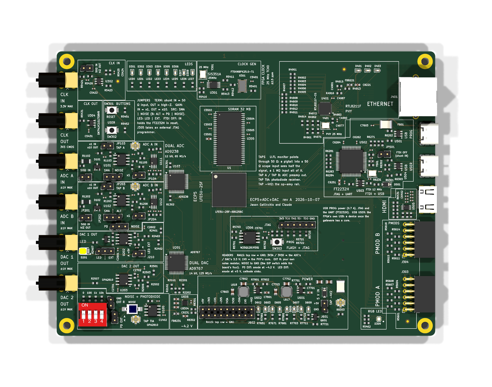
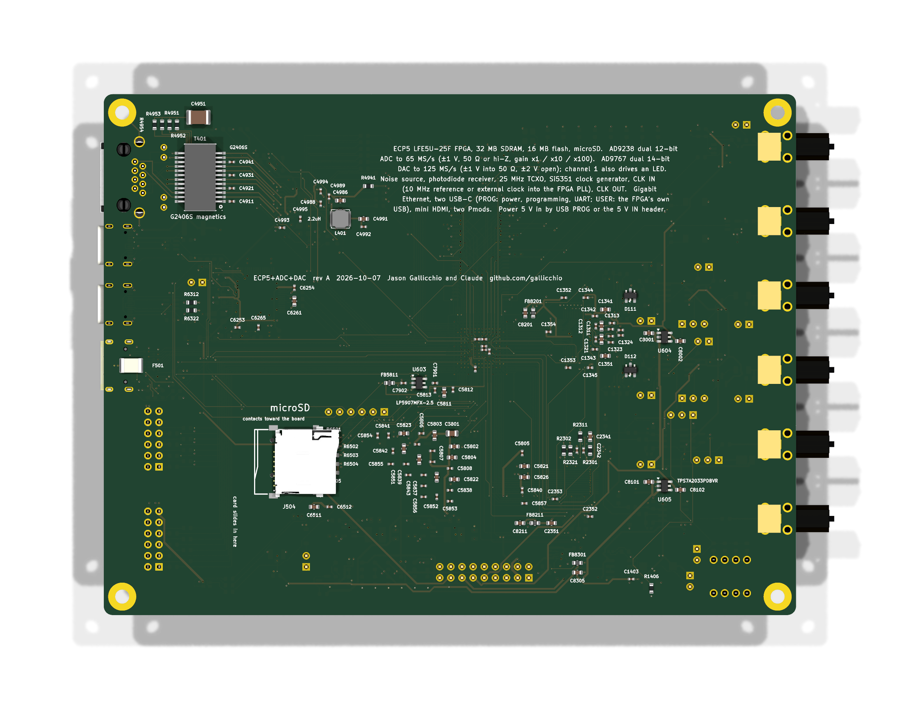
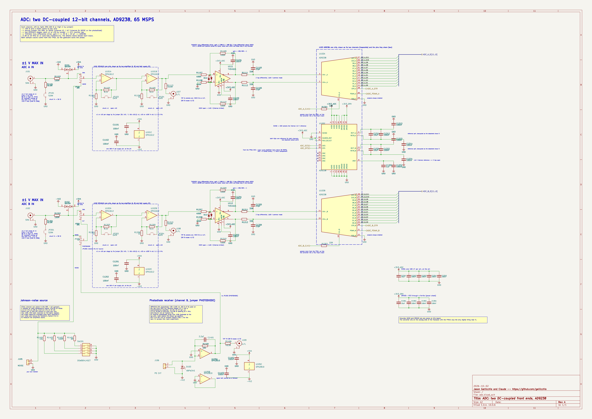

# ECP5 + 2x DAC + 2x ADC

## Prompt 1

The goal is to use KiCad 10 at `$HOME/.local/bin/kicad-10.0.6-x86_64.AppImage` to design a PCB that can host:

* ECP5 FPGA, FTDI JTAG+serial, TCXO, at least 32-128 Mbit QSPI of flash, at least 32 MB SDRAM or 128 MB DDR3, Digital GPDI, Direct USB to FPGA, and ethernet PHY+magnetics+RJ45. It should be a simple matter to make this a new linux-on-litex-vexriscv target with all interfaces supported.
* 2x ADCs: AD9226 (12-bit, 65 MS/s) or a dual AD9238.
* 2x DACs: AD9767 (14-bit @ 125 MS/s), DAC904 (14-bit, 165 MS/s), or AD9744 (14-bit, 210 MS/s)
* The analog channels are DC coupled, with all op amps and analog signal conditioning to allow experiments in lock-in techniques, Johnson noise measurements via correlation of the two ADC channels, and OFDM communication experimentation. You can take inspiration from AliExpress modules.

Potential starting points, all of which you should investigate and pursue are:
* iCESugar-Pro core, where you just design the carrier board with the ADCs and DACs.
* A modified ULX3S, ButterStick, OrangeCrab, or ECPIX-5 board with the ADCs and DACs and Ethernet.

Eventually I want to have JLCPCB manufacture and assemble it, so you should pick parts that they have plenty of in stock -- parts that I do not need to consign.

A previous Claude model started to modify the Icepi Zero design `OpticsPCBs/IcepiZeroADCDAC`. Even using a maze router that worked for `OpticsPCBs/GPSDO-PYNQ-Z2`, you failed to route out of the FPGA balls to even a minimum number of peripherals. This is an attempt to start over from different initial conditions. Take lessons learned from those attempts, but don't get sucked down the same blind alleys.

We did, however, get an Icepi Zero manufactured successfully by JLCPCB with some part substitutions as described in `OpticsPCBs/IcepiZeroADCDAC/jlcbuild`. We also made the `OpticsPCBs/IcepiZeroADCDAC/adapters` board for a less capable "AD9280 AD9708 Data Acquisition Board". There are some python tools that may be of use to you there, like for pulling in-stock JLCPCB parts and for doing your more sophisticated version of electrical and design rules checks. I have successfully tested these boards by doing some of the aforementioned experiments on real hardware as documented in `$HOME/DroneSDR/openfpga/IcepiZeroADCDAC_tutorials`. Your task here is meant to be a significant (though hopefully not significantly more expensive) upgrade to that stack, which should enable even more interesting tutorials and experiments.

Git clone each of the open-source designs mentioned above. Do not treat the "vendored" schematic and PCB as sacred. I think treating them like this caused you trouble in your `OpticsPCBs/IcepiZeroADCDAC` attempts. Feel free to grow each PCB. The priority should be:
* route out the additional DAC and ADC buses and clocks as your top priority. 
* Adding ethernet is your next priority, and if you can find an RJ45 jack with integrated magnetics that I don't need to consign to JLCPCB, use that.
* Adding an external sample clock with a PLL that can be synchronized between boards (as was done in some of the IcepiZeroADCDAC attempts) would be the next priority.
* Digital GPDI and Direct USB are nice, but could probably be dropped.
* An additional PMOD or even SYZYGY connector might be nice, but again, is a lower priority.
* Finally, if it doesn't totally destroy the analog performance, it might be nice to have jumpers or switches or simple ways to attach the DAC to things like a properly-biased LED and the ADC to things like a properly-biased photodiode to do long-distance lock-in and communication experiments. Similarly for the other experiments listed. If it only adds $10, I'd rather have these built into the board rather than have students dangle a breadboard mess off of this board and try to tilt it to point it across the room.

I understand that the FTDI chip that the Icepi Zero used can only do either JTAG or serial. It would have been nice to be able to keep the serial open while the FPGA was reprogrammed through JTAG. This allows the entire boot sequence to be captured.

There are some choices that we'll need to make: 
* LFE5U-25F / 45F / 85F ? What does the larger FPGA buy for our experiments/tutorials/applications?
* SDRAM or DDR3 ? What does more RAM or different types of RAM buy?
* Which ADC and DAC in this class would be the best balance of price, performance, and availability. Which would unlock the most interesting physics experiments (and secondarily comms experiments)

As you make each decision, document the relevant factors. Summarize the choices in tables that I can look at.

* I want you to keep going all night, potentially taking different parallel approaches.
* I want you to take it all the way to gerbers, a BOM, and a CPL file that I can simply upload to a place like JLCPCB, NextPCB Rev 0, or CircuitHub.
* Select components that these places have plenty of in stock, such that that I can order in only one step. I do not want to consign any parts. I do not want to wait for out of stock items.
* Do all of the placement and routing yourself. The java autorouter that you tried in `OpticsPCBs/IcepiZeroADCDAC` only seemed to cause trouble.
* You should have a shell script or python file that just "makes" everything on the command line: the schematic, PCB, manufacturing files, and a document with a cost estimate and other manufacturing instructions for me. Your scripts should run as many checks as necessary to ensure that I can just upload the files, "click go", and have working boards show up at the door.
* Make the design rule checks at least as strict as the design rules at JLCPCB for the stackup that we need.
* Lay out the schematic and the PCB as Paul Horowitz does in his hand-drawn schematics in the Art of Electronics. Use large page-sizes for the schematics -- I'd rather zoom and scroll than constantly flip around to find where a labeled signal disappeared to. Don't just assign labels to signals that disappear and reappear elsewhere. The power should flow from top to bottom and the signals from right to left. Actually look at the schematics to make sure they are easy to read and beautiful, with nothing on top of other things. 
* The PCB should be legible and logically arranged.
* The schematic should be in the beautiful "Art of Electronics style" --- the circuit is drawn, and things are labeled in such a way as to immediately answer typical questions that might arise in a reader's mind:
 - I don't want to see labels that disappear and magically reappear elsewhere (except maybe power and ground).
 - If a note belongs with a node or IC, write it right next to the node, not somewhere off to the side.
 - No labels should overlap components or other labels. You can spread things out a bit on the page to allow this to happen, but keep everything within the borders of the page. Really check that this is the case.
* The PCB's silkscreen should make it clear what the inputs and outputs are. 
 - Nothing on the silkscreen should overlap other silkscreen or components. Really check this. Make it beautiful.
 - The silkscreen should have the following on it: "ECP5+ADC+DAC", "by Jason Gallicchio and Claude", "https://github.com/gallicchio", today's date, and "rev A" in case we need to re-spin.
 - Important component values and IC names should also be on the silkscreen (in addition to the reference designators) for educational purposes. An output or input 50 ohms, for example, should be explicitly labeled as such.
* Simulate the analog aspects of the circuit wherever possible and check that your circuit actually implements it properly.
* Do a self-critical design review of the circuit, the way the schematic is drawn, the way the PCB is laid out, and the component and manufacturing selections. Make any changes. Iterate until satisfied.
* I will open the schematic and PCB in KiCAD and give you feedback after you've worked on it at least all night.
* Build basic gateware, making sure that all pins make sense (that clock inputs, for example, correctly actually successfully build as clock inputs)

All of my prompts and all of your responses should be logged here. If there are minor typos in my prompts, fix them here, but otherwise this will serve as a record of the project. If you have questions for me as you work, put them in in the chat and also in a temporary QUESTIONS.md and If I happen to see them in the chat, I'll try to answer them there or in ANSWERS.md (so we don't save over each other). These two files should go in .gitignore. I'll check the chat and QUESTIONS.md when I can, and so should you.

## Response 1 2026-10-01 23:12 - 2026-10-02 06:26 Claude Fable 5.1 Max

### What you are looking at

Everything under `OpticsPCBs/ECP5-2ADC-2DAC/` is generated by `python3 build.py` (`--clean` removes what it
makes).  The sources of truth are `gen/` (pin plan, symbols, the seven schematic sheets), `pcb/` (placement,
BGA escape, router, silkscreen, board writer), `mfg/` (release) and `tools/` (JLCPCB queries).  The products
are the KiCad project (`ECP5-2ADC-2DAC.kicad_pro/.kicad_sch/.kicad_pcb` + six sub-sheets), the constraints
(`gateware/ecp5_2adc_2dac.lpf`, a LiteX platform file), the pin proof bitstream, and `mfg/release/` with the
Gerber zip, BOM, CPL, cost estimate and fabrication notes.  `README.md` has the decision tables; this
section is the log.

The board: 130 x 100 mm, six layers (JLC06161H-7628, ENIG, via-in-pad filled and capped), M3 holes in the
four corners, grounded.  Left edge, top to bottom: CLK IN, CLK OUT, ADC A, ADC B, DAC 1, DAC 2 on edge-launch
SMAs.  Top edge: four LEDs, RESET and USER buttons, two Pmods.  Right edge: RJ45 (gigabit), USB-C for
programming/serial/5 V, USB-C to the FPGA, mini-HDMI, 5 V bench header.  Bottom edge: the noise-resistor
DIP switch and header, the LED and photodiode headers, nine test points (one per rail), microSD.  The ECP5 is
in the middle, SDRAM above it, flash and JTAG below, the converters to its left, the PHY and FTDI to its right,
the switching regulators in the bottom-right corner, as far from the analog as the board allows.

### Decisions (the tables are in README.md; the one-line versions)

| decision | choice | why |
|---|---|---|
| FPGA | LFE5U-25F-6BG256C ($14.25, 81 in stock) | the only ECP5 JLCPCB stocks; the 45F/85F are footprint-compatible BOM swaps for rev B |
| RAM | 32 MB SDR SDRAM W9825G6KH-6 ($5.63, 8909) | litedram's SDR PHY is proven on ULX3S/Icepi; DDR3 on a -6 ECP5 is the one schedule risk I would not take overnight; 32 MB = 8 s of both ADCs at full rate |
| ADC | one AD9238BSTZ-65 ($71, 21 in stock) | two matched cores, one reference, simultaneous sampling, 3.3 V only; AD9226 is 5 V and $157 for two |
| DAC | AD9767 ($14, 147) | dual 14-bit 125 MSPS, two full ports (own WRT/CLK), the Red Pitaya's DAC |
| Ethernet | RTL8211F-CG + G2406S magnetics + plain RJ45 | 88k/30k/10k in stock; discrete magnetics keep each pair's centre tap on its own capacitor, which is what a voltage-mode PHY wants |
| USB | FT2232H (A = JTAG, B = serial) on one USB-C that also powers the board; a second USB-C straight to the FPGA | serial stays open while reprogramming; ULX3S-style direct USB for TinyUSB/LUNA |
| clocks | 25 MHz TCXO (FT5HNBPK25.0) -> Si5351A (three outputs to PCLK balls) + external CLK IN (50 Ω, 1M self-bias squarer) + CLK OUT | sample clock sourced on-board, from another board, or sent to another board |
| front end | 50 Ω/hi-Z jumper -> 100 Ω + BAV99 clamp -> source jumper -> 2 x OPA1612 (x1/x10 each) -> THS4521 -> 33 Ω/22 pF -> AD9238 | DC coupled, ±1 V full scale at x1, x100 for the Johnson-noise experiment, 23 MHz at x1 (simulated) |
| output stage | AD9767 current outputs into 24.9 Ω -> OPA2810 difference amp (gain 4) -> 49.9 Ω -> SMA | DC coupled, ±1 V into 50 Ω, -3 dB at 13 MHz (simulated) |
| opto | DAC 2's unipolar node -> V-to-I (OPA2810 + SS8050, 10 Ω sense) -> on-board LED or header; photodiode (VBPW34S) -> TIA (10 kΩ ‖ 2.2 pF) -> ADC B's source jumper | the lock-in-across-the-room experiment; channel 1 stays untouched |
| power | one 5 V USB-C (or bench header, diode-OR'd); TLV62569 bucks for 3.3 V and 1.1 V; LP5907 for 2.5 V; TPS7A20 LDOs for +3V3_ADC and +3V3_DAC; +5VA through a ferrite, -5VA from an LM27761 charge pump (-4.4 V) | single supply as you asked; every analog rail is its own LDO or filter off the 5 V, the switchers are in the far corner |
| board | 130 x 100 mm, 6 layers, via-in-pad under the BGA | 4 layers would have forced dog-bones for rings 2+ and last month's fight; the layer count is ~15% of a 5-board order |

### How the board gets made (the pipeline, and what each stage checks)

1. `gen/fpga.py` assigns every signal to a ball by rule (bank by side of the package, order along the side)
   and applies `build/pin_swaps.json` if the board has produced one (see 5).  `gen/lpf.py` writes the LPF and
   a LiteX platform file from it.
2. `gen/gen.py` draws the seven sheets with its own writer (`gen/kisch.py`), which also runs an
   accidental-connection detector (pins landing on wires, wires on top of wires, nets merged by a stray
   wire) and a layout checker (text over text).  The build stops on any accidental touch.
3. `kicad-cli sch erc` (all severities) and the netlist.  The build stops if ERC is not 0.
4. `gateware/test/build.sh`: a Verilog design that uses every pin in the LPF (every clock input feeds a
   counter, the PLL runs, the flash clock goes through USRMCLK) through yosys/nextpnr-ecp5/ecppack, so a pin
   that cannot be a clock, or a dual-purpose pin used wrongly, fails here and not on the bench.
5. `pcb/pinswap.py`: the board is placed and the BGA escape planned, then for every bank the free signals
   are matched to the bank's balls by minimum total distance from the ball's escape exit to the signal's
   destination pad (Hungarian assignment; a minimum-length matching of a planar bundle has no crossings).
   The schematic/LPF are regenerated with the swaps.  This is the "don't commit to the ball until you route"
   you asked for: the ball a bit lives on is decided by the placed board, and clocks, JTAG, sysCONFIG and the
   LVDS pairs stay where the silicon wants them.
6. `pcb/build_pcb.py`: anchored placement of the ICs/connectors (`pcb/place.py`, with a collision check
   against courtyards, edges and keepouts), automatic placement of the passives next to the pins they
   serve (FPGA decoupling on the back), BGA escape by construction (`pcb/escape.py`: rings 7/8 on the top,
   6 on In2, 5 on In3, 4 wherever a midline is free, via-in-pad 0.3/0.15, +1V1 and +3V3 islands under the
   core), ground vias at every GND pad, then the A* grid router (`pcb/router.py`: 0.2 mm cells, four
   routing layers, reference-counted obstacle grids per layer and track width, own copper lifted while a
   net routes, hole-aware via placement, width fallback into fine-pitch pads), then the silkscreen pass
   (`pcb/silk.py`: every label on a free spot found on an occupancy grid; designators that cannot be printed
   without covering something go to the Fab layer and are listed).
7. `kicad-cli pcb drc` with `ECP5-2ADC-2DAC.kicad_dru`, rules at least as strict as JLCPCB's 6-layer
   capability (0.1/0.1 mm only inside the BGA, 0.127 elsewhere, hole clearance 0.2, hole-to-hole 0.25, silk
   0.153 mm strokes), promoted so silk-over-pad and silk-over-silk are errors.
8. `mfg/make_fab.py`: Gerbers + Excellon (zipped), BOM (one line per LCSC code), CPL (JLCPCB frame, the
   bottom-side mirror rule and the per-footprint corrections from the GPSDO/Icepi boards), the hand-solder
   list, a live cost estimate (JLCPCB parts API, with stock and Basic/Extended), and FABRICATION_NOTES.txt.

### What the build reports (python3 build.py, run 2026-10-02 06:26)

| stage | result |
|---|---|
| pin plan | 192 constrained pins; balls by ring 0/1/2/3/4: 47/44/42/36/23 |
| schematic | 7 sheets (A1 FPGA, A2 ADC/DAC/Ethernet/USB/power, A3 root), 0 accidental touches, ERC 0 violations at all severities |
| pin swaps | per bank, exit-to-pad length: bank 0 18 signals 416 -> 416 mm; bank 1 32 signals 455 -> 455 mm; bank 2 19 signals 342 -> 341 mm; bank 3 27 signals 762 -> 762 mm; bank 6 32 signals 588 -> 583 mm; bank 7 28 signals 352 -> 352 mm; bank 8 6 signals 135 -> 135 mm |
| gateware proof | every pin in the LPF used, yosys + nextpnr-ecp5 + ecppack: all clock inputs on PCLK balls, PLL and USRMCLK placed; sdram_clk 217 MHz, clk_tcxo/clk_si* 349 MHz (PASS) |
| BGA escape | 144 via-in-pads, 331 escape tracks, 189 exits, 0 failures |
| ground stitching | 241 GND vias placed, 14 GND pads left to the router |
| routing | **304 of 412 nets** in 2412 s (1 connections finished at a narrower width: /FPGA, memory, clocks, configuration/ETH_MDIO: mid -> thin) |
| DRC | 311 violations (223 errors), 361 unconnected items -- table below |
| silkscreen | 148 designators could not be printed without covering something and went to the Fab layer (110 of them passives; the others: J204, J302, J101, J501, JP2009, JP103, TP5, TP6, TP7, FB5811, FB8231, FB8201) |
| release | 378 placements on 74 BOM lines (28 Extended); 5 boards ~$498 (~$100 each, parts from JLCPCB's API on 2026-10-02) |

DRC by type (all severities):

| type | severity | count |
|---|---|---|
| silk_overlap | error | 199 |
| track_dangling | warning | 85 |
| silk_over_copper | error | 22 |
| via_dangling | warning | 3 |
| clearance | error | 2 |

Unrouted nets (108): +1V0_PHY, +1V1, +2V5_AUX, +3V3, +3V3_ADC, +3V3_DAC, +3V3_DAC_D, +3V3_DRV, +3V3_ETH, +5V, +5VA, -5VA, /ADC/ADC_A_D0, /ADC/ADC_A_D1, /ADC/ADC_A_D7, /ADC/ADC_B_D4, /ADC/ADC_B_D7, /ADC/ADC_B_D9, /ADC/ADC_B_OTR, /ADC/ADC_PDWN_A, /ADC/ADC_PDWN_B, /DAC/DAC_CLK1, /DAC/DAC_P1_D10, /DAC/DAC_P1_D11, /DAC/DAC_P1_D13, /DAC/DAC_P1_D2, /DAC/DAC_P2_D0, /DAC/DAC_P2_D1, /DAC/DAC_P2_D10, /DAC/DAC_P2_D11, /DAC/DAC_P2_D12, /DAC/DAC_P2_D2, /DAC/DAC_P2_D3, /DAC/DAC_P2_D4, /DAC/DAC_P2_D6, /DAC/DAC_P2_D8, /DAC/DAC_WRT2, /FPGA, memory, clocks, configuration/ETH_RXD1, /FPGA, memory, clocks, configuration/ETH_RXD3, /FPGA, memory, clocks, configuration/ETH_RX_CTL, /FPGA, memory, clocks, configuration/ETH_TX_CTL, /FPGA, memory, clocks, configuration/FTDI_RTS, /FPGA, memory, clocks, configuration/GPDI_CK_P, /FPGA, memory, clocks, configuration/GPDI_D0_N, /FPGA, memory, clocks, configuration/GPDI_D2_N, /FPGA, memory, clocks, configuration/GPDI_D2_P, /FPGA, memory, clocks, configuration/GPDI_SCL, /FPGA, memory, clocks, configuration/GPDI_SDA, /FPGA, memory, clocks, configuration/JTAG_TDO, /FPGA, memory, clocks, configuration/PMODA_0, /FPGA, memory, clocks, configuration/PMODA_1, /FPGA, memory, clocks, configuration/PMODA_2, /FPGA, memory, clocks, configuration/PMODA_3, /FPGA, memory, clocks, configuration/PMODA_6, /FPGA, memory, clocks, configuration/PMODA_7, /FPGA, memory, clocks, configuration/PMODB_1, /FPGA, memory, clocks, configuration/PMODB_2, /FPGA, memory, clocks, configuration/PMODB_3, /FPGA, memory, clocks, configuration/PMODB_5, /FPGA, memory, clocks, configuration/PMODB_6 ...

The analog simulations (`sim/`, ngspice through KiCad's own libngspice): ADC front end -6.03 dB at the
terminated input (the 50 Ω source halving), -3 dB at 23.1 MHz at x1, linear to ±0.5 V over ±1 V in, the
clamp holds the node within ±5 V for ±10 V in; DAC stage ±1.83 V open / ±0.91 V into 50 Ω, -3 dB at 13.5 MHz;
TIA 80 dBΩ, -3 dB at 6.8 MHz with 3.5 dB of peaking at 4 MHz (70 pF photodiode); LED driver 0-48 mA linear in
the DAC code.

Images (regenerated by every build into `docs/images/`): `ECP5-2ADC-2DAC_schematic.pdf`, `sch_*.png` (one per sheet),
`board_front.png`, `board_back.png`, and KiCad's 3D views:

### Your ANSWERS.md, answered

**microSD and a USB-C for the FTDI** -- both in.  The FTDI's USB-C is the only supply the board needs
(a 2-pin "5 V IN" header for a bench supply is diode-OR'd with it); the microSD is on six FPGA pins on
bank 3 (SD-mode wiring, with pull-ups), bottom right.

**Everything from one 5 V USB-C** -- yes.  The analog is kept quiet by rails, placement and planes rather
than by a separate supply: +3V3_ADC and +3V3_DAC are TPS7A20 LDOs (65 dB PSRR at 100 kHz) off the 5 V, the
op-amps run from +5VA (ferrite + 10 µF off the 5 V) and -4.4 V from the LM27761 charge pump (2 MHz, 250 mA,
also behind a ferrite), the converters' digital supplies come through ferrites from +3V3, the two bucks sit in
the far corner from the SMAs with the FTDI and PHY between, and In1/In4 are unbroken ground planes.  The
USB 5 V itself is the dirtiest thing on the board; the bulk capacitors and the polyfuse are at the connector.

**AD9238: your Digi-Key numbers, and when to consign.**  AD9238BSTZ-20/-40/-65 are the same die binned at
20/40/65 MSPS, pin-identical; the board is drawn for the -65.  JLCPCB has 21 of the -65 at $71 (their price
carries their markup); Digi-Key has 850 of the -20 at $42 and the -65 is listed at ~$58.  The AD9235 you saw
at $25-28 is the single-channel version: two of them is the same silicon in two packages without the shared
reference, $50-56.  Consigning at JLCPCB means you buy the parts (Digi-Key/Mouser ship to their Shenzhen
warehouse, or to you and you forward them), they book them into your account and charge a small per-part
handling fee; the real costs are the shipping (~$30-60 DHL, plus duty) and a week or two of lead time.
Break-even on the ADC alone is roughly 3-5 boards; for the two test boards use their stock.  If the project
takes off: either consign the AD9238 or let rev B switch to two AD9235BCPZ (134 in stock at JLCPCB, same
analog interface, no shared reference).  Nothing on the board changes for the first option.

**The SDRAM table** -- it is in README.md ("RAM: 32 MB SDR SDRAM") and the short form is above.  What
DDR3 would buy: 256 MB instead of 32 (128 s of both ADCs at 65 MSPS instead of 8 s) and ~6x the
bandwidth; what it costs: $13 more per board, a second BGA escape, and litedram's ECP5 DDR3 PHY, which at
speed grade -6 is the thing people spend weeks on.  For a lock-in, a correlator or OFDM the data is
reduced in the FPGA and 32 MB is plenty; for long raw captures the Ethernet (1 Gbit/s ~ 60 MB/s) streams
to a PC anyway.

**Ethernet centre taps** -- it is not an isolation question (the isolation is the transformer either way).
The RTL8211F has voltage-mode line drivers; its reference design puts each pair's centre tap on its own
0.1 µF to ground.  A magjack that joins the four centre taps on one pin makes the four pairs share one
common-mode return, which costs a little crosstalk and EMI margin at gigabit and nothing at 100 Mbit.
Countless boards do it and work.  I kept the discrete magnetics (G2406S, 30k in stock) and a plain RJ45
because they are in stock, keep the per-pair capacitors, and routing them was not the hard part.

**Power only through the FTDI USB-C** -- yes, like the ULX3S and Icepi Zero.

**Channel 2's extras, and what they cost channel 2.**  With JP203 on "SMA" (and JP2009 on the on-board LED
or nothing), ADC B differs from ADC A by one open jumper position at the source node (a 2.54 mm pad pair,
~1 pF, before the x1/x10 stages) and the TIA sitting idle in its own corner; DAC 2 differs from DAC 1 by the
LED driver's op-amp input hanging on the 24.9 Ω node (10 MΩ, 2 pF).  Both are below what the 22 pF filter
caps and the SMA cables do.  For the Johnson-noise correlation the two channels need not be identical --
each channel's own noise and gain drop out of the cross-spectrum; what must be small is coupling between
channels, which here is 14 mm of board, a ground plane and separate LDO-fed supplies.  For phase-coherent
RF the channel-to-channel phase difference is a fixed calibration (the sample clocks come from the same
FPGA pin pair and the two front ends are the same parts and lengths).  If a measurement ever shows the LED
driver's switching on ADC 2, lift JP2009 and the current source is off.

**4 vs 6 layers, board size, standoffs.**  JLCPCB's price for 5 pieces of 130 x 100 mm: about $45 at 4 layers
(JLC04161H) and $130 at 6 layers with ENIG and filled/capped vias (the cost_estimate uses the list prices).
Assembly fees + parts for 5 boards are ~$370, so the six layers are ~15% of the order and buy the clean
BGA escape and two solid ground planes.  The board is now 130 x 100 mm with M3 holes 4.2 mm in from each
corner (tied to ground), which fits the 150 x 100 mm price tier either way; 130 x 95 was simply what fitted
and 100 mm gave the label strips the extra room.  150 x 100 would not have made anything easier.

**Puzhi PZ-FL3867** -- I could not find a schematic or layout for it (only Puzhi's eBay/AliExpress listings
exist); what the photos show is the obvious: converters next to the FMC connector, SMAs along the free
edge, transformer-coupled inputs.  Ours is DC coupled on purpose, so it would not have transferred.

**Split ICs.**  The ADC and DAC are drawn as you described: one trapezoid per channel (analog in on the
tall side, data out on the short one), the shared pins in a box between/under them, a dashed box around
the three with "one chip" written on it.  The FPGA is nine units (one per bank plus power), the PHY three
(RGMII, line, power) and the FT2232H two; all drawn next to each other.  Everything else is one symbol.

**Ball assignment while routing** -- done, see stage 5 above.

**KiCad 10 or 9?**  The generator writes the KiCad 9 file format, which KiCad 10 opens and offers to
upgrade; the build now runs `kicad-cli sch upgrade` / `pcb upgrade` on everything it writes, so what you
open is KiCad 10's own format (20260306 / 20260206) and it will not ask.

### What you have had to ask for before, and where this board stands

I read every "## Prompt" in `IcepiZeroADCDAC/README.md`, `GPSDO-PYNQ-Z2/README.md` and
`~/ai_unleashes_chaos/CLAUDE_CODE_CHAT.md`.  The list, grouped, with what is done about each here:

*Schematic.*  Signal left to right, power from the top, notes at the node (done, all sheets); no text over
symbols, wires or other text (the generator's checker reports 0 accidental touches and the residual
layout complaints are listed; the field-mirroring rule of rotated symbols is handled); labels that
disappear and reappear only for power (hierarchical labels only at sheet edges, the root sheet is a block
diagram with every bus drawn); ICs not chopped into pieces (ADC/DAC trapezoids; FPGA/PHY/FTDI units
adjacent); decoupling drawn one capacitor per supply pin at the pin (done, ladders per pin); jumpers with a
note saying when to fit them (TERM/SRC/GAIN/ALT/LED); why-this-part boxes (OPA1612, THS4521, OPA2810,
Si5351, LM27761); expected levels and frequencies at every stage (front end, converter inputs, outputs,
clocks, rails); input limits at the SMAs on the schematic and on the silkscreen; nets with sensible names;
repeated blocks drawn identically (A/B, 1/2 from one function); configuration pins traced (ECP5 CFG0-2,
PROGRAMN/INITN/DONE, PHY straps, FTDI EEPROM, DAC MODE/SLEEP, ADC DCS/DFS/SHARED_REF/MUX); PWR_FLAGs where
the rails are driven; ERC 0 at all severities.

*PCB.*  Everything placed on purpose with the signal flowing from the connector to the FPGA (anchors for
every IC and connector; passives automatically next to the pins they serve, FPGA decoupling on the back);
mounting holes in the corners; connectors facing out at the edge with the USB-C flush to the edge; a
silkscreen that says what every connector is and its limits, with pin names at the hand-use headers, the
rail at every test point, "ON" on the DIP switch and its resistor values; nothing on the silkscreen over a
pad, a part or another label (the occupancy-grid placer; designators that do not fit go to Fab and are
listed in build/route_report.json rather than printed on top of something); pin-1 marks where a
footprint prints none and the pads are symmetric; CPL rotations in JLCPCB's frame with the verified
corrections carried over and the unverified packages listed in FABRICATION_NOTES.txt; BOM one line per
LCSC code, Basic parts wherever one exists, live stock and prices with the query time; the footprint of
every ordered part checked against the land pattern JLCPCB holds (mfg/footprint_check.py); a 3D model for
every part (three generated here); DRC rules at least as strict as JLCPCB's; ground planes really filled.

*Build.*  One command, `--clean`, reproducible from a clone (KiCad only through the AppImage path or
`KICAD_CLI`), relative library paths; the decision tables, the log, and the questions file.

The items I could not close tonight are in the next section.

### Self-critical review (what I would check first if a board came back dead)

1. **The AD9238's reference and clock pins** -- SENSE to ground selects the internal 1.0 V reference, and
   SHARED_REF/MUX_SELECT high gives one reference with two output ports: that is the datasheet's table, but
   it is the kind of thing that is right in the table and wrong in the symbol.  The symbol's pin numbers
   were typed from the datasheet by me, twice, and cross-checked against the LQFP-64 footprint count; a
   third check against the EVAL-AD9238 schematic is on the list.
2. **ECP5 configuration**: CFG0-2 = 0/1/0 (SPI master from the flash), PROGRAMN pulled up with the button,
   INITN/DONE pulled up, the flash on the sysCONFIG balls the Icepi Zero uses, JTAG on the FTDI's channel
   A.  If it will not configure, the first thing to try is JTAG (openFPGALoader -c ft2232).
3. **The -5VA rail is -4.4 V, not -5 V** (LM27761 from 5 V after its own drop), which the op-amps are fine
   with; the labels say -5VA because that is the rail's name.  The clamp diodes go to +5VA/-5VA, so an
   input beyond about ±5 V is clamped through the 100 Ω -- ±10 V survives, more does not.
4. **The front end is 23 MHz at x1** (OPA1612 GBW-limited; the simulation is sim/adc_frontend.cir), lower
   at x10/x100.  For a 65 MSPS converter that is a built-in anti-alias filter; for 30 MHz radio it is the
   wrong op-amp (an OPA1656 or an LMH6629 in rev B).
5. **The TIA peaks 3.5 dB at 4 MHz** with the VBPW34S's 70 pF; 3.3 pF across the 10 kΩ flattens it.  Noted
   on the schematic; the BOM has 2.2 pF.
6. **DAC output ±0.91 V into 50 Ω** in simulation against the "±1 V" on the silkscreen (24.9 Ω x 19.2 mA x
   4 / 2 = 0.956 V ideal).  Honest label: "±0.9 V".  The FSADJ resistor can be trimmed (1.9 kΩ gives ±1.0).
7. **The pin-swap pass** chooses balls by distance only; a bus whose destination presents its bits in the
   opposite order along the face still gets the crossing-free order, but the two SDRAM pin columns and the
   RGMII TX/RX halves are matched together, so a few crossings between groups remain for the router.
8. **CPL rotations** for 20 packages have never been looked at in JLCPCB's preview (listed in
   FABRICATION_NOTES.txt).  The six with verified corrections come from the GPSDO/Icepi boards.
9. **Controlled impedance** is asked for in the notes (50 Ω runs 0.3 mm, MDI pairs 0.2/0.2 mm over In1) but
   nobody has run JLCPCB's calculator on this exact stack; the runs are short (<25 mm) so a 10% miss
   costs nothing measurable.
10. **The Si5351's I2C is on bank 0 at 3.3 V** with the FPGA as master; its outputs go to PCLK balls through
    33 Ω.  Nothing else talks I2C.  If the TCXO is quiet, the FPGA still boots from its own flash and the
    external CLK IN; the Si5351 is never in the configuration path.

### What is not finished, honestly

* **Routing is not complete.**  304 of 412 nets close.  A multi-terminal net counts as unrouted when any
  one of its hops fails, so every power rail is in the list although most of their hops are drawn (the DRC's
  361 unconnected items, with the planes filled, is the true number of missing connections).  What is really
  missing: about a third of the SDRAM bus, a third of the DAC port-2 bits, half the Pmod pins, the last
  few bits of each other bus, and the power hops into the fine-pitch parts.  The board file is placed and
  this far routed, every open connection is in the ratsnest, and the DRC table says exactly where it stands.
  Do not order this release; FABRICATION_NOTES.txt says so at the end.  Over the night the router went from
  95 to 304 honest nets (sealed exits, phantom terminals, pads overwritten by their siblings, vias with no
  hole clearance, back-side capacitors walling the fans, a retry pass that reported connections it had not
  made -- each a bug found and fixed; the run before this one claimed 412 of 412 and 65 of those were that
  last bug).  What it still needs is a bundle router for the converter and SDRAM ribbons (route a bus as one
  object with a shared turning line) and a rip-up that does not thrash on a shared corridor (the one I tried
  made things worse and is out); both are a day, not a night.
* **DRC is not clean** for the same reason (dangling tracks are the unrouted nets' stubs) plus whatever the
  table lists.
* **The pin plan moves between runs** (QUESTIONS.md 16).  The LPF, the LiteX platform file and the
  schematic are always consistent with each other and with the board, because they come from one json.
* **The PHY and FT2232H are multi-unit symbols** (QUESTIONS.md 15).
* **Not simulated:** the squarer for CLK IN (it is the GPSDO board's circuit), the switching regulators
  (datasheet designs), the Si5351 jitter on the sample clock (sub-100 ps rms per its datasheet; a 65 MSPS
  12-bit converter wants < 1 ns at 10 MHz input).
* **Not written:** the LiteX target (the platform file is there; the SoC file with the SDRAM/Ethernet/
  UART/SPI-flash CSRs is an hour on top of it), the bring-up handbook, the CPL preview walk-through.

### The questions

`QUESTIONS.md` has 17 items (gitignored, for you); none blocks the build.  The ones that change copper:
whether the mounting holes should be isolated (12), ±0.9 V vs 1.91 kΩ FSADJ (13), the AD9238 speed-grade
alternative in the BOM (14), and whether the PHY/FTDI should be single symbols (15).

### Files touched tonight (everything is regenerated by build.py; these are the sources)

`build.py`, `gen/{fpga,lpf,gen,kisch,parts,draw,rules,sheet_*}.py`, `pcb/{place,escape,router,build_pcb,
pinswap,silk,board,fplib,netmap,models3d,plot,route_diag}.py`, `mfg/{make_fab,jlc_rotation,footprint_check,
pin1}.py`, `tools/{jlc_api,jlc_datasheet,jlc_query,kisym}.py`, `gateware/test/{pins.v,build.sh}`,
`sim/{opamps.lib,*.cir,run.py}`, `library/{ours.kicad_sym,ours.3dshapes,easyeda/*}`, `README.md`,
`QUESTIONS.md`, this file.

## Prompt 2

Left-to-right was correct. Thanks for catching that.

Your other decisions, down to question 11, are all good.

Looking at the 3D model:
* I saw no SMAs
* The RJ45 was pointing in toward the board, not out.
* The USB PROG, USB FPGA, and HDMI were all so low that they seem closer to their neighbor than the port they are supposed to label.
* Labels for the things that go off board need to be big and clear: SMAs, LED, photodiode, PMOD, and the USBs.
* The arrangement of the resistors and capacitors around the ethernet is a mess. I thought that the magnetics were better on the back like we did in OpticsPCBs/IcepiZeroADCDAC. The schematic makes a simpler arrangement seem possible.
* Similarly, the RAM was arranged and routed well for the Icepi Zero when it was rotated 90 degrees. Maybe this will be just as good with a 6 layer board, but check.
* U505 and F601 didn't have 3D models.
* The clock SMAs seem too close. Could all SMAs be more evenly spread out along the left edge? And more clearly labeled?
* Are the decoupling capacitors on the FPGA close enough to the power and ground pins?

In the schematic, it's not clear that the bottom ADC can select the noise. Why is JP1203's pin 2 tied to its pin 3?

Answers to your questions:

12. Board size: If you need more room to spread out and label the SMAs, another 10 mm or 20 mm would be fine. If there is a standard aluminum box enclosure to slide this in on PCB slots, maybe target that, and keep the components away from the sides that need to slide in.

13. DAC output is ±0.91 V is fine.

14. AD9238: Keep the faster part

15. PHY and the FT2232H can remain multi-unit symbols, but put a dotted box around them if you can like you did with the DAC and ADC.

16. Pin swapping is fine

17. Bob Smith capacitor: fine.

When I open the schematic in kicad 10, I get that strange behavior where I need to zoom in and out to see anything, and the view is always of the last place I zoomed in on, not the most recent. You ran into this problem on one of the other boards (maybe GPSDO) and I think you traced the problem to a malformed file, but you should check the discussion there.

Of the open source projects I told you to clone and take inspiration from, which one are you most similar to? What, if any, inspiration did you take from each one? Or is your design mostly done from the ground up?

Does the 6 layers allow you to escape all of the balls of the FPGA? Is there still good grounding, especially around the sensitive analog parts and fast digital traces? When a trace changes layers, is there always a nearby ground via for the return path (to keep the field contained)? Are you following good design practices for quiet analog next to fast digital? Are you using RF-style layout practices?

The inputs need a big warning about ±1 Vin max!
The output should also say ±1 Vout max.

The power should be distributed in wide traces or planes. The GPSDO board had a large 3V3_A droop between the regulator and the far-away test point because power planes were never poured.

If your placement has not already optimized rotations of big chips with busses, optimize that. In particular, the Icepi Zero and ULX3S both arrange the SDRAM rotated 90 degrees from how you have it, and Icepi Zero (maybe both) can route to it with only 4 layers.

In the past, you've had problems during placement knowing how KiCAD treats components rotated at 0, 90, 180, and 270 degrees. You told me that you thought 0 degrees put resistors horizontal when they were actually vertical (or vice versa). Make sure that you verify, for each part, what these different rotations actually do and where they place the pads. This may help put pads that need to be wired together next to each other.

Trace through all of the signal paths, especially the analog paths from SMA or noise or photodiode to each of the ADCs, along with the paths from the DACs out to the SMAs and LEDs. Trace the clock paths too one by one. Make sure everything makes sense.

## Response 2 2026-10-02 14:01 - 2026-10-02 17:58 Claude Fable 5.1 Max

I started at 14:01 from the text you had put in ANSWERS.md; the chat-log version of the prompt reached
this machine at 14:55, and the paragraphs that were new in it (the ±1 V warnings, power in planes, chip
rotations, the rotation check against KiCad, and the trace-through) went in from then on.  Everything
below was built by `python3 build.py --boards 5` from the generators; nothing in the KiCad files is
hand-edited.

### The board, as you asked

* **Size and enclosure.**  150 x 118 mm (was 130 x 100), sized for a Hammond 1455Q extrusion: 125 mm wide,
  51.5 mm tall, and its slots take a PCB up to 119.5 x 159 mm (element14's listing of the 1455Q1601; the
  1455Q2201 is the 220 mm version).  The long edges carry nothing within 3.5 mm so they slide into the
  slots; the SMAs leave through the left end plate, every other connector through the right one.
* **SMAs** 15 mm apart down the whole left edge (CLK IN, CLK OUT, ADC A IN, ADC B IN, DAC 1 OUT, DAC 2 OUT).
  Each name is 1.5 mm bold silkscreen in a strip directly under its own connector that the placer keeps
  free of parts, with the limit under it in 1 mm bold -- **±1 V MAX** under both ADC inputs and both DAC
  outputs, 3.3 V MAX under CLK IN -- and the detail (50 Ω/hi-Z jumper, DC coupled) in small print beside.
* **Right edge, top to bottom:** ETHERNET, USB PROG, USB FPGA, HDMI, microSD, PMOD A -- each name 1.5-2 mm
  bold, standing up in a strip just inboard of the connector it names, centred on that connector, so none
  can be read as its neighbour's.  The RJ45 now points out (its 3D model confirmed it pointed in before).
* **Pmod B** became an upright socket inboard (only one Pmod can go through an end plate); LED, PHOTODIODE,
  NOISE R, LED EXT, PD EXT and 5 V IN are labelled in 1 mm bold beside the parts, with pin names in the
  right order (three of the lists were reversed; see the trace-through below).
* **Ethernet**: the magnetics are on the back directly under the RJ45 as on the IcepiZeroADCDAC; the PHY,
  its crystal, the RGMII series resistors, the MDI terminations and the Bob Smith network sit on the
  front between the FPGA's east face and the jack, each group next to the pins it serves.
* **SDRAM orientation**: checked both ways, with a full build each.  The SDRAM stands with its long axis
  perpendicular to the FPGA's north face, its two pin rows facing east and west (the TSOP footprint's 0°).
  Turned 90° so one pin row faces the FPGA, the same pipeline routed 299 of 412 nets and 17 of the 39 SDRAM
  nets against 311 and 19 standing (both before today's router changes), so it stays standing; the
  Icepi Zero's arrangement is a consequence of its own floorplan, not something the 6-layer board needs.
  The scan of all four rotations
  of every bus chip (`pcb/rotscan.py`, total signal distance) agrees: SDRAM 0°, ADC 0°, DAC 180°, FTDI 180°,
  magnetics 270° are each the best of their four; only the PHY would gain 1.5 % at 270°, left alone.
* **FPGA decoupling at the balls**: 10 of the 28 0402 capacitors on the FPGA's rails now sit on the back
  directly under the package, each spanning a power ball's via and the via of the ground ball next to it
  (0.8 mm pitch), so the loop is two vias and nothing else.  KiCad's 0402 courtyard is too big for that, so
  the generator writes `library/ours.pretty/C_0402_1005Metric_BGA` (courtyard trimmed to 1.56 x 0.76 mm,
  pads of neighbours kept 0.2 mm apart).  The ball map only allows so many pairs; the rest, and the bulk
  capacitors, are in the band just below the package.
* **Power in planes.**  In4 is now a power layer: the 1.1 V core plane under the FPGA (its buck moved to
  just south of the package, inside the plane), the 5 V plane from the USB-C down the right edge to the
  regulators, 3.3 V under everything else, ground filling the rest (In1 stays one unbroken ground plane).
  Pads over their plane got a via each: 1.1 V 13 (2 without room), 5 V 8 plus 5 joined at the plane's edge (16 without room), 3.3 V 52 plus 36 at the edge (15 without room).  The other rails are 0.4 mm traces; the test points of +3V3, +1V1 and +5V are vias into their
  planes, not the far end of a thin trace -- the GPSDO droop you mentioned cannot recur that way.
* **3D models** for U505 (DFN-8) and F601 (1812 fuse) are generated meshes in `library/ours.3dshapes`.
* **JP1203** (channel B's NOISE/photodiode select) had pin 2 tied to pin 3 -- a bug, the common could not
  reach the NOISE line.  Fixed: pin 3 NOISE, pin 1 photodiode, pin 2 common; the trace-through confirms both
  channels can select the same noise resistor.
* **PHY** stays multi-unit, its three units stacked inside a dashed box with a one-line explanation like the
  ADC and DAC; the FT2232H was already a single 64-pin box, so it needs none.
* **KiCad zoom/repaint** is not a malformed file: it is KiCad's OpenGL canvas under native Wayland, traced
  in the IcepiZeroADCDAC log (README lines ~8085-8140 there).  `./kicad-gui.sh` runs KiCad 10 through
  XWayland and the symptom is gone.

### What the trace-through found (and fixed)

You asked for every signal path to be traced.  `tools/trace_paths.py` now walks the netlist from every SMA,
header, photodiode, oscillator and converter pin through each series part to whatever ends the path and
writes `docs/SIGNAL_PATHS.md`; `tools/check_pads_kicad.py` asks KiCad's own pcbnew for every pad position
and compares it with what the placer believed (430 footprints, 1652 pads, worst disagreement 0.0000 mm,
at 0/90/180/270 on both sides).  Reading the trace against the datasheet pin figures found seven real
bugs in rev A as reviewed this morning.  All are fixed in the generators and verified by re-tracing:

1. **THS4521 outputs swapped** (both ADC front ends).  The FDA symbol had pin 4 as VOUT- and pin 5 as
   VOUT+; the datasheet is the other way round.  The schematic looked right but the board would have had
   positive feedback -- the ADC drivers would have latched to a rail.  Found by the trace: "R1109 from
   VOUT+ (pin 4) back to VIN+ (pin 8)".  The SPICE model used its own node order, which is why the
   simulation did not catch it.
2. **Mini-HDMI (type C) numbering.**  The symbol used type-A pin order.  In type C every pair's shield comes
   first (D2+ is pin 2, not 1), DDC ground is 13, CEC 14, reserved 17.  Every TMDS line would have landed on
   a shield pin.  Also the jack's four shell tabs are pads 20-23 in the LCSC footprint and were not on any
   net; now grounded.
3. **93LC56B EEPROM** (FTDI configuration) had the SOIC-8 pin numbers on a SOT-23-6 footprint (CS/CLK/DI/DO
   on 1/2/3/4 instead of 5/4/3/1).  Now per Microchip's SOT-23 column.
4. **AD9767 port 2 bit-reversed**: DB13P2 is pin 23 and DB0P2 pin 36 (same direction as port 1); the symbol
   had them the other way.  Would have been curable in gateware, now simply right.
5. **TCXO FT5HN pin 1 is a second ground**, not an enable; it was drawn as E/D and left unconnected.
6. **Photodiode VBPW34S polarity**: LCSC's footprint (and EasyEDA's symbol) has pad 1 = anode; KiCad's
   D_Photo symbol has pin 1 = cathode.  As drawn, the diode would have been forward-biased from -5 V into
   the TIA.  Fixed with `ours:VBPW34S_K1_A2`, the same copper and silk with the pad numbers swapped, so
   the cathode is the TIA's summing node and the anode sits at -5 V (5 V reverse bias).
7. **Header pin names on the silkscreen** for NOISE R, PD EXT, 5 V IN and JTAG were printed in reverse
   order (pin 1 is GND on the first three).  The LED EXT header was right.

Verified correct against the datasheet figures: AD9238 (all 64), AD9767 (all 48, after 4), RTL8211F-CG
(all 41 against Realtek's QFN figure), W9825G6KH-6 (54), W25Q128JVS, G2406S (24, against the CND-tek
drawing and its "2-23, 5-20, 8-17, 11-14 in phase" note), PCA9306, microSD TF-01A, USB-C USB4105 (A4/A9/B4/B9
VBUS, A6/B6 D+, A7/B7 D-), SS8050 (1 B, 2 E, 3 C), the OPA1612/OPA2810 duals, the XL-2835 LED (pad 1 =
cathode, the marked corner), the LFE5U-25F (from Lattice's pinout CSV).

What the trace shows, path by path (docs/SIGNAL_PATHS.md):

* **ADC A/B in**: SMA -> 49.9 R to ground through the TERM jumper -> 100 R series -> BAV99 clamp to the rails
  -> SRC jumper (SMA / alternative) -> OPA1612 x1 or x10 (GAIN jumper, 9.1k/1k) -> second OPA1612 x1 or x10
  -> 499 R into the THS4521 at gain 1 (499/499, VOCM open = 1.65 V) -> 33 R / 22 pF -> AD9238 VIN+/VIN-.
* **Noise**: the NOISE R header's R pin, the DIP-switch resistors 0/100/1k/10k to ground, channel A's SRC
  jumper (ALT) and channel B's ALT jumper are all one node, so both channels can sample the same resistor.
* **Photodiode**: cathode -> TIA (OPA2810, 10k || 2.2 pF) -> channel B's ALT jumper -> SRC jumper -> the
  B chain; the PD EXT header parallels the on-board diode; the unused half of the OPA2810 is a follower of
  ground.
* **DAC 1/2 out**: IOUTA/IOUTB into 24.9 R each -> OPA2810 difference amplifier, 499 R in, 2k || 2.2 pF
  feedback (gain 4) -> 49.9 R -> SMA.  **LED**: the second OPA2810 of channel 2 follows IOUTA2 and drives an
  SS8050 through 100 R; the 10 R emitter resistor closes the loop, so I_LED = V(IOUTA2) / 10 R, up to
  50 mA, into the on-board LED or the LED EXT header (JP2009), both returned from +5 V.
* **Clocks**: CLK IN -> 49.9 R TERM jumper, 10 nF, SN74LVC1GU04 biased by 1 M (sine to square), SN74LVC1G17
  Schmitt, 33 R -> PCLK D7.  TCXO -> 33 R -> PCLK A7.  Si5351 CLK0/1/2 -> 33 R -> PCLK C7/B7/A8.  CLK OUT:
  FPGA -> SN74LVC1G17 -> 49.9 R -> SMA.  ADC CLK A/B and DAC CLK1/2, WRT1/2: FPGA -> 33 R -> converter.

### Your questions

**Which open-source design is this closest to, and what came from each?**  Mostly ground up and generated;
closest to the Icepi Zero in its parts and configuration wiring (the same LFE5U-25F caBGA256, W9825G6KH
SDRAM, TLV62569 bucks, USB-C, microSD and mini-HDMI parts that JLCPCB stocks, its sysCONFIG/JTAG/flash
wiring, its 22 nF VCCIO capacitors).  From the ULX3S: the GPDI resistor network and the direct-USB-to-FPGA
circuit, and the "power only through the FTDI's USB-C" habit.  From the ButterStick: the RGMII PHY block,
translated from its KSZ9031 to the RTL8211F.  From the OrangeCrab: the 6-layer ECP5 power tree and
decoupling plan.  From the iCESugar-Pro only the confirmation that 32 MB SDRAM + 32 MB flash on a 25F is a
sane pairing.  The analog front ends, the DAC stages, the opto blocks, the clocking, and the whole PCB
(placement, BGA escape, router, silkscreen) are new.  `reference/SOURCES.md` lists the commits and licences.

**Do six layers escape every ball?**  Yes: 144 vias, 331 tracks, 189 exits, 0 failed -- every one of the 189 signal balls has its own track to the package edge.  Rings 7 and 8 leave on F.Cu, ring 6 on In2, ring 5 on
In3, ring 4 on whichever midline is free; every ball of rings 1-6 has a filled-and-capped 0.3/0.15 mm via in
its pad.

**Grounding, return paths, quiet analog, RF practice.**  In1 is one unbroken ground plane under everything.
Every ground pad has its own via to it (250 pads given a via of their own by the builder, 6 left to the router).  Every signal via now gets a ground via within
1.5 mm for its return current, placed by `return_vias` after routing (133 signal vias already had one, 296 ground vias added, 192 in places too dense for one); the BGA field has a
ground via in every ground ball.  The analog strip down the left (front ends, DAC stages, noise source,
opto blocks) is a routing keep-out for every digital net that has no terminal in it, so no digital return
current runs under an analog trace.  The analog supplies come from their own LDOs through ferrite beads
and the -5 V pump sits at the far corner of the strip.  The SMA feeds are 0.35 mm wide -- 50 Ω microstrip
over In1 on this stackup (0.21 mm of 7628 under 1 oz copper) -- with ground on both sides from the SMA's own
ground pads and their vias.  What it is not: the router does not length-match (RGMII and SDRAM are short
and slow enough on this board), and the analog traces are microstrip beside ground vias, not coplanar
waveguide.

**Rotations as KiCad sees them.**  `tools/check_pads_kicad.py` loads the finished board with KiCad's own
pcbnew module and compares every pad position with what the placer assumed: 430 footprints, 1652 pads, worst disagreement 0.0000 mm.  So the 0/90/180/270
and back-side conventions in `pcb/fplib.py` agree with KiCad for every footprint on the board; the
two-pad parts are placed by trying both rotations against the real pad positions.

### Build state

**Routing: 337 of 412 nets** (this morning's rev A had 304, the first build of the new floorplan 311, the third build today 350, the fourth 333).  The 75 that did not route: 19 SDRAM, 14 other, 11 Ethernet, 9 HDMI, 8 rail groups, 5 ADC bus bits, 5 Pmod, 4 DAC bus bits.  **DRC: 0 errors (none), 93 warnings (dangling stubs of the unrouted nets), 143 unconnected items** -- all the unconnected items and dangling pieces belong to those 75 nets; the silkscreen, zones, holes and courtyards are clean.  Cost estimate for 5 boards from JLCPCB's live prices: ~$498 (~$100 per board: PCBs ~$130, assembly ~$109, parts $259).  Build time 2017 s.

**Not orderable yet**, and the release says so (`mfg/release/FABRICATION_NOTES.txt` ends in DO NOT ORDER
until every net routes and the DRC is clean).  The schematic, the parts, the floorplan, the escape, the
planes and the labels are done; what is left is the router finishing the last tenth of the nets.  Where it
fails is specific: the last few bits of each converter ribbon and of the SDRAM bus find their corridor
full after the first thirty have taken it (a greedy A* with no rip-up: I tried a rip-up pass this morning
and it made things worse, so it is off), the eight mini-HDMI coupling capacitors were placed in the
middle of the busiest corridor instead of against the jack, and the Ethernet MDI pairs cross the RGMII
bundle on the way to the back-side magnetics.  Those are the next three things to fix, in that order; none
of them changes the schematic or the BOM.

Five full builds ran today (`build/scratch/build_p2*.log`): the new floorplan with this morning's
generator routed 311 of 412; the first build with today's fixes exposed a bug of my own -- the
component bookkeeping dropped the FPGA bus exits from the routing list, so only 246 nets were even
attempted; the third routed 350 of 412 but left six 0.125 mm clearance errors where a 0.3 mm rail track
entered a 0.25 mm QFN pad; the fourth laid each connection no wider than the pad it enters (333 routed,
one error left where a path ended on such a pad from the other side); the fifth, with a net's narrowest
pad setting its width, is the one in the repository and described above.  The spread between those runs
is the greedy router being order-sensitive -- a small change in widths reshuffles which bits of a ribbon
get through -- which is itself the clearest sign that it needs rip-up rather than more tuning.  The
third and fourth builds' boards and releases are kept under `build/scratch/` (`final3.kicad_pcb`,
`release_final3/`, `final4.kicad_pcb`, `release_final4/`).  The SDRAM rotation comparison was built in
full both ways (`build/scratch/build_sdram90.log`, `route_report_sdram90.json`).

Not done, and said so: no length matching (RGMII and the SDRAM bus are short and the clocks slow enough
that it does not matter at these rates, but a 125 MHz DDR RGMII would like it); the PHY stays at 180°
although 270° scores 1.5 % shorter; 227 "layout complaints" from the schematic generator's own checker
remain, all of the kind "a capacitor's value sits beside its symbol" or a ground flag touching a note --
the text-on-text overlaps are at zero; and the FT2232H is drawn as one box, so it needed no dashed one.

Files: the schematic (7 sheets, KiCad 10 format), `docs/images/` (schematic PDF and PNGs, board plots,
3D views), `docs/SIGNAL_PATHS.md`, `mfg/release/`, `QUESTIONS.md` (items 18-22 are new), and this log.
Nothing has been committed.

Sources looked up today: the Hammond 1455Q1601 listing with its maximum PCB size (https://nz.element14.com/hammond/1455q1601/case-aluminium-52x120x160mm/dp/1511214)
and the HDMI connector pinouts page for the type C numbering (https://www.electronics-notes.com/articles/audio-video/hdmi/hdmi-pinouts-connections.php);
every part pinout came from the datasheets in `datasheets/`.

## Prompt 3

If you have further ideas on how to complete the routing, do them. My one idea is to try to route a few things out piece by piece "by hand", where you visually look at a postage-stamp rendering of each layer at each stage in the neighborhood of where you're heading. If you always see the same types of things blocking you, we can address that explicitly. I'll bet you discover a bug or inconsistencies or an incorrect assumption that will unblock you.

## Prompt 4

Is your routing grid compatible with both the FPGA ball spacing and the spacing of all of the chips that you are having trouble routing to? If there are different incompatible pitches, do you have different grids around each chip with some non-gridded transition region?

## Response 3 2026-10-02 18:03 - 2026-10-03 00:43 Claude Fable 5.1 Max

I did what you suggested: took single failed connections and looked, layer by layer, at what the router
actually sees around the pad it starts from and the copper it is trying to reach.  `pcb/route_diag2.py`
rebuilds the router's obstacle grid from the finished board, lifts one net's own copper, floods outward
from its failed terminal on all four layers, retries the connection with a huge search budget, and draws
eight postage stamps (four layers around the start, four around the goal; grey = blocked for a 0.127 mm
track, dark red = no via allowed, blue = the net's own copper).  `pcb/stamp.py` draws the same region
from the real geometry, with the lanes described below washed over it, at a scale where a 0.4 mm pitch
can be read.  Stamps for every net named below are in `build/scratch/diag/`.  You were right on both
counts: the same few things blocked every failure I looked at, and none of them is "the board is too
dense" -- and the second round of stamps, on the build that had all my first fixes in it, found that two
of those fixes were themselves the next wall.

### Round one: what the stamps showed (builds 5-7)

1. **Routes running along a face, right in front of the exits.**  Every FPGA exit sits at the end of a
   comb of 0.1 mm escape tracks (ring 7 and 8 share F.Cu at 0.4 mm pitch, so the comb is a solid wall
   for a track with 0.16 mm clearance) and can only be entered head-on from outside.  The first routes
   out of a ribbon turned along the face immediately -- a push-button's net (FPGA A4 to R5452, placed
   behind the SDRAM) lay for 29.6 mm along the north face at 0.2 mm from the exits; a clock-buffer net
   (E4 to U304 at the top left) 16 mm along the west face; the ADC/DAC bits themselves 4-18 mm each.
   After those, no later exit on that face could be reached, on any layer that carried such a route.
   The same thing, in miniature, in front of QFP pad rows: ADC_A_D1 left its pad and turned diagonally
   0.3 mm in front of the next pad, sealing ADC_A_D0 (its whole reachable world on F.Cu was the nine
   cells of its own pad).  With the lanes in (build 6) the walls were gone, but SDRAM_DQ1's exit was
   still shut: SDRAM_DQ6 had put its layer-change via 0.4 mm beside it, 0.13 mm from the cell DQ1 had to
   enter through.
2. **Ground (and plane) vias 0.9 mm in front of fine-pitch pads.**  `ground_vias` put every ground pad's
   stitching via 0.9 mm outward.  In a row at 0.4-0.5 mm pitch that is a column of 0.45 mm vias standing
   in front of the signal pads between the ground pins: the HDMI jack (ground on pins 1, 4, 7, 10, 13),
   the PHY and the converters (AGND/DRGND between data pins), the USB-C.  The stamps of `Net-(J503-D0+)`
   and `SDRAM_DQ2` show the dotted column exactly where the signal pads needed to leave.  The plane vias
   (`rail_vias`) did the same for VDD/VDDQ pads.
3. **Parts placed between their ends.**  The placer put a two-pad part at the centroid of what it connects
   to, so the twelve RGMII 22 R resistors sat 20 mm from the PHY in the middle of the bundle leaving the
   FPGA, the SDRAM pull-ups sat behind the SDRAM (so their nets went round it along the face, item 1), and
   the eight mini-HDMI coupling capacitors sat 29 mm from the jack.

### Round two: the stamps of builds 8 and 9, which had every round-one fix in them

Build 8 routed 311 nets; build 6, with nothing but the lanes, had routed 354.  It had lost 72 nets build 6
had routed and gained 29.  The stamps of eight of the lost ones, on build 8's own finished board:

4. **The via ban inside the lanes took away the only via spot some pads have.**  Round one's answer to the
   via beside DQ1's exit was to forbid vias anywhere inside a lane.  But the AD9238's +3V3 pins
   (`+3V3_ADC`), `ADC_A_D1`, the PHY's `RSET` and a dozen others sit in a 0.4 mm row whose F.Cu pocket is
   sealed by the neighbours' stubs: the four-layer flood reaches the rest of the net 1.3-2.2 mm away
   through a via, and the only cells that via can stand on are the 1.6 mm band in front of the pad --
   the lane.  The pocket of `+3V3_ADC` is 20 cells; "no path" with two million pops.  At the PHY the same
   ban met item 6 below.
5. **The hard band in front of pads forbade the last diagonal step.**  Round one made the last 0.8 mm
   before a fine-pitch pad "straight only" (no step along the row).  `Net-(J501-CC1)` is a 3 mm
   connection from a 5.1 k resistor to the USB-C's CC pad; `/DAC/DAC_P2_D3`, `Net-(J503-SCL)` are the
   same story: the straight-in row is taken by a neighbour's stub or track and the only way in is one
   diagonal cell through the band.  With the band at the pads made penalty-only (the FPGA's own inner
   band stays: there the comb really does need a straight approach) all three route at once, through
   exactly that diagonal.  Half the pads of a 0.5 mm part sit exactly between two grid cells, so this
   hit every USB-C, DAC and FTDI pin that was not lucky.
6. **The "inward first" stitching vias were wrong for the SDRAM.**  Round one moved stitching vias
   under the package body, which is right for a 0.4-0.5 mm row (a via's 0.46 mm halo is wider than the
   pitch, so 0.9 mm outward it walls the two pads beside it).  For the SDRAM's 0.8 mm rows the halo is
   narrower than the pitch, outward 0.9 mm was harmless, and the inward vias landed under the body
   where the whole bus comes in from the FPGA 3.6 mm away: build 8 lost ten more SDRAM bits than build 6.
   The zoomed stamp of the corridor (`stamp_final8_62_42.png` against `stamp_final6_62_42.png`) also
   shows the knock-on: once `SDRAM_A3` had failed, `C7_PCLK` slid one column sideways at the edge of
   the hard band and took A3's column on In2 for good -- a bus net that fails early hands its column to
   whoever comes next.
7. **The retry pass ate the fine grid's time.**  The four-times retry on 101 leftovers ran out the whole
   60-minute budget, so the 0.1 mm grid that was supposed to rescue the 0.5 mm parts "tried 101, routed
   0" without a single search.
8. **Build 9 (items 4-7 fixed) routed 354 again, and its stamps found footprint-level bugs.**  Why could the
   PHY's exposed pad and the USB-C ground pads never get a stitching via, in any build?  The stamp of the
   PHY showed its own pad "blocked by foreign copper": the LCSC footprint draws nine unnumbered *paste
   windows* over the exposed pad, and the builder had been rasterising every pad `pcb/fplib.py` reads
   into the obstacle grid whether it had a copper layer or not -- the paste apertures (also one on the
   LDO) were walls.  The
   USB-C receptacle draws A1/B12 and A12/B1 as two pads on one spot with a shell pad over them, so the
   pad being lifted always had an identical twin still in the grid.  Build 8's and 9's two DRC errors
   were the third one: a stitching via of a 0.5 mm pad was snapped to the grid 0.05-0.1 mm off the pad's
   axis, and its slanted stub came 0.123 mm from the next pad (0.15 required).  Paste-only apertures are
   no longer obstacles, a pad's overlapping same-net twins are lifted with it, and a fine-pitch pad's via
   sits exactly on its axis.
9. **A routing via 0.25 mm in front of a pad row.**  Build 9's `+3V3_ADC` pocket was eight cells -- the pad
   itself.  Beside it, `Net-(U103C-VREF)` had changed layer 0.25 mm in front of the AD9238's west row
   (the four-times via cost was cheaper than its alternative) and walled three pads with one via.  In the
   first 0.8 mm in front of a fine-pitch pad a via is now impossible again (lane kinds 5/6); from 0.8 to
   1.6 mm it costs four times, so the via spot item 4 is about stays available.

### The rules as they are now (build 10)

* **Fan-out lanes** (`Grid.lane`, `LANE_PEN` in `pcb/router.py`; `Build.lanes` in `pcb/build_pcb.py`): in a
  band 4 mm deep in front of each FPGA face, and 1.6 mm in front of every fine-pitch pad (a pad with a
  neighbour closer than 0.9 mm: 367 of them), a step parallel to the face or the pad row costs six times
  more.  Routes leave straight and turn where there is room; nothing can lie across the exits.
* **A hard inner band at the FPGA only.**  In the last 1.2 mm before an exit a parallel step is
  impossible -- build 7's stamps showed routes coming down a neighbour's column and sliding sideways
  0.4 mm in front of the exit line (the TCXO clock exit, walled by R5443's net; SDRAM_DQ4's, by RAS_N).
  In front of pads the band is penalty-only (item 5).
* **A via inside a lane costs four times more** (`LANE_VIA_PEN`) instead of being forbidden (item 4): a
  route leaves the comb before it changes layer when it can, and drops where it stands when it cannot --
  except in the first 0.8 mm in front of a fine-pitch pad, where it stays impossible (item 9).
* **Stitching and plane vias of fine-pitch pads** go along the pad's axis: a 0.4-0.65 mm row inward
  first (under the body), then outward beyond the lane (2.6-4.2 mm, staggered), then the old search; a
  0.8 mm row outward 0.9 mm first (item 6); an exposed pad gets its via in the pad itself.  The via sits
  exactly on the pad's axis, the stub is never wider than the pad, and a pad's overlapping same-net
  twins are lifted with it (item 8).
* **Only copper is an obstacle**: paste and mask apertures in a footprint are skipped by the grid (item 8).
* **Placement**: a two-pad part that connects the FPGA to something else sits at the something else
  (the RGMII resistors around the PHY, the pull-ups by their buttons and LEDs), 2.5 mm off the chip's pad
  row so it stays outside that row's lane -- build 7 packed the resistors against the PHY's pins and
  sealed them, which the stamp of TXD1 showed at once; the eight HDMI coupling capacitors are anchored
  in two columns beside the jack's pads, pair by pair.  (The twelve resistors at 2.5 mm are a second
  comb around the PHY; item 4's penalty is what lets the PHY's other nets via past it.)
* **Budget**: the retry pass (four times the search of the first pass) stops at three quarters of the
  routing budget so the fine grid gets the last quarter (item 7).
* The per-net width cap and everything from Response 2 stay.

### Your grid question (Prompt 4)

One grid, 0.2 mm, everywhere.  Measured against every bus chip as placed: the BGA (0.8 mm = 4 cells), the
SDRAM (0.8), the AD9238, the RTL8211F and the mini-HDMI jack (all 0.4 mm = 2 cells) sit on it; the
AD9767, the FT2232H and the Si5351 (0.5 mm = 2.5 cells), the USB-C receptacles (0.5), the THS4521 (0.65),
the SOIC-8s (1.27) and the microSD (1.1) do not.  (While measuring I thought the ADC and PHY footprints
were wrong -- they are 0.4 mm parts and both match LCSC's land patterns, so no.)  An off-grid pad gets
the nearest cell as its terminal and a 0.04-0.1 mm stub; the clearance raster uses the exact pad
geometry, so nothing is placed wrong -- but on a 0.5 mm row with 0.3 mm pads a 0.127 mm track has
exactly one free cell row to leave through, with 0.015 mm to spare, and half the pads sit exactly
between two cells.  There was no second grid and no transition region.

The stamps said the walls were made by routes, vias, rules and placement, not by the grid; but you are
right that the 0.5/0.65/1.27 mm parts deserve a grid that fits them, so there is now a second grid:
after the first pass and its retry, the builder rebuilds the obstacle grid at 0.1 mm from everything laid
so far (every net's copper becomes its own connected component on the new grid) and routes only the
leftover nets on it.  The transition is the laid copper itself -- routes from the fine pass meet
coarse-grid copper wherever it is, and KiCad does not care which grid a track came from.  In a dry run on
build 6's board the fine grid routed DAC_P2_D8 in 2.8 s where the coarse grid had failed; in build 8 it
never ran (item 7).

### Results

Builds this evening (`build/scratch/build_p3*.log`, boards and reports kept as `build/scratch/final<N>.*`), all on the same floorplan: build 5 (the end of Response 2) 337 of 412; build 6, the lanes alone, 354 -- DRC 0 errors, 116 unconnected; build 7 (plus the via ban, the far outward vias, the partner placement, the HDMI anchors) 320, 18 ground pads unstitched; build 8 (plus the hard bands, the inward vias, the standoff, the four-times retry, the fine grid, a 60-minute budget) 311, 2 clearance errors, 178 unconnected, 5 pads unstitched.  Before build 9 I re-ran the five worst build-8 stamps on build 8's own finished board under the round-two rules: every one of them routes (`+3V3_ADC` in 19 cells, `ADC_A_D1` 94, `RSET` 53, `SDRAM_A3` 138, `SDRAM_DQ2` 136).  Build 9 (items 4-7 fixed) 354 -- the same count as build 6 with 36 different nets, the fine grid took 4 of its 62 leftovers, 2 clearance errors, 121 unconnected, the same 5 pads unstitched.

**Build 10, the one in the repository: 357 of 412 nets routed** (the fine grid took 4 of the 59 the coarse grid had left).  The 55 that did not route: 18 SDRAM, 10 other, 10 Ethernet, 8 rail groups, 4 DAC bus bits, 3 ADC bus bits, 2 Pmod.  Against build 6 it is the best count so far: it routes 36 nets build 6 had lost and loses 33 build 6 had.  **DRC: 0 errors, 89 warnings (dangling stubs of the unrouted nets), 110 unconnected items**.  Return-path vias: 149 signal vias already had a ground via within 1.5 mm, 329 added, 164 without room.  Build time 3771 s.

### State

Still not orderable: the release carries DO NOT ORDER until every net routes.  The schematic, parts, floorplan, escape, planes and labels are unchanged from Response 2; everything tonight is the router and the placer.  The stamp method is in the repository (`pcb/route_diag2.py`, one net per argument; `pcb/stamp.py BOARD x0 y0 x1 y1 [net...]` for a zoomed region with the lanes drawn; stamps in `build/scratch/diag/`), and that is how the next failures should be read too.  Nothing committed.

## Prompt 5

Rework the router to route the big busses by hand toward the FPGA first while avoiding crossing within the bus. Also, start routing the balls away from the FPGA. When the busses from the chip are near the FPGA, only then assign balls by picking the nearest stub coming out from the FPGA. Only when the busses are completely routed, then start on your normal router for the control signals and everything else. At each intermediate step, actually look at your progress to make sure things are processing as expected. Start with the RAM. Try this with the RAM rotated and not rotated, and use your visual perception of how the Icepi Zero routed it to compare how you're doing. The Icepi Zero mostly had traces from the RAM go under the RAM chip at 45 degrees until they met to form a wide river toward the FPGA. See if you can do this with each bus, and rotate chips and reassign balls as needed. Take your time to do it right.

## Prompt 6

This plan looks like it's working better than whatever was going on before. An inquiry: It looks like U103 could have been moved down a bit for a direct path to the FPGA. Was it moved up for a particular reason?

## Prompt 7

Otherwise keep up the good work until it's done.

## Prompt 8

When you did the river for the DAC, is it going to conflict with the river for the ADC? If not, keep up the good work.

## Prompt 9

Are you able to place the series resistors near their pads or balls and orient them in the correct way (checking that you're not 90 degrees off)? Similarly for decoupling capacitors: straight out to a ground via-in-pad. If this is all correct, keep going.

## Prompt 10

River for Ethernet, HDMI, and PMODs all seem worth doing.

## Response 5 (and 6-10) 2026-10-03 10:00 - 2026-10-03 14:32 Claude Fable 5.1 Max

The big buses are no longer the router's problem.  `pcb/river.py` routes them by construction, from the
chip toward the FPGA, before anything else exists on the board: every signal pad's trace leaves its row,
turns 45 degrees toward the FPGA, runs straight down a lane, and lands head-on on an exit stub of the same
layer -- and the stub it lands on decides the FPGA ball.  Nothing in a river crosses: a row's lanes are
ordered the way its pads are (the pad nearest the FPGA takes the outermost lane), so they nest.  Only
when the five rivers (SDRAM, ADC, DAC, Ethernet, HDMI: 112 lanes) are laid does the old grid router
start on the control signals and everything else, with the rivers as obstacles.  I looked at every
intermediate step as a drawing (`build/scratch/diag/river_*.png`, the board renders `board_*.png`, and
`pcb/stamp.py`), and each step was also checked numerically (a clearance check of the river against
itself, the chip's pads and the escape; a check against the whole obstacle grid; KiCad's DRC on the real
board).

### The SDRAM, not rotated and rotated

**Not rotated** (rows pointing at the FPGA, the Icepi Zero's way -- I rendered its SDRAM corner from its
own board file to compare, `icepi_sdram_front.png`/`_back.png`: pads inward, 45 degrees under the body,
a wide river toward the FPGA on the top and bottom layers): 39 lanes, F.Cu 21 / In2 10 / In3 8, 18 vias,
no lane on the back.  The west row's lanes take the river's slots from the west end and the east row's
from the east end; a pad whose lane is on an inner layer drops through a via 0.4 mm along its diagonal
(`river_U305.png`).  The SDRAM sits 1 mm further north than before (y 35) so the river has 3.1 mm to
reach the exit line; its lanes run exactly on the u of their exits, so there is no sideways shift at all
in front of the package.  `stamp_ECP5-2ADC-2DAC_60_22.png` and `board_sdram_front.png` show it on the
real board, with the stitching vias where they fell afterwards.  The first version packed the lanes at
0.3 mm and spread them out in front of the package: an inner layer's lanes spreading onto its 0.8 mm
exits crossed the clearance, so the lanes now take the exits' positions as their own.

**Rotated 90** (rows parallel to the face, the near row straight on, the far row through vias under the
body: `river_sdram_rot90.png`): it only fits with the chip 8 mm from the exit line (the near row's 21 mm
span has to funnel into a 10 mm face, the outer lanes shift 7.2 mm), it needs one lane on the back, and
rotated 270 it does not fit at all, because the clock corridors on the inner layers split those layers
into a west and an east half and the far row's 20 signals do not fit the halves.  Not rotated wins on
every count, and it is the Icepi Zero's topology.

**The clocks were in the way.**  Bank 0's PCLK balls sit in columns 6-7, the middle of the north face,
exactly where the river passes; a river cannot cross a clock's column on the top layer, and with the
clocks on A7/A8/B7 the west row's overflow had nowhere to go.  So gen/fpga.py now puts the three clocks
that stay in bank 0 on the inner-layer PCLK balls (C7 In2, D7 In3, E7 on the back) -- each gets a
0.57 mm corridor on its own layer, which costs the river two inner slots -- and sends CLK_SI2 and
CLK_EXT to bank 7's spare PCLK pair K1/K2 at the south edge of the ADC's ribbon.  nextpnr accepts all
of it (the gateware proof passes at every pass).

### The balls follow the river

`pcb/pinswap.py` now plans the rivers first and writes their ball assignment into `build/pin_swaps.json`
(a swap may cross banks: every bank's VCCIO is 3.3 V on this board; the SDRAM's 39 lines now span banks
0 and 1 by position), then matches the leftover signals to the leftover balls by distance as before,
with the banks of one face pooled together (so the USB lines could take bank 2's spare balls north of
the HDMI pairs and the Pmods the south face's).  gen/fpga.py applies it, the schematic regenerates, and
the second pass plans the same rivers on the same geometry and changes nothing: the fixed point in one
regeneration.  Things that had to give way: the escape plans exits for SPARE balls too (so a river can
take them; their copper is only laid once a signal is on them); the Hungarian matching only moves a
signal when it gains half a millimetre (equal-length ties flip-flopped between passes); the FPGA sheet
places all seven bank units first and draws every signal on the unit its ball is on, a signal drawn in
the clock/LED/button section whose ball went to another bank ends in a label at its source and on a stub
at the pin, every unit's pins are ordered by the whole plan (a bus bit moved into bank 0 sorts with the
buses, above the LEDs' and buttons' fan-out), and the SDRAM's bank-0 members join the bus left of bank 0
whatever they carry.  The first regeneration found a real bug by accident: with DQ0-7 on bank 0, BTN0's
fan-out wire ended on the SDRAM members' wire ends and KiCad merged BTN0 with CAS_N -- gen.py's touch
check does not see a wire END on a wire, ERC did (`multiple_net_names`).

### The ADC and the DAC: a chip with pads on four sides

The planner grew a general case (`plan_chip`): the row facing the FPGA goes straight out on the top
layer; the two side rows go inward, 45 degrees, through a via onto an inner layer, to an interim slot
inside the body, then straight; a row facing away drops through a via at its inner end and runs under
the body and under the facing row.  At 0.4/0.5 mm pitch no via fits beside the neighbours' stubs, so a
side row's stubs run straight OUT of the row to 0.3 mm vias at two staggered depths (0.6 and 1.4 mm),
and the lane comes back under its own pad on the inner layer before it turns -- a diagonal that started
at the via itself crossed the next lane's run.  A far row at 0.5 mm gets one column of 0.3 mm vias at
its inner ends.  Every lane then jogs 45 degrees to the u of its exit (nested, so no crossings) and runs
straight in; a group may instead take a 90-degree bend when its exits are around a corner, and a bent
bundle turns only after every lane's jog.  The row's ground pins get their stitching via in the same
stagger, from the river, because nothing else fits.

**Your question about U103 (Prompt 6)**: it had not been moved up for any reason -- its anchor was the
midpoint of its two SMAs (y 51), and bank 7's exits run y 52.4-59.6, so every lane jogged 4-9 mm.  It
now sits at y 54.8 and its data row lands within 1 mm of its exits (`river_U103.png`): 26 lanes, F.Cu
12 / In2 9 / In3 4 / B 1, 14 vias.  The converter clocks (ADC_A/B_CLK, DAC_CLK1/2, WRT1/2) are not in the
rivers: with them the side rows needed one more inner exit than bank 7 has, and they are single nets
the router handles.

**The DAC** (`river_U201.png`): bank 6's exits are 20 on the west face and 12 on the south face, so its
river has two destinations.  The facing row's 12 lanes run east, bend north in a nested bundle at
x 50-55.5 and turn east into the west face's lower exits (y 60-63.6); three of the far row's lanes
surface no further but run on to x 66.8-69.6 and bend north into the south face, as do five inner-layer
lanes; the four data bits on the north row leave through outward vias.  28 lanes, F.Cu 12 / In2 7 /
In3 6 / B 3, 16 vias.  The flash (U306) and the reset switch (SW303) were in the bundles' way and moved
(to (76, 80) and (58, 90)); the placer keeps everything out of the converters' lanes (x 46.9-64) and off
the back under the south-face lanes, where the FPGA's decoupling capacitors used to lose their ground
vias.

**Your question about the two rivers (Prompt 8)**: they do not conflict.  They were planned on the same
board and checked against each other and against everything else: the ADC's lanes occupy y 52.4-59.6
on their way to bank 7, the DAC's bundle runs north at x 50-56 and turns east into bank 6 at
y 60-63.6, and the strip between them at y 58.9-59.9 is kept for the two clock inputs on K1/K2.  The
checker reports zero collisions with all rivers laid; KiCad's DRC on that board reports zero errors
(`board_west_front.png`, `board_west_back.png`).

### Ethernet (Prompt 10)

The PHY is a QFN with an exposed pad, so nothing passes under it, and its TX group faces away from the
FPGA while its RX group faces it; all twelve RGMII lines go through 22 R series resistors.  The recipe
(`plan_phy`, `river_U401.png`): the six TX resistors stand in a column west of the TX pads' corner,
1.5 mm apart (an 0603's courtyard is 1.45 mm), each in line with its signal, pad 2 toward the PHY; the
PHY's 0.4 mm pads reach them through nested stubs -- north out of the pad, then west, the eastmost pad
turning northmost.  The five RX resistors stand in a column straight west of the RX pads, fed through a
45-degree fan, with a via 0.6 mm after each far pad.  From the resistors the eleven lanes gather at
0.5 mm into one bundle, bend south in front of the east face and run in onto bank 2's exits north of the
HDMI pairs' fixed balls: TX on the top layer, RX on In2/In3; 5 vias.  RXC stays with the router (its
ball is a fixed PCLK ball south of the HDMI block), and so do MDC/MDIO.  The ferrite FB8221 moved out of
the column's way; the placer keeps the stubs' zone north of the PHY, the fan west of it, the columns and
the bundle's path clear.

### HDMI (Prompt 10)

The four TMDS pairs' balls are fixed (LVDS pairs) and sat on four different layers, split across pairs.
The escape now puts each pair on ONE layer, in the order the jack's pads and the coupling capacitors
dictate (D2 at the top, then D1, D0, CK): CK on the top layer, D0 on In2, D2 on In3 (H12 takes the
midline toward the centre so it lands north of H13), D1 on the back (G12 and G13 both sent there, G13
inward).  The river (`plan_hdmi`, `river_J503.png`) starts at the capacitors' FPGA-side pads, the west
column offset half a row so the east column's lanes pass between its parts, drops the inner-layer pairs
through staggered vias just past the columns, jogs north after every via to the row of its balls, and
runs 56 mm straight into the east face: 8 lanes, 6 vias, nothing crosses.  The FTDI's crystal (Y501) and
EEPROM (U503) sat in that corridor and moved north of the FTDI.

### The Pmods (Prompt 10)

I did not give the Pmods a river.  Both headers sit in the bottom-right corner behind the power section
(the bucks, their inductors, the 5 V input and fuse, the test points): sixteen lanes from there would have
to run through the regulators or move them, and the SD card socket blocks the other way round.  What
they got instead: the matching by face hands them the south face's bank-3 balls, the nearest ones, and
the room the other rivers freed.  If they still fail after this build, moving the power section is the
next decision -- yours.

### Series parts and decoupling (Prompt 9)

Yes, on both.  The twelve RGMII resistors are anchored in line with their signals and the recipe checks
the net of every pad it lands on, so a resistor 90 or 180 degrees off is a plan error, not a crossing.
For every other two-pad series part the placer had only ever tried 0 and 90 degrees, which a new check
in `build_pcb.place` showed: 67 two-pad parts in series with a signal were placed sideways or with their
pads reversed.  Small parts may now take any of the four rotations and the count is 34, the rest being
parts whose two partners lie on the same side (a pull-up at a button, a resistor whose other end has
several destinations).  The decoupling capacitors' ground vias go IN the capacitor's own pad (a 0.3 mm
via, the board is a via-in-pad process because of the BGA) and, where that does not fit, straight out
along the capacitor's axis away from the other pad; the sideways stub is gone.

### What the stamps of build 12 said, and what changed for build 13

Build 12 (five rivers) routed 390 of 412 with 0 DRC errors.  Its stamps (`build/scratch/diag/`,
`stamp_final12_44_54.png`, `stamp_final12_132_58.png`) named three more walls, all my own making:
the strip between the ADC's and the DAC's rivers held one clock's via but not two (CLK_SI2 took it,
CLK_EXT could not pass that via to reach K2) -- the DAC now sends four top-layer lanes round the corner
instead of three, which moves its west block one exit south and makes the strip 1.4 mm; another net's
track ran north-south 0.4 mm in front of the HDMI jack's pads and sealed D2- in -- the HDMI river now
lays the eight jack-to-capacitor stubs itself; and the PHY's strap resistors, placed 2.5 mm off its pins
by the standoff rule, walled the crystal, RSET and the MDI2 pair -- the placer keeps bands south and east
of the PHY clear.  The retry pass also searches eight times harder (XTAL_IN and SD_D1 were found with the
diagnostic's budget).

### What the router did with the rest

Build 11 (the SDRAM, ADC and DAC rivers only) routed 388 of 412 with 0 DRC errors, against build 10's 357 from the grid router alone; the 24 it left were the Ethernet cluster (10), the Pmods (6) and singles.  **Build 13, the one in the repository: 393 of 412 nets routed** -- the five rivers' 112 nets by construction (J503 8 lanes / 6 vias, U103 26 lanes / 14 vias, U201 28 lanes / 16 vias, U305 39 lanes / 18 vias, U401 11 lanes / 5 vias), the rest by the grid router (the 0.1 mm fine grid took 8 of the 27 the coarse grid had left).  The 19 that did not route: 6 other, 5 rail groups, 4 Pmod, 4 Ethernet.  **DRC: 0 errors, 53 warnings (dangling stubs of the unrouted nets), 28 unconnected items**.  Return-path vias: 198 signal vias already had a ground via within 1.5 mm, 297 added, 122 without room.  Build time 2723 s.

### State

Not orderable yet: the release carries DO NOT ORDER until every net routes.  The schematic regenerated around the new pinout (ERC 0, no accidental touches), the gateware proof passes, the release is built; the rivers, their recipes and the pin-swap flow are in `pcb/river.py`, `pcb/pinswap.py`, `pcb/build_pcb.py` and `gen/fpga.py`; the floorplan changes are in `pcb/place.py`.  Boards and reports of every build stay under `build/scratch/` (this one as `final13.*`).  Nothing committed.

### The stamps of build 13's leftovers (`build/scratch/diag/`, `diag_b13.log`)

Of the 19: XTAL_IN's and +3V3_ETH's first connections are found with the diagnostic's budget (order and
budget, not walls), but the crystal-to-PHY leg, RSET's resistor-to-PHY leg and INITN's pull-up sit in
sealed pockets -- the PHY's south-side stitching vias and the LED/strap resistors' routes close the band
the placer now keeps free of parts, and the FPGA's back-side decoupling vias plus the DAC's south-face
lanes close in the config pull-ups below the flash.  USB_PULLUP's resistor landed between the Ethernet
bundle's way in and bank 3's balls.  The four Pmod lines and the five rails are the long ones through the
power corner.  Next steps, in order of what they would buy: a hand-laid stub for the PHY's crystal and
RSET like the Ethernet river's (3 nets), the config pull-ups anchored beside the flash with their own
lane (2), and the power section moved to let the Pmods have a river (4 + the rails).

## Prompt 11

I don't see any processes running. Is it done? If you're waiting on me, I think that the "by eye" inspection and the effort you've spent on the river routing has paid off. Keep doing that until the board is routed and ready to be manufactured. At that point, I'll ask you to write a document that I can prompt other LLMs with when I ask them to do a top-to-bottom design review. As for your specific questions, along with additional things:
* I'd like the two PMODs to be next to each other with the standard spacing, such that a Digilent "Pmod VGA: Video Graphics Array" and a "PMOD-TFTLCD Expansion Board" (https://github.com/wuxx/icesugar/tree/master/schematic I think) can be plugged in to the pair. Because this is designed to slide into that enclosure, I suggest moving the microSD slot to the bottom because the microSD will not be changed as often. The test points should probably become a 2xN header with each voltage paired with a ground for easy probing. The PMOD resistors should be hand-arranged to be inline, and river routing should bring the entire PMOD section to the FPGA before any balls are assigned.
* The analog sections still seem messy. Have you hand-arranged and hand-rotated the components as they emerge from the SMA connectors and eventually make their way to the ADC and DAC? Similarly with the ethernet PHY's crystal and other components that cannot be routed. I would think that you'd hand-arrange or better-arrange the passive components to be as close as possible and rotated as best as possible to the pin of the chip that they serve (avoiding any of the big river runs).
* For things that still cannot be routed, do a closer inspection on their placement. Consider using the back of the board, since we'll need to assemble it on both sides anyway. If each FPGA ball has a via, reaching a component (and its associated passives) on the back is just as hard as one on the front.
* You still haven't taken advantage of the left side of the board to spread the SMAs out. Once you spread them across the left side of the board, make sure that their labels (including their limits) are close to the SMA that they refer to, and that there's a gap to the next SMA.
* Feel free to move the power section or any other section to make this work. It would be nice, at the end, to draw boxes around each section, with the box silkscreen interrupted with the label for what that section is. This can go along with hand-placement of the ADC, DAC, PLL, and Ethernet components from SMA or RJ45 to FPGA. In general, I would have expected you to roughly design on an overall floorplan, then route each signal path through relevant chips, then hang all of the relevant passives directly off of the pins of the chips. For the SMAs, that would mean a nice linear run from the SMA right by the optional termination, through the series resistor, and then through the opamps, each of which would have its little cluster of passives and jumpers right around it. Each ADC input SMA path should look identical, with its components and jumpers arranged in the same horizontal strip (maybe even with a silkscreen box around it). Similarly for the DAC SMAs. Looking at the board, it should be obvious which jumpers go with which signal paths, and that the two ADC signal paths (and two DAC signal paths) are as identical as possible.
* The silkscreen for the jumpers contains no information about what they are for. For the ones where the jumper is either in or out, the jumper needs to be labeled what it's for and priority should be given to that silkscreen. For the jumpers where the center pin either connects one way or the other, there should be two labels, separated by a vertical line that is exactly aligned with the center pin so that it's obvious to a user what putting a jumper on either side does. The silkscreen for the places where an external LED transmitter and external photodiode can be plugged in need to be labeled so people can plug them in with the correct orientation. With the new river routing, it looks like the ADC and DAC chips can be moved closer to the FPGA to free up space for this labeling, along with silkscreen boxes around the circuitry associated with ADC A, ADC B, DAC 1, and DAC 2. (Why are the ADCs labeled with letters and the DACs with numbers? Is this standard practice?)
* The RAM chip can also be moved close to the FPGA to free up room on top.
* Are there at least 5 white LEDs so that LiteX can boot into its chase pattern? If there is still room and FPGA balls, add an RGB LED. Are there dim LEDs to indicate that the power supplies are all on and good?
* What does the "-5" under PHOTODIODE mean? There is no negative supply, is there?

Some minor things that may be indicative of a general problem with how the current placement and routing is done:
* The traces from the miniHDMI to the capacitors right next to it have some odd loops where you zig-zagged each trace twice. Take a look at that and fix the underlying issue.
* The USBs have a resistor to ground next to them, but their traces are blocked by the VBUS trace, so you route around in a confusing way. I'd suggest rotating the resistors so they line up with the USB pins they need to connect to, routing to those resistors, and then routing the VBUS around the pair of resistors.

## Prompt 12

Also

* ETH_LAN1_P and the like gets routed around all of the pins only to dive to the back of the board by the ethernet transformer chip. Why not just route those on the back to begin with? Or, because they have to cross, at least have the traces exit the RJ45 pins toward the transformer chip and then dive down to whatever layer they need to go? Maybe the way you have it is best electrically, but I'd think these should be matched lengths, and maybe even thicker to drive the amount of current that ethernet needs.
* Are all higher-current traces thick enough? Is the power distribution situation good, with lots of short thick traces or pours?

## Prompt 13

(three messages in a row)

Keep going, but It is only the 2x12 board that is relevant and should be included here. The document and my prompt were wrong, probably because my memory was wrong. Eliminate the 2x20 board and references to it. It probably works, but is untested and I don't want to overwhelm people with options.

Sorry, that was for a different claude.

Keep going on your excellent and beautiful placement.

## Response 11 (and 12-13) 2026-10-03 14:35 - 2026-10-03 22:35 Claude Fable 5.1 Max

Everything on the board is now placed by hand, cluster by cluster, in `pcb/floorplan.py` (it replaces the
anchor table in `pcb/place.py`; the spiral search only places the FPGA's decoupling band and strays), the
converters' entries, the DAC's outputs and the whole Ethernet line side are laid by hand too (`floorplan.HAND`,
laid by `build_pcb.hand()` before the rivers), and there are seven rivers (SDRAM, ADC, DAC, PHY, HDMI, Pmods --
and the DAC's clocks ride its river).  Build 15, the repository as this is written, routes 401 of the 412 nets; what is left, and why, is under
"What is still open" -- the fixes are the work of Response 14.

### Your questions

**ADC letters, DAC numbers.**  They are the data sheets' names: the AD9238 calls its channels A and B, the
AD9767 calls its ports 1 and 2 (IOUTA1/IOUTB1, IOUTA2/IOUTB2 -- A/B there are the complementary outputs of
one port).  Keeping the chips' names keeps the schematic, the silkscreen and the register map honest.

**"-5" under PHOTODIODE** was the net -5VA: the LM27761 charge pump's output, which is -4.4 V once the
regulator and the 10 R feed are counted (the sheet says so), biasing the photodiode's anode.  The net is
now called -4V4 everywhere, and the header's pin is labelled "A -4.4V" with "K" on the other pin.

**The microSD** went to the back, inboard, where it needs no edge: with the right end carrying the RJ45,
two USB-Cs, the HDMI and the two Pmods at 0.9", there is no edge left on a 118 mm end, and a card that
is rarely changed can live inside the enclosure.

**The Ethernet pairs** (Prompt 12).  The problem was the geometry, not the router: the PHY's pads run
N-above-P, the jack's pins P-above-N, and the jack takes pairs 1,2 / 3,6 / 4,5 / 7,8 while the magnetics
has its four channels in a row -- so every pair has to cross something somewhere.  The crossings are now
chosen: each pair's P goes to the magnetics' "-" ends on BOTH sides (an end is only a name; the polarity
through the transformer is unchanged), which puts every pair's own N/P crossing at the PHY, where all eight
lines change layer anyway (the N via stands 1.6 mm past the P via, and that is the crossing).  Between the
magnetics and the jack the four pairs then only reverse ORDER, so each rides its own layer: A straight on
the back from the pads, B on In3 and C on In2 through a via 2.8 mm past the pad and into the jack's pins
through the 0.52 mm gaps of its west column (0.2 mm tracks, 0.16 mm to the pads), and D round the north
of the jack's LED pins on the top layer -- N inside, P along the top of the jack and down between its
pins and the board edge.  Lengths within a pair match to 1-4 mm except D (14 mm, the loop); at 125 MBd
a millimetre is 7 ps against a 50 ns pair-skew budget, so the DRC's skew rule for the line side is 20 mm
(5 mm for the PHY side, where the pairs are matched to 0.5 mm).  Width: Ethernet carries no current to
speak of (a few mA of signal; no PoE), so the 0.25 mm traces are chosen for impedance, not copper.  The
ETH_RXC clock moved to E8, a PCLK ball on the north face, because bank 2's other clock balls sit south
of the HDMI pairs.

**Higher-current traces and the power distribution.**  The rails are In4 planes (+3V3 over most of the
board, +5V from the input and the USB jacks to both bucks and along the bottom to the analog side, +1V1
from its buck to the core), fed by via arrays; the 0.4 mm "Rail" traces only run from a plane to a part.
The bucks' inductors and output capacitors stand on the chips' pins.  The 5 V input is one header pin,
fused at the USB jack; nothing on this board draws more than the FPGA's core (about 1 A at 1.1 V), which
has its own plane.

**The HDMI zig-zag.**  The caps had been placed 29 mm from the jack by the spiral search, and the lanes
jogged at the caps and again at the jack.  Now the eight coupling capacitors stand in two columns 1 mm
from the jack, one per jack pad in the jack's order on rows 0.6 mm apart: the east column faces its pads
straight on, the west column's stubs jog 0.2 mm between the shield pins; from the capacitors each pair
runs west on its own layer (the clock pair on top, the others through a via IN the capacitor's pad) to one
line, where every lane takes its single 45-degree jog to the row of its fixed ball.  One jog, nothing
crosses, and the pair's two lanes stay 0.42 mm apart.

**The USB CC resistors** stand in line with the CC pins, with hand-laid D+/D-/VBUS stubs.

**LEDs.**  Six white LEDs in a row at the top (D301-306; LiteX's chaser wants five) plus a common-anode RGB
LED at the Pmod corner, and a dim red power-good LED on every rail (D602-609) next to the rails header
(J602: eight rails on the odd pins, ground on the even ones -- the test points).  Eight LEDs would have
cost the two balls that the FTDI's UART and the USB port needed north of the HDMI pairs; the PHY's
interrupt pin and the FTDI's RTS/DTR lines were dropped for the same reason (the PHY's INTB keeps its
pull-up, LiteEth polls; the modem lines were spares).

### The floorplan

Every cluster is a function in `pcb/floorplan.py` that places its parts from pad geometry (`put_facing`
turns a two- or three-pad part so the pad on a given net faces a given way, and reports every true-courtyard
overlap), so a part sits exactly where its trace wants it:

* **The six strips on the left**, one per SMA on a 17 mm pitch, each a straight run east: the two ADC strips
  are the same function (termination resistor and jumper, 100 R, clamp, the SRC jumper, the OPA1612 pair with
  its gain jumpers and feedback parts, the THS4521 with its 33 R and 22 pF right at the converter) and so are
  the two DAC strips (the 24.9 R loads at the converter's pads, 499 R into the OPA2810's inputs, 2 k and
  2.2 pF feedback, 49.9 R on the line); DAC 2's strip carries the LED driver in its bottom row (the on-board
  LED, the LED/EXT jumper and the EXT header in a line).  The converters stand at the strips' east ends
  facing the FPGA (the AD9238 at x 50, the AD9767 at x 50 too, both now 4-5 mm closer to the FPGA than before),
  their decoupling and reference parts on the back under the pins they serve.
* **CLK IN and CLK OUT** chains at the top left in their own boxes, the buttons between them, the LEDs in
  a row above, the Si5351 and TCXO beside the SDRAM.
* **Ethernet** top right: the PHY with its RGMII resistor columns, the crystal and straps south of it, the
  magnetics on the back under the jack, the LAN lines by hand (below).
* **FTDI + USB** under it: the FT2232H, its crystal and EEPROM, the two USB-C ports' parts (the CC resistors
  in line with their pins), then the **HDMI** block: coupling capacitors in two columns 1 mm from the jack,
  the DDC level shifter and its resistors under them.
* **Pmods** at the bottom right with their series resistors in two columns in line with the river's bend;
  the RGB LED at the corner; the microSD on the back under the flash's row.
* **Power** along the bottom: the two bucks moved 14 mm east to clear the DAC's south-face lanes, the 5 V
  input beside them, the RAILS header and the power-good LEDs in the middle, the -4.4 V pump beside the
  DAC's clock resistors.
* **Flash, PROG button and JTAG header** south of the FPGA; the **SDRAM** north of it.

### What is laid by hand

`floorplan.HAND` is a list of tracks and vias in board coordinates that `build_pcb.hand()` lays before the
rivers, checks against the grid and against each other, and hands to the router as finished copper (the pads
it lands on need no further routing):

* the ADC entries (channel B nests, channel A's VIN+ hops to In2 under VIN-);
* the DAC outputs: port 2's pair rises north and turns 45 degrees west onto the op amp's rows; port 1's rises,
  runs west past the chip's corner and down two columns beside its west row, A hopping to In2 for 1.1 mm
  under B's column near the bottom so that each lands on its own row without a crossing;
* the DAC's north-row parts (MODE, FSADJ, REFIO, SLEEP, AVDD) through 0.3 mm vias at the pads' ends, 0.6 and
  1.4 mm out so no two stand side by side, into parts on the back;
* the Ethernet MDI fan and the eight LAN lines (above).

### The silkscreen

`build_pcb.silk` draws a 0.15 mm outline round every floorplan section (the clusters record which section
each part belongs to; `floorplan.SECTION_BOX` gives a polygon where a bounding box would not do, with notches
where two sections interlock) and sets the section's name into a gap of the top edge, or of another edge, or
standing in a side; every 3-pin jumper gets its two choices beside the pins or off their ends with a line
through the centre pin (SMA | NOISE, SMA | ALT, PD | NOISE, LED | EXT), every 2-pin jumper what a shunt does
("50 Ω", "x1"); the hand-use headers have their pin names (RAILS: the rail on each odd pin, standing under
it; PD EXT: "A -4.4V" and "K"; LED EXT: "A +5V" and "K"); the eight LEDs and the RGB LED their names; the
right-edge connectors their names at fixed spots (PROG and FPGA standing between each USB jack and its
parts, HDMI under its jack, ETHERNET over the LAN lines, PMOD A/B beside the sockets, microSD on the back).
`pcb/plot.py` now draws the silk lines, so the renders show the boxes.

### Builds 14 and 15

Build 14 (the first with all of this): routing finished, 11 nets left -- the two crystal lines (the crystal
stood rotated so that they crossed), five nets on the south face walled by the FPGA's spare decoupling
capacitors and their vias just below the package, the Pmod B lanes' inner-layer starts (the lane began at
the body line instead of at its via), the +2V5 auxiliary rail (a 0.4 mm trace cannot thread the BGA's via
field), the PHY's reset net; ten rail vias dangling on the seams between the In4 planes; the silk's small
labels under the 0.7 mm minimum.  Build 15 fixes each of those and is the repository.

Build 15 (2114 s): 401 of 412 nets routed, 31 unconnected items, 28 DRC errors (22 of them silkscreen overlaps),
58 dangling vias.  The releases is written but marked not orderable.  Where the leftovers come from, found by
parsing the routed board (`build/scratch/p11/near.py`, `netdump.py`, `zones.py` list the copper in a box, a net's
copper, and each dangling via's distance to its plane):

* **The south face** (INITN, PROGRAMN, LED_G, SD_D0).  Thirteen top-layer exits stand at 0.4 mm pitch under the
  package; every one of them wants to go east (flash, PROG button, JTAG, microSD, the RGB LED), so they have to
  leave as a staircase, the eastmost turning first.  The router takes them west to east, so the westmost turned
  east first and walled the others; the ones that found a via survived, the four whose via spots were taken by
  the inner-layer exits of the same column did not.  Under them, a 0.5 mm 1.1 V trace runs from the core's feed
  via down to the RAILS header: the header's pin lies outside the 1.1 V plane, the via the plane code put at the
  plane's edge for it is 0.8 mm inside the polygon -- and the fill stops 0.2 mm short of the polygon, so the via
  is dangling and the router, which could not reach it anyway (a plane via is not lifted for its own net the way
  the escape's copper is), drew the trace to the next 1.1 V copper it could reach: the island's feed via.
* **The planes.**  The same 0.8 mm placement made all 58 dangling vias.  Worse, 46 of the 3.3 V pads lie inside
  the 1.1 V polygon (it covers x 56-92, y 42-106: the SDRAM's, the flash's, the JTAG header's and the FPGA's own
  3.3 V parts), so each got a via at the polygon's edge (the column at x 92.8) and a 0.4 mm trace to it.
* **The PHY's south row** (XTAL_IN, XTAL_OUT, LED2/CFG, +3V3_ETH, PHYRSTB).  LED1's strap trace could not go
  west (its neighbours' traces had the 1.7 mm gap between the pin ends and the crystal's ground pad) and went
  round the crystal's east side instead, cutting off the crystal pins; the 1.0 V via for pin 38 landed between
  pins 37 and 39, the ground via for the crystal's pad 4 in the gap toward the pins.
* **+2V5_AUX**: its two balls' vias stand in the via field (0.5 mm channels); the router's clearance of 0.16 mm
  does not let a 0.2 mm trace through (0.52 mm), nor did the narrower classes find a way out.
* Nine ground pads without a via (the crystal corner, the DAC's load resistor and a back-side part, two FPGA
  capacitors the spiral search put 20 mm away), one FPGA capacitor (C5856) sitting on the DAC's hand-laid ground
  via, the HPD track 0.125 mm from a jack pad, and the silkscreen: JP103's own outline crosses the ADC A box, the
  RAILS header's standing rail names run into each other and into the POWER box.

### What is still open

Build 16 is being prepared with: the plane vias lifted for their own net and placed 1.2 mm inside a plane; the
1.1 V polygon shrunk to the core and a corridor to its buck; the FPGA's faces routed in staircase order (east-bound
exits east to west); the PHY's crystal corner laid by hand (both crystal lines, RSET, AVDD33, the ground vias in the
crystal's pads) with the strap resistors 1.3 mm lower so four traces fit the gap; +2V5_AUX allowed the 0.127 mm
class through the via field; a keep-out round the DAC's north row for the spiral search; and the silkscreen fixes.
The record of that build, and the answers to Prompt 14, follow under Response 14.

## Prompt 14

This board is so much more beautiful now: The boxes and layouts within the boxes are finally looking like a board I can be proud of.

I think a microSD card can be slotted in over "blank" PCB. Be sure that it's oriented correctly, and make sure that one of your python design rule checks is to leave the PCB blank around where the microSD card needs to slide in and out of its holder.

Is the ethernet stuff sufficiently isolated? In a previous board attempt, you pulled back the ground plane and did other things to make sure that it could take 1500V or something as per some spec.

The measurement header silkscreen says "GND (even pins)" but even and odd don't mean much to someone looking at the board. Why not "GND (all top pins)"?

There are silkscreen labels that are outside of some boxes for components that are inside those boxes. The POWER box, for example, has resistor silk screen labels below it. Same with the LEDs box, with labels outside of the box rather than inside. And LED7's label is sideways. Whatever python you've written should take into account the components and their labels, not just the components themselves. "CLOCK GEN" box has labels below it.

There are at least 3 clocks: FPGA clock, Ethernet clock, and "CLK IN/OUT" having to do with the PLL. I'm confused about where everything is, and the silkscreen labels are good, but they don't help me distinguish them. I want the FPGA clock to be labeled as such. I want the PLL optional sample clock to be labeled as such. I suppose the ethernet clock can just be labeled by "Y401" if it's only ever used for the ethernet PHY and nothing else. All clocks and crystals should be labeled "25 MHz" or whatever. Is there a reason that you chose 25 MHz when the Icepi Zero and all of its examples assume a 50 MHz FPGA clock? Maybe a simple PLL internal to the FPGA can fix this, but what drove this choice? Good, low ppm TCXOs? Other ECP5 dev boards? Having the same clock work with the Si5351?

What exactly is the CLK IN and CLK OUT scheme? Can these be used like standard lab equipment's 10 MHz clock inputs, which get PLL'ed up? Or are these literally an override of the sample clock that goes directly into the ADC and DAC chips? Given that the DAC can be clocked faster than the ADC, I imagine you'd often want these clocks to be phase locked, but at different frequencies. Take a look at `$HOME/DroneSDR/openfpga/icepi-zero-dac-adc` for tutorials with my current Icepi Zero + cheap one-channel ADC and DAC board. The goal with this board is to make a similar set of tutorials, but even better and more awesome because of the integrated nature of the thing and the two ADC and two DAC channels. Are there any design choices, even at the fundamental architecture level or component selection level that you'd reconsider given these tutorials? Is there anything that would be worth adding? Maybe a 40 kHz ultrasonic transmitter and receiver pair, or a small microphone and small speaker for the sonar and radio experiments? Or a line in and line out (to amplified speakers)? Or some easier way to make and attach an antenna for the RF experiments?  If there is no board space (and there seems to be little edge space, except maybe at the top next to CLOCK GEN, we may have to avoid this feature creep. But if some of this is cheap to throw on and won't cause the budget to balloon or the board to become electrically bad in some way or the routing to become impossible, some of this might be worthwhile.

With the box labeled "NOISE+PHOTODIODE", it's not clear that you need the photodiode labeled "PHOTODIODE". If you do, put the label right above the photodiode because right now the PHOTODIODE label looks like a label for the box, which it's not. What does the "RAILS" label refer to in this box?

The "DAC 1 OUT" box label overlaps with the bottom of the DAC 2 box, which has no label…. Wait, "DAC 2 OUT" looks like it's in the "ADC B IN" box. That would be very bad.

What are the random resistors near D309 doing outside of the box? Are those for the RGB LED? That should be labeled RGB LED and maybe deserves its own box.

Is the length and width of the board set by the standard enclosure boxes? It actually looks like, with your new placement, you could shrink the board a bit. If these things are standardized, the current roomy arrangement is not bad. We should put more informative information on the silkscreen in the now-empty areas.

Label the ADC and DAC chips more prominently, with "Dual ADC" and "Dual DAC" and their part numbers. Often the part numbers printed on the chips are difficult to read. If there's room, label the FTDI chip with its part number so that people know that it's the "good one" that can do JTAG and serial at the same time. And maybe the ethernet PHY and transformer chip if you're proud of your selection or they are particularly well known parts.

Text can be sideways. For example, the "R" and "A" labels don't mean much on the headers in the "NOISE+PHOTODIODE" box, but if sideways along the jumper, they might become longer and more meaningful. Your rotated-text "50 Ω" labels are good, but might be small to actually read. I don't know what J210 or JP204 do. Does JP2009 select between the LED and the external SMA? It's a little confusing because both are to the left of the jumper. If the LED to the right of the jumper, which one is which could be swapped and the jumper would go next to the thing that gets the output signal, which would make more sense.

There needs to be a very clear label for which USB is for power and programming and which one is connected directly to the FPGA. If it's ok electrically, move things away from the USB connectors so that you can put a label that says "PROG" and on two lines, and some indication on the other that it's probably not going to do anything without the FPGA programmed. Maybe "USB PERIF" or something even better. I've only used the PROG USB on my Icepi Zeros, so I don't know what the other USB ports are capable of.

I'm worried that USB cables with wide plastic cannot be plugged into PROG without interfering with ethernet or the other USB, and I don't know if such a cable on the other USB will interfere with an HDMI cable or adapter plugged into HDMI. Could you move the HDMI down toward the PMODs and spread out the USB ports? Or does the PMOD spec want to be able to hang off a wider board and not interfere with HDMI? At the end of the day, we might not be able to use literally every port at once, but think about this as you look at the current arrangement.

## Response 14 2026-10-03 22:35 - 2026-10-04 02:05 Claude Fable 5.1 Max

Thank you.  The silkscreen you looked at was build 15's; this response's work is builds 16 to 20, and the
repository holds build 20: 407 of 407 router nets, 0 unconnected, no copper errors, but three DRC errors from the silkscreen pass (the LED EXT header, moved up with the LED row, met a capacitor's courtyard); the row is corrected in build 21, which Response 15 covers.  Everything below that says "now" is in it.  Your points, then the answers
to your questions, then what the builds did to the routing.

### The microSD card

The socket (J504) is on the back at x 100-116 mm, its contacts on the west side, so the card goes in from
the east and comes out to the east, over x 116-133 mm, y 76.5-91.8 mm of the back -- 16 mm beyond the
socket's mouth, the card's width plus a margin.  That strip is now a rule of the build: `floorplan.SD_CARD_PATH`
is a keep-out for the placer and `build_pcb.place()` stops the build if any back-side part, or any through-hole
part from either side, lands in it (`route_report.json` records the check under `sd_card_path`).  It has been blank
in every build since, and the back silkscreen says "card slides in here" beside the socket.  Nothing on the front side
of that strip is tall: the Pmod sockets' pins come through 4 mm east of it.

### Ethernet isolation

What the design has: the magnetics (G2406S, 1500 Vrms) are the isolation barrier; the line-side centre taps go
through 75 Ω each to a 1 nF / 2 kV capacitor to ground (Bob Smith), and the jack's shield is grounded.  What
the board did NOT do right in build 16, found while answering you (measured with `build/scratch/p11/moat.py`):

* the ground planes on In1 and In4 ran right under the jack and the line side of the magnetics -- the LAN_ISLAND
  rule area had been written with copper pour "allowed", so nothing pulled the planes back;
* the DRC rule that was meant to keep every other net 1.5 mm from the line side inside that island tested the
  "MDI" class (the PHY side) instead of the "LAN" class (the jack side), so it never applied to anything;
* the jack's shield pads carried no net at all: the symbol's shield pin was "SH", the footprint's shell pads are
  13 and 14, and the netlist matched nothing -- the schematic's "shield to ground" never reached the board;
* the Bob Smith network stood at x 121-133, straddling the island's edge, so the 2 kV capacitor's hot end and
  the four taps had ground copper at ordinary clearance beside them.

Builds 17-20 fix all four:

* the island -- x 127.3 mm (under the magnetics' body, between its chip-side and line-side pad rows) to the
  board edge, y 4.3-29 mm -- is a copper-pour keep-out on all six layers: no plane of any net under the jack,
  the line-side pads, the Bob Smith network or the LAN lines;
* the rule is rewritten for the LAN class (the eight LAN lines, the four centre taps and the capacitor's hot
  node): 1.5 mm from every other net's copper on the same layer inside the island, exempting only the
  capacitor itself (its two pads ARE the bridge) and the jack's and the magnetics' own footprints; KiCad's DRC
  runs it and reports nothing;
* the Bob Smith network is inside the island, on the back, north of the magnetics: the four 75 Ω in a row at
  y 7 mm (x 132.5-137.6, 1.7 mm pitch), each tap leaving its magnetics pad westward into its own column
  (x 130.0-131.2, 0.4 mm pitch, 0.2 mm tracks: the outermost tap takes the outermost column, so nothing
  crosses), turning north and then east to its resistor; the common node runs along y 4.9 to the 1 nF / 2 kV
  capacitor (C4951), whose ground pad stands over the planes just west of the island's edge;
* the shield: the symbol now has pins 13 and 14 to GND like the footprint; pad 13 is tied by hand to the
  corner mounting hole's ring (H2, which the planes reach north of the island) and pad 14 runs south along
  the jack's edge to a ground via just outside the island (y 30) -- the shell meets the board's ground at
  the jack's two corners and nowhere else;
* measured on the finished board: the nearest ground (or any other non-line-side) copper to any line-side
  copper on the same layer is 1.9 mm (the capacitor's hot pad, the designed bridge) and over 3 mm, and no plane lies under any line-side copper; the ground vias the
  router used to scatter inside the island are gone (`return_vias` skips it).

Is that enough for 1500 V?  The 802.3 test is 1500 Vrms (or 2250 Vdc) for 60 s across the barrier; air
breaks down at about 3 kV/mm, so the 1.9 mm (the capacitor's hot pad, the designed bridge) and over 3 mm gap over solder mask has a comfortable factor, and the usual
PHY layout guidance (a same-layer gap of 1.5-2.5 mm with no plane under the line side) is met.  The designed
path across the barrier is the 1 nF capacitor, rated 2 kV DC (its 1206 pad gap is 1.8 mm).  What I would
still do before a product: have the fab's hipot test, or a bench 1500 V test, on the first boards.

### The RAILS header

Agreed: "GND (even pins)" is gone.  The header is at the bottom of the POWER box, pins in two rows; under it
the silk says "RAILS: top row = GND", and the rail's name stands over each pin of the bottom row (+5V, +3V3,
+1V1, +2V5, 3V3A, 3V3D, +5VA, -4V4; the two short forms are the ADC's and DAC's 3.3 V, spelled out in the
legend).

### Labels outside their boxes, and the boxes themselves

The root cause of every one of those: the designator placer looked for a free spot around the part and did
not know what box the part was in, and the box code claimed each box's lines before placing the next box's
name -- so a name on a boundary shared with the box above could never fit and was put "above the box",
i.e. inside the neighbour (that is how "DAC 2 OUT" came to stand in the ADC B box and "DAC 1 OUT" on DAC 2's
bottom edge).  Now:

* every section's name is centred IN its top edge and every line that runs through the name -- its own box's
  and a neighbouring box's -- is cut round it, so two strips 0.2 mm apart share the name between their lines;
* a part's designator, value and labels stay inside the part's section box (the placer filters its candidates
  by the box and reports anything that had to go outside); the boxes that were plain bounding boxes (LEDS,
  CLOCK GEN, SDRAM, the new RGB LED) are polygons drawn with room for the labels, and the LEDs went to a 3.6 mm
  pitch so "LED0".."LED7" fit over them with "D301".."D308" under them;
* a name may only sit on a TOP edge of its box (a notched box has several top pieces), else stand in a side,
  else sit inside the top-left corner -- never on the bottom edge, which is the next box's top edge: that is
  where "DAC 2 OUT" had gone in build 18, beside "DAC 1 OUT" on the line between the two strips, which read
  as two names for one box.  The LED driver's transistor (Q201) moved 0.9 mm down to make the room on DAC 2's
  top edge, and the noise source's resistor values ("0R 100R 1k 10k", which stood 0.9 mm outside the NOISE +
  PHOTODIODE box) got a notch in the boundary with the DAC 1 strip to stand in; the SDRAM box is named
  "SDRAM 32 MB" because a label beside the chip had no room inside its box;
* "PHOTODIODE" is gone (the box says it; the part is obvious), the "RAILS" label was the header's name placed
  12 mm to its left, into the NOISE + PHOTODIODE box -- it is now under the header;
* the three resistors by D309 are the RGB LED's: they and the LED now have their own "RGB LED" box, west of
  Pmod A's socket (which, it turned out, the LED had been sitting on);
* the LED jumper: the row is now LED (D201) - jumper (JP2009) - EXT header (J210), the jumper lying along the
  row with "LED" under its west pin and "EXT" under its east pin, a line through the centre pin -- the shunt
  goes toward the thing that gets the current (the row moved 0.8 mm up in build 20 so that the two choices
  fit between the jumper's outline and the strip's bottom edge; build 18 had fallen back to one "LED | EXT"
  text beside the row, which was no better than before).  The same for the ADC strips' SRC jumpers ("SMA | NOISE",
  "SMA | ALT") and channel B's ALT jumper ("PD" and "NOISE" off its two ends, in the notch between the ADC B
  and DAC 2 strips).

### The clocks, and why 25 MHz

There are four clock sources, now each labelled with its frequency:

* **X301, "FPGA CLOCK, 25 MHz TCXO, ±2.5 ppm"** (CLOCK GEN box): the system clock.  LiteX's platform file
  takes it as `clk_tcxo`; the ECP5's PLL makes 50, 100, 125 MHz from it (the 25-to-50 step is one PLL
  setting, which LiteX does anyway for its sys_clk; the gateware test in build.py already closes 100 MHz
  from it).
* **U301 Si5351A with its own crystal Y301 (25 MHz)**: three programmable clocks (2.5 kHz to 200 MHz) into
  three PCLK balls, set over I2C -- the "PLL optional sample clock".  Its outputs are NOT locked to the TCXO
  (the A variant has no clock input, only a crystal); they are locked to each other.
* **Y401, "PHY 25 MHz"**: the Ethernet PHY's only; its 125 MHz RGMII clocks come out of the PHY's own PLL.
* **Y501, "FTDI 12 MHz"**: the FT2232H's only.

Why 25 and not 50 MHz: the TCXO.  The Fox FT5HNBPK25.0 is the ±2.5 ppm part the GPSDO board uses (known
good, in stock as a 5032 HCMOS part); 50 MHz TCXOs of that grade are rarer and cost more, and the Icepi
Zero's 50 MHz is a plain ±50 ppm oscillator that its examples divide anyway.  A 25 MHz reference also keeps
the three 25 MHz sources on the board the same family.  For the tutorials this changes one line: the PLL
input is 25 MHz instead of 50; every sys_clk the Icepi examples use is reachable.

### CLK IN and CLK OUT

Neither goes to the converters directly.  **All sample clocks come from the FPGA**: the AD9238's two clock
pins and the AD9767's two are FPGA outputs (the gateware owns phase and rate), fed from whatever the FPGA
is clocked by.  So:

* **CLK IN** (J301): 50 Ω with JP3001's shunt, AC-coupled into an unbuffered inverter biased at its threshold
  by 1 MΩ, then a Schmitt buffer, then a PCLK ball -- the GPSDO board's front end.  It takes a 10 MHz sine from
  a GPSDO, or any 0.5-3.3 V square wave up to 100 MHz, and the FPGA's PLL locks to it (8 MHz minimum).  That is
  exactly the lab instrument's "10 MHz REF IN": one board's PLL runs from the other's clock, and the ADC and
  DAC rates are then any PLL outputs -- phase-locked to the reference, and to each other, at different
  frequencies (the DAC at 125 MS/s and the ADC at 62.5 MS/s from one 10 MHz input is one PLL block).  If you
  want the input to BE the sample clock, the gateware can route the PCLK straight to the converters' clock
  pins instead; the hardware does not care.
* **CLK OUT** (J302): any FPGA clock (an ODDR output), through a buffer and 49.9 Ω, 3.3 V CMOS; the other
  board's CLK IN squares it up.  Tutorial 5b/5d's two-clock experiments are this pair of SMAs and a cable.

### The tutorials, and what to add

I read `icepi-zero-dac-adc` (the hardware page, the 4x/5x experiments, 5j's wish list and appendix A).
Mapping its experiments onto this board, chapter by chapter, nothing in the architecture wants changing:

* 1c-1k, 2d-2f, 4b-4f (sawtooth, DDS, captures, lock-in, spectrum analyzer, AM radio, PLLs, RC/LC, crystal Q,
  harmonics, quarter-wave stub): two DAC channels and two ADC channels with SMAs, ±1 V in and out, DC coupled,
  65 and 125 MS/s, 12 and 14 bits -- the 8-bit module's ±4 V range is the one thing lost, and the ADC input
  has x1/x10/x100 gain jumpers and the DAC drives ±1 V into 50 Ω (±2 V open) in exchange.
* 4g (speed of sound at 40 kHz): the DAC 2 strip's LED driver is a voltage-to-current stage from +5 V with
  the LED EXT header (A +5V / K); a 40 kHz piezo plugged there gets a 5 V swing, and a receiver transducer
  goes straight into an ADC input at hi-Z (JP201 open), where the x10/x100 gains help.  No new parts.
* 4h (optical link): built in -- the on-board LED or the LED EXT header on the DAC side, the on-board
  photodiode with its transimpedance amplifier (or PD EXT, anode biased at -4.4 V) on channel B's ALT input.
* 5b-5i (two boards, time transfer, modem, OFDM, radio link): CLK IN/OUT for the clocks, Ethernet for the
  data, the SMAs for the cable and the antennas (an SMA is the standard antenna connector: a wire loop on an
  SMA plug, or the active loop the tutorial suggests, plugs straight in).
* 5j's "thermal noise, a resistor and a tee to both ADCs": the NOISE source and channel B's NOISE input exist
  for that cross-correlation.

Speaker, microphone, line in/out: I would NOT put them on the board.  Both board ends are full and the long
edges sit in the enclosure's slots, so an on-board transducer or 3.5 mm jack has no face to point out of;
and they are what the two Pmods are for -- Digilent's Pmod AMP2 (speaker), Pmod MIC3 (microphone) and Pmod
I2S2 (line in/out codec) are $10-20 each, in stock, and a tutorial page per Pmod is cleaner than a board
feature nobody can remove.  The one cheap thing I did add is on the silkscreen: a legend of what every
jumper and header does, and the chips' names and ratings.

### DAC 2 OUT, DAC 1 OUT, RGB LED, board size

Covered above (the names were the shared-boundary bug, and then the bottom-edge rule).  The board's width, 118 mm, is the Hammond 1455Q's
slot width (the PCB rides in the extrusion's grooves), so it is fixed; the length, 150 mm, is what the
1455Q1601 (160 mm) holds with its two end panels and the connectors' overhang, and the next size down
(120 mm) cannot hold the right end's six connectors.  So the room stays, and I used it: "DUAL ADC AD9238,
12 bit, 65 MS/s", "DUAL DAC AD9767, 14 bit, 125 MS/s", "ECP5 LFE5U-25F", "32 MB SDRAM", "FT2232H, JTAG +
UART" (it is the two-channel part), "RTL8211F PHY", "G2406S magnetics" (back), every clock with its
frequency, and the legend ("JUMPERS: TERM shunt = 50 Ω input; GAIN shunt = x1, open = x10; SRC: SMA | NOISE;
ALT: PD | NOISE; LED: LED | EXT.  HEADERS: RAILS top row = GND, 3V3A/3V3D = the ADC's/DAC's 3.3 V; NOISE R:
DIP switch ON puts the resistor in; PD EXT: anode at -4.4 V; LED EXT: anode at +5 V, cathode sinks.
USB PROG: power, programming and the UART.  USB FPGA: wired straight to the FPGA -- it does nothing until
the gateware implements USB.") plus a longer description of the board on the back.

### Jumper and header text

The 2-pin jumper labels ("50 Ω", "x1") are 1.0 mm now and the 3-pin choices 0.8 mm (0.7 is the fab's minimum).
The header pin names stay horizontal beside their pins: those headers stand with their pins one above the
other, so a sideways name would run along the header and the two pins' names would collide; "A -4.4V" / "K"
and "A +5V" / "K" say which pin is which, and the legend says the rest ("GND" / "R" on NOISE R: the
resistor's node and ground).  J210 is the LED EXT header; JP204 (and JP203,
JP103, JP104) are the GAIN jumpers of the two OPA1612 stages, shunt = x1, open = x10 -- the SMA's detail line
says "gain x1/x10: JP203, JP204" and the legend says what the shunt does.  The header pin names sit beside
the pins ("A -4.4V" / "K" on PD EXT, "A +5V" / "K" on LED EXT, "GND" / "R" on NOISE R) with the legend
spelling them out; the DIP switch's four positions carry the resistor values (0R, 100R, 1k, 10k) over
their resistors.

### The USB ports and the right end

"USB PROG" and "USB FPGA" stand in large type beside their jacks; the two jacks' parts (CC resistors, ESD
arrays, fuse) moved 3.5 mm west to make the strip for them.  USB FPGA is the FT2232H-free port: its D+/D-
go to FPGA pins through 27 Ω with 15 kΩ pull-downs and a 1.5 kΩ pull-up the FPGA can switch -- a USB device
once the gateware has a USB core (LiteX has one), nothing until then; the legend says so.

The spacing, top to bottom, with the widest plugs the specs allow (USB-C overmould 12.35 mm, mini-HDMI
~10.5 mm; RJ45 plugs are narrower than the jack; a Pmod module up to 1" wide):

| connector | centre y (mm) | gap to the next | enough for |
| --- | --- | --- | --- |
| RJ45 | 19.0 | 15.5 to PROG | an RJ45 boot beside a USB-C plug |
| USB PROG | 34.5 (was 34.5) | 13.5 to FPGA | two spec-maximum USB-C plugs |
| USB FPGA | 48.0 (was 46.0) | 14.0 to HDMI | a USB-C plug beside a mini-HDMI plug |
| mini HDMI | 62.0 (was 58.5) | 8.6 to Pmod B's socket body | a mini-HDMI plug beside a Pmod module |
| Pmod B | 78.8 (socket centre) | 22.86 (0.9") to Pmod A | two 1" modules, or a dual module |
| Pmod A | 101.6 | | |

PROG cannot go higher (the RJ45's body ends 5 mm above it), and the Pmods cannot go lower (the enclosure
slot), so the HDMI went down 3.5 mm and the FPGA USB down 2 mm; everything can be plugged at once with
ordinary cables, and with the fattest cables only the two USBs would touch.  Moving the HDMI meant the Pmod
river's bend moved 3.5 mm west (turn_x 124) so the HDMI pairs' 45-degree jogs clear it; the rivers plan clean.

### The routing, builds 16 to 20

* **Build 16** (the floorplan and silkscreen above): 411 of 413 router nets.  The HDMI's DDC data line was
  walled in by its clock's route, and the PHY's reset line by the pin-11 route beside it -- both are hand-laid
  now, with the PHY's MDC and MDIO stubs beside them.  Found in the same pass: the 3.3 V VCCIO island under the
  core (In3) was being fed through vias that the escape's gap formula had put ON ball positions, so it hung off
  one via; it has fourteen in the ball gaps now.
* **Build 17** (the isolation island): 17 DRC errors, all in the Bob Smith network (the four 0603s overlapped
  in the 2 x 2 block I had drawn, and the LAN pair D's top route crossed the jack's shield pad ring, which is
  3.2 mm across), and two unrouted lines (MDC, MDIO) walled by the reset's hand copper.  Hence the row of
  four resistors with the hand-laid tap columns, pair D rerouted between the magnetics and the jack, the
  shield legs grounded by hand, the island's ground vias gone.
* **Build 18**: 0 DRC errors, 407 of 407 router nets, one unconnected item: the RAILS header's 3.3 V pin had
  its plane via on a 3 mm band of the 3.3 V plane under the 5 V corridor along the bottom, which the corridor
  cut off into an island of the fill.  The 3.3 V polygon now stops at the corridor.
* **Build 19**: DRC clean (0 errors, 0 unconnected).  The 17 "dangling via" warnings of builds 16-18 were
  plane vias placed for pads that lie off their plane (the rule gives such a pad a via at the plane's edge for
  the router to reach) which the router had then never used, joining the pad to another via of the plane
  instead; the build drops any such via no track touches (15 of them).  The moat widened to x 127.3 / y 3.
* **Build 20** (the silkscreen fixes above): 407 of 407 router nets, 0 unconnected, no copper errors, but three DRC errors from the silkscreen pass (the LED EXT header, moved up with the LED row, met a capacitor's courtyard); the row is corrected in build 21, which Response 15 covers.

### What is still open

* KiCad's three remaining warnings: two ground return vias north-west of the FPGA that touch the In1 ground
  plane only (every other return via also touches a sliver of ground fill on In4 and KiCad counts that as a
  second layer; these two sit where In4 is the 3.3 V plane), and one 0.2 mm spur of the 1.1 V trace under the
  FPGA that ends on another segment of the same trace.  Neither changes the copper's function.
* The designators of about a hundred small parts (0402s and 0603s in the dense clusters, the BGA band, the
  Pmod resistor columns) have no room on the silkscreen inside their box and are on the Fab layer instead
  (`route_report.json`, `silk_unplaced`); the assembly file carries every position.
* One ground pad (R2502's, in DAC 2's output stage) gets no stitching via of its own and reaches ground
  through its neighbour's; the DRC is happy.
* Before a product: a hipot test of the first boards (1500 V across the magnetics), and a look at the
  2 kV capacitor's creepage under the real soldermask.
* Your design-review prompt document: ready to write when you ask.

## Prompt 15

Keep going. Feel free to go all night and into the morning if it will help make this board as amazing as I hope. Once you think you are finished, you should write up the design review document that I'll give to other LLMs. You should do that review yourself. After you think of anything that would be reasonable to check for, take a look at OpticsPCBs/GPSDO-PYNQ-Z2/ for a similar set of design review prompts and responses. Also ~/OpticsPCBs/SyzygyRadioDrivers/*Design* and also ~/ai_unleashes_chaos/DESIGN_REVIEW.md for additional things to check and things that you may have made mistakes on in the past. I want you to think of all possible ways that this board could come back and not work and try to mitigate those ways.

## Response 15 2026-10-04 02:05 - 2026-10-04 04:05 Claude Fable 5.1 Max

Done through the night: builds 21 to 24, the design-review prompt for other LLMs
(`DESIGN_REVIEW_PROMPT.md`), my own review of the board against it (`DESIGN_REVIEW_RESPONSE.md`), and the
fixes the review forced.  The repository is build 24: DRC clean at every severity (0 errors, 0 unconnected, two cosmetic warnings), 407 of 407 router nets, 421 placements on 84 BOM lines, 158 x 119 mm.

### What the review found (the full table is in DESIGN_REVIEW_RESPONSE.md)

The method was the one the three earlier reviews taught: read the files the fab will use, not the files I
wrote; render the drawings that are pictures; look for the checks that report success while checking
nothing.  Five of the findings would each have sent back a board that does not work, and none of them was a
DRC error:

1. **JLCPCB would not have fitted the converters.**  The sheets name parts by what you call them ("AD9238",
   "OPA2810", "mini HDMI", "microSD") and the LCSC table is keyed by the orderable number ("AD9238BSTZ-65"), so
   `lcsc_for()` found nothing for eleven parts -- the ADC, the DAC, the six op amps, the HDMI jack and the microSD
   socket -- and `make_fab.py` quietly put them in the hand-solder list with an empty code column.  The BOM had
   77 lines; it has 85 now.  `parts.ALIASES` bridges the names and the release now refuses to build if any SMT
   part has no code.  The same pass found the two USB-C receptacles classed as through-hole (their four shell
   pegs) and hand-soldered too; a footprint's own `(attr smd)` decides that now.
2. **The board did not fit its enclosure.**  Hammond's drawing (now in `datasheets/`) says the 1455Q1601 is made
   for a 120 mm wide board up to 159 mm long between its end plates; ours was 150 x 118.  The SMAs are
   right-angle jacks whose barrels reach 7 mm past the edge, so with the right-end connectors at their plate
   the SMAs would have stopped 2 mm short of theirs.  The board is 158 x 119 mm now: everything east of the PHY
   moved 8 mm with the edge (`floorplan.E`), the rivers re-planned, DRC clean.  `mfg/end_panels.py` draws both
   end plates with every cutout (SVG and DXF, 1:1, in `mfg/release/`); it cannot know which slot the board rides
   in, and the lowest slot would stand the magnetics on the floor, so it defaults to the second and asks you to
   measure.
3. **HPD.**  The monitor pulls hot-plug-detect to its +5 V; through the 470 Ω copied from the Icepi Zero that is
   4.4 V on a 3.3 V FPGA pin.  4.7 kΩ now (3.2 V at the pin).
4. **The Ethernet PHY's switcher inductor was a 50 mA part.**  L401 was an 0805 multilayer chip inductor
   (the "Preferred 2.2 uH" I had picked for the Icepi rebuild too), rated 50 mA with 0.6 Ω; Realtek wants a power
   inductor good for 600 mA and says a lesser one may damage the regulator.  The PHY's 1.0 V core draws about
   0.3 A at gigabit.  It is now the bucks' 4 x 4 mm 2.2 µH (2.95 A), on the back beside the PHY with its
   capacitors at the output pad -- Realtek also asks for the inductor on the PHY's own layer, which the RGMII
   river on that side of the chip does not leave room for; the deviation is written up in the response.
5. **A USB 2.0 port cannot run it.**  About 3 W, 0.6-0.7 A at 5 V.  The legend and the README now say USB-C,
   USB 3 or the 5 V IN header.

Everything else checked out: every IC's pin numbering against its datasheet text, the PHY's straps, the
ECP5's Master-SPI power-up order, the configuration mode, the flash on the sysCONFIG balls, the EEPROM's
SOT-23 pinout, both LCSC LEDs' polarity from their drawings, the SMA against its drawing, the FDA's bias
arithmetic, the DAC stage's load, the LDOs' dissipation, the platform file against the pin plan, the
isolation moat on the finished copper.  The small things (a crystal 30 ppm high, dim LEDs, the config pins in
the .lpf) are listed and left.

### Builds 21 to 24

* Build 21 (150 x 118, the release and HPD fixes): DRC clean, 407 of 407 router nets, 421 placements on
  85 BOM lines.
* Build 22 (158 x 119, the east cluster 8 mm east): every river re-planned clean, 0 DRC errors, one net left
  unrouted -- the PHY's 1.0 V pin 21, whose via spot the re-routed RGMII clock had taken.  Build 23 gives that
  pin a hand-laid 0.3 mm via in the corner between the chip's two pin rows: DRC clean, 407 of 407, and the
  0.2 mm spur of earlier builds is gone (two cosmetic "dangling" ground vias remain).
* Build 24 (the power inductor, the PHY's 10 uF beside its 3.3 V pin, the revision date 2026-10-04 on the
  sheets and the silkscreen): DRC clean, 407 of 407, the release regenerated with the end plates (`mfg/release/end_panel_*.svg|dxf`), the BOM one line shorter because the PHY now shares the bucks' inductor.

### What is yours to do before ordering

Measure the extrusion's slot, read the placement preview for the polarised packages, order one board.  The
list, with the bring-up order, is §4 of `DESIGN_REVIEW_RESPONSE.md`.

### Addendum 03:38 - 04:05: the BOM's codes

After the response above was written I ran the Icepi build's land-pattern check (`mfg/footprint_check.py`, which
fetches EasyEDA's drawing of every ordered LCSC code and lays it over the footprint on the board) against build
24's BOM.  It reported one part that does not fit: the code given for the 2.2 pF 0402 capacitors, C1512, is a
1206 180 kΩ resistor.  That made every other code suspect, so a second check reads each code's JLCPCB
description back against the value on the schematic.  Seven more resistor codes in `gen/parts.py` were wrong:

| schematic | code in builds 1-24 | what JLCPCB sells under it | where on the board | what the first board would have done |
|---|---|---|---|---|
| 2.2 pF | C1512 | 1206 180 kΩ | TIA and both DAC difference-amp feedback | a part that does not fit the pads; uncompensated stages |
| 24.9 Ω | C23178 | 470 kΩ | the DAC's four IOUT loads | 20 mA into 470 kΩ: both DAC channels pinned at the compliance limit |
| 2.49 kΩ | C22965 | 270 kΩ | the PHY's RSET bias | wrong line-driver currents, probably no Ethernet link |
| 1.3 MΩ, 499 kΩ | C22967, C23200 | 27 kΩ, 536 kΩ | the LM27761's divider | -1.22 x (1 + 27/536) = **-1.28 V** instead of -4.4 V: every OPA1612 and the TIA without a negative rail |
| 27 Ω | C23350 | 240 Ω | the FPGA USB port's series resistors | no high-speed eye |
| 75 Ω | C23188 | 5.62 kΩ | the Bob Smith terminations | EMI only |
| 47 Ω | C25819 | 47 kΩ | unused | -- |

The schematic, the netlist, ERC, DRC, the stock check and the rotation check were all green through it,
because none of them asks what a code *is*; the table had been typed from memory of another project's.  The
codes are fixed (C1559, C22916, C22908, C13316, C26751, C25190, C4275, C23182) and two checks now gate the
release: `make_fab.code_value_check` fails the build if any ordered code's JLCPCB description does not carry
the schematic's value and package (self-tested on build 24's table: it flags exactly the six wrong resistor codes
still in use -- the capacitor's had already been corrected -- and nothing after the fix; it covers the loose-ordered
SMAs, RJ45 and DIP switch too), and
`mfg/footprint_check.py` is in the repository with this board's paths ("every ordered part fits"; the ten
"land" notes it prints are 0.16-0.40 mm pad-centre differences between KiCad's and LCSC's drawings of the same
package).  The fix also caught a slip of my own in passing: a comment I added to the capacitor table had
swallowed the 47 pF and 10 nF entries, and the release's no-code gate stopped on the 10 nF before anything
shipped.

Build 25 (the corrected codes, otherwise build 24): DRC clean at every severity (0 errors, 0 unconnected, the same two cosmetic via_dangling warnings as build 24), 407 of 407 router nets, 421 placements on 84 BOM lines, the release regenerated at 04:04 with both new checks passing; `build/scratch/final25.*` are the copies.  The review documents, the README and the memory
notes carry the finding as 4c.

## Prompt 16

If you think that the board is ready for design reviews from other LLMs, commit and make sure the prompt for them is written and clear. Be sure they write their temporary files and conclusions into a single directory that contains their name (GPT, Grock, Gemini, etc) and that they don't touch git or the files that other LLMs will be looking at in parallel.

## Response 16 2026-10-04 08:15 - 08:21 Claude Fable 5.1 Max

Yes: build 25 is what I would hand to a reviewer.  DRC clean at every severity with the project's own rules,
every net routed, the release regenerated with every ordered code read back from JLCPCB, the two review
documents in step with the board.  So the project is committed (the commit that contains this response is
the first commit of `ECP5-2ADC-2DAC/`), and `DESIGN_REVIEW_PROMPT.md` now opens with the rules you asked for.

### The prompt

A new §0, "Ground rules: where to work and what not to touch", before anything about the board:

1. one directory per reviewer at the project top, named after them -- `design_review_<YourName>/`, the
   GPSDO review's convention (`design_review_GPT-5.6Terra/`, `design_review_Grok4.6/`,
   `design_review_Gemini3.8Flash/`) -- holding every note, script, render, report and copy they make, with
   the report itself named `DESIGN_REVIEW_<YourName>.md` inside it;
2. no modifying, moving, deleting or creating any file outside it, because the others are reading those
   files at the same time;
3. no git that writes (add, commit, stash, checkout, reset, clean, branch, mv, rm); the read-only commands
   are fine; you commit their directories when the reviews are collected;
4. no build and nothing else that writes into the tree: `build.py`, `gen.py`, `fpga.py`, `pinswap.py`,
   `build_pcb.py`, `make_fab.py`, `end_panels.py` rewrite the files under review; the diagnostic drawers
   write into `build/scratch/diag/`; the KiCad GUI writes `.kicad_prl`, lock files and autosaves beside what
   it opens; `kicad-cli pcb drc` only without `--save-board`;
5. anyone who wants to run something that writes works on an rsync copy inside their own directory (the
   command is given; about 300 MB with the datasheets); the read-only tools may run in place with their
   output redirected into the reviewer's directory;
6. no reading of the other reviewers' directories or of `DESIGN_REVIEW_RESPONSE.md` until their own
   findings are written, then a short reconciliation section;
7. write the report as you go, findings table first, with a "confirmed by" column.

§9 "How to look at it" no longer says `git clone` and `python3 build.py --no-pcb`; it lists the files to
read (the response included, after the first pass), says that `datasheets/` and `build/` are in the working
tree but not in git and how the datasheets are refetched, and gives the read-only commands with the output
paths pointed into the reviewer's directory (DRC and ERC to JSON, renders, SVG plots, the signal-path walk,
the SPICE decks, the land-pattern check, a JLCPCB stock query, pdftotext).  §5's build commands carry a
note that they are for the record and not for the shared tree.

### The commit

`.gitignore` already kept `build/` (345 MB of intermediates and the final<N> copies), `datasheets/` (144 MB
of other people's copyright; `tools/jlc_datasheet.py` refetches the LCSC ones), the cloned `reference/`
designs (`SOURCES.md` says what and when), the JLCPCB caches, KiCad's backups and the working notes out; I
corrected the footprint cache's path (it lives in `mfg/`, not `tools/`) and added the pin proof's four
outputs (`gateware/test/pins.json|config|bit|pnr.log`, remade by every build; `pins.v` is a source and
stays).  What goes in: 210 files, 148 MB, of which 123 MB is the 88 EasyEDA footprints, symbols and
3D models in `library/easyeda/` (committed so a clone opens and renders without them being refetched, as
the Icepi project's models are) -- the rest is the seven sheets, the board, the project files, the
generators, the release, the renders, the documents and this log.  The other projects' uncommitted changes
in the repository (GPSDO-PYNQ-Z2, SyzygyRadioDrivers) are not mine and are not touched.

## Prompt 17

The other LLMs' reviews are in. Check in everything that is relevant, including anything in ../GPSDO-PYNQ-Z2 and anything in the other LLMs' responses that would be required for a clean push up to github and a remote cloud ultrareview. At that point, I'll ask you to run /ultrareview, which I believe will spawn a new agent in the cloud to do a review. That review should do its own review and also take into account the other LLMs' responses. I've never done this, so tell me if there are explitict caveats worth knowing about. I'll deal with the JLCPCB rotation later so no need to ask me about it. I'll come back to you with rotation issues when I'm closer to actually ordering.

*(sent while the survey was running:)* wait, the I am uploading the other LLMs' reviews now.

*(and then:)* ok, they all should be on the `bell` computer.

## Response 17 2026-10-04 09:34 - 09:49 Claude Fable 5.1 Max

Everything is checked in, on two branches, and the tree is clean.  I could not push: this shell has no SSH key
for GitHub (`git fetch` answered "Permission denied (publickey)"), so the push and the fetch that should precede
it are yours.  The caveats about `/code-review ultra` are at the end.

### The three reviews

All three landed in `ECP5-2ADC-2DAC/design_review_*/` at 09:31 and kept to the ground rules (own directory, no
git, no build; one of them opened the project in the KiCad GUI, which rewrote `ECP5-2ADC-2DAC.kicad_pro` -- I
reverted that to the generated file).  None of their findings has been acted on yet: build 25 stays frozen so
that the cloud review and the three reports describe the same board.  In one line each:

* **CopilotSDK**: do not order unchanged.  C4951 is a general-purpose 2 kV MLCC, not a safety capacitor, so the
  1500 V claim is unsupported; the DAC stage has no slew margin at 13 MHz (149 of 180 V/µs); CLK IN is a squarer,
  not a reference input; the RGMII TX delay has no gateware; USB-C current is not negotiated.  Passes: the ADC
  bias, the Master-SPI order, SDRAM/HDMI skew, independent ERC/DRC/footprint checks.
* **Gemini 3.8 Flash**: twelve findings, three of them new -- the THS4521 sees 2.27 V across its inputs
  (1 V absolute maximum) when a preamp saturates; the ADC input traces are 9-10 mm mismatched with the 22 pF
  caps 10 mm from the pins; DAC_CLK1/WRT1 cross the In4 plane split; the USB-C receptacles sit 2.7 mm behind
  the end plate (the RJ45 face sets the depth); no filter on -4.4 V; the DAC difference amplifier is
  AC-unbalanced; the squarer runs on the digital 3.3 V; narrow SOIC-8 has no CPL rotation entry (parked, as you
  asked).  It read the other two before writing its reconciliation.
* **Grok 4.7**: do not start over, do not hold the fab; fix the claims.  The -4.4 V pump's 2 MHz spur is
  common to both noise channels (35 dB PSRR, no ferrite); the silkscreen says ±1 V / ±2 V where the simulation
  says ±0.91 / ±1.82 V; the power sheet's "no order requirement" sentence is wrong (the datasheet's trip is the
  FIRST of VCC and VCCAUX); the isolation gap is a bench clearance, not a 1500 V barrier; the RGMII TX delay
  is missing in gateware; a ±10 V source into the high-Z input opens the 100 Ω shunt.  It disputes Gemini on
  the THS4521 overdrive (recoverable, under 1 V differential).

Where they agree, with my own review: the RGMII TX delay (gateware, not copper), the -4.4 V spur, the CLK IN
squarer's limits, the C4951 / 1500 V claim, the DAC labels.  Where they disagree: the THS4521 overdrive
(Gemini's 2.27 V vs Grok's "under 1 V" -- both cannot be right; the datasheet's VID limit and the FDA's output
saturation decide it) and whether the DAC stage needs parts or a label.  Reconciling all of that into a build 26
plan is the next job, after the cloud review has had its say; §11 of the prompt lists the three so the cloud
reviewer reads them after its own pass.

### What was checked in

Five commits, arranged so that the project is a branch and master is the rest of the repository:

* `master` = origin's five Syzygy commits (a colleague, 2026-09-30 to 10-02, which this clone had not pulled) +
  `GPSDO-PYNQ-Z2: rounds 39-43` (the 17 modified files, the bench tools, REVB_CHANGES.md, 25 MB of
  measurement logs) + `SyzygyRadioDrivers: V3 test board Gerbers, launch footprint, review prompt, fetch
  script` + `util_bench_instruments: drivers, tests and references` (110 MB, 105 of them Siglent manuals that
  the folder's own .gitignore chose to keep; its installers and catalogs stay out).
* `ecp5-2adc-2dac` = master + the build-25 project (the commit from Prompt 16, replayed) + the reviews, the
  reviewer material (`docs/datasheets/txt` and `drawings`, the un-ignored `build/` results, root `CLAUDE.md`,
  `.gitattributes`) + this log entry.  `git diff master ecp5-2adc-2dac` is the whole project: 381 files.

Why a branch: `/code-review ultra` reviews "the current branch" or a pull request, which is a diff against
its base.  With the project on master there would be nothing to diff; on the branch the whole project is the
diff, and a PR against master would carry the same content.  After the review, `git checkout master && git
merge --ff-only ecp5-2adc-2dac` puts it all on master.  While master is checked out the ECP5 files are absent
from the working tree and `git status` shows `?? ECP5-2ADC-2DAC/` for the ignored leftovers (build/,
datasheets/); that is expected.

The first attempt at this arrangement misfired: `cherry-pick -q` is not a valid flag, so the reset to origin's
head ran and the replays did not, leaving both branches at origin for a minute.  Nothing was lost -- every
commit was already stored by hash -- and the replay with explicit checks produced the tree above; the working
tree is clean on the branch.

### For the cloud review, and for the push

* I cannot launch `/code-review ultra` (it is user-triggered and billed); `/ultrareview` is its deprecated
  alias.  Run it with `ecp5-2adc-2dac` checked out, as it is now.
* Push first if you want the PR form: `git fetch origin` (to confirm nobody pushed since this clone's last
  fetch), then `git push origin master ecp5-2adc-2dac`, open a PR of the branch against master on GitHub and
  use `/code-review ultra <PR#>`.  The no-arg form bundles the local branch and needs no push.
* The cloud reviewer sees only what is committed: no `datasheets/` PDFs (it has the text and drawings), no
  `build/scratch`, no KiCad, yosys or ngspice.  `CLAUDE.md` at the repository root tells it where the brief,
  the reviews and the rules are, and to settle the reviewers' disagreements with datasheet numbers.
* The diff is large (381 files; the board file alone is 5 MB, the sheets 20 000 lines each).  3D models and
  Gerbers are marked not-for-diff, but a code-review product may still truncate or skip the biggest files; if
  its report is thin on the board itself, that is why.
* It is a code-review tool: expect it to find things in the Python generators too.  The design-review brief is
  what `CLAUDE.md` points it to.
* Its report comes back through the tool, not into the tree.  Save it as
  `ECP5-2ADC-2DAC/design_review_Claude-ultrareview/DESIGN_REVIEW_Claude-ultrareview.md` (or ask me to) so the
  reconciliation can cite it like the others.

## Prompt 18

/ultrareview

*(Claude Code answered: "/ultrareview isn't available over Remote Control.")*

Do I need to start claude code locally and then type /ultrareview or do I do that from within the github webpage?

## Response 18 2026-10-04 09:58 Claude Fable 5.1 Max

Neither the web page nor Remote Control: it is a Claude Code slash command, and it has to be typed into the
Claude Code terminal that runs on `bell` itself.  Remote Control only mirrors that session from another device
and refuses the command.  Two ways: (1) at bell's keyboard, or over SSH into the terminal running this session,
type `/code-review ultra` (the current name; `/ultrareview` is the deprecated alias) -- this session is already on
`ecp5-2adc-2dac` with a clean tree, which is what the no-arg form bundles and sends; or (2) start a fresh
session on bell, `cd .../OpticsPCBs && claude`, and type the same command there -- the review needs only the
repository state and the root `CLAUDE.md`, not this conversation.  The GitHub web page enters only if you want
the pull-request form: push both branches, open the PR of `ecp5-2adc-2dac` against `master`, then type
`/code-review ultra <PR#>` in Claude Code on bell.  The command is billed; I cannot run it from here.

## Prompt 19

/ultrareview

*(typed at bell; Claude Code answered: "Repo is too large. Push a PR and use `/code-review ultra <PR#>` instead.")*

## Response 19 2026-10-04 10:03 Claude Fable 5.1 Max

The no-arg form bundles the repository and ours is 1.3 GB packed, so the pull-request form is the only way.  The
push is still yours: this shell's SSH agent socket is stale ("Permission denied (publickey)"), and `gh` is not
installed, so the PR is opened on the web.  No file in the commits is over GitHub's 100 MB limit (the largest
are a 15 MB Siglent manual and a 12 MB 3D model).  Steps, from a shell on bell in the repository:

1. `git fetch origin` and `git log --oneline master..origin/master` -- if that prints anything, someone pushed
   since this clone's last fetch and master must be rebased first (ask me).
2. `git push origin master ecp5-2adc-2dac`.
3. Open https://github.com/QuantumQuasars/OpticsPCBs/compare/master...ecp5-2adc-2dac?expand=1 and create the
   pull request with the title and body in `ECP5-2ADC-2DAC/build/scratch/review/PR_BODY.md` (the body tells
   the reviewer to start from the brief and to reconcile with the three reviews).
4. In Claude Code on bell: `/code-review ultra <PR#>`.

Caveat: GitHub's PR view will not display the biggest files (the 5 MB board, the 20 000-line sheets, the 3D
bodies marked linguist-generated), and the review tool reads the PR through GitHub, so it may see those as
"too large" too; the root `CLAUDE.md` and the committed `build/` results give it the DRC/ERC/routing facts
without the board file.

## Prompt 20

/ultrareview 2

*(typed at bell after the push and the pull request; Claude Code answered: "Free ultrareview 1 of 3. Ultrareview launched for QuantumQuasars/OpticsPCBs#2 (~15-25 min, runs in the cloud). The findings arrive here when it finishes. When it finishes, the findings will be posted to the PR as a comment from your GitHub account. (Keep this session open: the consent lives only here, so if it ends before the review finishes, nothing will be posted — even on resume.)")*

## Response 20 2026-10-04 10:13 - 10:39 Claude Fable 5.1 Max

The cloud review finished in about twenty minutes and its findings are posted on the pull request as a comment
from your account: https://github.com/QuantumQuasars/OpticsPCBs/pull/2#issuecomment-5982633848.  They are
saved verbatim as `design_review_Claude-ultrareview/DESIGN_REVIEW_Claude-ultrareview.md`, the fourth review
directory, and nothing has been changed in the board or the code: the instruction that came with the findings
is not to apply them unless you ask.

It is a code review, as warned: six findings, all in the Python, none about the circuit or the copper, and it
did not engage with the three design reviews.  I checked the two it rates "normal" against the tree, and both
are real:

1. **A clone cannot build.**  `gen/fpga.py` reads Lattice's pinout CSV from `datasheets/`, which git ignores
   (the whole directory, for the PDFs' copyright) -- so the CSV, a 24 KB build input and not a datasheet,
   is missing from the pushed repository, and `import fpga` fails on a fresh clone before anything else runs.
   Also `mfg/pin1.py` is an unused leftover of the Icepi build that opens that project's board file.  Fix:
   un-ignore and commit the CSV; delete `mfg/pin1.py`.
2. **The SMA feeds are 0.15 mm, not the 0.35 mm 50 Ω width.**  `route_all`'s first pass takes the width from
   the net class and never looks at `self.rf`; only the retry pass does.  Measured on the build-25 board:
   all six SMA pin-1 nets are F.Cu tracks of 0.15 mm (with 0.127 mm necks), 5 to 11 mm long.  At the
   frequencies these ports carry (under 30 MHz) a 10 mm run at the wrong impedance does nothing measurable,
   but the generator does not do what the README says it does, and the fix is one line plus a check.  It
   needs a rebuild (build 26), so it belongs with the reconciliation of the other reviews, not before it.

The four nits are true and harmless: a dead `"bank"` filter in build.py's step 5 log (it hides the river
summaries), the `or True` in `end_panels.svg()` that keeps every label on one row, a no-op branch in
`gen/lpf.py`, and two unused functions (`place.x2_`, `fpga._lvds_pairs`).

Against the other three: nothing overlaps, because this one never looked at the design.  The useful
reconciliation is still CopilotSDK + Gemini + Grok + my own response, with the cloud review's two real
findings added to the build-26 list.  The branch has two local commits (this log, the saved review) that the
PR does not have; push it when you want the PR to carry them.

## Prompt 21

Apply the fixes and commit the CSV. Then do the reconciliation. Then spend whatever time you need to take it all the way to "OK, upload to JLCPCB." I might take a look at things by eye and ask you questions or give you suggestions, but hopefully at this point they'll be more about the silkscreen than the circuit. One thing that we haven't address is testpoints in any of the signal paths. If you think this would help debug the most questionable aspects of revA, add them. Needing to solder a little wire or hold a probe is annoying. If you do this, try to use something like a surface mount U.FL connector that I can just push an SMA pigtail into. If you think it needs a 10x probe, I can start a seperate PCB project to make a BNC to U.FL best approximation to a 10x probe, or even a simple active probe if that would really help. I just don't want to have to solder stuff or hold stuff while you and I debug. I'd rather plug something in and hook it up to the ADALM2000 or a one of the siglent scopes that you can control from O

*(completed a moment later:)* from OpticsPCBs/util_bench_instruments. (Sorry I hit enter early.)

## Response 21 2026-10-04 10:53 - 13:50 Claude Fable 5.1 Max

Done: the six cloud-review fixes and the pinout CSV committed first; the five reviews reconciled into one
table (`DESIGN_REVIEW_RESPONSE.md` §5, seventeen rows, each with its disposition and the reason); build 26
implements every "fix" row; four U.FL monitor taps are on the board; the documents, sheets and silkscreen say
what the circuit now does.  Build 27, the same day, is the repository: DRC 0 errors and 0 unconnected at every severity (the same three cosmetic warnings: two In1-only ground return vias and a 0.2 mm -4V2 stub), 412 of 412 nets, 438 SMT placements on 85 BOM lines, every ordered part on a land pattern that fits it, the Ethernet moat 2.30 mm at its capacitor, the release and end plates regenerated, ~$209 per board for five.

### What build 26 changes, and why

* **The THS4521 overdrive (Gemini vs Grok).**  A BAV99 wired anti-parallel across each FDA's inputs: pin 3 on
  IN+, pins 1 and 2 on IN-.  Whatever the amplifier does outside its common-mode range, the inputs cannot be
  more than a diode drop apart.  In use they are within millivolts, so the diodes carry nanoamps.  I ran
  Gemini's own overload deck with and without them: the behavioural model holds 0.45 V in every overload and
  never reaches their 2.27 V, so the diodes are insurance against the real part, not a model's prediction.
  A Schottky pair was considered and rejected (at 20 MHz the FDA's loop gain is ~6 and the differential error
  0.17 V peak: a Schottky would already conduct).
* **The input series resistor** is a 1206 (0.25 W): a ±10 V source into the clamp is 43 mA and 0.18 W, where
  the 0603 was the fuse (Grok).  The sheet says ±10 V max.
* **The op-amp rail.**  A ferrite bead and 10 µF between the LM27761 and the op amps, so the pump's 2 MHz is
  not common to both noise channels (Grok, Gemini); the divider's 1.3 MΩ is 1.2 MΩ, -4.15 V instead of
  -4.4, which gives the LDO 0.45 V of headroom from a 4.75 V USB supply (Grok's dropout point).  The net is
  `-4V2` everywhere.  Every op amp still has 9.2 V across it and the DAC stage 2.3 V below its swing.
* **The Bob Smith capacitor** is a 1 nF 3 kV X7R in 1812 (C692296).  The sheet, README and prompt say the
  magnetics are the isolation per IEEE 802.3, the capacitor the designed bridge, and that the board has not
  been hipot-tested.  No 1500 V claim remains (CopilotSDK, Gemini, Grok).
* **RGMII.**  RXD1 pulled up to DVDD_RG through 4.7 kΩ: TXDLY = 1 as well as RXDLY = 1, both 2 ns delays
  inside the PHY (the "rgmii-id" convention), so the gateware adds none (LiteEth tx_delay = rx_delay = 0;
  a note in the platform file).  All four reviews had the TX delay with no gateware to make it.
* **The DAC stage.**  2.2 pF across the 2 kΩ to ground (the AC balance Gemini found missing); the sheet,
  silkscreen and README say ±0.9 V into 50 Ω, ±1.8 V unloaded, full scale to 10 MHz, -3 dB at 13.5 MHz
  (Grok, Gemini, CopilotSDK).  The resistors stay.
* **CLK IN** is a TLV3501 comparator on the ADC's low-noise 3.3 V (4.5 ns, 6 mV of hysteresis, rail-to-rail
  inputs): 50 Ω / TERM jumper as before, 10 nF into IN+, IN+ biased through 10 kΩ from a 10k/10k mid-rail
  divider that also feeds IN- (100 nF on it), SHDN grounded, 33 Ω into the FPGA.  The inverter, its 1 MΩ and
  the Schmitt buffer are gone (every review).
* **Sequencing.**  100 nF on PROGRAMN (with its 4.7 kΩ, configuration cannot start until ~0.5 ms after the
  3.3 V rail that feeds VCCIO8 and the flash is up); the power sheet's note states the datasheet's rule and
  why the tree meets it (Grok, Gemini; CopilotSDK agreed it passes).
* **The right-edge jacks** stand out to the edge: the USB-C 1.9 mm and the mini-HDMI 0.75 mm past it, as far
  as their rear through-hole pads allow at 0.35 mm from the edge (I wanted 2.5 and the pads said no); since
  the plate is 1.45 mm and the board floats up to 2 mm between the plates, the end-plate cutouts now pass the
  plugs' overmoulds (12.8 x 6.8 and 14 x 8 mm), so a plug seats however the board sits (Gemini).
* **RAILS** is 2 x 9 with `+1V0_PHY` (my own note: the PHY's rail had no pin).
* **Monitor taps** (your request): four Hirose U.FL jacks (C88374), each through 49.9 Ω: TAP A and TAP B at
  each ADC channel's second preamp output, before the FDA; TAP TIA at the photodiode receiver's output;
  TAP -4V2 on the op-amp rail after its bead.  A U.FL-SMA pigtail into a 50 Ω scope input sees half the
  signal, a 1 MΩ input (ADALM2000) all of it; no probe to hold, nothing to solder.  No 10x probe is needed
  for these: the tapped nodes are op-amp outputs that drive 100 Ω without complaint, and the rail tap into
  50 Ω costs 42 mA the pump can spare.  I did not tap the clock chain (CLK OUT, driven from the FPGA, is
  the better place to measure the squared clock) or the FDA outputs (the ADC is their measurement).
* **Deferred, with reasons** in §5: the ADC input pair's length mismatch (60 ps against a 7.7 ns aperture;
  the first board's SFDR decides), the DAC clocks over the In4 patch (the core decoupling is the return
  path), the CPL rotation table (yours, on the day of ordering).

### How it went

The schematic side took three rounds to ERC 0; the placement twelve passes of placer-and-DRC, because every
strip was already full and the taps, the 1206, the 1812, the comparator's six parts and the longer rails
header all had to find room.  One DRC lied for an hour: `silk_overlap` named J603 against lines 100 mm away;
the board writer had been copying the library footprint's primitive uuids into every instance (142
duplicates), and KiCad attributed J107's and J109's real overlaps to J603.  `pcb/board.py` now gives every
primitive its own uuid.  Simulations re-run: nothing moved except what was meant to.

### Build 27: the last pass, by eye

Build 26 came back clean (DRC 0 errors and 0 unconnected at every severity, 412 of 412 nets, the release
built, every ordered part on a land pattern that fits it), so the last pass was the one DRC cannot do: the
finished silkscreen and the sheets as pictures, every changed area cropped at 200 dpi.  It found "TAP B"
printed inside the DAC 2 OUT box 6 mm from its jack (the ADC B strip's notch left no free cell beside J108 and
the placer's fallback is "anywhere"), "TAP -4V2" 6 mm below its jack, and on the sheets a dozen labels on top of
something: the CLK IN note over the mid-rail divider's ground symbols, the comparator's power-unit designator
on its capacitor's ground, the RAILS header's designator inside its body, the Bob Smith and PROGRAMN notes
through a ground wire, the DAC's output note on the +5VA flag and its Vout note under it, the gain note on
C1101's value, "to JP203" on R1406's value, the DAC and TIA feedback capacitors' values on their resistors'
designators, the TAP A and TAP -4V2 notes through a wire.  Each was moved in
the generators and checked in a 40-second regenerate-and-crop loop before the build; J108 moved to the
strip's empty bottom-left corner after a placement-plus-silkscreen dry run (45 s, no routing) showed the
occupancy grid had room for the jack and its name there and nowhere else in the strip.  One of my own tools
had been lying by omission: `pcb/plot.py` drew every designator white, including the ones the silkscreen
placer sends to the fab layer because they do not fit (not printed), so its crops showed collisions that are
not on the board; it draws those dim now, and the README's board pictures come from it.  The sheets' layout
checker counts 299 complaints (294 before build 26, 309 after it).

### Verified on build 27 (13:25-13:47)

* ERC 0; DRC 0 errors, 0 unconnected at every severity with the project's rules (three warnings: two In1-only
  ground return vias north-west of the FPGA and a 0.2 mm -4V2 stub at (15.0, 59.6), all cosmetic); 412 of 412 nets;
  the RF-width gate passes (every SMA feed at 0.35 mm).
* The release built with the LCSC code checks (every SMT part has a code whose JLCPCB description matches its
  value and package); `mfg/footprint_check.py`: every ordered part fits its land pattern (twelve pad-centre
  differences under 0.4 mm, one datum offset); the Ethernet moat 2.30 mm at C4951's hot pad; the end plates with
  no warning; 438 SMT placements on 85 BOM lines, ~$209 per board for five (AD9238 stock 21).
* By eye: the silkscreen crops of every changed area (both ADC strips, CLK IN, the power section, the noise lab,
  Ethernet, USB) and the 3D renders -- every tap name beside its jack; the sheets' changed areas at 200 dpi -- no
  label on a symbol or wire; the layout checker's complaints 299 (294 before build 26).
* `build/scratch/final27.*` holds the board, DRC and report; the dry-run tools are `build/scratch/silk/occ_probe.py`
  (placement + silkscreen without routing, 45 s) and `build/scratch/review/check27.sh`.

### What is yours

Measure the extrusion's slot, read JLCPCB's placement preview for the polarised packages (the U.FL and the
comparator are new to the rotation table), order one board, and bring it up in the order §4 of the response
gives -- with the pigtails.

## Prompt 22

Somewhere I saw a pull request go by for ecp5-2adc-2dac. What's going on with that? Where did it come from? Should I accept it?

## Response 22 2026-10-06 20:26 - 20:28 Claude Fable 5.1 Max

It is PR #2 on QuantumQuasars/OpticsPCBs, `ecp5-2adc-2dac` into `master`, and you opened it yourself on the 4th
(Prompt 19/20): the bundled `/ultrareview` on the branch failed with "Repo is too large", the cloud review needs a
pull request, so you pushed the branch and opened one with the title and body from
`build/scratch/review/PR_BODY.md`, then ran `/ultrareview 2`.  The review posted its six findings as a comment on
it; the two real ones are fixed (dd8a89d) and all six are saved in `design_review_Claude-ultrareview/`.

What it contains now: since you merged master into the branch and pushed last night (537b948), the pull request is
the whole project -- 386 files under `ECP5-2ADC-2DAC/` plus the root `CLAUDE.md`, `.gitignore` and
`.gitattributes` -- builds 26 and 27 included.  It should show as mergeable with no conflicts.

Accept it if you want the board on master beside the other projects; the branch only existed so the review could
see one diff.  Use "Create a merge commit", not squash (squash flattens the ten commits and the chat-log history
and makes the local branch diverge).  The title still says "build 25"; "builds 25-27" when you merge.  Afterwards
pull master here and the last bullet of the root `CLAUDE.md` ("The project is on branch ...") needs rewriting; say
so and I will.  Future cloud reviews: a fresh branch per build round, pull request against master.  Not merging is
also fine: nothing depends on it and the branch is pushed.

Untouched: your 18 uncommitted GPSDO files and `GPiBridge/`.  This entry is in the chat log, uncommitted.

## Prompt 23

I have accepted the pull request on github, There are changes from GPSDO-PYNQ-Z2 from another claude session plus one from you in ECP5-2ADC-2DAC/CLAUDE_CODE_CHAT.md and a totally new GPiBridge/. Only yours belongs on this branch. Should you be the one to change the branch to main here or one of the other claude sessions?

## Response 23 2026-10-06 20:30 - 20:36 Claude Fable 5.1 Max

Done: this checkout is on `master` at 8ecd406, the merge of PR #2 (the default branch is `master`, not `main`).
I did it rather than another session because the switch could not touch their work: the overnight run
(`overnight.py`, four hours in) writes untracked files, and their modified GPSDO files are identical on both
branches, so git carried all nineteen uncommitted changes across unchanged and the run is still alive.  The
steps: `git fetch origin` (this shell can fetch now), `git fetch origin master:master` to fast-forward the local
master ref while it was not checked out (a plain checkout would have refused to delete the branch-only files,
including the modified chat log), then `git checkout master`.

Committed on master, my files only: the chat log (Prompts 22-23) and the root `CLAUDE.md` bullet that said the
project lives on the branch.  Not pushed.  Left for you: the branch `ecp5-2adc-2dac` still exists here and on
GitHub; delete both when you like.  The other sessions' GPSDO work and `GPiBridge/` are untouched and
uncommitted.

## Prompt 24

What is the status of this board now? Are there particular things I should look at by eye in KiCAD? Should I upload the gerbers and bom and stuff to JLCPCB? If  I should upload, give me all of the relevant paths here.

## Response 24 2026-10-06 20:40 - 21:47 Claude Fable 5.1 Max

**Status.**  Build 27 is the board, on master and merged; `mfg/release/` is its output (2026-10-04 13:44) and
matches git.  DRC 0 errors and 0 unconnected at every severity (three cosmetic warnings), 412 of 412 nets,
438 SMT placements on 85 BOM lines (40 Extended), every ordered part on a land pattern that fits it, the five
reviews reconciled, about $209 a board for five.  Nothing has been fabricated.

**By eye in KiCad**, the things no check here can judge:
1. The 3D viewer, top and bottom, for every polarised part's orientation against its silkscreen mark and the
   sheet: the RGB LED D309 (the pin-1 dot), the SOD-123 diodes, the photodiode D103 (pad 1 is the cathode; the
   anode side faces -4.2 V), the BAV99 pairs D111/D112, the nineteen 0603 LEDs, the TCXO X301, the magnetics
   T401, the comparator U302, the four U.FL jacks.
2. The silkscreen as it prints: F.Silkscreen with F.Fab hidden.  The 146 designators on F.Fab are the ones that
   did not fit and are not printed.
3. The ADC strips at full zoom: the 1206 input resistor, the clamp, the taps.  TAP B's trace from R1213 to the
   relocated J108 is 16.7 mm on the front copper, no vias, between the SRC and ALT jumper rows (checked; fine
   for a tap behind 49.9 Ω, but look).
4. The inner layers one at a time over the Ethernet corner (x > 127 mm, y 3-29): only the Bob Smith net and the
   magnetics' line side; the ground fills stop 2.30 mm short at C4951.
5. The right edge: the USB-C shells 1.9 mm and the mini-HDMI 0.75 mm past the edge, by design; the SMA barrels
   on the left; compare with `mfg/release/end_panels.txt`.
6. The BGA from the back: 0402s on pairs of ball vias, which is why filled-and-capped vias are mandatory.
7. Inspect > DRC: two In1-only ground vias north-west of the FPGA and a 0.2 mm -4V2 stub at (15.0, 59.6).

**Upload: yes**, with the order options in `FABRICATION_NOTES.txt` (6 layers JLC06161H-7628, 1.6 mm, ENIG,
epoxy-filled and capped vias, green/white, controlled impedance 50 Ω single-ended and 100 Ω differential
referenced to In1), both-side assembly, the smallest assembled run first.  Between upload and "place order" is
the step that was parked: JLCPCB's placement preview.  The CPL rotations are KiCad native with the corrections in
`mfg/jlc_rotation.py`; the notes list the 24 package types never verified against JLCPCB's conventions, and the
polarised ones matter (the BGA, LQFPs, QFN, MSOPs, DFN, SOD-123s, LEDs, SOT-23s, the magnetics, photodiode,
TCXO, U.FL, USB-C, HDMI, microSD).  Anything turned: edit the CPL's Rotation column, or tell me the package and
the angle and I put it in the table.  AD9238 stock is 21; order before it moves.

**Paths** (all under `/home/jason/mudd/OpticsPCBs/ECP5-2ADC-2DAC/mfg/release/`):
`ECP5-2ADC-2DAC_gerbers.zip` (six copper layers, mask, paste, silk, edge, drill, drill map, job file),
`ECP5-2ADC-2DAC_bom.csv`, `ECP5-2ADC-2DAC_cpl.csv`, `FABRICATION_NOTES.txt` (the order options),
`hand_solder_bom.csv` (the loose parts: six SMAs C496551, the RJ45 C386757, the DIP switch C99418, the 2.54 mm
headers and Pmod sockets), `ECP5-2ADC-2DAC_assembly_top.pdf` / `_bottom.pdf` for your own eye,
`end_panel_left/right.svg|.dxf` and `end_panels.txt` for the enclosure, not JLCPCB, after the slot measurement.
Also fixed: §4 of the response named build 25's eight rails; it lists the nine now.

## Prompt 25

Take a pass through OpticsPCBs/CLAUDE_PCB.md , especially for lessons learned recently when building GPiBridge. I think, for example, that agent figured out a more reliable way to get JCLPCB's orientation correct and also to correct the positioning of this particular USB-C connector, which always needs manual correction because it shows up too far off of the board. Make any changes here that are relevant to do while I look at the KiCAD by eye.

*(while that ran:)* Even if it costs extra, let's have JLCPCB solder Six SMAs C496551, the RJ45 C386757, the DIP switch C99418, plain 2.54 mm headers and the Pmod sockets. The USB-C already triggers the through-hole fee. Make sure that this fact is in CLAUDE_PCB.md for future cost estimates.

## Response 25 2026-10-06 21:05 - 22:48 Claude Fable 5.1 Max

Done, without touching the board or the sheets (you had them open): the release was regenerated from the
build-27 files by `mfg/make_fab.py` alone, and the generator changes that need a build are marked below.

**Through-hole parts are assembled.**  The release has 27 through-hole parts on 91 BOM lines and nothing left
to hand-solder: the six SMAs (C496551), the RJ45 (C386757), the DIP switch (C99418), the 2.54 mm headers as the
1x40 and 2x40 strips the assembler snaps to length (C2337, C29952, as JLCPCB built the GPSDO board), and a
stocked 2x6 right-angle female header for the Pmods (C22373932, HC-PM254-8.5H-2x6PW, 8910 in stock).  Their
land patterns were laid on the board like every other code: the SMA and the Pmod socket fit to 0.000 mm (their
libraries number the pins differently, so the orientation is a preview item), the RJ45 and DIP switch are the
same drawings as ours.  The codes live in `gen/parts.py` (`LCSC_BY_FP`, by footprint, since a header's value is
the jumper's name); the release reads them from there until the next build carries them in the sheets.  The
estimate is about $222 a board for five: six more Extended codes and the through-hole labour ($3.58 per order
plus an assumed $0.02 a joint for 144 joints, the USB-C shells included -- calibrate against the cart).

**The CPL, GPiBridge's way.**  `mfg/footprint_check.py` already fitted JLCPCB's drawing of every code onto our
footprint; the release now reads two things off that fit.  (1) The quarter turn that lays their drawing on ours
by pin number predicts the rotation correction for every part nobody has read in a preview; a cross-check
prints the prediction beside each correction somebody has read, and all seven agree (SOT-23-5, TSOP-II-54,
SOIC-8 5.3 mm, VSSOP-8).  The two-pad parts are read by the polarity mark instead (JLCPCB numbers the cathode
2): the EasyEDA record carries a PNG of each drawing, and all five of this board's KiCad-library LEDs and
SOD-123s draw the cathode on the left at 0, as KiCad's pad 1 is -- correction 0.  (2) Where their drawing's
origin is not KiCad's, the uploaded CPL is moved to their origin, since that is what JLCPCB places: the two
USB-Cs by 1.303 mm toward their pad row (the "too far off the board" of every preview so far), the Pmod sockets
by (1.27, 6.35) mm.  `ECP5-2ADC-2DAC_cpl.csv` is the one to upload, `_cpl_native.csv` KiCad's numbers,
`PLACEMENT_CHECKS.txt` the list for the preview (62 placements of 30 part numbers predicted or unverified),
`FOOTPRINT_CHECK.txt` the fits.

**The bottom side was 180 out, in every CPL so far.**  JLCPCB's bottom-side rule (`rot -> 180 - rot`) was read
off a board KiCad itself had flipped, and KiCad stores a flipped footprint's pads mirrored top-to-bottom.
`pcb/board.py` stores them mirrored left-to-right (U604's pad 1 at +1.1375 where U601's is at -1.1375), which
is the same placement with a stored angle 180 away, so the rule now turns this board's angle by 180 first
(`jlc_rotation.BOTTOM_STORED_X_MIRRORED`, and `verify_bottom_convention` reads the file every release so the
flag cannot go stale).  Two checks agree: the BAV99, placed on both sides, predicts the same correction from
its bottom-side fit as from its top-side fit, and the EasyEDA-sourced footprints on the bottom (the magnetics,
the microSD) predict 0, as they must.  No preview has confirmed it yet: the seven polarised bottom parts (the
three SOT-23-5 regulators, the two BAV99, the magnetics, the microSD) are the first thing to look at, and the
notes say so.

**Also from CLAUDE_PCB.md:** `build/netlist.net` names the schematic relative to the project (it carried this
machine's absolute path); the KiCad AppImage and its share directory come from `KICAD_APPIMAGE`, `KICAD_SHARE`
and `KICAD_CLI` with the old defaults; the release refuses to build without filled zones or with a DRC error;
and `pcb/board.py` widens every silkscreen line under 0.15 mm (the KiCad library's 0.12, EasyEDA's 0.05) to
JLCPCB's minimum -- at the NEXT build, so build 27's shipped gerbers still have them thin.  Build 28, when you
are out of KiCad, is 18 minutes and changes nothing else but the headers' codes in the sheets.

**CLAUDE_PCB.md** (the other session's file, untracked; edited, not committed): the through-hole fact under
§8 with the strip and header-value lessons, and under CPL rotations the bottom-convention lesson, the
in-build prediction with its cross-check, and the polarity-by-PNG trick.

## Prompt 26

Schematic issues and questions:

Ferrite beads can cause oscillations and other trouble for power planes. Actually simulate the power distribution system as best you reasonably can, and make sure that the ferrite beads aren't causing more trouble than they are fixing.

At some point in the past, you asked if I wanted to keep the non-round number like ±0.913 V into 50 Ω and ±1.825 V open circuit, rather than  ±1 / ±2 V that used to be on the sheet and silkscreen. If it was a matter of an additional 1-2% cost to use resistors that actually made everything nice around round  ±1 / ±2 V, let's switch to that and make sure the silk screen is accurate  either way.

The new U.FL monitor tap in the schematic has a ground that overlaps with the OPA1612 op amp's power supply sub-symbol. In general, I don't love splitting chips like this, but if you do, draw a dotted box around all sub-symbol of the same chip if you can. At the very least, move things like U101C to be underneath the spot between the two op-amp symbols, and leave enough room that nothing overlaps. U102C has a horizontal wire through it from the photodiode block. There need to be better checks on the schematics to make sure that no labels or traces overlap in a confusing way. For example, the label and value for R1113 can be on the right and would not overlap the feedback path. The label for C1102 needs to be farther from the capacitor symbol. What's going on around R1204? What is the label "K1A2" right in the middle of the BAV99? Why is that there? Have a step where you check a bunch of these things both in python and visually to make sure that the schematic is clear and beautiful, with labels not overlapping and things aligned so that lines are reasonably straight. Actually look at the areas around the components I called out and make sure that your final arrangement is understandable. Put this requirement and lessons on how to do it in CLAUDE_PDB.md. Do that for all such requests and lessons.

When I asked for the ADC and DAC to be drawn as trapezoids, I meant for the long horizontal side to be the digital bus and the short side to be the analog signals like a multiplexer and demultiplexer in digital logic. The clock should go in underneath and then turn up to go into the bottom of the trapezoid, like it does for the clock of a flip flop or the select lines of a MUX. Your ADC trapezoid is backwards from this and the clocks look like analog inputs. The DAC is at least oriented the right way, but could use the control lines and clock (WRT CLK) coming in from the left lower than the trapezoid and going up into it.

Is the XL-2835SURC-05 LED red? Is the VBPW34S photodiode sensitive to red? Are these the best pair for these experiments? (I want the LED to be visible, not IR.)

Does the DAC comment "0 to +0.48 V (19.2 mA x 24.9 Ω)" refer to each of the two lines (IOUTA1 and IOUTB1)? Or just A?

The text box that starts "A resistor at room temperature" is informative, but look at it! The new lines lead to the word "to" being on its own line and words extending below the box. Your method for making these informative boxes needs to take into account how they end up looking. Same for the "VBPW34S PIN photodiode, reverse biased 4.5 V" box. Look at it. "(sim/tia.cir; <newline> 3.3 pF flattens it)" is nuts typographically. Part of your problem is that you include newlines in the text, but then you make the box too small and it wraps the ends of some lines. The box should be a reasonable size with newlines at logical places rather than "this line has a lot of characters" places.

The very long text boxes at the top of each schematic are really hard to read. I have to zoom way in and then drag the whole schematic left and right just to read a relatively small amount of text. In general, I'd rather have shorter columns broken up at logical places (like after a sentence or before a formula.) The one at the top of the ADC should be split into many lines, most obviously at the arrows. (Splitting logically is preferred over splitting based on typographic filling of a column. What is the optimal number of characters in something like a newspaper column? Surely fewer than the number of characters in "Bob Smith termination; the jack's shield goes to the same ground. The magnetics are the isolation (IEEE 802.3); this 1 nF / 3 kV 1812 is the designed bridge across it. The board has not been hipot-tested." and "The FPGA writes 14 bits per port with its own WRT and CLK (dual-port mode; drive MODE low and the same four pins become IQWRT/IQCLK/IQRESET/IQSEL for interleaved I/Q). Each DAC sources 0-19.2 mA into 24.9 Ω (0-0.48 V) on complementary outputs; an OPA2810 takes the difference with gain 4 -- its 499 Ω inputs load the 24.9 Ω, so the output swings ±1.8 V unloaded, ±0.9 V into 50 Ω, DC coupled and", each which is currently one extremely long, hard to read line.) Even better, the schematic should just be clear enough not to need a big comment like this, but instead smaller "just in time" comments. For example, it obvious that things then go into a 100 ohm resistor and that the jumper optionally applies a 50 ohm terminator to the input. (Or at leats it would be more obvious if the blue text that starts "±1 V full scale at x1" did not overlap the jumper symbol.) However, the part of the comment that says, "x1 or x10 by jumper (so x1, x10, x100; 1.1 nV/√Hz)" is less obvious from the schematic because it gives a new piece of information (noise), gives a piece of information that would take more than a passing glance (10x gain each, which actually seems closer to 9.1x but who's counting), and gives information about the interaction between primitive building blocks (100x is two cascaded inverting amplifiers). That list of gains and noise should go below the *pair* of inverting amplifiers. The information that says, "THS4521 fully-differential driver at gain 1" is good, but should be right above or below the THS4521 block. I think you are doing a good job laying the circuit out in "logical groupings" or "building blocks", in this case like "op-amp inverting amplifier" and "fully-differential driver". It's good that each major component, like the driver, is surrounded in close proximity by all of its little entourage of passives. (Put the phrase "entourage of passives" in CLAUDE_PCB.md because I'm proud of it.) But a label that applies to the whole building block should go above or below the building block and be centered on the center of the block (or the center of the main chip for that block).

The page size of the PCB "page" should allow the PCB to fit comfortably in the center of the page with a reasonable margin. Now, it starts at 0,0 and the page is huge. The problem with starting at 0,0 is that the border of the "page" overlaps all of the relevant PCB information. I don't actually care so much about this border, but the PCB shouldn't overlap the border and it shouldn't overlap the info box with the title and date and stuff. This desire should go into CLAUDE_PDB.md. As for the schematics, I'd make a similar request. I almost never print these out. There is always a tradeoff: a large "sheet"requires a lot of zooming and scrolling, which is slightly annoying, but it allows long signal paths and parallel signal paths to be on the same big sheet, which makes reading the schematic much nicer. In general, I don't like net labels that go off to some random other page (possibly more than one – who can tell?) Log that in CLAUDE_PDB.md too if it's not already there.

R4913 and R4914 and R4983 are on the dotted line surrounding the ethernet "chip" schematic symbol. Move them farther away. There should also be comments about which series resistors should be near the PHY and which near the FPGA. These comments should be off somewhere else, but should be right next to the resistors they refer to. It's ok to rotate the comment sideways if you need to – I can read small amounts of sideways text.

Can the OPA1612 handle 50+50 ohms to ground if I plug in the U.FL? If the silkscreen "TAP A" refers to the U.FL, why is it so far away? Same with the silkscreen J107, which looks like it refers to some jumper but I couldn't find the jumper because it's actually a U.FL tap.  Look at this area and make sure the labels make sense and are next to what they label. At least the silkscreen "TAP B" is near its U.FL.

PCB comments and questions:

Is the power distribution sufficient? Should the power traces be even wider or be coper pours in regions?

Is the width of all other traces appropriate?

In the ADC A IN box, there is a 3-pin jumper selector that is either SMA or NOISE. This is reasonably labeled. In ADC B IN, there are two such 3-pin jumper selectors right above each other with "PD" and "NOISE" silkscreen between them. Which 3-pin jumper selector do these labels refer to? What about the other one? What happens when I select the right pair or left pair on that? I don't know because there is no silkscreen.

It's odd that ADC A is above ADC B, but DAC 2 is above DAC 1. Is this because of the way the pins on the DAC chip itself is arranged? This is going to lead to no end of student confusion and mistakes. Is there no way to swap the oder and still make the layout work?

I like the outlines around groups like "CLK IN", "CLK OUT", "ADC A IN", "DAC 2 OUT", "NOISE + PHOTODIODE", etc. But the labels break up *both* lines – not just the line for the box that it's labeling, but the bottom of the box of the thing above it. This leads to a situation where the silkscreen for something like "ADC B IN" is exactly half way in between ADC A and ADC B. You can't tell from the silkscreen outlines nor can you tell from the placement which region this label refers to. This needs to be fixed.

Minor point, but R4907 and the other RX resistors are on the white silkscreen line for the ethernet region, not inside of it. Similarly for stuff on the bottom. The mysterious "93LC56BT-I/OT" label, which is kind of far from its chip, should be inside of the ethernet silkscreen region. Look at this to confirm. You can make the region bigger. The label "RTL8211F PHY" is far away from the actual PHY. Why not bring it closer? Break it up into two lines and bring it to the right. In general, are you avoiding silkscreen on the back? I suppose this is kind for the person look at the "see through" view in pcbnew, but I can just as easily turn on only either the front or the back silkscreen and be just fine. Other labels outside of their silkscreen regions are R4971, C6263, R6232, R6231, R6313, R6431, R6432, R4971, R5417, C7802, TLV62569DBVR, Q601, J603

Oppositely, there's a component, R2501, which is outside of the silkscreen bounding box, but whose label is inside. These components, which could be argued to be associated with the DAC chip rather than the analog conditioning circuit, might be fine outside the silkscreen region for "DAC 2 OUT", but having a component on one side of the region and its label on the other side is never good.

Under the label "microSD", say "contacts down" or "contacts up" or whatever it should be for someone trying to shove a card into what's going to be a lightly difficult slot (since it doesn't stick out the end). You might need to move the "microSD" label up slightly and away from the FTDI header. I'm actually confused about that header. Is it what comes out of the FT2232H chip and goes into the flash and FPGA? Or can an external JTAG header be plugged on here to program the flash and FPGA without fighting the FT2232H outputs?

When thinking about a revB, what would it take to send data to the DACs and get data from the ADCs at their maximum sample rates and bit widths? Can gigabit ethernet handle it? Would USB3.x over a differently-configured USB-C cable handle it? Can the FPGA handle it?

Would it be possible to jumper in and out the low-pass filters at the DAC output and ADC input? This would be good to "see" the images from the DAC on an external spectrum analyzer (with the jumper set to the stair-steppy zero-order-hold mode) or to see the images get smaller with the filter in. Similarly for the ADC, it might be nice to experiment with aliasing, either for educational purposes or to operate it in a higher Nyquist zone on purpose. If this is not a reasonable change for revA at this point, add it to a list of possibilities for revB.

Maybe change the name of "USB FPGA" to "USB USER", which I think will make students less likely to plug in their single USB-C cable into it when they should be plugging it into "USB PROG". What is the best use of this port in the spirit of the tutorials for which this board is intended?

PCB: The jumpers don't all have what they do right next to them. There is a jumper right under where the silkscreen says, "ADC A IN". I think this is for 50 Ω (when jumper is plugged in), but the silkscreen "50 Ω" is far down and to the right. Why? Look at this region. The jumpers that say (x1) should say (x1 if in; x10 out).... at least the top one, above R1103 where there is silkscreen room.

I don't want to hand solder anything. Everything should be assembled. The hand_solder_bom.csv file should end up empty.

As you are making these changes, check anything else that comes up and seems relevant, including going back to the datasheets.

## Response 26 2026-10-07 01:00 - 09:44 Claude Fable 5.1 Max

Build 28.  Everything below is in the tree; the numbers are from the build log (`build/scratch/build28.log`,
not committed) and `build/route_report.json`.

### The answers first

* **Ferrite beads.** Simulated before being kept (`sim/pdn_bead.cir`, ngspice): the BLM18KG601SN1 as
  DCR 0.15 Ω + (1.1 µH || 1 kΩ || 0.3 pF) between a regulator's 10 µF + 100 nF and the load's 10 µF plus
  the 100 nF at each pin, sweeping the impedance the load sees.  Each bead's ~1 µH resonates with its 10 µF
  near 50 kHz, a 0.7 Ω peak, far below the switchers' 1.5 and 2 MHz (5 mΩ there), and no regulator's
  feedback loop sits behind a bead: the LM27761's divider senses its own output, before the bead, and the
  bucks feed planes, not beads.  So nothing can oscillate round one, and the worst a bead does is show a
  step load 0.7 Ω at 50 kHz.  The power sheet's note says this; `sim/pdn_leg_*.cir` are the damping-leg
  variants for a rev B if that ever matters.
* **±1 V / ±2 V.** Yes: the DAC difference amplifiers' gain resistors (R2405/6, R2505/6) are 2.2 kΩ instead
  of 2 kΩ (gain 4.4 on the 24.9 Ω loads with the 499 Ω inputs across them; `build/scratch/sim/dac_2.2k_24.9.cir`
  against `dac_2k_24.9.cir`): ±2.0 V open, ±1.0 V into 50 Ω through the 49.9 Ω.  The 2.2 kΩ is the same Basic 0603 (C4190, $0.002) that three other resistors already use: no new BOM line, no extended-part fee.  The sheet and the
  silkscreen say "±1 V into 50 Ω, ±2 V open" and the SMAs "±1V MAX".
* **Is the LED red, does the photodiode see it?** XL-2835SURC-05: dominant wavelength 615-630 nm, peak
  625 nm (its datasheet's table; "red light" in its header).  VBPW34S: 430-1100 nm, peak near 900 nm,
  about 60 % of peak at 625 nm -- 0.4 A/W or so, fine for a TIA with 1 MΩ.  Is it the best pair?  For
  seeing the light and the photodiode seeing it too, red is the right compromise: a green LED would be
  brighter to the eye but the silicon's response at 525 nm is half what it is at 625; an IR LED would be
  best for the diode and invisible.  Keep them.
* **"0 to +0.48 V (19.2 mA x 24.9 Ω)"** is each line: IOUTA and IOUTB are complementary current sources,
  each swinging 0-19.2 mA (code and 16383 - code), each into its own 24.9 Ω.  The note now says "IOUTA and
  IOUTB each ...", under IOUTB.
* **The OPA1612 and the taps.** Yes: a tap is the second preamp's output through 49.9 Ω into the U.FL;
  a 50 Ω scope makes 100 Ω to ground, 10 mA at ±1 V, against the datasheet's +55 / -62 mA short-circuit
  current (and 40 mA at the rails); the preamp's own 49.9 Ω output resistor is in series as well.  Nothing
  to add to the sheet beyond the note that was there.
* **J305 (the FTDI header).** It is the FT2232H's channel-A JTAG brought out (TCK, TMS, TDI, TDO, 3V3,
  GND, named on the silkscreen now), going to the FPGA's JTAG pins -- the flash is programmed through the
  FPGA.  With the FTDI OFF jumper fitted the FT2232H is held in reset and its pins float, so an external
  programmer on J305 drives the chain.  The legend and the silkscreen say so ("FTDI OFF (shunt IN)").
* **Rev B: full-rate data.** Both ADC channels at 65 MS/s x 12 bits are 1.56 Gb/s, both DAC ports at
  125 MS/s x 14 bits 3.5 Gb/s.  Gigabit Ethernet carries about 940 Mb/s of payload: one ADC channel at full
  rate, or both at 30 MS/s, or capture into the 32 MB SDRAM (8 s of both channels) and send.  USB 3 would do
  it: an FT601 (USB 3.0 FIFO bridge, 32-bit bus to the FPGA, about 3.2 Gb/s usable) on a USB-C wired for
  the SuperSpeed pairs -- the FT2232H and the FPGA's own full-speed port are 480 Mb/s and 12 Mb/s.  The
  ECP5-25F moves the data easily (a 32-bit FIFO at 100 MHz is nothing).  In the README's rev B list.
* **LPF bypass jumpers** (DAC output, ADC input): rev B.  Each filter sits in a 17 mm strip with no room
  for a 3-pin jumper and its labels, and a bypass across an RC changes the strip's loading; the README's
  rev B list has it, with the images / aliasing reasons.
* **USB USER.** Renamed on the silkscreen, the end plate and the sheets.  What it is: the second USB-C goes
  straight to FPGA pins (ULX3S style) -- 27 Ω series, 15 kΩ pull-downs, a 1.5 kΩ pull-up on D+ that an
  FPGA pin switches, so the FPGA can be a full-speed (12 Mb/s) USB device in gateware (a CDC serial port, a
  USB-TMC instrument, a HID): the tutorial use is "the board is the instrument a laptop talks to" without
  the FTDI in the way.  High speed would need a ULPI PHY the board does not have.
* **Power distribution.** The rails were narrower than the design said, and it was a bug, not a decision:
  measured by net from build 27's shipped board, +3V3_ADC ran 205 mm at 0.23 mm, +5V 146 mm at
  0.23 mm, +3V3 at 0.28 / 0.30 mm, +3V3_ETH, +3V3_DRV and +3V3_DAC_D the same way -- against a 0.4 mm rule
  for rails and 0.5 mm for the Power class that every build log had claimed.  The router's "a track must not
  be wider than the pad it enters" rule took the narrowest pad of the whole net, so one 0.25 mm pin (the
  AD9238's, the LM27761's, the RTL8211F's) set every connection on the net, end to end.  I tried twice to fix
  it in the router (route wide, narrow only near the fine pads, with and without a 4 mm zone round them) and
  each time the wide tracks took the room the converters' own signals needed: three runs lost two to five
  nets.  So the router lays the rails as it always did, and a pass after routing (`pcb/fatten.py`) widens
  every rail track toward its class width as far as the copper round it allows -- the other nets' tracks,
  vias and pads on its layer, the holes, the board edge, the Ethernet island's 1.5 mm, each at KiCad's
  clearance; a track that ends in a pad stays no wider than the pad.  No route moves, so what routed still
  routes; DRC on a widened copy of a finished board reported exactly what it reported on the original.
  Build 28, by net (`build/route_report.json`: `rail_widths` as routed, `fattened` the growth; the 0.127 mm
  entries are pad stubs and the VCCAUX feed through the via field):

  | rail | at the rule's width | narrower, and where |
  |---|---|---|
  | +5V (rule 0.5) | 114 mm at 0.44-0.50 | 24 mm at 0.40, 11 mm at 0.30-0.35, 1 mm at 0.25: the LM27761's and the bucks' pins (build 27: 146 mm at 0.23) |
  | +3V3 (0.5) | 60 mm at 0.45-0.50 | 52 mm at 0.28-0.30 under the FPGA (its 0.32 mm balls), 10 mm at 0.32-0.40 (build 27: 0.28 / 0.30 throughout) |
  | +1V1 (0.5) | 101 mm at 0.50 | the core's plane patch carries the rest |
  | +3V3_ADC (0.4) | 208 mm at 0.38-0.40 | 11 mm at 0.20-0.25: the AD9238's 0.25 mm pins (build 27: 205 mm at 0.23) |
  | +3V3_DRV (0.4) | 43 mm at 0.38-0.40 | 10 mm at 0.20-0.27 at the AD9238 |
  | +3V3_DAC (0.4) | 109 mm at 0.40 | 3 mm at 0.20 at the AD9767 |
  | +3V3_DAC_D (0.4) | 38 mm at 0.35-0.40 | 9 mm at 0.19-0.30 at the AD9767 |
  | +3V3_ETH (0.4) | 68 mm at 0.35-0.40 | 9 mm at 0.20-0.30: the RTL8211F's 0.25 mm pins |
  | +1V0_PHY (0.4) | 163 mm at 0.40 | 10 mm at 0.20 at the PHY |
  | +1V8_FTDI (0.4) | 25 mm at 0.40 | 20 mm at 0.25-0.34: the FT2232H's 0.3 mm pins |
  | +2V5 (0.4) | 77 mm at 0.40 | -- |
  | +2V5_AUX (0.2 by rule) | 28 mm at 0.20-0.25 | 13 mm at 0.127: the hand-laid feed through the BGA's via field |
  | +5VA, -4V2 (0.4) | 181 and 213 mm at 0.40 | hand-laid, as before |

  Is it sufficient?  The biggest currents are on planes: 5 V from the jacks to the bucks (In4 corridor), 3.3 V
  under everything (In4) with 70 mm of 0.5 mm trace to the VCCIO island, 1.1 V under the core.  The 0.4 mm
  rails carry the converters' and op amps' 100-200 mA: 0.4 mm of 1 oz copper is 1.2 Ω/m, so 200 mm of +3V3_ADC
  drops 25 mV at 100 mA (it was 43 mV at 0.23 mm), and the LDO or bead feeding each rail sits before the drop.
  No rail needs a pour it has not got; the gain is a narrower, honest margin and a table that says so.
  The planes are as before (In4: 5 V from the USB jacks down the right edge, 1.1 V under the core, 3.3 V
  everywhere else; the other rails 0.4 mm, 0.5 mm for the Power class).  The widths of the rest: signals
  0.15 mm (the FPGA's few mA), the converter and SDRAM buses 0.127 mm inside their ribbons, the analog
  strips 0.3 mm, the SMA feeds 0.35 mm (50 Ω over In1), Ethernet MDI and USB 0.2 mm differential, the
  LAN side 0.25 mm; `gen/rules.py` is the table.  Nothing needs a pour that has not got one.
* **ADC A over B, DAC 2 over 1.** Swapped: DAC 1 is above DAC 2 now (the AD9767's port 2 pins are the
  northern ones, so port 2's IOUT pair crosses under port 1's lines on In2 inside its strip; the SMAs read
  CLK IN, CLK OUT, ADC A, ADC B, DAC 1, DAC 2 down the edge).
* **Hand soldering.** `mfg/release/hand_solder_bom.csv` is its header and nothing else (the file is its header line and nothing else); the release
  notes say so.

### The sheets

Every item you called out, and what the checks found beyond them:

* The tap's ground on the OPA1612's power unit, U102C's wire from the photodiode block, R1113's fields on
  the feedback path, C1102's value on its plates, R1204 (the SRC jumper's labels sat on it), "K1A2" in the
  BAV99 (the symbol's pin names printed; the footprint-style pin names are "~" now and print nothing):
  all fixed, and each dual op amp's three units sit in a dashed box with the power unit under the gap
  between the amplifier units, 10 mm lower than before.
* **Checks.**  Three now gate the sheets.  (1) The generator's own overlap model, rewritten after measuring
  KiCad on a calibration sheet: a field's anchor snaps to the 1.27 mm grid and a reference's glyphs run from
  0.76 x size before the anchor to 0.23 x size after it, a value's from 0.38 x to 1.37 x after, whatever the
  symbol's rotation; the model tests text against text, text against symbol bodies (rectangles, polylines,
  circles) and wires through text, and the page's 11 mm margins and title block.  (2) The page is exported
  and read back: `gen/check_sch_text.py` takes `pdftotext -bbox`'s word boxes and fails on any two that
  overlap or one past the frame (0 complaints on build 28's PDF).  (3) Eyes: the regions you named were
  cropped from the PDF and looked at after every change (`build/scratch/review/`).
* **Trapezoids** the MUX way: the long side is the digital bus, the short side the analog pins, the clock
  comes in from below and turns up into the bottom edge (`make_box` grows the body for pin names on its
  top and bottom); the DAC's WRT and CLK come from the left, lower than the trapezoid, and turn up.
* **Notes.** The top-of-sheet essays are gone: what survives at the top is a few short columns broken at
  sentences; the rest moved to the blocks they describe (the gain and noise list under the two amplifiers,
  "THS4521 fully-differential driver at gain 1" over its block, the block titles centred on their blocks,
  the 22 Ω series-resistor notes beside the resistors, sideways where they had to be).  `wrap()` breaks at
  sentences and formulas, and a box is sized to its longest line, so no "to" strands.  On column width:
  typographers put the comfortable line at 45-75 characters (66 the classic); the notes are 50-70.
* **Pages and labels.** Logged in `CLAUDE_PCB.md` §4: a big sheet that keeps a signal path together beats
  several small ones, and net labels that leave for another page are the thing to avoid.  The seven sheets
  stay (each is one complete path: ADC, DAC, FPGA, Ethernet, USB, power, root); the only cross-sheet nets
  are the converter buses and clocks and the FPGA's I/O, as hierarchical labels at the sheet edges.
* **R4913, R4914, R4983** are off the PHY's dashed box (the box is larger); the series resistors carry the
  note of where they belong: the RX lines' 22 Ω at the PHY (it drives them), the TX lines' at the FPGA --
  and on this board all twelve sit at the PHY, so "TX series resistors at the FPGA end" is in the rev B list.
* Power symbols are numbered (`#PWR0001`...): seventy symbols all referenced "#PWR" had made every netlist
  export warn "schematic has annotation errors".

### The board

* **Page.** The board sits at (25, 25) on a 208 x 194 mm page with the title block below it.  The design
  keeps its own frame (the floorplan, router, silkscreen, `placement.json`, the end plates and the picture
  crops all work with the board's corner at 0,0); only the written `.kicad_pcb` is shifted
  (`board.shifted`), and the CPL and the KiCad pad check add the same offset, so gerbers, drill, CPL and
  KiCad agree (checked on the release: R8303 at (118.5, 110.0) on the design is (143.5, -135.0) in both CPL files, and the paste gerber's flashes and the drill file sit at the same offset).  Logged in `CLAUDE_PCB.md` §5.
* **Section names** are inside their boxes under the top edge, never cut into a line (a name in a shared
  line read as either box's).  ETHERNET's name is the big one beside the jack.
* **Jumpers.** "50Ω IN / hiZ OUT" and "x1 IN / x10 OUT" beside the 2-pin jumpers (one line where only one
  fits: "50Ω IN" above JP101, "x1" beside JP104/JP204), "SMA | NOISE", "SMA | ALT", "PD [tick] NOISE" and
  "LED | EXT" beside the outer pins of the 3-pin ones with a tick through the centre pin (the tick had never
  printed: the 0.25 mm occupancy grid rounded the words' claims onto its cell; it is tested against the
  words' exact boxes now).  A jumper label more than a few millimetres from its jumper fails the build
  (`silk_jumper_far`).
* **Labels in boxes.** `silk_label_outside_box` and `silk_part_outside_box` in `route_report.json`: 0 labels
  outside, and the only parts not wholly inside a box are the six edge connectors, by design.  R4907 and the
  RX resistors, R4971, C6263, R6232/1, R6313, R6431/2, R5417, C7802, Q601, J603: inside.  R2501 is inside
  DAC 2's box with its label.  "RTL8211F / PHY" is two lines right of the PHY.  The EEPROM's value
  (93LC56BT-I/OT) is 9 mm long and has no room inside the FTDI box: it is on F.Fab (the assembly drawing),
  its designator U501 printed by the chip.
* **Taps.** "TAP A" / "TAP B" / "TAP TIA" stand beside their U.FLs and the taps' designators are not printed
  ("J107" read as a jumper), nor the SMAs'.
* **microSD** (back): "microSD", "contacts toward the board", "card slides in here" at the card's end.
* **USB USER**, **EXT R** (the noise-resistor header, its pins named NOISE and GND; it was "NOISE R" with a
  pin called "R"), **5 V IN** by its header with +5V / GND at the pins, **TAP -4V2** over its jack.
* **The legend.**  Builds to 27 had printed none: the four lines were 150 mm wide, no empty area is, and the
  code gave up silently.  Now each paragraph is wrapped to the columns that fit the largest empty area left
  (HEADERS, TAPS and USB on the front; the whole-board paragraph on the back); the JUMPERS paragraph found
  no room and is reported -- the jumpers carry their own labels now.
* **Two balls, not moved.** ADC_DCS and ADC_PDWN_A are on bank 8, the FPGA's south face, so each is a 60 mm
  detour round the DAC on the back that only the fine-grid pass finds (build 27 found them; three build-28
  runs with wide rails did not).  I moved them to bank 7's two spare balls (J5, K3; the face that looks at
  the ADC, 10 mm from their pins) and the routes came out fine -- but the pin swap that follows a plan change
  reshuffled a dozen other balls and three other nets then failed at the margin.  Reverted: the plan and the
  swap file are build 27's and the rails are laid as build 27 laid them -- and the two detours did not route
  as before (the rails had taken their corridor), so the two lines are laid by hand on build 27's own routes
  (`floorplan.adc_control_lines`): the router cannot lose what it never has to find.  Rev B: put the ADC's
  controls on the west face when the plan is first made.
* **The title** carries the build's date.  KiCad's own rendering (`kicad-cli pcb export svg`) was the
  judge of all of this: the quick matplotlib plot draws text at a third of its size and had said "fine".

### Build 28 numbers

* ERC 0.  DRC with the project's rules at every severity: 0 errors, 0 unconnected, three warnings -- the two
  ground return vias north-west of the FPGA that touch only the In1 plane (build 27's), and a 0.2 mm +5VA
  stub at the photodiode receiver's supply pin (build 27's was a -4V2 one).  Every net routed, two of them by
  hand (DCS, PDWN_A).  The KiCad pad check: 470 footprints, 1764 pads, 0.0000 mm worst disagreement.  The silkscreen's own checks: every jumper's label beside it, 0 labels and 0 parts outside their boxes.  Parts: 5 boards about $1112 (~$222 each), every part on a JLCPCB code, the AD9238's stock still thin (21).
* The widening: 659 mm of track on eight nets of rail that the router had laid below its class width grew; what is left narrow
  is at the fine-pitch pins, under the FPGA, and the VCCAUX feed.
* Ten runs of build 28 between 04:47 and 09:35: ERC (the bus alias), DRC (the DAC hop vias on the back-side
  parts), the router (three width rules, two balls moved and moved back, two lines hand-laid), one ground pad.
  Each is in the log above; none changed the circuit.

### What I would still look at

* The JUMPERS paragraph of the legend found no empty area and is not printed (the jumpers carry their own
  labels now); `route_report.json` says so.  About 150 designators of the dense strips go to the fab layer, as
  in every build since 20 -- the assembly drawing has them, the silkscreen has the ones that fit.
* "PD EXT" stands beside its header rather than lying under it: the header's 6 mm courtyard reaches the
  NOISE box's bottom edge.  Legible, but not the layout I asked for.
* The DAC strips' hop vias now thread the gaps between the back-side bias parts under the AD9767 with
  0.2-0.3 mm to spare (DRC's hole clearance is 0.2 mm): the first build-28 run drilled R2301, C2342 and R2321
  before I measured the back row.  If the back parts ever move, the vias must move with them
  (`floorplan.dac_strip`, the comment names the numbers).
* `route_report.json`'s `failed_connections` lists first-pass failures, which the retry pass then routes
  (build 27 carries the same dozen); DRC's unconnected count is the number to read.  `pcb/route_diag2.py`
  mis-lifts a net's copper on this board (it reported "owned copper" 30 mm from the AD9238) -- it needs a
  look before it is trusted again.
* The silkscreen date is the build's, so the board file changes on every rebuild even when nothing else
  does.
* The CPL rotation preview stays yours for the day of ordering.

## Prompt 27

Would streaming in and out over a FT601 to the non-PROG USB-C pin require a significant layout redesign? How much would that cost, and what would that buy in terms of the kinds of tutorials that we could do in version 2 of ~/icepi-zero-dac-adc?

## Response 27 2026-10-07 09:46 - 12:39 Claude Fable 5.1 Max

Short answer: the layout work is moderate, the FPGA's pin budget is the real cost, and what it buys is live
full-rate streaming: a 32 MHz-wide software-defined radio and a DAC the laptop can drive continuously.

**Layout.** Three things change on the east end.  (1) The USB USER jack: the GCT USB4105 is a 16-contact USB-C,
USB 2.0 only; SuperSpeed needs the 24-contact kind, with two 90 Ω pairs (SSTX, SSRX) kept under about 25 mm and a
USB 3 ESD array -- the jack stays where it is.  (2) The FT601Q itself: a 9 x 9 mm QFN-76 at 0.4 mm pitch (the
PHY's pitch), with an internal 1.0 V regulator so it needs only 3.3 V, a crystal and its decoupling; it sits where
the USER port's ESD diode and pull-up are now, beside J502.  (3) Its bus: 32 data lines, four byte enables, a
100 MHz clock and seven control lines, about 44 signals into the FPGA's east face, a river like the SDRAM's.
The generator does all of that; the pin plan is the hard part.  Bank 2 and bank 3, the east banks, have 34
balls each and 31 and 29 are used: eight spare, not 44.  An FT601 means giving up the two Pmods (16) and the
HDMI (12) and the RGB LED (3), plus the spare eight, or the FT600 (the 16-bit version, 26 signals: 200 MB/s,
enough for both ADCs at 65 MS/s in one direction) for the price of the Pmods and the RGB LED.  The 45F and 85F
in this package have the same 197 I/O; a bigger package is a different board.

**Cost.** The FT601Q-B-T is C1550513 at LCSC, $14.00 each, $11.21 at 100; the FT600Q about $8; the 24-contact
jack, the crystal and the ESD array a few dollars; three or four more extended codes at JLCPCB's fee.  Call it
$25-30 on a $222 board.  The design work is a day or two in the generator (the pin plan, the east floorplan,
one more river, the two pairs) and the build-and-review loop after it -- a rev B, not a patch.

**Bandwidth.** The FT601's 32-bit bus does up to 400 MB/s, 3.2 Gb/s, and it is one bus for both directions.
Both ADCs at full rate are 1.56 Gb/s; both DACs at full rate 3.5 Gb/s, so one DAC port streams at 125 MS/s or
both at about 100; in and out at once share the 3.2.  On a USB 2 port it falls back to 480 Mb/s.  For scale:
the board's gigabit Ethernet already carries about 940 Mb/s with LiteEth, one ADC channel at full rate or both at
32 MS/s, at no cost; the FT2232H's channel B could have been a 35 MB/s FIFO but is wired as a UART; the USER
port today is a 12 Mb/s soft device, which the FT601 would replace.

**What it buys for the tutorials.** In `~/icepi-zero-dac-adc` the spine stops at captures that fit the
board (1.06 Fast captures, 1.09 the spectrum analyzer, 1.10 the AM radio) and Chapter 6 lives on bursts from
`awgcap.sv`.  With 1.5 Gb/s into the laptop: the spectrum analyzer and the AM radio run live at 65 MS/s, a
32 MHz-wide SDR front end for GNU Radio and `learnSDR` (6.00-6.12 on real streams, not 60 ms bursts: eye
diagrams and constellations that update, OFDM and LoRa frames of any length, the radar on a cable with long
chirps); the DAC plays what the laptop computes for as long as it likes (the SDRAM holds 16.8 M samples,
0.13 s of both ADCs at full rate -- the README said 8 s until today, fixed now); the noise and photodiode
experiments average cross-spectra in Python without end; Chapter 5's two boards exchange real-time streams;
and Chapter 3 gets a driver worth writing (3.02): a USB 3 instrument the kernel talks to by DMA.  What it
takes away is the Pmods or the HDMI, and the "write your own USB device" exercise on the USER port.

Logged here; the README's SDRAM figure corrected (two places) and committed with this entry.

## Prompt 28

I'd be willing to give up the HDMI, but the PMODs and RGB LED would be missed. How would adding this make this board compare against the ADALM2000 and Red Pitya for streaming (speed, number of channels, bit depth, etc.)? Could the ECP5 handle 2DAC and 2ADC at full rate, or would the data somehow bypass the FPGA in streaming mode?

The silkscreen text box that starts with "TAPS" can use 50 ohms instead of 49.9 ohms. The one that starts with "HEADERS" should be above the POWER box (in which the headers live). The one that starts with "USB PROG" should be under the FT2232H. You may need to re-wrap the text.

## Response 28 2026-10-07 09:52 - 13:20 Claude Fable 5.1 Max

### With the HDMI given up, which chip fits?

The east banks have eight spare balls and the HDMI uses twelve: twenty.  The FT601's 32-bit bus wants about 44
(32 data, 4 byte enables, clock, seven controls); the FT600's 16-bit bus wants 26, or 24 with RESET and SIWU tied
off.  So the HDMI alone buys the FT600, and only with four more pins freed: the FT2232H's RTS and DTR, and the
PHY's RST_N and INT_N (both can be pulled).  The FT600 is 200 MB/s, 1.6 Gb/s: both ADCs at 65 MS/s packed to
12 bits (1.56 Gb/s) in one direction, or one DAC at about 110 MS/s, not both at once.  The FT601 (400 MB/s)
needs the Pmods as well.  A bigger ECP5 in this package has the same 197 I/O; the next package is a new board.

### Against the ADALM2000 and the Red Pitaya

| | ADALM2000 | Red Pitaya STEMlab 125-14 | this board, as built | this board with an FT601 / FT600 |
|---|---|---|---|---|
| inputs | 2 x 12 bit, 100 MS/s, 25 MHz, ±25 V | 2 x 14 bit, 125 MS/s | 2 x 12 bit, 65 MS/s, ±1 V (x1 / x10 / x100) | same |
| outputs | 2 x 12 bit, 150 MS/s, ±5 V | 2 x 14 bit, 125 MS/s | 2 x 14 bit, 125 MS/s, ±1 V into 50 Ω | same |
| link | USB 2.0 (480 Mb/s) | 1 GbE, Linux on the Zynq | 1 GbE (LiteEth, ~940 Mb/s), USB 2 serial, 12 Mb/s soft USB | USB 3: 3.2 Gb/s (FT601) / 1.6 (FT600), one bus for both directions |
| continuous stream | tens of MS/s at best, full rate only into its own RAM | the streaming app: ~62 MB/s, 31 MS/s one channel, 15.6 both | one ADC channel at 65 MS/s, or both at 32; DAC from the SDRAM | both ADCs at 65 MS/s and one DAC at 125 (FT601); both ADCs or one DAC at ~110 (FT600) |
| buffer | 512 MB DDR | 512 MB DDR | 32 MB SDRAM: 16.8 M samples | same |
| price | about $260 | $490 (starter kit) | about $222 at 5 | plus $25-30 |

So: more bits out than the ADALM2000, fewer in than the Red Pitaya, a narrower input range than either (±1 V
with gain, against ±25 V and ±1 / ±20 V), and with an FT601 a stream about six times the Red Pitaya's and
fifty times the ADALM2000's.  As built, the Ethernet already outstreams both.

### Does the data go through the FPGA?

Yes, all of it, and it must: the converters' parallel buses connect only to the FPGA, the FT601's FIFO bus
connects only to the FPGA, and nothing else on the board can move data (an FT601 is a FIFO, not a bus master,
and the AD9238 speaks nothing but its own parallel port).  The fabric is not the limit.  Both ADCs are 24 lines at
65 MHz, 1.56 Gb/s; both DACs 28 lines at 125 MHz, 3.5 Gb/s; the FT601's bus 32 lines at 100 MHz; the ECP5's I/O
and a 32-bit datapath at 100-125 MHz are ordinary (the SDRAM bus already runs at 100).  A streamer is a few
thousand LUTs of the 24 k: packers, FIFOs, the FT601 protocol.  The limits are the link (3.2 Gb/s shared
between directions, so 2 ADCs + 1 DAC at full rate, or 2 + 2 at about 60 MS/s out) and buffering: USB 3 bulk
transfers come in bursts with gaps of a millisecond or so, and at 1.56 Gb/s a millisecond is 195 kB; the FT601
holds 16 kB and the ECP5's block RAM 128 kB, so full rate in needs the SDRAM as the elastic buffer (16-bit
at 100 MHz, 1.6 Gb/s: enough for one direction at full rate, not both).  Capture-then-send into the SDRAM is
what the board does today over Ethernet; streaming adds the elastic FIFO and the flow control.

### Thick-trace power to the FPGA, the DAC and the ADC

Measured, not asserted: `tools/power_path.py` builds each rail's copper into a resistance network
(1 oz outer, 0.5 oz inner, 1 mΩ per via, the In4 planes as a node) and runs Dijkstra from the rail's source
(the buck's inductor, the LDO's or bead's output pad, or the plane) to every supply pin.  The worst pin per
chip, with the datasheet current through it:

| rail | to | worst pin | current | drop |
|---|---|---|---|---|
| +1V1 (plane) | FPGA core, 6 balls | 2.5 mΩ | 77 mA static, say 300 mA busy | 0.8 mV |
| +3V3 (plane) | FPGA VCCIO, 14 balls | 4.5 mΩ | 0.5 mA/bank static, ~100 mA switching the SDRAM | 0.5 mV |
| +3V3 (plane) | SDRAM, FT2232H | 4.7 mΩ | tens of mA | 0.2 mV |
| +2V5_AUX | FPGA VCCAUX, 2 balls | 102 mΩ (the 0.127 mm feed through the via field) | 16 mA static, 40 with PLLs | 4 mV, of a 125 mV tolerance |
| +3V3_ADC | AD9238 AVDD, 6 pins | 43 mΩ | 200 mA (IAVDD at 65 MSPS) | 9 mV, if one pin took it all |
| +3V3_DRV | AD9238 DRVDD, 3 pins | ≤ 170 mΩ (the whole net in series, a bound: the script lost a link) | 14 mA | ≤ 2.5 mV |
| +3V3_DAC | AD9767 AVDD | 39 mΩ | 71 mA | 2.8 mV |
| +3V3_DAC_D | AD9767 DVDD, 2 pins | 50 mΩ | 15 mA | 0.7 mV |
| +5VA, -4V2 | the op amps | 9-200 mΩ | 5-20 mA each | ≤ 4 mV |
| +1V0_PHY, +3V3_ETH, +1V8_FTDI | the PHY and the FT2232H | 49-62 mΩ | ≤ 100 mA | ≤ 6 mV |

The thinnest copper anywhere on a rail is a 0.15 mm pad entry a millimetre or two long: 3.3 Ω/m, 0.6 A for a
10 °C rise by IPC-2221, at 14-70 mA.  The planes feed the FPGA; the ADC's and DAC's rails come off their LDOs
and beads a few centimetres away at 0.4 mm.  Nothing on the board drops more than 10 mV at its datasheet
current, and the converters' references are internal.  Yes, I am sure.

### The silkscreen

TAPS says 50 Ω.  HEADERS sits above the POWER box (its east end is the microSD socket's pegs, so it wraps to
55 characters in five lines west of them); USB sits under the FT2232H's box, between it and the Pmods' (four
lines).  The TAPS paragraph took the free area east of the BGA and the JUMPERS paragraph, which had found no
room before, the area under the LEDs.  Build 29 (12:57-13:20): the same board with the paragraphs moved -- the routing is deterministic and came out identical, DRC 0 errors and 0 unconnected, every net routed, the sheets' text check 0, the hand-solder BOM empty, the power paths above re-measured on it.  Committed; nothing pushed.

## Prompt 29

How did you have a lost link in the graph without failing a DRC?

## Response 29 2026-10-07 13:25 - 15:41 Claude Fable 5.1 Max

Because the graph was mine, not KiCad's.  DRC's connectivity is geometric: any two pieces of copper of a net that
overlap on a layer are connected, and a via or a through-hole pad connects every layer it spans.  My resistance
model joined copper only where it had put nodes: segment endpoints, T junctions where an endpoint touched a
segment's interior, via centres, and pad centres with a proximity rule on the pad's own layer.  Two constructs on
the board are copper to KiCad and nothing to that model:

* **+3V3_DRV: a via on a track's interior.**  The router laid an F.Cu track from (51.2, 54.4) to (51.2, 57.0)
  and dropped the via at (51.2, 55.4), a path point that `simplify()` had folded into the straight segment, so
  the via sits in the middle of the track, not at an end.  KiCad sees the annulus on the copper.  The model had
  the via's node with nothing on F.Cu attached to it, and the bead's side (B.Cu) was cut off from the ADC's.
* **+5VA: a track ending inside a through-hole pad on the back.**  At the RAILS header's +5VA pin (J602.13, a
  1.7 mm pad at (76.24, 110.50)) an F.Cu track and a B.Cu track both end at (76.2, 110.4), 0.1 mm from the pad's
  centre and well inside its copper.  The model joined nodes inside a pad on F.Cu only, so the B.Cu track -- the
  path on to OPA1612 B -- was an island.

Both are now joined the way copper is: a via that lies on a segment's interior splits it there, and every node
inside a pad's copper joins the pad on each layer the pad reaches (`tools/power_path.py`).  Every supply pin of
every chip is reached; the numbers moved a little, because the old proximity rule had also joined a few things
that do not touch:

| rail | to | worst pin | current | drop |
|---|---|---|---|---|
| +1V1 (plane) | FPGA core | 2.5 mΩ | 300 mA busy | 0.8 mV |
| +3V3 (plane) | FPGA VCCIO / SDRAM / FT2232H | 4.5 / 6.0 / 6.8 mΩ | ~100 mA | ≤ 0.7 mV |
| +2V5_AUX | FPGA VCCAUX | 106 mΩ | 40 mA | 4 mV |
| +3V3_ADC | AD9238 AVDD | 45 mΩ | 200 mA | 9 mV |
| +3V3_DRV | AD9238 DRVDD | 33 mΩ | 14 mA | 0.5 mV |
| +3V3_DAC | AD9767 AVDD | 42 mΩ | 71 mA | 3 mV |
| +3V3_DAC_D | AD9767 DVDD | 54 mΩ | 15 mA | 0.8 mV |
| +5VA / -4V2 | the two OPA1612s | 176-206 mΩ | ~10 mA | 2 mV |
| +1V0_PHY, +3V3_ETH, +1V8_FTDI | PHY, FT2232H | 51-69 mΩ | ≤ 100 mA | ≤ 7 mV |

So the answer to Prompt 28 stands with the bound replaced by the measurement: the ADC's DRVDD is 33 mΩ, half a
millivolt at its 14 mA, and nothing on the board drops more than 9 mV at its datasheet current.  The lesson, in
CLAUDE_PCB.md: a connectivity model of one's own must join copper by overlap, as KiCad does, or it will report
opens that are not there -- and the honest thing to do with such a report is to find the construct, not to
explain it away.

## Prompt 30

The fact that the biggest drops on are on the analog voltages is not a good sign. Maybe 9 mV is small in the grand scheme of things, but it's still many codes. Why can't this drop be smaller?

## Response 30 2026-10-07 13:40 - 16:04 Claude Fable 5.1 Max

You are right that it is the wrong place for the biggest drops, and it can be smaller: the copper, not physics,
set it.  Where the 45 mΩ to the ADC's AVDD came from, step by step (`tools/power_path.py --path +3V3_ADC`):

* the ADC's LDO (U604) sits on the back 16 mm west of the chip, under the channel B op amps, because the back
  under the ADC itself is full of its reference capacitors;
* from its output pad: 12.6 mm of 0.4 mm track on B.Cu (16 mΩ), up a via to the front, 8 mm of 0.4 mm track
  that wanders round the strip's parts (11 mΩ), down a via to In2 for the last 3.3 mm at 0.4 mm (8 mΩ: the inner
  layers are 0.5 oz, twice the resistance of the outer 1 oz), and the pad entries at the pin's width.

The DAC's AVDD is the same story from U605 (42 mΩ, 16 mm of B.Cu and 5 mm of In2).  The op amps are worse for a
different reason: their ±rails come from one bead and the charge pump at the bottom of the board and run
60-70 mm up the strips, half on In3 (176-206 mΩ to the OPA1612s), so a current pulse in one channel's output
stage modulates the rail every amplifier shares.

What the drop does and does not do.  The 9 mV is static: the AD9238's current is set by its clock, not the
signal, and its reference is internal.  Its PSRR is ±0.01 % of full scale per % of supply, so 9 mV of 3.3 V,
0.27 %, moves the transfer function 0.003 % of full scale, 0.06 LSB.  The DAC's analog current is constant
(current steering), 3 mV static, nothing.  So "many codes" it is not, by itself -- what the thin rails cost is
the shared-impedance coupling between channels and the op amps' supply ripple at the signal frequency (±20 mA
into 0.2 Ω is 4 mV on +5VA; the OPA1612's PSRR takes that to microvolts, below the ADC's 0.5 mV LSB, but
falling with frequency).  Analog rails deserve a plane regardless, and the board has the layer for it.

The fix, built as build 30: four more planes on In4, the power layer, under the analog side.  -4V2 west of
x 27 (every op amp's V- pin sits there), +5VA east of it to the converters (the V+ pins, the THS4521s, the
TIA), and the converters' AVDD rails as patches from their LDOs to the chips, cut into the +5VA plane.  The
plane mechanism was already there for 1.1 V, 5 V and 3.3 V (`build_pcb.RAIL_ZONES`): every pad over its plane
gets a via into it, a pad beside it a via at the plane's edge.  In1 stays the unbroken ground under the strips;
In4 under them was unused 3.3 V plane and ground fill.  Build 30 (15:52-16:03): DRC 0 errors and 0 unconnected, every net routed, and the routing finished in half
the time, since the rails no longer wander.  Measured again on the finished board:

| rail → pins | build 29 | build 30 | at the datasheet current |
|---|---|---|---|
| +3V3_ADC → AD9238 AVDD (6) | 45 mΩ worst, 30 median | 23 worst, 5 median | 0.8 mV per pin at 33 mA each; 4.5 mV if one pin carried all 200 (was 9) |
| +3V3_ADC → THS4521 | 32 | 12 | 0.3 mV |
| +3V3_DAC → AD9767 AVDD | 42 | 8 | 0.6 mV at 71 mA (was 3) |
| +5VA → the OPA1612s, OPA2810s, TIA | 93-206 | 5-7 | 0.1 mV |
| -4V2 → the same | 109-177 | 5-26 | 0.1-0.3 mV |

The model counts a plane as zero between its vias; a 0.5 oz pour of these sizes adds a few milliohms of its own,
so read the second column as "five to ten".  The digital supplies (DRVDD, DVDD: 33 and 52 mΩ at 14-15 mA, under
a millivolt) stay on traces.  What the planes change beyond the numbers: the op amps of both channels now share
a plane, not a 0.2 Ω trace, so one channel's output current no longer modulates the other's rail; and the ADC's
and DAC's AVDD come from their own patches with the LDO's output a via away.  In1 is still the one unbroken
ground under the strips.  `README.md` and `DESIGN_REVIEW_PROMPT.md` say so; committed, nothing pushed.

## Prompt 31

Let's save for revB the FT601 and the dream of full-rate, full-bit depth, 2TX 2RX, bi-directional streaming. At this point, is there anything that might block a successful run if I uploaded the board now. If no blockers, let's do another round of design reviews, where you write DESIGN_REVIEW_PROMPT2.md and tell everyone to put their answers into a "2" version of their folders. Tell them where to find and run the tools, and tell them not to mess with the project files, but copy them into a temporary place if they need to change anything. Be sure to incorporate all new additions to OpticsPCBs/CLAUDE_PCB.md in your request for review.

## Response 31 2026-10-07 16:28 - 17:21 Claude Fable 5.1 Max

**The FT601 and full-rate, full-depth, 2 TX + 2 RX bidirectional streaming are rev B** (README, "Rev B candidates", first
bullet; the chat and the memory say so too).

### Would anything block a run if you uploaded build 30 now?  No.

Read from the release, not from memory (the pass is now CLAUDE_PCB.md §10, gate 17):

| what | build 30 |
|---|---|
| ERC | 0 |
| DRC | 0 errors, 0 unconnected, schematic parity 0, **4 warnings** (not the 3 the prompt's state line said): the two dangling ground return vias north-west of the FPGA, and two `connection_width` necks (0.064 and 0.030 mm) in one crumb of the In4 ground fill |
| the crumb | 0.7 x 0.9 mm at board (150.8-151.5, 44.1-45.0): two ground vias 0.7 mm apart in the gap between the +5V corridor and the +3V3 plane, their annuli joined by webs of fill.  KiCad reports a zone's neck at the zone's anchor (25.5, 25.5), so it took a shrink test (shapely, each filled polygon buffered inward until one splits) to find.  Harmless: each via is grounded through In1 whatever the etch does to a 0.03 mm web; nothing floats |
| routing | 412 of 412 nets; the route report's "failed" list is the first pass, as always |
| release | gerbers (6 copper + mask, paste, silk, edge, drill map, job file; 6 layers, 158.1 x 119.1, ENIG in the job), Excellon drill, BOM 91 lines, CPL 466 rows (342 top, 124 bottom), native CPL, assembly PDFs, end plates, notes |
| BOM vs CPL | every CPL designator in the BOM and back; no duplicate LCSC code (JLCPCB's "multiple lines matched" error); no duplicate designator |
| hand solder | the header alone |
| parts | 91 codes, 46 Extended; every description checked against value and package; every land pattern fitted (the four PADS findings are the snapped header strips); stock fetched 16:02 today; thin: AD9238 at 21 for 5 needed |
| cost | ~$1112 for 5, ~$222 a board |
| paths | `git grep` for absolute paths in the project: none; the netlist's source is relative |
| capacitors by part number | every frequency-setting or signal-path capacitor is C0G (0402CG...: the 22 pF at the ADC inputs, the 2.2 pF feedback and TIA, the 18/27 pF crystal loads); the bulk is X5R at 25 V; the 1 nF Bob Smith 3 kV; the 100 nF X7R |
| exposed pads | the PHY's 3.6 mm pad has nine paste windows |
| stack-up | the gerber job names the six copper layers in order with FR4 between; the drill file is metric, decimal, KiCad 10.0.6 |

What is left is Jason's on ordering day (the placement preview against PLACEMENT_CHECKS.txt, the bottom side's seven polarized
parts first; epoxy-filled-and-capped vias; the JLC06161H-7628 impedance option; the slot measurement for the end plates) and
what any first board risks.

### "If you think those things should be fixed before others do a design review, fix them now" -- build 31

The pass also found four things the lessons file asks for that the board did not have, all added the same hour (the
Rosenberg rules went into CLAUDE_PCB.md this morning, after build 30):

1. **Fiducials.**  There were none.  Three now, front and back: a 1 mm copper dot in a 2 mm mask opening at (25.5, 12.5),
   (120, 7.5) and (146.5, 113) from the top-left corner, spots a scan of build 30 found free of copper, silkscreen and
   courtyards on both sides with 2 mm to spare (the bottom-left corner has none: the DIP switch and the box lines own it).
   JLCPCB adds its own fiducials on the panel rails, so this was never a blocker; marks on the board are what a camera
   aligns a 0.4 mm LQFP to.
2. **Layer markers.**  None.  Now "1" to "6" in copper, each on its own layer, in a row at x 70-83, y 1.9 mm: the top slot
   band, where no part may go and the extrusion hides them.  The inner layers' digits are islands inside the ground planes.
3. **JLCPCB's order number.**  No `JLCJLCJLCJLC` on the board, so their number would have gone wherever they liked.  It is on
   the back silkscreen in the same band now (x 95, y 1.9), and the fabrication notes say to choose "Remove order number:
   specify a location".
4. **A fuse on the bench 5 V header.**  USB had F601 (2 A); the header had only the Schottky, whose 1 A is less than a bench
   supply delivers into a fault.  **F602**, the same MF-MSMF200-2 (C210837, no new BOM line or Extended fee), sits after D601
   on the sheet and at (118.3, 98.9) on the board, east of the bulk capacitors under the POWER box's top edge, its +5V pad on
   its own via into the +5V plane.  The sheet's label now reads "a Schottky keeps it off the USB port, a 2 A resettable fuse off
   the copper".

The marks are netless graphics (`pcb/place.FIDUCIALS`, `LAYER_MARK`, `ORDER_MARK`; `pcb/board.circle`; `pcb/build_pcb.marks`,
run after the silkscreen and before the write), so they need no symbol, no BOM row and raise no parity warning; the placer's
keep list, the router's obstacle grid (the fine-grid rebuild included) and the silkscreen's occupancy map all know them, so
nothing lands on them.  `tools/power_path.py` runs from any directory now (a reviewer's convenience).

Two things the pass found are **not** fixed, because they are judgement calls the reviewers should weigh (they are items 1
and 4 of the new prompt's attack list):

* **The ADC's analog LDO runs warm at full speed.**  U604 (TPS7A2033, SOT-23-5, 187 °C/W on JEDEC's board) drops 5.0 to 3.3 V
  for the AD9238's 200 mA at 65 MS/s: 0.34 W, +64 °C, 89 °C junction at 25 °C and about 110 °C in a closed extrusion at 45 °C,
  against 125 °C.  At the course's usual 10-40 MS/s it is 0.1-0.19 W.  The cheap cure is 3 Ω in series with the LDO's input
  (0.6 V of the drop moves into a 1206, headroom still 1.1 V); the dear one is a bigger low-noise LDO.  Your call after the
  reviews.
* **Hot-plug ringing on +5V.**  About 94 µF of X5R ceramic behind a 0.05 Ω polyfuse: a live 5 V through a 1 m cable rings
  toward twice the supply unless the series resistance damps it; my estimate is Q about 0.6 (10 % overshoot), and the
  tightest absolute maximum on the rail is the LM27761's 5.8 V, so a bench supply at the top of the sheet's stated 5.0-5.5 V
  is where it gets close.  A TVS or a small electrolytic on +5V, or a narrower stated range: the reviewers get the numbers.

### Build 31

ERC 0; DRC 0 errors, 0 unconnected, parity 0, the same four warnings as build 30 (the two dangling
ground vias, the two necks of the In4 crumb); every net routed (442 nets); 357 filled polygons; 439 SMT placements (F602 is the one more)
and 28 through-hole on 91 BOM lines, 46 Extended; CPL 467 rows; hand solder empty; ~$222 a board at 5.  The first run of
build 31 stopped at the release: the Fuse_1812 footprint's courtyard is 8.2 x 3.9 mm (its pads reach well past the 4.5 mm body),
so lying at (118.3, 98.9) it overlapped C7602's courtyard and crossed the POWER box's east edge, and the order-number text at
0.15 mm was 0.003 mm under the silk rule's 0.153.  Standing at (118.5, 98.4) with 0.16 mm text the rerun is clean.
power_path: the worst pins are unchanged (+3V3_ADC 22.7 mΩ; +3V3_DAC 7.8 mΩ; -4V2 26.0 mΩ; +1V1 2.5 mΩ).

Your KiCad has the project open (the lock file is from 16:19; the GUI rewrote the `.kicad_pro` with its default keys at 16:20,
values unchanged).  The build rewrote the sheets, the board and the project file under it: close and reopen before looking,
and do not save from the GUI.

### The second review round: `DESIGN_REVIEW_PROMPT2.md`

Written for build 31, 583 lines:

* §0 the ground rules: one directory each, the "2" version of the first-round name (`design_review_CopilotSDK2/`,
  `design_review_Gemini_3.8_Flash2/`, `design_review_Grok4.7_2/` -- an underscore where the name ends in a digit), the report
  `DESIGN_REVIEW_<Name>2.md` inside it; nothing else in the tree touched; **anything they want to change is copied first**
  (the rsync into their directory or a `mktemp -d`, with `build.py --no-pcb` and the full build allowed only there); no git;
  the list of every script that writes; your KiCad may have the project open; first-round material is history and may be
  read at once, second-round directories only after their own draft; the cloud-reviewer paragraph (what is committed, that
  `CLAUDE_PCB.md` may not be, so §4 restates it).
* §1 what changed since round 1: a table of builds 26-31 with the commit and where to look.
* §2 the state of build 31 (the table above, refreshed) and **the claim to break: nothing blocks the order**, with the day-of-
  ordering steps that are yours and the items I decided to live with (the crumb, the dangling vias, the F.Fab designators).
* §3 what to attack, ten items ordered by cost: the LDO's dissipation, the new In4 planes' seams (my scan of which In3 and
  B.Cu nets cross which plane edge, including the ADC's own data lines over the +3V3_ADC patch and the flash's SPI over the
  +1V1 patch), the widened rails, the 5 V input both ways in, then round 1's list as it stands after the fixes (the analog
  chains with the BAV99s and the -4.2 V rail, the TLV3501 CLK IN that nobody has reviewed, Ethernet, configuration, the
  sheets and silkscreen as claims, the package and the new marks).
* **§4 the standard: every rule of CLAUDE_PCB.md that applies to this board, restated as a check with my belief in
  brackets** -- the schematic checks (one-pin nets, one name per rail, one ground, copied blocks, fuses on every input,
  polarized parts, coupled windings, floating inputs, the design equations against the netlist's values, ratings, options,
  the drawing rules, the pin figures), placement and routing (floorplan, orientation, decoupling and one via per ground pad,
  drops not widths, rail widths, stack-up, layout order, inductors in line, aggressors and victims, floating copper, copper
  balance, via sizes, assembly room, paste, fiducials, layer markers, 1:1 prints, clean traces, holes, the page frame, late
  pin assignment, the far-face control lines), silkscreen (identity, connectors, header pins, jumpers, taps, region labels,
  overlap and sizes, pin-1 marks, prose and legend homes, the card slot, the port names, judging from KiCad's render),
  mechanical, the manufacturing package (upload files, nothing hand-soldered, DRC, CPL rotations and origins, codes and
  land patterns and stock, the order number, JLCPCB's options, the cost calibration), bring-up (taps and their loads, DNP,
  rail LEDs, bring-up order, firmware), the sixteen verification gates with which the build runs and which the reviewer
  must, and the Rosenberg/fast-digital/RF/power sections applied here (dielectrics by part number, resistor and
  semiconductor ratings, slew rates, transmission lines and termination on the SDRAM and converter buses, impedance, return
  paths, pair matching, group matching, crosstalk, PDN, clocks and jitter, EMC, the SMA launches, current widths, hot plug,
  input protection, converter layouts, surface heat).
* §5 the tools: every reader with the exact command and where it writes (KiCad's DRC/ERC/render/SVG without `--save-board`,
  `trace_paths`, `power_path` and `--path`, `check_sch_text`, `sim/run.py`, `footprint_check`, `jlc_rotation`, `jlc_query`,
  `check_pads_kicad`, `rotscan`, `pdftotext`), the AppImage path and its environment variable, the map of the tree, the
  committed `build/` results, the scratch boards of earlier builds for diffs, the git commands that show a sheet's change
  since round 1.
* §6 known open items (not to be rediscovered), §7 what is most useful back (a one-paragraph verdict first), §8 the round-1
  reviews in one line each and the round-2 directory names.

The root `CLAUDE.md` now points a reviewer at the round-2 brief and the "2" directories; the first prompt's state line is
corrected (four warnings) and says it is round 1's; the README has "What build 31 changed" and the round-2 paragraph.

### CLAUDE_PCB.md (edited, not committed)

§1: the second-round protocol, and "fix what the lessons file already asks for before a round" with your sentence.  §5:
fiducials and layer markers as netless graphics in a generated board, and what has to know about them.  §8: the order-number
marker.  §10: gate 17, the upload-readiness pass, item by item.  §11: how to find a zone fill's narrow neck.

Committed (the project's files and the root `CLAUDE.md`; `CLAUDE_PCB.md` is yours to commit), not pushed.  Build 31 is the board
the round reviews; when the reports are in, the reconciliation goes into `DESIGN_REVIEW_RESPONSE.md` as before and the fixes into
build 32.

## Prompt 32

Everyone is done with their design reviews. If any of their changes are ones that should be made, make them. Then let me know if we're ready to upload to JLCPCB.

## Response 32 2026-10-07 19:29 - 20:22 Claude Opus 5.5 Max

**Yes: build 33 is ready to upload**, after the five circuit changes the reviews earned (below).  ERC 0; DRC 0 errors and 0 unconnected, with the same four harmless warnings as builds 30-31; every net routed; the
release in one frame (the BGA's 256 paste openings centre exactly where the CPL puts U1); 93 BOM lines, 474 placements,
nothing to hand-solder; about $1116 for five ($223 each).  Nothing found blocks the order.

### The reviews

Two second-round reports arrived: `design_review_CopilotSDK2/` ("order the five for bring-up; not for the lab as the
sheets describe it") and `design_review2_Gemini_3.8_Flash/` ("do not order build 31 unchanged").  Grok wrote nothing to
disk: no folder anywhere in the repository, the home directory or `/tmp`; its answer was in its chat window, which was
closed.  The two that arrived agree on every finding that mattered, and each was checked against the datasheet text
before anything changed.  The full table is `DESIGN_REVIEW_RESPONSE.md` §6.

| finding | who | checked | change |
|---|---|---|---|
| CLK IN: the TLV3501's inputs must be held to 10 mA; a 10 V generator through the 10 nF drove about 130 mA | both | TLV3501 §6.1 note 2 | **R5427, 1 kΩ** in series (7.7 mA at a 10 V step; a 50-80 MHz pole) |
| With USB and a bench supply both plugged in, the bench supply back-fed the laptop's VBUS through F601; the sheet said the Schottky prevented it | CopilotSDK | the netlist | **Q602, an AO3401A P-FET** on the USB path: on through 100 k to ground with USB alone, turned off through 10 k by a bench supply on J601; its body diode then blocks +5V -> VBUS.  No drop on the USB path |
| D601 (1 A, 0.5 W) behind a 2 A-hold fuse: a 1-2 A fault cooks it without tripping the fuse | both | B5819W, MF-MSMF200 | **D601 an SS34** (3 A, SMA).  Gemini's other option, a 1.1 A fuse, named the wrong code (C17313 is F501's 0.5 A part) and would nuisance-trip |
| The ADC's LDO at 0.36-0.45 W in a SOT-23-5: 110-129 °C in a 45 °C box at 65 MS/s | both | TPS7A20, AD9238 | **R8001, 2.2 Ω 1206** ahead of it: 0.1 W moves into the resistor, the LDO drops to about 0.26 W, still 0.9 V of headroom at 4.75 V |
| RXDLY and PHYAD0 relied on internal pull-ups, which lose to the ECP5's configuration pull-downs at the moment the PHY samples its straps | CopilotSDK (Gemini assumed the opposite) | ECP5 pin table; Realtek §7.8 "an external ... resistor is required" | **R4942, R4943, 4.7 k** pull-ups, like RXD1's |

Text and gateware fixes from the same reports: the bench input is specified 4.75-5.25 V (the LM27761's absolute maximum is
5.8 V), on the sheet and in the back legend; the fabrication notes ask for 50 Ω at 0.35 mm, the width drawn (they said
0.3); the power sheet's "±4.5 V" title; the ADC input's "±10 V max" is now "±8 V continuous, ±10 V brief"; the README's
pre-build-28 DAC numbers and its claim that every signal via has a ground return via (about three quarters do); the
photodiode note (its 3.5 dB of peaking came from the zero-bias 70 pF; biased, the diode is 25 pF: 9.2 MHz, 0.5 dB); the
generated LiteX platform drives the SDRAM and the DAC data with slow edges.  Left for bring-up or rev B, as both reviewers
judged: the DAC clocks' 49 mm run over the +1V1 corridor (scope it), the DAC clock resistors at the source end, the HDMI
pair skew (1-2 mm, fine at 720p), the PHY's REG_OUT layout and the 3.3 V soft start (scope them), and the PLL jitter that
limits the ADC's SNR at high input frequencies (a README note: clock the ADC from a clean source for full SNR).

### Builds 32 and 33

| | build 31 | build 33 |
|---|---|---|
| DRC errors / unconnected / warnings | 0 / 0 / 4 | 0 / 0 / 4 (the same four) |
| SMT + through-hole placements | 439 + 28 | 446 + 28 |
| BOM lines (Extended) | 91 (46) | 93 (47) |
| signal vias with a ground via within 1.5 mm | 373 of 500 | 382 of 515 |
| cost for 5 | ~$1112 | ~$1116 |

Build 32 (19:53-20:10) had one new warning, a 0.2 mm router stub on the new LDO input; build 33 lays those 3 mm by hand and
puts the bench range in the back legend.  The placement probe (40 s) checked every new part's courtyard and section box
before each 20-minute build; one probe moved R8001 off the GAIN jumper's holes and C7603 off Q602.  KiCad's pad positions
agree to 0.0000 mm on all 478 footprints; the sheets' PDF has 0 overlapping words.  Your KiCad still has the project open:
reopen it to see build 33.

### What you do on ordering day

1. Upload `mfg/release/ECP5-2ADC-2DAC_gerbers.zip`, then `ECP5-2ADC-2DAC_bom.csv` and `ECP5-2ADC-2DAC_cpl.csv`.
2. Options, all in `FABRICATION_NOTES.txt`: 6 layers, JLC06161H-7628 with impedance control, ENIG, epoxy-filled and capped
   vias, "Remove order number: specify a location", PCBA Standard on both sides plus through-hole.
3. Read the placement preview against `PLACEMENT_CHECKS.txt`: the bottom side's seven polarized parts first, then the new
   Q602 (predicted 180, like the board's other SOT-23s) and D601 (cathode band on the left in JLCPCB's drawing, as on
   ours: 0).
4. The AD9238 is the thin part: 21 in stock for the 5 needed.

### Lessons

CLAUDE_PCB.md (uncommitted, yours): §1, a review exists only as a file, and the brief must say so in bold at the top
along with "writing your own folder is required"; §4, rate everything in series with a fuse for its hold current, block
both supplies' paths, external straps against an FPGA that is still configuring, a series resistor on every comparator
input that meets a connector; §12, a linear regulator's heat at the worst input.  The same rule is in memory, at the top
of `DESIGN_REVIEW_PROMPT2.md` for a rerun, and in the root `CLAUDE.md`.

Committed with the two review reports and their measurements; not committed: Copilot's `kicad_copy/` (a copy of build
31's project, in git already as `11e2f61`), its 14 MB of copper renders, and two of its log files that name `/home` paths.
A stale git lock from 18:50 (no git process running; probably a reviewer's interrupted command) was removed first.  Not pushed.

## Prompt 33

I am uploading the board to JLCPCB. Some things to change, which do not require a rebuild:
* The two cpl files should be called ECP5-2ADC-2DAC_cpl_kicad_native.csv and ECP5-2ADC-2DAC_cpl_jlcpcb_upload.csv
Add this convention to CLAUDE_PCB.md and fix all of the other OpticsPCBs that use a different convention.
* The jumpers selected showed up way too long, and the SMAs were rotated. I will check other components later, when I have time, but figure out why this happened and fix it. I've attached a screenshot.

I often had to manually download analog devices datasheets because you could not. I can wget the pdfs directly at addresses like:
https://www.analog.com/media/en/technical-documentation/data-sheets/adl5511.pdf
Try that. There are web pages leading to this where wget does not work. In the future, when you ask me to get a datasheet, ask me for the link so that you know the general format and you can try this directly. Add that info to CLAUDE_PCB.md too.

(Screenshot: JLCPCB's placement preview of build 33. Every 2.54 mm header shows as a full 40-pin strip, long bars running across the board and off its edges; the six edge SMAs on the left stand with their barrels along the edge instead of pointing off it.)

## Response 33 2026-10-08 20:15 - 20:44 Claude Opus 5.5 Max

**Build 34's release fixes both faults in the preview.  Upload all three files again from `mfg/release/`:**
`ECP5-2ADC-2DAC_gerbers.zip`, `ECP5-2ADC-2DAC_bom.csv` and `ECP5-2ADC-2DAC_cpl_jlcpcb_upload.csv`.  The copper is build
33's, item for item; the BOM changed (the headers) and so did the CPL.

### Why it happened

* **The headers were 40-pin strips.**  Since 2026-10-06 the release ordered every 2.54 mm header as a 1x40 or 2x40
  break-away strip for JLCPCB to snap, as the GPSDO board was built.  JLCPCB's drawing of that part is the whole strip, so
  the preview drew a 100 mm bar centred on each header's pin 1.  Each header is now the stocked part of its own length:
  XFCN PZ254V-11-02P (C492401), -03P (C2937625), -06P (C492405) and PZ254V-12-18P (C492426).  They are cheaper per header,
  and the CPL places them at the middle of their pins, where JLCPCB's drawings have their origin.
* **The SMAs and the Pmod sockets were turned.**  Rotations come from fitting JLCPCB's drawing onto our footprint by pin
  number, and these two parts number their pins differently.  No prediction came out, and the CPL silently kept KiCad's
  angle.  Their pads cannot say which way the body faces: five holes in a square, a 2x6 grid.  JLCPCB's land drawings can.
  The SMA's barrel runs along +x there but along -y in KiCad's footprint, so it needs +90.  The Pmod socket needs +270.
* The same look found a third fault the preview had not shown yet.  JLCPCB draws the new headers lying along x and KiCad
  stands them along y.  The longer headers predict -90 by pin number, but a two-pin part predicts nothing, so the 1x2
  jumpers would have shown a quarter turn off their holes.  They have the correction now too.

### What stops it next time

| check | what it does |
|---|---|
| `mfg/make_fab.py` | refuses a release with any part of three or more pads whose rotation nothing predicts and nobody has read |
| `mfg/preview_check.py`, a build step | places JLCPCB's own drawing of every top-side part at the CPL's position and angle; each of their pads must land on ours, and their silkscreen body must face the same way as our courtyard |

On build 34 the preview check passes all 347 top-side placements.  On build 33's CPL it flags the six SMAs, both Pmod
sockets and the headers, as your screenshot showed.  The 127 bottom-side placements are not covered yet, so they stay the
preview's to judge.  The bottom side's seven polarized parts are still the first thing to look at.

### The rest

* **CPL names:** `<board>_cpl_jlcpcb_upload.csv` (upload) and `<board>_cpl_kicad_native.csv` (reference), here and in
  GPSDO-PYNQ-Z2, the Icepi JLC rebuild and SyzygyRadioDrivers' plugin outputs, committed separately as `f911009`.  I told
  the GPSDO session.  GPiBridge and the Halloween board live in their own repositories and still use their old names.
* **Analog Devices:** `wget` of `analog.com/media/en/technical-documentation/data-sheets/<name>.pdf` works.  It returned
  the same bytes as your manual AD9238 and AD9763/5/7 downloads; the product page returns 403.  The name is the datasheet's
  (the AD9767 lives in `ad9763_9765_9767.pdf`).  `tools/adi_datasheet.py <name>` fetches one into `datasheets/` with its
  text.
* **CLAUDE_PCB.md (yours to commit):** the CPL names, ADI downloads, asking you for the link, exact-length headers,
  unpredicted rotations, the computed preview, and the new rotation table rows.

| | build 33 | build 34 |
|---|---|---|
| DRC errors / unconnected / warnings | 0 / 0 / 4 | 0 / 0 / 4 |
| copper | | identical, all 6905 items |
| BOM lines (Extended) | 93 (47) | 95 (49) |
| cost for 5 | ~$1116 | ~$1100 |

Committed, not pushed.

## Prompt 34

For D501, it is hard to tell if it is in the correct orientation because the silkscreen has no U shape, only two bars. At least on JLCPCB's viewer
D309 is also difficult to tell
D201 too
If these look good, I'll send the board off. If not, fix them and I'll upload a new CPL. The other things look ok by eye. The only other thing I want you to check is whether the PMOD connectors are too far away from the edge. Does the PMOD standard specify how close they should be to the board edge?

(Three screenshots of JLCPCB's viewer: D501, a SOD-123 1N4148W, with "+" on its left pad and "-" and the band on its right, between two plain silkscreen bars; D309, the RGB LED, with "+" on its upper-right pad and a small triangle on the right; D103, the photodiode, with "+" on the left pad and "-" on the right.)

## Response 34 2026-10-08 20:52 - 21:22 Claude Opus 5.5 Max

**All four are the right way round, and so is every other diode and LED on the top side: send it.**  No CPL change.

| part | our pad on the board | JLCPCB's viewer |
|---|---|---|
| D501, 1N4148W | cathode (pad 1, USB_DP) on the right | "-" and the band on the right |
| D309, RGB LED | common anode (pad 2, +3V3) upper right | "+" upper right |
| D201, 2835 LED | cathode (pad 1, the large pad) on the right | JLCPCB's drawing: "-" on the large pad, which lands on the right at 180 |
| D103, photodiode | anode (pad 2, -4V2) on the left | "+" on the left |

Your third screenshot was D103; D201 had none, so it was read from JLCPCB's land drawing, where the large pad carries the
"-".  The rest were checked by a new test, not by eye.  `mfg/preview_check.py` now takes the pin names from JLCPCB's own
symbol for each part (K, A, COM+) and puts that pad where the CPL puts the part.  It must land on our pad with the same
role.  All 23 top-side diodes and LEDs pass.  A scratch CPL with D501, D309 and D602 turned 180 fails all three as
REVERSED.  D602 is one of the 0603 LEDs, whose JLCPCB library numbers the cathode 2, so the test follows the pin's name,
not its number.

**Why D501 is hard to read: our silkscreen dropped its cathode line.**  KiCad's SOD-123 draws a U: two bars and a line at
the cathode end.  `pcb/board.py` drops any library silk line that comes near a pad, judging "near" by a square the size of
the pad's longer side.  That square reaches past the cathode line, 0.2 mm from the pad.  It has done the same to almost
every outline on the board: the ICs, SOT-23s, resistors and capacitors.  Pin-1 marks survive because KiCad draws them as
filled triangles, and D501's is the only cathode mark lost.  The other diodes and LEDs keep theirs (D601's SMA bar, the
0603 LEDs' bar, the 2835's triangle, the photodiode's symbol).  It changes nothing JLCPCB does: they place by the CPL and
the part's own band.  Fixing it is a silkscreen-only rebuild with new gerbers, and the label placement would have to
avoid lines beside 191 resistors.  I put it on the rev B list rather than delay the order.

**The Pmod sockets are where the standard puts them.**  Digilent's Pmod Interface Specification 1.3.1, Figure 5, places a
host port's pin row nearer the edge 0.40" (10.16 mm) from the board edge.  Ours is 10.06 mm, with the socket face flush
with the edge, so on the bench a module seats fully.  The one catch is the Hammond box.  A module's board, 0.8" wide,
cannot pass the end plate's 17.5 mm cutout.  The 1.45 mm plate plus the board's 0-2 mm float in its slots cost 1.5-3.5 mm
of the pins' roughly 6 mm of engagement: they still mate, but less deeply.  Standing the sockets 2.5 mm past the edge,
as the USB-Cs do, fixes that.  It is on the rev B list too.

Committed (the polarity test and these notes), not pushed.  After you order: tag the commit and zip `mfg/release/` with
its SHA-256 sums (CLAUDE_PCB.md section 1, "Rev A until ordered"), and start `REVB_CHANGES.md`.

## Prompt 35

D201 seems upside down:

(Screenshot of JLCPCB's viewer: D201 with its "-" and its corner triangle on the left, "+" on the right; our silkscreen's triangle at the bottom right.)

## Response 35 2026-10-08 21:05 - 21:24 Claude Opus 5.5 Max

**It was upside down; the CPL is fixed.  Upload `mfg/release/ECP5-2ADC-2DAC_cpl_jlcpcb_upload.csv` again.**  The only
change is D201's rotation, 180 to 0.  The gerbers and the BOM you uploaded stay as they are; the gerbers on disk are
byte-identical to them.

My answer to Prompt 34 was wrong about D201.  Our cathode, the large pad 1 on Net-(D201-K), is on the right, and our
silkscreen's triangle at the bottom right marks it.  I had predicted JLCPCB's side from their land drawing, where the
large pad is "-": our footprint is that drawing, turned the same 180, so +0 looked right.  Their viewer, which is what
places the part, draws this LED a half turn from their own drawing.  Your screenshot is the reading, so the rotation
table now has it as read, +180 (`mfg/jlc_rotation.py`).

The preview check could not catch this because JLCPCB's symbol for this LED names its pins "1" and "2", not K and A.  It
now carries the part as read in the viewer: marked pad 1, plus the viewer's half turn.  Run on the CPL you uploaded, it
flags D201 as REVERSED; on the new one all 24 diodes and LEDs pass.  The other three you showed, D501, D309 and D103,
were checked against JLCPCB's own pin names and your screenshots agree with them.  The lesson: a footprint copied from
JLCPCB's drawing still needs its rotation read in their viewer.

## Prompt 36

D201 looks too far to the left. Fix that and let me know when I can reupload. The reason I'm asking you to fix it rather than just nudging things over myself is because
1. I don't want to do that every time I upload the BOM and CPL
2. It is error prone. Each time I submit a board, I end up doing this upload over and over again. I want to make sure that it's correct in the file, which comes from a correct script, which ultimately got written from a correct CLAUDE_PCB.md and all other sources of truth.

(Screenshot of JLCPCB's viewer: D201 now with "+" on the left and "-" on the right, the right way round, but JLCPCB's body sits left of our pads: our cathode pad sticks out past its right end.)

(Two more messages while this was being fixed.)

I think this picture of the U.FL is correct, but just verify.  (Screenshot: J108 in JLCPCB's viewer.)

Check the crystals. I'm less sure of how their symbol matches their orientation, but these seem ok. If not, explain how I should be reading their symbols for orientation. Y501 has an extra confusing purple dot on the top left. I don't know why.  (Screenshots: X301, Y301, Y401, Y501 in JLCPCB's viewer.)

## Response 36 2026-10-08 21:10 - 21:37 Claude Opus 5.5 Max

**Upload `mfg/release/ECP5-2ADC-2DAC_cpl_jlcpcb_upload.csv` again.  The one change is D201: (36.250, -108.600) becomes
(36.850, -108.651), still at 0.  The gerbers and the BOM are unchanged.  J108 and the four crystals and oscillators are
right as they are.**

**D201's position.**  Your screenshot measures it.  JLCPCB's body is drawn 0.56 mm short of our pads along the LED's
axis.  That is twice the 0.30 mm from the 2835 drawing's origin, the midpoint of its pads, to the middle of its body
outline.  Their viewer turns this part a half turn about its body, not about the origin, and every pad then moves by
twice that distance.  The same turn is why +0 had shown it reversed.  The fix lives in the sources:
- `jlc_rotation.VIEWER_HALF_TURN` names the part and why.
- `footprint_check.body_centre` reads the body's middle from JLCPCB's drawing.
- `make_fab.py` moves the CPL point by twice that, turned with the part: 0.600 mm along x and 0.051 mm along y here.
- `PLACEMENT_CHECKS.txt` lists the move.
`preview_check.py` draws the part the way the viewer does.  On the CPL you uploaded it flags D201 0.60 mm off, and on the
new one it passes.

**J108 and the other U.FL taps:** JLCPCB's three pads land within 0.006 mm of ours, its signal pad 1 on our signal pad
below the two ground pads.  The viewer draws the connector's contacts, which are smaller than its land pattern, so our
pads show around them.

**The crystals, and how to read them.**  The purple dot is JLCPCB's pin 1 for that part.  A four-pad 3225 crystal has the
crystal on pins 1 and 3, the diagonal pair, and its case on 2 and 4.  So the dot must sit on a pad wired to the
oscillator: the chip's XI/XO, or XA/XB.  It must not sit on a ground pad.  The part cannot go in a quarter turn wrong, since
3.2 x 2.5 mm does not fit 2.5 x 3.2 pads, and a half turn merely swaps the two crystal pins.  The TCXO is stricter:
its dot must sit exactly on pin 1.  All four are right:

| part | dot | our pad 1 |
|---|---|---|
| X301 TCXO | top left | top left |
| Y301 25 MHz (Si5351) | bottom right | bottom right, XA |
| Y401 25 MHz (PHY) | bottom left | bottom left, XTAL_IN |
| Y501 12 MHz (FTDI) | bottom left | bottom left, OSCI |

Pads 2 to 4 land on ours within 0.05 mm too.  **The extra dot at Y501's upper left is U502's**, the FT2232H's pin-1
mark.  Its pin 1 is the pad at Y501's upper left, 3.4 mm away, and the dot sits at that pin's tip.  Every part gets
one, so a neighbour's dot can sit next to a small part.

**And no one reads dots again:** `preview_check.py` now also requires JLCPCB's pin 1 on our pad 1 for every part of
three or more pads.  42 pass.  With X301, Y401 and the ADC turned 180 in a scratch CPL it flags all three.  It runs in
the build.

Your rule is now CLAUDE_PCB.md section 8's: a correction goes into the file through the script, from a source of truth,
never as a nudge in JLCPCB's viewer.

## Prompt 37

I almost forgot to check the back parts. Here the back checked out ok. But make a note in CLAUDE_PCB.md to remind me to check the back too.

## Response 37 2026-10-08 21:42 - 21:42 Claude Opus 5.5 Max

Noted in CLAUDE_PCB.md section 8, as the first item of the preview checks: check the back in JLCPCB's preview too.  It is
easy to skip because the preview opens on the top, the computed preview check covers only the top, and the back is
where the rotation rules are least proven.  From now on `PLACEMENT_CHECKS.txt` and every response that hands you an
upload ends by naming the back-side parts to look at.

Your check also confirms something no preview had until now.  This board's bottom-side convention puts every back-side
angle 180 from KiCad's own, then applies the mirror rule from the Icepi board.  CLAUDE_PCB.md still called it "not yet
confirmed in a preview".  It now records it as confirmed on build 34: the three SOT-23-5 regulators, the two BAV99s, the
magnetics, the microSD and the decoupling under the BGA.

The back-side parts to look at in this upload were the seven polarized ones, and you have looked: D111, D112, J504,
T401, U603, U604, U605.  Nothing else changed: upload `ECP5-2ADC-2DAC_cpl_jlcpcb_upload.csv` from `8c9e740` with the
gerbers and BOM you have.

## Prompt 38

Here is the actual current charges (without tariffs and shipping). Make sure that your price estimate model matches this as best you can:

Charge Details
PCB Price $47.25: Engineering fee $33.00; Via Covering $0.00; Board $13.20; Confirm Production file $1.05
Standard PCBA Price $566.49: Setup Fee $51.50; Stencil $16.54; Panel $0.00; Large Size $0.00; Components (95 items) $328.93; Feeders Loading fee $132.33; SMT Assembly $8.52; Confirm Parts Placement $0.00; Hand-soldering labor fee $3.61; Manual Assembly $4.59; PCB assembly fixture $16.54; X-Ray Inspection $3.30; Packaging fee $0.51; Special components fee $0.12
Advanced Options: Depanel boards & edge rail before delivery $2.32
Build Time: PCB 8-9 days $0.00; Assembly $0.00

(While this was being done:) The site always makes me select what this is for, probably for tariff reasons. Some of my boards can be for more than one thing. For all of the boards (including the ones in other directories that you know about), what should I select for the tariff category to be correct but also the least expensive option.

## Response 38 2026-10-08 21:30 - 21:49 Claude Opus 5.5 Max

**The cost model now reproduces your cart line by line: $613.84 against JLCPCB's $616.06 (5 PCBs, 2 assembled), all of
the $2.22 in component prices.**  `FABRICATION_NOTES.txt` itemises it the way the cart does:

| line | model | cart |
|---|---|---|
| engineering, board (5 PCBs), confirm production file | $33.00 + $13.20 + $1.05 | same |
| setup, stencil | $51.50, $16.54 | same |
| components (95 lines) | $326.72 | $328.93 |
| feeders loading (49 Extended x $2.70) | $132.30 | $132.33 |
| SMT assembly (1631 pads x $0.0017 + $1.50, x 2) | $8.55 | $8.52 |
| hand-soldering labour; manual assembly (146 joints x $0.0157 x 2) | $3.61; $4.58 | $3.61; $4.59 |
| assembly fixture, X-ray, packaging, special, depanel | $16.54, $3.30, $0.51, $0.12, $2.32 | same |

What was wrong before:
- It priced 5 assembled boards; you assemble 2 of 5 PCBs.
- The 6-layer board came out at $130 against a real $47.25.
- Components ignored the attrition JLCPCB adds to each line (`lossNumber`) and each feeder's minimum (`leastPatchNumber`).
- It had no fixture, X-ray, packaging or depanel lines.
- Its SMT joint count was three per part instead of the real 1631 pads.

`build.py --boards` now means boards assembled, defaulting to 2.  Duty is listed separately at about 35%, roughly $215,
and shipping is extra.  The constants and where each came from are in `mfg/make_fab.FEES` and CLAUDE_PCB.md section 8.

**The usage dropdown: pick the board's real primary use.  No truthful choice costs less than another.**  JLCPCB's
published tariff table pre-collects a flat 35% on every PCB order and every SMT assembly order.  They say they set it
"based on the product type and material", not on the usage you pick, and they "reserve the right to replace the HS
code to match the actual product".  The usage you pick is a description for the customs declaration.  Picking something
for a lower rate would be a misdeclaration, and it would not lower what JLCPCB charges you anyway.  For your boards:

| board | its real use |
|---|---|
| ECP5-2ADC-2DAC | teaching and research lab instrument |
| IcepiZeroADCDAC (both) | course tutorials, education |
| GPSDO-PYNQ-Z2 | research lab, time and frequency |
| GPiBridge and GPiBridge Lite | lab instrument interface for research and teaching |
| SyzygyRadioDrivers boards | research |
| AI UNLEASHES CHAOS | educational demonstration |
| Halloween board | a hobby decoration |

All of these sit in the research / education / DIY kind of category.  None is industrial, medical, automotive or
aerospace, which may also bring stricter manufacturing handling.  Where a board serves two of your purposes, pick the
one it was built for.  I could not see the dropdown's exact wording from here: the order form needs your login, and
JLCPCB's help pages do not list it.  If you paste the options, I will name the exact entry for each board and add it
to CLAUDE_PCB.md.

Sources: JLCPCB, "U.S. Tariff Policy FAQ" (https://jlcpcb.com/help/article/us-tariff-policy-faq, updated 2026-09-09);
JLCPCB, "Important: US Tariff Logistics Policy Update" (https://jlcpcb.com/news/logistics-update-us-china-tariff,
2026-03-17).

## Prompt 39

There is a new "OSP" Surface Finish option. Should I still pick ENIG?
To minimize error when I upload (over and over as we make changes), the FABRICATION_NOTES.txt need to be spelled out in list or table form, in the same order as JLCPCB does. (This should go in CLAUDE_PCB.md so in the future I get these parameters in the same, easy to read format. The order of the options are (I just copied and pasted here, but also gave you two screen shots):
Base Material / Layers / High Precision PCB / More / Dimensions 158 * 119 mm / PCB Qty / Product Type /
PCB Specifications: Different Design / Delivery Format / PCB Thickness / PCB Color / Silkscreen / Material Type / Surface Finish /
High-spec Options: Outer Copper Weight / Inner Copper Weight / Specify Layer Sequence / Specify Stackup (Impedance calculator >) / Via Covering / Min via hole size/diameter / Board Outline Tolerance / Confirm Production file / Mark on PCB / Electrical Test / Gold Fingers / Castellated Holes / Press-Fit Hole / Edge Plating / Blind Slots / UL Marking / Backdrill / Humidity Indicator Card

(Screenshots of JLCPCB's PCB form as set: FR-4, 6 layers, 158 x 119, qty 5, Product Type Industrial/Consumer electronics (or Aerospace, Medical), single PCB, 1.6 mm, green, white, FR4 TG135, OSP (new, selected) / ENIG, 1 oz / 0.5 oz, layer sequence No, stackup No, Epoxy Filled & Capped, min via 0.3mm/(0.4/0.45mm), +-0.2 mm, Confirm Production file No, Remove Mark, flying probe, the rest No.)

When I pick ENIG, I get more options about the thickness (screenshot: Gold Thickness 1 U" / 2 U").

(While this was being done:) And here are the assembly options, which you should also make a list or table-format for.  (Screenshot of the PCB Assembly section and its Advanced Options, and the charge panel: Surface Finish $18.80 for ENIG, Board $12.20, shipping DHL Express DDP $31.23, 0.45 kg.)  (I haven't actually picked our settings yet, just gave you screenshots as quickly as I could.)

## Response 39 2026-10-09 09:05 - 08:37 Claude Opus 5.5 Max

**ENIG, with 1 U" of gold.**  OSP is flat too, but it is a thin organic coat that each heating uses up.  This board is
reflowed twice, once per side, then gets its through-hole parts, and the second pass is where OSP pads solder worst.
OSP also keeps for months rather than years, and test pads under it do not probe well.  ENIG costs $18.80 for the five,
JLCPCB's own figure in your screenshot.  The 1 U" gold only protects the nickel until soldering; 2 U" is for gold fingers
and wearing contacts, and the board has none.

**`FABRICATION_NOTES.txt` now opens with the order form, field by field in JLCPCB's own order:** the PCB section, PCB
Specifications, High-spec Options, then PCB Assembly and its Advanced Options, then Stencil and the files.  Each field has
the value to pick, and the reason wherever it is not the default.  The values that come from the board are computed by
`mfg/make_fab.py`, not typed: the size, the layers, the smallest via's option, the sides that carry parts, the 50 ohm
width.  CLAUDE_PCB.md section 8 has the rule and the form's field order, so every board's notes come out this way.

Settings where JLCPCB's defaults are wrong for this board:

| field | default | set |
|---|---|---|
| Material Type | FR4 TG135 | **FR4 TG155** (two reflows plus through-hole; if Specify Stackup sets the material, take it) |
| Surface Finish | OSP | **ENIG**, Gold Thickness **1 U"** |
| Specify Stackup | No | **Yes, JLC06161H-7628** (the 0.35 mm 50 ohm feeds and the MDI pairs are drawn for it; if it is not offered, stop) |
| Min via hole size/diameter | 0.3mm/(0.4/0.45mm) | **0.15mm/(0.25/0.3mm)** (the board's smallest vias are 0.3 mm with 0.15 mm drills) |
| Confirm Production file | No | **Yes** (about $1) |
| PCBA Type, Assembly Side | Economic, one side | **Standard, Both Sides** |
| PCBA Qty | 5 | **2** |
| Confirm Parts Placement | No | **Yes** (free; read both sides) |
| Depanel boards & edge rail | No | **Yes** (about $2) |

**Product Type answers yesterday's tariff question.**  The field is Product Type, with Industrial/Consumer electronics,
Aerospace and Medical.  All your boards are Industrial/Consumer electronics, and the duty is 35% whichever you pick.

The cost estimate now adds ENIG ($18.80), so the total is $632.64 before duty, about $221 of duty and $31.23 of shipping.
The 0.15 mm via option, TG155 and the specified stack-up may each raise the board price: send the cart once they are set
and I will calibrate those lines too.  The release files you upload are unchanged; only the notes changed.

## Prompt 40

Make the "Set to" column bold, so that I don't accidentally pick up on the Default setting in a late-night or "office-hours-is-about-to-start" rush.

(While this was being done:) Oh wait, your text document only has the new options. I thought you might have the same format as the table in the chat. What you had is probably ok.  /  I do like explaining the non-defaults.

## Response 40 2026-10-09 09:20 - 08:52 Claude Opus 5.5 Max

**The "set" column of Response 39's table is bold in this log, and `FABRICATION_NOTES.txt` now marks the same thing in
plain text.**  The notes list every field of the form in JLCPCB's order, and the 12 that differ from JLCPCB's default
start with `>>`.  Each of those names the default to avoid, then gives the reason:

    >>  Min via hole size/diameter ......  0.15mm/(0.25/0.3mm)   NOT the default 0.3mm/(0.4/0.45mm).  (the board's smallest via ...)

The fields left at their defaults are listed too, unmarked, so the list reads straight down the form.  The defaults come
from your screenshots (`mfg/make_fab.JLC_DEFAULTS`), and the build counts the differences: 12 on this board.
CLAUDE_PCB.md section 8 has the rule: `>>` in plain text, the value to set **bold** in a Markdown table, and the value
spelled exactly as the form spells it.  Only the notes changed.

## Prompt 41

Here is the layer stackup option page:

(Screenshot of JLCPCB's Layer Stackup dialog: Layers 6, thickness 1.6, outer copper 1, inner 0.5; JLC06161H-7628 selected among No requirement, -3313, -7628D, -1080, -2116A, -1080A, -3313C, -1080B, -3313E, -1080C, -2116B, -2116, -7628B, -3313D, -2116C, -7628A.  Its layers: Top copper 0.035 mm; prepreg 7628x1 0.21040 mm; L2 copper 0.0152; core 0.4 mm (H/HOZ without copper); L3 copper 0.0152; prepreg 7628x1 0.2028 mm; L4 copper 0.0152; core 0.4 mm; L5 copper 0.0152; prepreg 7628x1 0.21040 mm; bottom copper 0.035.  "This is a special stackup, and it doesn't support economic PCB assembly.")

But then I got this error:

(Screenshot of JLCPCB's Reminder dialog: "The actual thickness of this stackup is 1.5544mm (tolerance ±10%), not 1.6mm ... Do you still want to select this stackup?")

I will accept, but you should include a note in the tables and FABRICATION_NOTES.txt about what to do with this dialog.

There is an option for Impedance control that you don't have in your FABRICATION_NOTES.txt, maybe because it wasn't shown for the old settings. I have chosen the settings suggested, but you should confirm this with the screenshot I am giving you now.

(Screenshot of the PCB form's High-spec Options: 1 oz / 0.5 oz, Specify Layer Sequence No, Specify Stackup Yes, JLC06161H-7628, **Impedance Control: No requirement** (the other choice "±10% (±5Ω if value≤50Ω)"), Epoxy Filled & Capped (Tented and Plugged greyed out), Min via 0.15mm/(0.25/0.3mm) with the note "High-precision PCBs with 0.15mm/(0.25/0.3mm) Via are much more difficult to produce. To ensure the board quality, '4-Wire Kelvin Test' and 'FR4 Tg155' options are automatically selected.", Board Outline Tolerance ±0.2mm (Regular), Confirm Production file Yes.)

Similarly for my assembly options. This is what I'm going with unless you object with good reasons.

(Screenshot of the PCBA form: both sides ticked; Standard (Economic greyed out); Both Sides; PCBA Qty 2; Edge Rails/Fiducials "Added by JLCPCB" ("The board size is modified to be 158mm*129mm due to adding two 5mm edge rails"); Confirm Parts Placement Yes; Stencil and Fixture Storage No; By Customer (Self-Service); Advanced: Bake No, Photo Confirmation No, Board Cleaning No, Conformal Coating No, Special stencil No, Packaging Antistatic bubble film, Depanel Yes, Solder Paste High temp., Flying Probe Test No, Nitrogen reflow No, Function test No, Assembly remark No.  Charge details: Engineering $33.00, Via Covering $0, Stackup fee $33.08, Surface Finish $19.00, Material Type $3.81, Board $13.20, Min via hole size/diameter $38.14, 4-Wire Kelvin Test $17.89, Confirm Production file $1.05; $159.17.  DHL Express (DDP) $31.23, 0.47 kg.)

## Response 41 2026-10-09 08:53 - 09:04 Claude Opus 5.5 Max

**Your settings on both pages are right; no objections.**  The notes now have the dialog, the Impedance Control field and the
Kelvin test, in the form's order, with the value to set and why:

| Section | Field | Set to | Why |
|---|---|---|---|
| PCB Specifications | PCB Thickness | **1.6mm** | the stack-up below really builds 1.5544 mm; its reminder asks you to accept that |
| High-spec Options | Specify Stackup | **Yes: JLC06161H-7628** | the SMA and MDI widths are drawn for its 0.2104 mm of 7628 under each outer layer |
| | then its Reminder dialog (1.5544 mm, ±10%) | **Yes, then Confirm** | nothing clamps the board's edge, the extrusion's slots take a thinner board, and the impedances depend on the outer prepregs, not the total |
| | Impedance Control | **No requirement** (the default) | ±10% obliges an impedance table in the zip or the order waits on an engineering question; without it width and spacing are held to ±20% and the dielectric is the stack-up's.  The lines drawn to an impedance are short against their edges (SMA feeds 8 mm, MDI lines about 20 mm); the 70 mm HDMI pairs (0.1-0.127 mm) were not drawn to one, so ±10% would not reach them |
| | Min via hole size/diameter | **0.15mm/(0.25/0.3mm)** | the 0.3/0.15 mm vias; the form then selects the 4-Wire Kelvin Test and FR4 TG155 itself: leave both |
| | Electrical Test | **Flying Probe Fully Test** | plus the Kelvin test the vias switched on |
| PCB Assembly | Edge Rails/Fiducials | **Added by JLCPCB** | (the form's new name for "Tooling holes") two 5 mm rails, 158 x 129 for the line; Depanel takes them off |
| Advanced Options | Nitrogen reflow soldering | **No** | air reflow with SAC paste on ENIG wets a 0.8 mm BGA |

JLCPCB's own wording settles the impedance choice: with control "our factory will control the impedance within a
tolerance of ±10%", and you must "provide your impedance requirements in the form of a table or diagram, along with the
compressed PCB files"; without it "we will ... ensure that the line width and spacing are within a tolerance of +/-20%".
The assembly page matches every row the notes had; Solder Paste "High temp." is the lead-free SAC paste the BGA's balls want.

**Cost.**  Your PCB page is now in the model line by line (stack-up $33.08, ENIG $19.00, TG155 $3.81, 0.15 mm vias $38.14,
Kelvin test $17.89); it gives $159.17 for it, exactly, and still $613.84 for the $616.06 cart of 2026-10-08.  The estimate
for this order is $725.76 before shipping ($31.23, 0.47 kg) and about 35% duty.  The 0.15 mm via is the dearest option, about
$56 with the Kelvin test it brings.

**Two stale lines fixed** in the notes' prose: the impedance line still said "ask for controlled impedance" (and misstated
the MDI width as 0.2 mm; the pairs are 0.25 mm, 0.2 mm in the PHY's fan-out), and the order-number line still said "Specify a
location", which the form row and CLAUDE_PCB.md's May 2026 rule had replaced with "Remove Mark".  The JLCJLCJLCJLC in the
back's slot band prints as plain text, hidden by the extrusion.

**The stack-up in the board file** now matches JLCPCB's dialog: the middle prepreg 0.2028 mm (was 0.2104), 7628 at εr 4.4,
1.5544 mm in all (`pcb/board.py`).  Only the description changes; the shipped board file keeps the old numbers until the next
build, and no copper moves.

CLAUDE_PCB.md (yours, uncommitted), section 8: every dialog the form raises gets its own line; JLC06161H-7628's layers;
Impedance Control as its own field and when to choose ±10%; what a 0.15 mm via costs; Edge Rails/Fiducials; the old
"Specify a location" rule marked superseded.

## Prompt 42

The new cost breakdown is:

(JLCPCB's charge details, pasted: PCB Price $159.17 -- Engineering fee $33.00, Via Covering $0.00, Stackup fee $33.08, Surface Finish $19.00, Board $13.20, Material Type $3.81, 4-Wire Kelvin Test $17.89, Min via hole size/diameter $38.14, Confirm Production file $1.05.  Standard PCBA Price $566.41 -- Setup Fee $51.50, Stencil $16.54, Panel $0.00, Large Size $0.00, Components (95 items) $328.85, Feeders Loading fee $132.33, SMT Assembly $8.52, Confirm Parts Placement $0.00, Hand-soldering labor fee $3.61, Manual Assembly $4.59, PCB assembly fixture $16.54, X-Ray Inspection $3.30, Packaging fee $0.51, Special components fee $0.12.  Advanced Options: Depanel boards & edge rail before delivery $2.32.  Build Time: PCB 8-9 days $0.00, Assembly $0.00.)

## Response 42 2026-10-09 09:57 - 10:03 Claude Opus 5.5 Max

**The model now gives $727.89 for this cart, which came to $727.90**, and $615.97 for the $616.06 cart of 2026-10-08.

| Line | Cart | Model before | Model now |
|---|---|---|---|
| PCB, all nine lines | $159.17 | $159.17 | $159.17 |
| Components (95 items) | $328.85 | $326.69 | $328.84 |
| Feeders loading | $132.33 | $132.30 | $132.33 |
| SMT assembly | $8.52 | $8.55 | $8.52 |
| Manual assembly | $4.59 | $4.58 | $4.59 |
| Every other PCBA line and depanel | as listed | exact | exact |
| **Total** | **$727.90** | $725.76 | **$727.89** |

**Components.**  With prices refreshed from JLCPCB's parts API this morning, the model buys the same quantities JLCPCB
does (the parts needed, plus each line's attrition, at least a feeder's minimum) and comes to $326.69: 0.66 % under the
cart.  The cart of 2026-10-08 was 0.68 % over the model too ($328.93 against $326.72), so the gap follows the prices,
not a few lines.  Tested and rejected: attrition stacked on the feeder minimum ($2.33 over), the price break of the
quantity needed rather than bought (no change), each line rounded up to the cent (recovers $0.46), each unit price
rounded up to 0.001 (recovers $0.74).  A uniform markup, such as an exchange rate or rounding inside JLCPCB, fits both
carts, so the model now multiplies the components by 1.0066 and says so on the line.  JLCPCB's BOM page, line by line,
would show the real cause.

**The fee lines** take the cart's own numbers: feeders $132.33 / 49 Extended codes = $2.7006 each; SMT $1.4873 a board
on top of the published $0.0017 a pad; manual assembly $0.01572 a through-hole joint.

**The estimate for this order:** $727.89 before shipping, $31.23 DHL Express (DDP, 0.47 kg) and about $255 of duty.

FABRICATION_NOTES.txt's cost section lists both calibration carts with the model's figure for each.  CLAUDE_PCB.md
(yours, uncommitted): the second cart and the markup, in the cost-model lesson.

## Prompt 43

ECP5-2ADC-2DAC/design_review_CopilotSDK2/kicad_copy/ is listed as untracked. If something in there should be tracked, add it and commit. If not, .gitignore it.

## Response 43 2026-10-10 15:43 - 15:43 Claude Opus 5.5 Max

**Ignored, nothing tracked.**  `kicad_copy/` is the copy of the project the reviewer ran KiCad's DRC and ERC on (its report
says so).  The five real files are byte-identical to build 31 at commit 11e2f61.  The `.kicad_prl` is KiCad's window
state.  The other eight entries are symlinks with absolute `/home/jason/...` targets into the live tree, which would break
the no-absolute-paths rule and would point at today's sheets, not build 31's.  What the copy produced is already tracked
in the folder (the DRC and ERC outputs, the layer renders).  The root `.gitignore` now ignores
`ECP5-2ADC-2DAC/design_review_*/kicad_copy/`, beside the rule for a reviewer's `repo/` copy.  Committed as 2b77104.

## Prompt 44

I got an email from JLCPCB asking to confirm the orientation of D309. I included a screenshot of their placement at
'ECP5-2ADC-2DAC/mfg/release/Screenshot From 2026-10-22 08-50-51.png' for you to look at.  [Then:] yes. do that. and
rename it to be something more reasonable, like a check on the RGB LED orientation.

## Response 44 2026-10-22 08:52 - 09:00 Claude Opus 5.5

**D309 is right as JLCPCB shows it, at 0; tell them to proceed.**  D309 is the XL-1615RGBC-RF (C965840) at (159.5, 137),
0 deg, on top.  Its pads: 1 lower right (R), 2 upper right (+3V3, the common anode), 3 upper left (B), 4 lower left (G).
The datasheet's top view (`docs/datasheets/drawings/rgb1615_dim-08.png`) is the footprint turned a half turn, with R and
the anode on one side and its triangle between them pointing outward.  EasyEDA numbers G and B the other way from the
datasheet (B=3, G=4), but the nets follow the pads' places, so the colours are right.  In their snapshot the "+" is on our
+3V3 pad, the pin-1 mark on our pad 1 (R, beside our silkscreen dot), and the triangle on the right, pointing out.  The
dark circle on the body at the upper right is the via at (160.4, 136.4) in the +3V3 pad, seen through their model; it is
epoxy filled and capped like every via on this order.

Recorded: the snapshot is now `mfg/jlcpcb_order/2026-10-22_D309_RGB_LED_orientation_check.png` (moved out of the release
directory); `mfg/jlc_rotation.py` has C965840 as read at 0, with the reading.  The committed `PLACEMENT_CHECKS.txt` still
lists D309 as predicted until the next build; the CPL does not change.

## Prompt 45

(`/remote-control bell-ECP5-2ADC-2DAC`, 2026-11-05)  The PCBs came in, but I haven't unwrapped them. What is the bring-up
procedure? If that's not written down, write it down and check it in. Assume you'll be in my office with access to a 2
channel power supply that you can control using the library in ~/mudd/lab-instrument-control, which you can modify and
commit to if needed. I'll try to plug in the USB-C programming cable and the oscilloscope and function generator and
anything else you need. Then you'll do the bring up with me over chat while I check in occasionally on your progress and
do any physical changes that need doing. When you write that document, summarize it here, giving more detail to the first
few steps. I want you to be as ready for tomorrow morning as you can, with firmware written and debugged in a simulator
where possible, and with python scripts to control the instruments (2 channel power supply, nicer of the two Siglent
oscilloscopes, Siglent and HP function generators, etc.)

## Response 45 2026-11-05 evening - 22:22 Claude Fable 5.1

Done and committed (`db3706a`, not pushed).  Nothing had been written down for the bring-up before; it is now
`ECP5-2ADC-2DAC/BRINGUP.md`, with a bench tool and gateware behind it.  Nothing has touched real hardware yet.

**What is in the repository**

- `BRINGUP.md`: stages 0 to 8, each with a pass condition, the reviews' open questions as measurements, and a
  dead-on-arrival table saying which stage retires which risk.
- `bringup/bench.py`: the E3646A, the Fluke 45, the SDS2104X Plus, the SDG1032X and the board in one tool, every
  reading logged to `bringup/data/` (gitignored).  `BRINGUP_LOG.md` and `REVB.md` are ready to fill.  The instrument
  drivers in `lab-instrument-control` already covered everything, so nothing changed there.
- `gateware/bringup/`: two bitstreams, committed.  `blink.bit` needs only the TCXO: LED chaser, buttons, the TCXO on
  CLK OUT, a serial greeting.  `bringup.bit` is a register bus over the FT2232H's serial channel with frequency
  counters on every clock input, ADC capture of 8192 samples per channel with statistics, two DAC generators, an SDRAM
  tester, and bit-banged I2C and MDIO for the Si5351 and the PHY.  `host/ecp5bu.py` drives it.
- Verification: the full testbench passes 60 checks, the Python driver passes 17 checks against the RTL, blink and the
  SDRAM unit test pass, and nextpnr meets timing on every clock.  The simulation found four real bugs along the way
  (DAC data clocked on the wrong edge, a lost start during refresh, dropped UART bytes during a reply, and ecppack
  refusing a DDR register on DAC 2's bank 8 pins), all fixed; the last is rev B list row 1.

**The procedure, first steps in detail**

1. **Stage 0, before power.**  Unwrap, photograph, mark the boards A and B.  With the loupe, check polarities in order of
   what a mistake costs: D601 (the SS34 by the 5 V IN header) cathode toward +5V, Q602 and Q601 pin 1, the eight power
   LEDs and eight white LEDs, the BAV99 clamps, pin 1 on U103, U201, U401, U502, U301, U606, the SMAs pointing off the
   edge.  Set the jumpers: TERM shunts in on both ADC inputs and CLK IN, SRC to SMA, both GAIN shunts in (x1), JP2009
   open, JP501 open, SW101 all off.  Run `python3 bringup/bench.py check` so the serial ports are in the config.
2. **Stage 1, first power from the E3646A into J601, no USB.**  The staircase: 1.0 V at a 0.3 A limit, then 2.5, 4.0,
   5.0 V, reading the current at each.  Under 30 mA at 1 V is no short.  Then the nine rails on the RAILS header J602
   with the Fluke (odd pins rails, even pins ground, in the printed order +5V, +3V3, +1V1, +2V5, +3V3_ADC, +3V3_DAC,
   +5VA, +1V0_PHY, -4V2), and all eight red LEDs lit.  Then five minutes under the IR camera, then the scope on +3V3
   against +1V1 at power-on for the sequencing question the reviews left open.
3. **Stage 2, USB PROG.**  `lsusb` shows 0403:6010 and two serial ports appear.  `openFPGALoader --detect -c ft2232`
   reads the ECP5 IDCODE 0x41111043.  Then confirm the board also runs from USB alone.
4. **Stage 3, the bitstreams.**  Load `blink.bit` and watch the chaser, the buttons, 25 MHz on CLK OUT, and the
   greeting at 115200 baud.  Load `bringup.bit`, run `bench.py board ident`, then write it to the flash and power-cycle
   to see the board boot alone.
5. **Stages 4 to 7**, each a `bench.py run` command: the clocks and the Si5351, the SDG's 10 MHz into CLK IN for the
   TCXO's error, DAC DC codes and a 1 MHz sine on the scope, ADC noise floor, generator sine, the U.FL taps, gains,
   the DAC-to-ADC loopback for SFDR, first light through the LED and photodiode, the SDRAM latency scan and full 32 MB
   test, the PHY ID and gigabit link.

**What I need from you tomorrow**: a 2-pin lead from the E3646A to J601, a USB-C cable to J501, SMA-to-BNC adapters
for the scope and generator, one SMA lead for the loopback, and U.FL pigtails for the taps (the full list is at the top
of `BRINGUP.md`); one root command before stage 2 (the openFPGALoader udev rule); and two numbers are estimates until
measured: the expected currents in the staircase, and the SDRAM read latency and ADC capture phase, which the tools scan
automatically.

## Prompt 46

I was not able to do this today.  Give me "the openFPGALoader udev rule" and I can run it remotely, now.  Check that I
didn't already install it for another project first, though.

## Response 46 2026-11-06 21:00 - 21:10 Claude Fable 5.1

Nothing to run.  The rule is already installed, by the `openocd` package rather than by you.
`/lib/udev/rules.d/60-openocd.rules` (openocd 0.12.0, from apt) matches FTDI 0403:6010, the FT2232H's ID, with mode 660,
group plugdev and the uaccess tag; you are in plugdev; the two FT232 RS-232 adapters plugged in now are covered by the
same file and their device nodes are `root plugdev`, so the rule is active.  `/etc/udev/rules.d/` holds only your
bench-instrument rule and the Pi and snap rules; the oss-cad-suite ships no rule file of its own, so my earlier docs
pointed at a file that does not exist.  The three places that told you to install a rule now say none is needed, with
the only fallback (`sudo cp /lib/udev/rules.d/60-openocd.rules /etc/udev/rules.d/ && sudo udevadm control --reload &&
sudo udevadm trigger`).  Committed as `3c64bc8`.

## Prompt 47

I'd like to have this board up and running in a few days to do a demo for trustees of and potential donors to Harvey
Mudd college.  The session is for interdisciplinary science and engineering.  I don't know if there is a simple thing
that demonstrates the full capabilities of this board without a ton of extra stuff that I don't have time to build or
scrape together.  The trustees will be milling about a lobby area and there will be a table with this and the "AI
Unleashes Chaos" PCB.  I want something immediately appealing that doesn't take much time to set up or explain.  The theme
is interdisciplinary engineering plus science.  My science is physics, but if there is an easy to set up demo for another
science, I'd be open to that too.  There is also a sub-theme of AI in the physical world.  The fact that you, Claude,
designed most of this board and will write its firmware might already check this box, but if the demo itself can further
check that box, all the better.  Come up with a list of 10 to 20 demonstrations that can show off this board and some
engineering+science and/or physical AI in an eye-catching way to trustees and donors walking past the table.  For each
idea, estimate the "bang for the buck" in terms of extra hardware setup effort.  I probably don't have time to buy stuff
for this, but image that we have things that typical physics and engineering departments would have.  The firmware effort
will be all yours, so something where I can set up some sort of closed loop feedback to you, such that you can write and
debug the gateway would be great.

Take your time on this -- a few hours if you need to look up things on the internet or write draft gateway that you
simulate.  You can put this in a new sub-directory called trustee-show-and-tell.  If you talk about ideas here in the chat,
I may or may not be able to check my phone to give you feedback.  You're more likely to get feedback from me if I happen
to step away and see some interesting images here in the chat -- sketches or simulations of your ideas.

[Mid-way:] The 2D chaos is not as interesting with the analog board next to it.  If you need a 2D thing on a scope, look
into the Harvey Mudd Seal (the old logo with the globe and the compass for drawing circles rather than the new logo that
just says "HMC").

## Response 47 2026-11-07 17:50 - 20:00 Claude Fable 5.1

(Images sent to the chat as they were made: the chaos-board twin locking and unlocking, the scope in XY as a vector
display, the seal traced from the official artwork, the analog x against the twin's x, the board's HDMI screen decoded from
the simulated TMDS bits.)

Finished.  The final state, committed through `dc654be` on master and not pushed:

- `ECP5-2ADC-2DAC/trustee-show-and-tell/README.md`: the 18-idea list with bang for the buck, and the recommendation of
  three demos from one bitstream (the chaos board's digital twin with the knob readout and the button, the scope as a
  vector display drawing the College seal or whatever Claude is asked for, sound over the on-board LED to the on-board
  photodiode with a theremin mode).
- `SETUP.md`: the table cable by cable with a sketch, the jumpers, the commands and the card texts.
- `gateware/build/demo.bit`: meets timing on every clock (video 136 MHz for 125, converters 64 for 50, UART 115 for 25);
  the build script sweeps eight placer seeds and all eight pass.
- `gateware/sim/tb_demo.v`: the whole top with the analog board replayed into the ADC pins over the real serial protocol.
  All 12 checks pass: lock, divergence with BTN0 held, relock, the knob estimate following the replayed knob from 28 to
  32, and the four DAC modes.  The screen frame sent to the chat is decoded from that run's HDMI bits.
- `host/demo.py` for the table, `host/seal.json` traced from the official seal.

Two things the simulation cannot settle, both noted in the README: HDMI has no bench history on this board, and a few
stray pixels per sweep appear on the simulated screen whose cause I did not find (possibly the testbench's ADC model).
Everything waits on the bring-up reaching the ADC and DAC stages.

## Prompt 48

I like that the digital twin of the chaos board uses both the DACs and ADCs, but 'm less excited about this one than I am
the others -- I don't think people will appreciate at a glance that one is analog and one is digital.  The most
interesting thing that could be done with the Lorentz digital twin, which has access to the Lorentz equations' x, y, a z,
is to show the Lorentz trace rotating in 3D.

I like the College seal on an XY analog scope.  Some other effects would be fun: One is to draw it faster and faster until
it reached its 200 frames per second or whatever was required to look persistent.  Another would be to do something with a
3D effect.  Rotating the "flat" seal in 3D seems easy.  Don't just rotate it around the X or Y axes, since this would just
look like you're squishing it vertically or horizontally.  If you rotate around an axis in 3D that itself rotates, it would
look more 3D.  A more complicated (but more interesting) effect would be to animate the globe to have it rotate.  You'd
need to project hemispheres of some actual map, but do it in the style of the existing globe to remain recognizable.  I also
like the "ask Claude to draw it" mode.

I like the theremin mode, but this is probably going to be outside in unknown lighting.  Let's not do that or the
photodiode audio.  The "Measure the speed of light" with a mirror might be an interesting way to control the vector
display.  With no mirror, it should just do its vector XY default thing, but if someone puts a mirror up, within some
reasonable range it can control the refresh rate or rotation or something.  Unfortunately, there are only 2 DACs and both
are needed for the XY.  The only hacky thing I can think of is that the LED could be the X ADC or Y ADC directly and the
DAC does a lag-correlation to determine distance.  Can the hardware output both to the LED and to the SMA out without
putting the LED's nonlinearity on the SMA out?

Some of the other ideas, like the magnetic levitation, are already in the OWLternating current board in `~/pcbs`.  Take a
look at that, other PCBs in `~/pcbs`, and other PCBs here in OpticsPCBs for more inspiration, but I'm 90% certain that an
XY vector display involving the Harvey Mudd Seal for at least part of the time is the way to go, especially if you can get
the FPGA to do cool 3D effects.

Form my standpoint, one good thing about an "output only" demo is that you can simulate the whole thing as you're writing
the gateware and other code.  Whenever there is an input, the environmental conditions and other signal conditions are
uncertain, and I suspect I will need to spend a lot of time debugging it in person.  If I need to debug it in person *on
site*, that would be even worse -- the demo would need to be really amazing for that.  I'm already going to spend a huge
number of in-person on-site hours getting the OWLternating Current and Costas PCB to work for this event.

[Mid-way:] Keep going on this.  When you're done, I want you to consider the possibility that the ECP5-2ADC-2DAC board
will not work as manufactured.  I still have two of the Icepi Zero devices with the adapter board and a ADC+DAC on them.
These are used in the long set of tutorials in `~/mudd/133electronics/icepi-zero-dac-adc`.  If this custom ECP5 PCB does
not work, would it be possible to use two of those Icepi Zero + ADC + DAC stacks to do the same demo?  Each one's DACs
could be split to go to one channel of the scope and to the other one's DAC for synchronization.  I'd like you to write
the firmware for this too, using the set of things in the `~/mudd/133electronics/icepi-zero-dac-adc` as a starting point.
I could test this before I could bring up the ECP5-2ADC-2DAC board.

[And:] Keep going.  I hope you're still logging all of my prompts and your responses in ECP5-2ADC-2DAC/CLAUDE_CODE_CHAT.md

## Response 48 2026-11-07 20:30 - 2026-11-08 Claude Fable 5.1

(Images sent to the chat as they were made: the float previews of the 3D globe in the seal, the tumble, the spinning
globe, the Lorenz tail and the slow-draw ramp; then the Verilog's own DAC samples rendered frame by frame.)

The demo is now an output-only scope show, and it is in `trustee-show-and-tell/`:

- **The ECP5 show** (`gateware/build/show.bit`, `host/show.py`): the two DACs steer a scope in XY from a 3D vector engine
  whose scene memory starts with the College seal; a sequencer cycles the seal drawn slowly then faster until it fuses
  (the dwell ramp), the seal tumbling about a wandering axis with perspective, the seal's globe replaced by a wireframe
  globe from the Natural Earth coastline in the same style, spinning on its tilted axis with its far half hidden, and the
  twin's Lorenz attractor as a 2048-point tail tumbling in 3D; BTN0 next, BTN1 hold; mode 4 draws whatever a Claude
  session uploads.  Timing closes (60 MHz for 50).  The whole thing is simulated: every DAC sample recorded and rendered
  (`images/sim_show_sheet.png`, `sim_show.gif`).
- **The mirror**: the LED driver forces the LED's current from DAC 1's node at a high-impedance input, so the LED carries X
  plus a constant while the SMA stays clean; a mirror's return would give a robust correlation amplitude but time of
  flight needs sub-sample work; not done, not recommended for an outdoor table.
- **The Icepi Zero fallback** (`icepi/`): the same engine on two tutorial stacks, one 8-bit DAC each; board A starts every
  frame with a burst on its DAC (a gap, then its mode, dwell, animator phases and twin state as bits), board B decodes it
  from its ADC through a tee, loads the state, draws the same frame and trims its sample rate; both bitstreams close
  timing, and the two-board simulation through a modelled cable draws the seal from A's X and B's Y.
- The chat log is caught up (Prompts 45-48).

## Prompt 49

This is looking good, but I'd like the following: Show the Harvey Mudd Seal mostly as is for 5 seconds, "ramping up" the
speed of drawing it from an obviously moving point until it's persistent in the last second.  Then show the globe rotating
while the seal is viewed normally.  This should last 5 or so seconds, and the globe should go all the way around once.
Then, keep the globe rotating relative to the seal and rotate the entire seal.  This should last 5-10 seconds, letting the
whole seal go far enough to be viewed from the back, where the lettering is obviously backwards.  Then pick up the Lorentz
3D view from where the Lorentz equations left off last time and where the view was last time.  Animate Lorentz for 5
seconds.  Then back to the beginning.

Make a python file with constants that I can modify.  Running this python file should generate a movie of at least 3
cycles (to see the Lorentz evolve).  It's a movie so that I can pause and scrub it.  It should also generate an animated
gif and all of the firmware and any tests you run.  It should also load the firmware onto the correct boards if they are
connected through USB.  If there is one ECP5-2ADC-2DAC board, load it on that.  If there are two Icepi Zeros, always load
the "X" onto one and "Y" onto the other.  It should be the same each time.  I'll just swap the cables on the oscilloscope
if it's opposite the first time.  Don't bother with the LED mirror thing.  When you are done writing and testing this, I
will play with tweaking the times and watching the movie until I like it.

[Mid-way:] "once around in 5 s" does not need to be exact.  They can advance once per frame.  The times I give as
parameters can be approximate.

## Response 49 2026-11-08 Claude Fable 5.1

(Sent to the chat: a one-cycle GIF and frames of the new sequence, then the three-cycle movie.)

`trustee-show-and-tell/make_show.py` is the file.  Its constants at the top are the times (T_SEAL 5 with a 4 s ramp from
DWELL0 2048, T_GLOBE 5 with one turn, T_FLIP 7.5 with one turn about an in-plane axis that drifts 8 degrees a second,
T_LORENZ 5 with the view's three rates), the Lorenz speed and tail, the perspective, the movie's length, frame rate and
phosphor.  Running it writes `show_params.vh` for both targets and regenerates the scene tables, renders
`images/show_movie.mp4` (three cycles, 30 fps, scrubbable, a caption with the time, the mode and the dwell) and
`show_movie.gif` (the first cycle), runs the three simulations (the twin bit-exact, the ECP5 show with every DAC sample
rendered, the two Icepi boards through the modelled cable), builds `gateware/build/show.bit` and `icepi/build/icepi_x.bit`
and `icepi_y.bit`, and loads the boards on USB: the ECP5 board through its FT2232H, or two Icepi Zeros with X on the lower
FT231X serial number and Y on the other, every time; `--quick`, `--movie`, `--no-sim`, `--no-build`, `--no-load`, `--sram`.
The animator now advances its seven phases in real time (a millisecond tick), the seal's matrix is a turn about an
in-plane axis (seen normally when the turn is zero), the Lorenz view has its own three phases that advance only in mode
3, and the twin runs all the time, so both carry on between cycles.  The run on 2026-11-08: all simulations pass,
all three bitstreams close timing (62, 64 and 58 MHz for 50).  The LED mirror is dropped.

## Prompt 50

This looks great except for a few things.  First, the ramp-up might ramp up too quickly.  At least in the video, it reaches
persistence with a few seconds to go of the 5.  Maybe with the real analog scope it will look better.  I'd note this, but
probably keep it.  Second, the compass in front of the globe needs to be fixed.  When the globe starts rotating, you need a
better compass, whose right arm looks more like its left arm.  Right now, the right arm has a bunch of random stuff left over
from where it used to cross the globe.  Fix this and re-render.

[Mid-way:] The two scopes that I have access to are Tektronix 2235 and 2212 oscilloscopes.  I can adjust their brightness.
I don't know if their phosphors share the same persistence, but you can look that up.

## Prompt 51

What, if anything, about this 30-minute build can be done in parallel?  Does the movie come from simulating the verilog or
through an independent path?  If everything is independent, the build should do it all in parallel.

## Response 50 2026-11-08 Claude Fable 5.1

The dividers: their own outline is stroke 10 of the traced seal, which gave the real geometry (the knob centred at
x = -0.252, the left leg's edges and tip); the right leg is now the left's mirror about the knob's vertical axis, the knob
stays as traced, and only a strip 0.028 wide along each leg is cut from what lies under it (the sun's rays on the left, the
globe's grid on the right), where before a band kept fragments of the globe's grid with the right leg.  The ramp: noted in
`make_show.py` and the README, the numbers kept.  The scopes: the 2235's CRT is P31, Tektronix's standard phosphor then
(the 2212 almost surely the same), which decays in tens of microseconds, so the persistence seen is the eye's, 50-100 ms,
which is what the movie's 0.08 s phosphor models; set the intensity for the full-speed picture.  Re-rendered, re-simulated
and rebuilt.

## Response 51 2026-11-08 Claude Fable 5.1

The movie is the float reference, not the Verilog; after the tables (seconds) the movie, the three simulations and the three
bitstreams are independent, and `make_show.py` now runs them all at once (the Icepi build script takes a role argument so
the two bitstreams build side by side).  The run: 111 seconds for everything, against the previous sequence that took
half an hour under its own contention; all pass, all close timing.

## Prompt 52

This is much better.  The Lorentz thing is a little out of place.  Are there other physics, math, chemistry, bio,
engineering, or CS demos that could be added?  I'd want the seal to do exactly what it's doing now for around 5+5+5=15
seconds.  That last 5 seconds can be Lorentz or one of the many interesting things that you can think of that are
appropriate.  Maybe some cool organic chemistry 3D rotating thing, like the caffeine molecule.  Maybe a cool gear mechanism for engineering, even better a lerobot robot arm moving around
(because hopefully I'll have one of those).  Maybe a cool rotating double helix for bio.  I'm happy to hear other ideas.
I don't have a good sense for where things are stored on these boards, so I don't know if we're going to run out of room
or fail to meet timing.

## Prompt 53

Do the gears "go" while the thing is rotating?  That would be nice.  Are there some more "physicsy" looking simulations
that can be done and shown in 3D?  Optics?  Quantum?  Something recognizable by a generally-informed person with a
technical background, but not only by someone specializing in that field.  Maybe lines of electromagnetic radiation
propagating out (there will be radio dishes there from the Costas board), a wavefront of light being focused into a
telescopes (there will be telescopes there from my free-space quantum communications projects and quasar telescopes).
We made some online demos in `~/mudd/brainflux`, but some of those are probably too technical for a general
STEM-background person to recognize in 5 seconds as rendered with an XY dot.

## Prompt 54

To add one thing, do the arm joints move as the animation spins?

## Prompt 55

Don't label any of them (especially LSD!).  Get rid of the C60, since that just looks like a soccer ball.  The telescope
light one also doesn't look great.  The parabolic antenna looks good, but I think it's less clear that the telescope one
is a telescope.  Since we already have the wavefront in the parabolic dish, the telescope animation should be something
else recognizably optics.  I do have refracting telescopes, mostly from William Optics, like Gran Turismo 81, William
Optics GT71, and William Optics Fluorostar FLT91.  If you make the telescope look like those, people will recognize it
as the telescopes they are standing next to.  I don't know what, other than wavefronts, would make a good animation.

## Prompt 56

When you're all done, make a movie of the Harvey Mudd seal stuff, and then all of the finales, one after another.  This
won't be what shows on the oscilloscope, since the Harvey Mudd seal will play for around 15 seconds between each finale,
but for me to debug, the movie without the repeated Harvey Mudd seal stuff would be helpful.

## Response 52 2026-11-08 Claude Fable 5.1

(Prompts 52-56 answered together.  Sent to the chat: the simulated frames of every finale, the finales sheet, the movie.)

The seal's fifteen seconds are untouched; mode 3 is now a finale, a different one each time round.  Eleven of them, in
`make_show.py`'s `FINALES` list (the order and the seconds are constants; repeat or delete as you like), no labels: the
Lorenz attractor (as before), caffeine and LSD (PubChem's 3D structures, bonds as lines and atoms as small rings,
tumbling), DNA (B-DNA proportions, spinning and nodding), a trefoil knot, a planetary gear train, a robot arm, an
electromagnetic wave, a refracting telescope, a radio dish transmitting, and satellites round the Earth.  C60 is gone
(the buckyball stays in `objects.py`, unused).  The gears go: the sun drives, the three planets go round on their
carrier and spin the other way against the fixed ring gear, the teeth meshing, since the carrier's and the planets'
phases run at the ratios the tooth counts give (12, 9, 30: the carrier at 2/7 of the sun), and the whole train nods
thirty degrees so it reads as 3D.  The arm's five joints (base yaw, shoulder, elbow, wrist pitch, wrist roll with a
gripper, the SO-100's proportions) wave on sines of one phase while the viewpoint turns round it; the links are chained
by forward kinematics in the animator.  The physics finales for the table's company: the EM wave is the textbook picture
of E and B in perpendicular planes travelling along the axis (a trick makes it travel with no vertex changing: the wave
is stored as (x, cos kx, sin kx) and a matrix with cos wt and sin wt in it produces sin(kx - wt)); the telescope is drawn
in the William Optics proportions (the dew shield wider than the tube, the rack-and-pinion focuser with its knobs, the
drawtube, a diagonal and an eyepiece, tube rings on a dovetail), and its animation is the light itself: dashes stream in
along parallel rays and converge through the tube to the focus (the dashes inside are scaled about the focus, so they
slide down the rays and shrink), which is a telescope gathering light rather than a wavefront picture; the dish is a
paraboloid with its feed, plane wavefronts leaving along its axis and spreading; the satellites are three on inclined
orbits round the seal's globe drawn large and spinning, each pointing a link beam at the ground.  Quantum I left out: an
orbital or a wave packet is not recognisable in five seconds as a line drawing; the brainflux demos are field
simulations on grids, which a vector display cannot draw at all; what the engine can do is anything that is fixed
polylines under a per-group matrix that changes every frame, which covers travelling waves, growing wavefronts, sliding
dashes, orbits and mechanisms.

Room: the scene memory is now 8192 vertices (the seal and its globes 3727, the eleven objects 2896, 1569 free); the
matrices come from a 1024-register file in block RAM that the animator writes and the engine reads through the RAM's
second port, with sixteen matrix groups instead of four; the animator has 32 phases and a 893-instruction program in
sections (the seal's, and one per finale; it gained SIN and COS of a register, for the joints and the nods).  The ECP5
uses 35 of 56 block RAMs and the same 23 of 28 multipliers; the converter clock closes at 66.2 MHz for 50, the
Icepi pair at 62.6 and 53.9.  The movie now runs the gateware's own microprogram bit for bit (one cycle per finale,
about four minutes), and `images/finales_sheet.png` shows three moments of each; the Verilog simulation draws every
finale (`images/sim_show_sheet.png`); the Icepi burst carries the finale and all 32 phases, the X board's wait after its
burst is the animator's measured time plus a 9-tick calibration, so the two boards stay in step whichever section runs,
and the Y board's rate trim now compares its tick count with the X board's (carried in the burst; the old loop compared
the Y board with itself, and a false burst from a drawing that touched the screen's edge kicked it off, which smeared the
ends of its frames: every finale now stays within 0.85 of the centre).  The whole run (tables, movie, three simulations,
three bitstreams) takes 181 seconds.
The second movie (Prompt 56): `images/show_finales.mp4`, the seal once and then every finale one after another (80 s;
`make_show.py` renders it beside the main movie, and the finales sheet comes from it).

## Prompt 57

(With five photos: the hexacopter in flight with the BicoLog antenna under it, the mesh-grid radio dish with its Yagi
on a wheeled tripod mount, the two together in the field, the hexacopter from above, and the overhead view of the Sagnac
source on its optical table; then a sixth, the William Optics refractor on its pier with the optics cage and the camera
behind the focuser.)

In your EM wave, you could show one going through a half wave plate to rotate its polarization by 45 degrees and another
going through a quarter wave plate to turn it into circularly-polarized light.  Another demo I'm bringing out is a Sagnac
source of entanglement, so showing a simple view of that would be good too.  Show some drones.  Another demo I'm bringing
out is a drone with a BicoLog antenna used to map out the beam pattern of radio astronomy antennas.  I've attached some
photos of that setup to inspire you to add one or more finales based on that.  I've also attached an overhead photo of
our Sagnac source of entangled photons and some of our telescopes, with our custom optics for free-space classical and
quantum communication next.

## Prompt 58

The way entire set of gears rotates in your movie just makes it look like it's getting squished.  Since that one is 2D,
maybe the gears can not rotate.  Another animation that might be good is an animation of DNA replication, DNA to RNA
transcription, and RNA to protein translation.

## Response 57 2026-11-08 Claude Fable 5.1

(Prompts 57 and 58 together.  Sent to the chat: the finales sheet, the simulated frames, the compact movie.)

Six finales added, seventeen in all (`FINALES` in `make_show.py`; the index now goes to 32), the gears flat (no nod),
and the telescope redrawn from the photo.  Polarization: one wave, vertical, through a half-wave plate, after which it
is at 45 degrees, through a quarter-wave plate, after which it is circular (a helix), travelling; the three parts are
three matrix groups of the same stored (x, cos kx, sin kx) wave, the matrices making sin(kx - wt) in the right planes,
so the quarter-wave plate's input is the 45-degree light the half-wave plate made, which is the standard way to make
circular light.  The Sagnac source is laid out as on your table: the pump laser at the right, a plate, the dichroic
mirror, the polarizing beam splitter at the bottom of the loop, the two mirrors and the crystal in the far leg, the
two detectors below with their fibre coils; photons (dashes) flow in along the pump, both ways round the loop, and
pairs (double dashes) leave down to the detectors.  The drone: the hexacopter with the BicoLog under it, its six
propellers spinning (alternate ways), sweeps on an arc through the beam pattern (a main lobe and side lobes as a
surface of revolution) of the mesh dish with its Yagi on the wheeled tripod, as in the mapping flights.  The telescope
now has the objective at the right, the red focuser with its knobs, the adapter, the optics cage behind it with the
beam-splitter cube and the branch going up, the camera at the back, on the pier; the light comes in from the right and
converges through the tube and the cage into the camera.  The central dogma, three schematics with moving parts since
the engine moves rigid pieces: replication (the parent helix opens at the fork, the helicase ring, into two daughter
helices each with a dashed new strand; nucleotides fly in to the new strands), transcription (the polymerase slides
along the DNA with the RNA strand trailing out of it; nucleotides fly in to it), translation (the ribosome's two
subunits slide along the mRNA with its codon ticks; the peptide chain of beads grows out of the top; tRNAs with their
amino acids arrive into it).  They are in the list one after the other, but the seal comes between finales on the
scope, so a visitor sees them a minute apart; the compact movie shows them in a row.

Room: the scene memory is full (8019 of 8192 vertices: the globe's grid and a few objects were thinned to fit; adding
an object means trimming one), the program is 1650 of 2048 instructions (the program memory doubled, two more block
RAMs), the longest section 204.  The ECP5: 37 of 56 block RAMs, 23 of 28 multipliers, the converter clock at 64.7 MHz for
50; the Icepi pair at 64.5 and 52.4.  All simulations pass; the whole run takes 263 seconds.
Also: the engine now takes a frame's ranges at the frame's start (a mode change mid-frame used to draw the new ranges
with the old matrices for the rest of that frame, which on the Icepi pair could reach the burst's codes and fake a
burst), and `host/show.py` knows the wider registers (`finale N` picks one).

## Prompt 59

Some suggested improvements: The robot arm seems small.  Maybe it needs to be that small to not go off the edge, but if
it can me made bigger, it should.  The Sagnac source is not possible: the UV light (and returning IR light), in real life,
either goes straight through the polarizing beam splitter or it turns 90 degrees, whereas in your drawing it magically
turns 45 or -45 degrees.  (The Sagnac triangle just needs to be oriented properly with respect to the beam
splitter/recombiner)  In the polarization demo, get rid of the half wave plate and only keep the "linear to circular"
transition, but move it to the middle.  Add a Chua's circuit simulation.  In this and in the Lorentz simulation, it's not
obvious from the 5 seconds that anything is changing.  Could you show the equivalent speed of the "nice" setting in
ai-unleashes-chaos, and each time the thing is drawn (at 200 Hz or whatever the final persistence refresh rate it is),
pause a bit on the final point to make it brighter.  This way it'll be obvious that it moves.  The order is good, with
things like the "drone beam mapping" shown after the "parabolic transmission", and all of the central dogma ones next to
each other (though I'd move the double helix up right before those).  My one criticism with the central dogma ones is
that, as shown, the protein synthesis (translation) one starts toward the end of the strand and then loops back to the
beginning.  If it's only 5 seconds, it should need need to reset party way through.

## Prompt 60

If Chua keeps breaking timing, drop it.  Adding Chua is not worth sacrificing a lot.  If a few tweaks can make it go,
great.

## Response 59 2026-11-08 Claude Fable 5.1

(Prompts 59 and 60 together.)

(Sent to the chat: the finales sheet, the simulated frames, the compact movie.)

The arm is 1.25 times bigger with its shoulder carried a little up (the largest that stays on the screen through a whole
turn of the viewpoint, checked over 14 s: the old pose reached 0.93 of the height when it pointed at the viewer).  The
Sagnac loop is a right triangle with the polarizing beam splitter at its right angle: the pump comes in along one leg
and goes straight through, or turns 90 degrees up the other; the crystal sits square in the hypotenuse; the mirrors turn
the beams by the angles that geometry needs, and nothing turns 45 degrees at the splitter any more.  The polarization
demo is the quarter-wave plate alone, in the middle, its axes drawn at 45 degrees: vertical light in, circular (the
helix) out.  Chua's circuit is a second digital twin (`chua.v`): the double scroll with alpha 15.625, beta 28, m1 -23/32
and (m0 - m1)/2 -7/32, chosen so every product is shifts and adds (the multipliers were 82 % used), Runge-Kutta 4 at
dt 2^-10, into a second 2048-point ring; it is the second finale, drawn through the same turning view as Lorenz and
carrying on between cycles like it.  Both tails now run at the analog board's "nice!" speed (an integrator time constant
of 102 ms, so 9.8 Lorenz time units a second, some 14 orbits a second; the ring then holds the last 2.9 s), and the
engine holds the beam on a ring's newest point for 20 us every frame (`TAIL_HOLD_US`; a register too), a bright head
that visibly runs along the attractor; Chua runs at 2.5 time units a second.  The order: Chua after Lorenz, the double
helix moved down to sit just before replication.  The walkers: a finale can now put phases to zero when it starts
(`zero` in `KINDS`), so the polymerase and the ribosome start at the left each time, and their walk (one per 6.7 s) is
a little longer than the finale (6.5 s), so neither wraps.

Room: scene memory 7970 of 8192 vertices, the program 1632 of 2048; the ECP5 at 43 of 56 block RAMs (the second ring
took six), 17 of 28 multipliers (the second ring's scaling would have needed six more and ran the chip out, so the two
rings now share one scaler that forms the three products one after the other, which also gave back what the first ring
used), the converter clock at 69.1 MHz for 50; the Icepi pair at 64.5 and 65.9, the burst
grown to 824 bits with the Chua state (which pushed the Y board's clock below 50 MHz: its critical path was the
burst's checksum, a one-cycle sum of 102 bytes; both ends now add the bytes up as they go by, and the Y board closes
again).  Chua's own derivative was the first offender, at 30 MHz as one long chain of adders; pipelined to one or two
adders a clock (32 clocks a step of the 1246 available) it closes everywhere, so it stays.  All simulations pass (the pair: 70 bursts, none bad); the run takes 369 seconds.

## Prompt 61

What was the 102-byte one-cycle checksum for?

## Response 61 2026-11-08 Claude Fable 5.1

The two-Icepi fallback's sync burst, nothing on the ECP5 board: the X board starts every frame by sending its state down
its DAC as a burst of bits (the frame number, mode and finale, the dwell, its tick count, the 32 phases' top 16 bits,
both twins' x, y, z), the Y board decodes it from its ADC through the tee, and the last byte is the sum of all the bytes
before it mod 256, so the Y board only loads a burst it decoded correctly (noise or a false gap would otherwise scramble
its frame).  Both ends computed that sum in one clock as an adder tree over the whole payload, which grew from 47 bytes to
87 and now 102 until it was the Y board's longest path; now each end adds a byte to a running sum as it goes by.

## Prompt 62

In the DNA replication animation, shouldn't the new strands only be single stranded (until the new bases get added)?
For the RNA synthesis (transcription), can you make the RNA that's coming out look like its moving away?  Maybe its
sine-wave shape should look like it's oscillating back and forth a bit while being attached to the transcription site.
For the translation, the protein needs to extend all the way down to where the tRNA joins (the docking site) and then
it should move up (if it moves up continuously as the new amino acid is added for ease of animation, that's fine.

## Response 62 2026-11-08 Claude Fable 5.1

(Sent to the chat: the finales sheet, the simulated frames, the compact movie.)

Replication: each arm out of the fork is now the template strand alone for its first third (single-stranded), and from
the growing point on it has its new strand (dashed) and the rungs; the nucleotides fly in to the growing points.
Transcription: the RNA out of the polymerase is its own matrix group, stored as (s, cos ks, sin ks) along its own axis
like the EM wave, so the animator's matrix makes a wave that runs along it away from the polymerase while its root
stays at the exit; the wave uses the EM phase (half a wavelength a second).  Translation: the peptide chain of beads
starts at the docking site (where the tRNAs' amino acids land, between the subunits), runs up through the large subunit
with the ribosome, and the part outside rides up continuously, two beads a cycle of a sawtooth phase, which is one period
of its zigzag, so the pattern is seamless where the moving part leaves the fixed one and at the wrap.  Everything
re-rendered, re-simulated and rebuilt: the ECP5 at 69.5 MHz for 50, the Icepi pair at 70.2 and 65.0; all pass.

## Prompt 63

You have an 1104X-E scope connected through USB.  Two IcePi Zeros are plugged into USB.  One is connected to the scope's X
and one to the Scope's Y.  Their ADCs are split.  Half goes to the scope and half to the other one's DAC.  If you need 50
ohm terminators externally, I can add those later.  Check that everything is wired as expected and start to debug the demo
with the actual scope.

[Mid-way:] I'm switching you from Fable to Opus for now.

[Mid-way:] Are you using ~/lab-instrument-control?  If so, feel free to update that code to account for the issues you
found.

[Mid-way:] Yes, please use lab-instrument-control and keep it up to date with all of the quirks and bugs that you find.
Would it be good or bad to add external termination?  I don't remember what the termination situation of these boards
are, but you did investigate his in `~/mudd/133electronics/icepi-zero-dac-adc` along with the "voltage to code" levels of
two particular boards, which may be these two.

[Mid-way:] They may not be these boards.  I've swapped the ADC+DAC modules between Icepi Zero units, so don't rely on any
old mapping of FTDI id to anything.  But you can read that to get a sense of termination experiments and levels.

[Mid-way:] Should I swap the 'scope channels or are you going to swap which icepi is which?

[Mid-way:] The cabling is (I think) DAC to 10cm SMA cable which goes into an SMA splitter screwed directly on the ADC SMA
input, to a 1 meter SMA to BNC cable, then to the scope.

[Mid-way:] My thinking was that the signal from the DAC passes by the ADC and goes to the scope, where it can be terminated
there if needed.  In its current configuration, it probably reflects back from the scope, passes by the ADC a second time,
and then gets series terminated in the DAC.  I may be wrong, but I think the DAC has roughly 50 ohm series termination and
the ADC on these boards is high impedance.

[Mid-way:] They each can talk to each other: Their cabling is symmetric.  The two things that break the symmetry are the
FTDI numbers and which BNC I happened to connect to scope channel 1 vs 2.

[Mid-way:] Let me know right away if I need to change any cabling or add any terminators.  I need to leave in a few
minutes.  You can debug with the board for the next few hours.

[Mid-way:] i will swap the BNCs at the scope now.

[Mid-way:] Swapped.  Eventually I'd like you to put some XY plots here in the chat.  Once things are debugged, I'll look up
one of the Tektronix analog scopes and take some videos.

## Response 63 2026-11-08 Claude Opus 5.5

(Sent to the chat: the XY sheets from the scope, the last with every mode and finale right.)

The wiring checked out (each board's DAC held at known codes, the other board's ADC and both scope channels read): both
cross-links work, and the only swap was the scope inputs, which you swapped.  No terminators: the DAC is series-terminated
(about 50 ohm) and the ADC and scope are high-impedance, so the reflection off the scope passes the ADC 10 ns later and is
absorbed at the DAC, invisible at 25 MS/s; a terminator would halve the swing and the sync margin.  All of the show now
draws right on the SDS1104X-E in XY with no bad bursts (`images/icepi_bench_xy.png`).  What the bench found and what fixed
it (the Icepi README has the table): the burst's gap reads code 30 on the ADC, not near 0, so the Y board never synced
(threshold from the measured transfer, the drawing in 0.8 of the range); two samples a bit were too few for the module's
edge and ringing (four, decided two in); the rate trim's gain did not scale with the frame length; the Lorenz twin started
at the origin, a fixed point, on both boards unless a host loaded it (now at power-up); the Y board's twins replayed on
their own step clocks and skipped ring points written just before a burst, which garbled Lorenz and Chua (the burst now
carries the step counters and the rings' state); mode 0 could show the seal tilted (now zeroed on entry, the ECP5 board
too); the burst's streak (the Y board parks below the screen during it); and the start skew, TX_DELAY 9 measured; and the Y board's rate trim, which a counter reset at each burst biased by up to a
tick a frame (now differences of free-running counts summed over 10 ms: -3 +/- 2 ppm in every mode; the testbench's Y
clock, which its comments called 60 ppm fast, is 100 ppm fast at the simulator's 1 ps resolution, and the trim matches it
to 1 ppm).  The boards are flashed with this and boot into the show.

The scope: lab-instrument-control's SDS1104X-E driver now works over USB and has `xy()`; its notes and code record what
this firmware (8.1.6.1.35R2) does: `SAST?` never answers once an acquisition has stopped (so `single()` hung) and
`SANU? C2` never answers at all (the point count now comes from the waveform descriptor); polling `PAVA?` back to back
keeps the value from updating; reading `/dev/usbtmcN` directly loses replies and an abandoned screenshot stays queued.
Those edits are not committed there (that repository's rules say to ask).  The bench tools are `host/bench_icepi.py`,
`host/skew.py` and `host/scope.py`.

## Prompt 64

Great.  Commit on both repos.

## Response 64 2026-11-08 Claude Opus 5.5

Committed, not pushed: OpticsPCBs `25a2bc5` on master (the bench work), lab-instrument-control `9bb0958` on main (the
SDS1104X-E driver over USB, `xy()`, the firmware 8.1.6.1.35R2 workarounds, `siglent.md` and `AGENTS.md`; its offline
test passes).  `CLAUDE_PCB.md` was a change already there before this session, not mine, and was left out.

## Prompt 65

I am seeing this error when I pulled: [`git pull` in ~/OpticsPCBs: "error: The following untracked working tree files
would be overwritten by merge: ECP5-2ADC-2DAC/trustee-show-and-tell/gateware/sim/tb_lorenz.vvp ... Aborting", the rebase
stopped at `pick 39e436c`.]  Is this because you're doing something with branches?  (Other than just working in main?)
Do what you need to do to fix then.  Then I want to pull and push so everything is in sync.  If you're on a different
branch, don't do that.  Merge back into main and work in main.

## Response 65 2026-11-08 Claude Opus 5.5

No branches: all of this work is on master (`~/OpticsPCBs` is the same repository as the one under `~/mnt/local4TB`).
Local master was 18 commits ahead (the bring-up and the show, never pushed, plus your `CLAUDE_PCB.md` commit) and 4
behind (a colleague's SyzygyRadioBoard BOM/CPL passes).  The two sides touch no file in common.  The pull is set to rebase,
which replays the 18 commits one by one; the first show commit had `gateware/sim/tb_lorenz.vvp` in it (a simulator
build product, untracked and ignored later), and the copy on disk was in the way, so git stopped.  The rebase was
aborted (master back to `c8982cd`, the tree as it was) and origin/master merged instead (`f1f643e`): a merge keeps the
commit names this log quotes (`db3706a`, `3c64bc8`, `dc654be`), which a rebase would have changed.  The other local
branches are older and not this work: `icepi-maze-router`'s one commit is already in master, and
`backup/pre-data-rewrite` and the agent worktree's branch hold the CostasLink history from before the bench data left
git, so neither is merged.  This shell has no GitHub key, so the push is from your terminal (`git pull --no-rebase`
first, so that if anything new arrived the 18 commits are merged and not replayed).  The "X11 forwarding request failed"
line is ssh asking github.com for X11 forwarding and is harmless.

## Prompt 66

I got a clean status, so I thought I could do a quick pull, but I was wrong: [a plain `git pull` stopped again at
`pick 39e436c` on `tb_lorenz.vvp`; then `git pull --no-rebase`: "You are not currently on a branch."]  Fix what needs
fixing and give me a command do this right.

## Response 66 2026-11-08 Claude Opus 5.5

Response 65 was wrong that `--no-rebase` mattered only if something new had been pushed: with `pull.rebase=true`, a
pull rebases whenever the unpushed history holds a merge, even with nothing new upstream, and a rebase without
`--rebase-merges` flattens the merge, so it replays the 18 commits and stops on the same build product (reproduced in a
scratch repository, git 2.53).  The second command then ran in the middle of that rebase, on no branch.  The rebase was
aborted (master `a4ef361` again, origin unchanged at `d1f18d7`).  The command is `git pull --no-rebase --no-edit && git
push` on master; once the merge is on GitHub, a plain `git pull` is fine again (also checked in the scratch repository).

## Prompt 67

[The output of `git pull --no-rebase --no-edit && git push`: "Already up to date", then the push, 285 MB, with GitHub's
warnings that `trustee-show-and-tell/images/show_movie.mp4` is 53-57 MB, over its recommended 50 MB.]

## Response 67 2026-11-08 Claude Opus 5.5

Both repositories in sync with GitHub.  The 285 MB was the rendered media: six versions of `show_movie.mp4` (230 MB),
four of `show_finales.mp4` (51 MB), the GIFs (about 80 MB), all of it regenerated by `make_show.py`.  Offered: stop
tracking the movies from now on, purge them from the history too (a rewrite and a force-push), or leave it.

## Prompt 68

I'm fine with 3 for now.  I don't want to keep committing newer and newer slightly different versions, though.

## Response 68 2026-11-08 Claude Opus 5.5

Left the history and the tracked files as they are; what is rendered from now on goes where git does not look.
`make_show.py` writes the movies, the GIF and their logs to `trustee-show-and-tell/renders/`, and `render_show.py`,
`render_icepi.py` and `preview3d.py` their GIFs, and `.gitignore` has `renders/`; the PNG sheets the READMEs show stay
in `images/` (re-rendered, they came out byte for byte the same).  `images/` keeps the movies of 2026-11-08 as a
snapshot, and `renders/` starts with copies of them.  The READMEs and SETUP.md say where the movies are now.

## Prompt 69

Don't check this in, but I took a video of the demo on an analog scope.  Things look ok, but not great.  The video is
`trustee-show-and-tell/renders/20261108_230454_XY_demo_1st_try_analog_scope.mp4`.  Some things I notice: the part where
the Mudd seal is drawn faster and faster just looks awkward and blocky rather than drawing the whole thing slowly at
4 Hz, then 8 Hz, then 16 Hz, etc. up to 200 Hz or whatever.  There is often a very bright spot in the middle of the
screen.  On the digital scope and even on the analog scope, there are a lot of ghost dots and dashes, as if the path
isn't optimized and instead often goes off to a blank area of the screen for a bit.  I hooked it back up to the digital
scope.  If you can do captures, try to diagnose some of these issues.  Would this look better with the ECP5 board's
higher-resolution converters and lack of a need for synchronization?  What compromises in image quality needed to be
made for the pair of Icepi Zeros?

## Response 69 2026-11-08 Claude Opus 5.5

(Diagnosed from the video's frames (Tek 2213), 1.4 M-point records of X and Y on the SDS1104X-E at 500 MS/s, and the
simulations' exact DAC streams; nothing changed yet.)  The ramp: on the Icepi pair it is broken: the X board lowers the
dwell every 67 ms but the Y board takes it only from a burst, once per (seconds-long) slow frame, so the two draw at
different speeds and the seal is scrambled (a capture at a fixed dwell draws right, the ramp's does not); and by design it
is a continuous 7/8 decay from a 2 s frame, never whole drawings at 4, 8, 16 Hz.  The bright spot: the frame's last
point is held while the animator runs, twice a frame on the X board (before the burst and the matching wait after it),
8-34 us, against 40-80 ns for a drawn dot; the last vertex is often near the middle (the arm's exactly).  The ghosts: the
strokes are in the order they were made, so the jumps between them add up to as much as the drawing (the seal 99 %, the
telescope 400 %, the molecules 250 %; nearest-end ordering gives 20 %, 73 %, 50 %); with no blanking every jump is a
streak and its landing rings; the digital scope at 10 MS/s catches jumps as dots; the globe's hidden vertices are still
visited as jumps; the left-edge dash at mid-height is the burst's start before the Y board parks.  The Icepi's own
costs: the burst every frame (small finales draw at 2.7-4.4 kHz, so it is 40-63 % of the time and the drawing gets
15-40 %), 8-bit DACs with sub-steps of up to 2 codes held 2 samples (the beads), the drawing in 0.8 of the range, two
clocks.  The ECP5 board would draw continuous lines 78-99 % of the time with no burst or skew, but shares the hold, the
stroke order, the hidden vertices and the ramp's shape, which are in the common engine and scene.

## Prompt 70

Yes.  [To: "Want me to go ahead with all six?" (park the beam off-screen whenever it isn't drawing; redo mode 0 as whole
drawings at 4, 8, 16 ... Hz; order and chain each object's strokes; skip the hidden vertices; Icepi: one burst every
~4 ms with the frame redrawn in between; Icepi: steps of at most one code, one sample each).]

## Response 70 2026-11-09 Claude Opus 5.5

All six done, simulated, built, flashed on the Icepi pair and measured on the SDS1104X-E.  The engine (`vec3d.v`, the
ECP5 board's too): y parked at 0, below the screen, from the end of a frame to the first segment of the next, and after
16 samples without a segment (skipping the globe's hidden vertices left the beam on the last visible point for up to
58 us while the engine worked through a few hundred of them); hidden vertices skipped instead of visited; the dwell
taken at the start of each frame.  The scene (`gen_scene.order_strokes`, shared with the movie's model): each object's
strokes nearest end first, joined where they meet (7841 of 8192 entries now; jumps per frame on the ECP5 down 2-8x).
Mode 0: the dwell halved every 0.6 s from the one that draws the seal at 4 Hz, then full speed after the last step at or
below 150 Hz (`RAMP_START_HZ`, `RAMP_STEP_S`, `RAMP_END_HZ`); the line generator holds a segment's last sub-step one
sample, so a slow frame lasts dwell x sum(2^k - 1), which the first measurement (189 ms where 250 was meant) showed; on
the bench now 249, 125, 63, 31, 16 and 8 ms frames, the whole seal each time, then full speed.  The Icepi pair: a burst
every 4 ms (`ICEPI_SYNC_PERIOD_S`), both boards drawing the frame again every rep_f ticks in between (the interval in the
burst, now 920 bits; a frame that overruns its slot ends the period), the X board taking the mode and finale as a period
starts (a change between its animator and its burst would have mixed two finales for 4 ms); sub-steps of half a code
to one, one sample each (`ICEPI_STEP_SHIFT` 3, dwell 1).  Measured: the beam on the drawing 90 % of the time (38-79 %
before), the longest stop on the screen under 4 us (12-27 us before; what is left is fine lettering a code at a time),
no left-edge dash, bursts every 3.8 ms with none bad in 11,000, the skew 0 ns, the trim -3 to -4 ppm.  The testbenches
start mode 0 at full speed (the power-up frame is now 250 ms) and wait for a mode to take effect; the two-board one's
fast regime steps every 20 and 24 ticks (back-to-back steps let the Y board's trimmed tick drop one, which the next
burst, now 4 ms on, corrects; the board steps every 623 and 9766 ticks).  All simulations pass; ECP5 69.6 MHz, Icepi
64.3 / 60.2 MHz.  The Siglent in XY samples at 10 MS/s, so it still shows the moves between strokes and to the park as
scattered dots, which on the Tek should be faint streaks.

## Prompt 71

There are awkward transitions between the Harvey Mudd seal frame rate increasing, the static seal, and the
globe-spinning seal.  Something strange happens, where things "snap into focus" or are otherwise drawn differently.  On
the Icepi Zero, at least, let's skip the "increasing frame-rate" 5-second clip and go right to the next thing, which I
think is the static seal for a few seconds.

## Response 71 2026-11-09 Claude Opus 5.5

The Icepi pair now starts mode 0 at full speed: the still seal for 3 s (`ICEPI_RAMP` False, `ICEPI_T_SEAL` 3.0), then
the globe turning (5 s) and the seal turning over (7.5 s), measured on the board in its own sequence (3.0, 5.0, 7.5 s).
The ECP5 board keeps the ramp (`ECP5_RAMP`; one board, so its ramp never had the Y board's problem).  The other snap:
mode 0 draws the seal's own globe (the traced artwork, the Americas) and mode 1 swaps in the 3D wireframe globe, which
faced longitude 0 (Africa) at rest and whose spin runs in every mode, so it came in at any longitude.  The 3D globe now
faces 45 W at rest (`scene.GLOBE_FACE_LON`: South America in the middle, Africa at the edge, as on the seal) and mode 1
zeroes its spin on entry (`ZERO_GLOBE`), so it always starts looking like the globe it replaces; on the bench, mode 1
entered after 1.0 s and after 3.3 s of mode 2 gives the same globe (correlation 0.987, where the spin alone would have
turned it 165 degrees).  The two styles still differ (the seal's globe is its engraving, the 3D one a 30 degree grid
and the coastline).  All simulations pass; rebuilt (ECP5 68.5 MHz, Icepi 64.5 / 60.2 MHz) and flashed.

## Prompt 72

The main difference between the seal and the wireframe globe is that in the seal, the view is at directly at latitude 0
and the poles are exactly at the top and bottom.  If you can switch to the wireframe in the same orientation as the
seal, it would be less jarring.  Then the wireframe can rotate, and then the rest of the seal.  Let's try that.  If it
still looks jarring, we'll only ever show the wireframe globe, but it should begin in the same "poles at the top and
bottom" orientation as the seal.  I'm sure you can find the correct longitudinal orientation that best matches the seal.

## Response 72 2026-11-09 Claude Opus 5.5

The 3D globe now comes in exactly as the seal's: upright, seen from the equator, the poles at the top and bottom.  It
had been tilted 23.4 degrees, so it was seen from 23 N with its parallels drawn as ellipses (`scene.SEAL_GLOBE_TILT`
is now 0; the satellites' Earth keeps its tilt).  The longitude was fitted to the engraving.  The real coastlines were
projected as the engine does, and the mean distance between them and the traced strokes, both ways, was minimised.  At
latitude 0 the best fit is 64 W (`scene.GLOBE_FACE_LON`, which was 45 W).  South America fits best there (a mean
distance of 0.0035 of the half-width), and so does North America.  Africa alone would fit at 44 W: the engraving
squeezes it in from the edge.  Mode 1 now starts with the globe held still for 1 s where the seal's was (`GLOBE_HOLD_S`;
`show_seq` keeps the spin at zero for `GLOBE_HOLD_MS`), so the change of drawing is seen apart from the motion.  It then
turns once, eastward, in the other 4 s, so mode 2 starts with it facing the seal's way again, and the seal turns over.
The seal's globe section is now R0 Ry(s), 23 instructions shorter (the program is 1661 instructions).  All simulations
pass.  Rebuilt (ECP5 69.3 MHz, Icepi 62.4 / 64.8 MHz) and both Icepi boards flashed.  On the SDS1104X-E, mode 1 held
and 0.4 s in shows the upright wireframe with the Americas where the engraving has them; 2 s in it is turning; 6845
bursts, none bad, -3.8 ppm.  The bench sheet's mode 1 tile was retaken.  What still differs is the style: the engraving
has about 12 degree ocean cells, the wireframe a 30 degree grid over land and sea.  If the swap still looks jarring,
the next step is yours from the prompt: draw only the wireframe, in mode 0 too, starting upright the same way.

## Prompt 73

There is still a jarring transition.  Get rid of the non-wireframe seal.  Start with your wireframe globe with its
initial orientation, matching that of the seal as best as possible.  It should hold for a second, then the globe should
start rotating and then the seal as before.  If this shortens the seal time, that's fine.

There are also some distracting dots above the U in MUDD at the top of the the logo.  These show up more on the analog
scope than on the digital one, but you can still see them sparkling occasionally on the digital scope.  There are other
vertical lines and other distractions that are more prominent on the analog scope.  Please try to minimize these.  If
these are caused by the synchronization, have that happen less often -- if the image gets slightly sheared due to lack
of synchronization, it's not as annoying as these extra dots and lines.

## Response 73 2026-11-09 Claude Opus 5.5

The seal as traced, with its engraved globe, is gone from the show.  The cycle is now mode 1, mode 2, a finale, mode 1,
and power-up starts in mode 1: the seal with the wireframe globe, upright and facing 64 W, still for a second, then
turning.  The ECP5 board's beam ramp went with mode 0; mode 0 remains only as a mode the host can select.

Measured on the SDS1104X-E (500 MS/s records of X and Y), the dots above the U were the beam coming back from the park
below the screen to the frame's first point, the U: a 5.9 V step that overshot by 0.6 V and rang.  That happened every
frame, about 1,400 times a second.  The vertical lines were parks in the middle of each frame, 13 to 19 of them, 13-20 %
of the time: with a 16-deep FIFO the engine could not keep the beam fed while it worked through the globe's hidden half.
The upright globe added lone points at the poles of the meridians behind it, which now lie exactly on its edge.

The fixes, in the engine (`vec3d.v`, the ECP5 board's too):
- a 512-entry FIFO in a block RAM;
- at least 8 sub-steps on a drawn segment (`MIN_SUBSTEPS`), so the engine runs ahead of the beam;
- the next vertex read while the current one is transformed, and a hidden one known a state earlier (6 clocks, from 9);
- a jump sent only when a drawn segment follows it;
- frames back to back, every other one drawn backwards, so each starts where the last ended.

On the Icepi pair, the period's frames are drawn back to back and the number of frames travels in the burst.  The burst
now comes every 20 ms instead of 4 (`ICEPI_SYNC_PERIOD_S`, register 1F).  On the bench, 70 ms of the seal now has only
the four parks for the bursts, 1 % of the time; this morning there were 23 a millisecond, 23 % of the time.  Nothing
lands above the U any more.  The burst's return now lands at the bottom of the seal, once per 20 ms, overshooting 0.3 V.

All simulations pass.  ECP5 65.7 MHz, 44 of 56 block RAMs; Icepi 61.6 / 68.1 MHz.  Both boards flashed; no bad bursts in
50,000, rate trim -3 to -5 ppm.

## Prompt 74

In the scene where the drone hovers above the antenna, there is a lot of random dots sprinkled everywhere.  I suspect
that you're going back and forth between the drone and antenna, whereas if you did all of one first and then all of the
other, there wouldn't be the annoying sprinkling of dots.  Have you optimized the order of drawing the scenes, such that
the beam minimizes time where it needs to sweep from one object in the scene to another across large gaps?

## Response 74 2026-11-09 Claude Opus 5.5

Partly.  Each group's strokes were already drawn together, nearest end first, and the drone scene's groups never
alternated: the dish with its beam pattern, then the drone, then its propellers.  The scattered dots came mostly from
the old firmware.  The drone's frames are about 110 us, and each was followed by a park and a return, some 9,000 a
second; those are gone (response 73).

But the groups did come in the order each object was made, and each group's tour began at its first stroke.
`gen_scene.order_strokes` now:
- takes the next group to be the one with the nearest stroke end;
- tries every stroke as the start, both ways round;
- measures the jumps on the screen at 8 moments of the finale's motion, from the animator's own matrices.

Jump travel per frame, before and after:

| scene | change |
|---|---|
| drone | -34 % (the 2.7 V jump from the dish group to the drone is gone) |
| telescope | -46 % |
| dish | -35 % |
| arm | -30 % |
| transcription | -29 % |
| the rest | -3 to -23 % |

On the bench the drone scene has no steps over 1 V between 10 ns samples.

## Prompt 75

Something is also happening now that wasn't happening before: Occasionally there are glitches that seem to draw a large
rectangle worth of spots in the whole screen.  This happens, for example, right as the globe starts to rotate.  Fix that.

## Response 75 2026-11-09 Claude Opus 5.5

A rectangle of spots means the two boards were drawing different things, so X and Y were uncorrelated.  The X board's
animator reads the phases over its first 224 clocks, but the burst took the phases only after the run, up to 30 us
later.  A millisecond tick in between, about 3 % of periods whenever something moves, gave the Y board a globe one tick
further on.  Different vertices were then hidden, so the two boards' frames had different lengths.  With frames back to
back the boards stayed apart for the rest of the 20 ms period.  The old per-frame restart had kept this to a little
drift, which is why it wasn't happening before.

The fix: the X board's phases are held from its animator's start until the burst has taken them (a tick in that 0.2 ms is
applied just after).  In simulation the unfixed board gave the Y board different matrices in 1 of 71 animator runs; the
fixed one in none.  On the bench, 12 starts of the globe's turn (8.4 s recorded) show no period out of step.

The same scan found the Chua finale smeared for a period now and then (2 in 35).  The Y board's twin replays the X
board's about 148 us late, and each frame took the ring's write pointer as it started, so a frame could begin one point
further on one board than the other.  On the pair, each period's rings are now drawn from the pointers the burst
carried, less the 64 oldest slots, which the twins overwrite during the period (`ICEPI_RING_SKIP`).  Both boards then
draw the same 1984 points all period, and the tail moves 50 times a second.  On the bench afterwards there were no
smeared periods in 640 of Lorenz and Chua.

## Prompt 76

All of the demos are *so* much better.  I notice no shear.  The one slightly strange thing is that in the seal animation,
when the earth is rotating but before the whole scene rotates (when the poles are still at the top and bottom), the
horizontal equator looks like its jumping up and down a tiny bit, as if some rounding error was pushing the equator a
little high or a little low.  Fix that.

## Response 76 2026-11-09 Claude Opus 5.5

It was rounding, as you suspected.  The upright globe's equator lies exactly on the screen's centre line, 12-bit code
2048.  On the Icepi pair's 8-bit DACs, that is exactly where code 127 steps to 128.  The matrices are in Q2.14, and their
rounding put the equator's vertices a speck above or below the line, changing as the globe and the seal's turn axis
turned.  The projection rounded down, so a speck below zero became 2047, DAC code 127.

In a bit-exact copy of the engine's arithmetic over 200 moments of a turn:
- at 15 moments the whole visible equator sat one code low;
- at 36 it was split between the two codes (a step in the line);
- in the RTL simulation, with the globe and the axis spun up, 15 % of the equator's samples were on 127.

The fixes:
- the projection rounds to the nearest code (`vec3d.v`, both boards);
- the Icepi tops round the 12-bit codes to 8, so the centre line is in the middle of DAC code 128, not on its edge.

Now the equator is on 2048, code 128, at every moment, in both the arithmetic copy and the RTL.  All simulations pass.
ECP5 66.9 MHz; Icepi 60.9 / 62.9 MHz.  Both boards are flashed; there were no bad bursts and no out-of-step periods at
the globe's start of turning.  The bench could not resolve a one-code shift directly: zoomed in, the rest of the drawing
clips onto the window's edges.  So the scope is your judge.

## Prompt 77

It would be fun if you could make a planetary gear STL file that I could print and put next to the oscilloscope. It
would be nice to make it look like the gear finale. It would be great if you could print a closed-back housing and print
all of the gears In a way that required minimal human assembly. I don't know if it's possible to print this "inflated
place" in a semi-enclosed thing that can't fall apart or if it's better to just print things separately and toss them in
once. You decide. Make it and tell me the path to the STL file with everything that I can quickly send to 3dprinteros.

## Response 77 2026-11-09 Claude Opus 5.5

The STL is `renders/planetary_gears.stl` (`~/OpticsPCBs/ECP5-2ADC-2DAC/trustee-show-and-tell/renders/planetary_gears.stl`).
It holds the set and its cradle, one plate, 166 x 90 mm, about 50 g of PLA.  `print/planetary_gears.py` makes it.

I chose print-in-place, all in one go: no assembly, and it can't fall apart.  A closed back can't be printed in place:
the back would be on the bed and the gears would have to be printed in mid-air above it.  It isn't needed either.  The
teeth are herringbone (a V across the face), and the V locks every gear to its neighbours along the axle, so nothing
slides out of the housing either way, front or back.  The only assembly is dropping the set into its cradle, which
stands it on edge like the scope's screen.

It looks like the finale:
* the same gears: sun 12, three planets 9, ring 30;
* the ring fixed, the sun turned by a knob, the planets rolling round at 12/42 of its rate;
* the finale's hub circles as holes.

The teeth:
* the planets' are 20-degree involutes;
* the sun's and the ring's are cut by a planet rolling round them, as a gear-shaper would, so each pair meshes by
  construction.

The clearances:
* every part is shrunk 0.22 mm all round, so neighbours are 0.44 mm apart;
* the first 0.6 mm of each part is 0.3 mm smaller again, against the first layers' squash;
* the helix is 35 degrees, so the flanks overhang about 35 degrees at most.

Checked as it turns:
* in the plane, over a third of a carrier turn, never closer than 0.44 mm;
* in 3D, turned to four moments, 0.36 mm across the slanted flanks;
* each gear slides 0.67 mm along its axle at most before the V stops it;
* the STL is watertight (every edge shared by two triangles), six bodies, all on the bed.

Slice with no supports, no brim and no raft; a skirt is fine.  A brim would fill the gaps.  After printing, hold the
housing and give the knob a firm first twist.

## Prompt 78

Great. Are there any other of these finale demos that lend themselves to a physical, 3D printed thing? If so, make that
in a similar style.  (Then, mid-turn:) If "not really", that's fine too.

## Response 78 2026-11-09 Claude Opus 5.5

Not really.  The gears are the only finale that is itself a mechanism you can print in place, and that does in the hand
what it does on the screen.  The rest, by kind:
* The robot arm: print-in-place hinges are easy, but they print loose, so the arm flops instead of holding a pose.
* Lorenz, Chua, the knot, DNA and the molecules are sculptures: tubes looping through 3D space.  They print only with
  supports all through them, and picking supports out of a tangle is the opposite of minimal assembly.  The Lorenz
  attractor would pair well with the analog chaos board, given a printer with dissolvable supports or the patience to
  clean them.
* The dish, the telescope and the drone: the mounts and propellers could move, but the dish's bowl overhangs, and
  spinning propellers need flat gaps that weld shut in a print-in-place.
* The satellites: nested gimbal rings print in place and hold their angle, but tilting rings don't orbit, so the tie to
  the finale is thin.
Nothing was made.

## Prompt 79

Given the list of finale demos you've done and your sense for what works and what doesn't, come up 10 more, focusing on
engineering and physics and their overlap. I'll look at your list and ask you to add some. If there's not room, I can
give you suggestions about which to drop.

## Response 79 2026-11-09 Claude Opus 5.5

What works on the scope:
* rigid parts, each moved by its own matrix (the gears, the arm);
* travelling or standing waves (the EM wave);
* wavefronts that expand as scaled circles (the dish);
* a twin's glowing tail (Lorenz, Chua);
* in every case, a few hundred vertices, recognisable in 5 s with no words.

What doesn't:
* shapes that deform continuously (fluid flow, field lines breaking away);
* swarms of independent particles;
* flat things that nod edge-on (they look like a squash);
* anything that needs a label.

Room: 355 vertices are free.  The engraved flat globe (556) is drawn only in mode 0, which has left the show, so taking it
out of the scene memory frees about 900.  About 400 of the 2048 program instructions are free.  That is room for 3-5 of
the ten below without dropping a finale.

1. The four-stroke engine.  Crank, connecting rod and piston; the valves open in turn; a spark flash.  ~180 vertices.
2. Watt's flyball governor.  The balls swing out as it speeds up and fall as it slows: the first feedback controller.
   ~150 vertices.
3. The sonic boom.  A jet leaves expanding wavefronts that pile into a Mach cone as it passes Mach 1 (the dish's
   wavefront trick).  ~250 vertices.
4. LIGO.  The L's arms stretch and squeeze in turn, while a ring of test masses beside it flexes into ellipses.
   ~200 vertices.
5. A spinning top, precessing and nodding: one matrix; gyros are how the drone knows which way is up.  ~120 vertices.
6. The pendulum wave.  Twelve pendulums drift from a line into snakes and back; one per matrix group.  ~150 vertices.
7. A clock's anchor escapement.  The pendulum swings, the anchor rocks, and the escape wheel ticks a tooth a swing.
   ~250 vertices.
8. The AC generator.  A coil turns between N and S, with its sine output scrolling beside it in step.  ~200 vertices.
9. CartPole.  A cart darts to keep a pole upright: control theory, and reinforcement learning's hello-world.
   ~80 vertices.
10. Tacoma Narrows.  The deck twists in a travelling torsion wave and the cables sway.  ~250 vertices.

In reserve:
* a double pendulum with a glowing tail (mechanical chaos; it needs a third twin);
* a tokamak with a particle spiralling round the torus;
* MRI spin precession on a Bloch sphere;
* Fourier epicycles drawing a shape;
* a Stirling engine tracing its PV loop;
* a steam locomotive's drive wheels;
* a wind turbine.

## Prompt 80

Redo that table and add two more: 1. a gallon board that shows how a series of binary coin flips add to a gaussian
(start the animation after there has been sufficient accumulation to see the gaussian). 2. Something tgat looks like
traces on a PCB with electrons flowing in the traces between chips. Estimate the other columns of the table and give me
the new table wirh 12 rows.

## Response 80 2026-11-09 Claude Opus 5.5

| # | Finale | What moves | Vertices |
|---|---|---|---|
| 1 | Four-stroke engine | Crank, connecting rod and piston; the two valves open in turn; a spark flash | ~180 |
| 2 | Watt's flyball governor | The balls swing out as it speeds up and drop as it slows: the first feedback controller | ~150 |
| 3 | Sonic boom | A jet leaves expanding wavefronts that pile into a Mach cone as it passes Mach 1 | ~250 |
| 4 | LIGO | The L's arms stretch and squeeze in turn; a ring of test masses beside it flexes into ellipses | ~200 |
| 5 | Spinning top | Precesses and wobbles; gyros are how the drone knows which way is up | ~120 |
| 6 | Pendulum wave | Twelve pendulums drift from a line into snakes and back into line | ~150 |
| 7 | Clock escapement | The pendulum swings, the anchor rocks, the escape wheel ticks one tooth a swing | ~250 |
| 8 | AC generator | A coil turns between N and S poles; its sine output scrolls beside it in step | ~200 |
| 9 | CartPole | A cart darts back and forth to keep a pole upright | ~80 |
| 10 | Tacoma Narrows bridge | The deck twists in a travelling wave and the cables sway | ~250 |
| 11 | Galton board | Balls bounce left or right at each of 8 rows of pegs and drop into 9 bins; the bars are already a clear bell curve when the finale starts and keep rising under the bell curve's outline | ~200 |
| 12 | Circuit board | Chips with pins, joined by 45-degree traces and vias; electrons stream along the traces from chip to chip as moving dots | ~350 |

Galton board: the animator has no random numbers and can't count, so the coin flips are pseudo-random (a phase times a
large constant, its top bit), and the bars grow together as the binomial's expected shape (one matrix), starting about
70 % full.  The balls are drawn from the same distribution but don't add to the bars one by one.  Up to six balls fall
at once.

Circuit board: dots can only slide along straight runs, so every run in the same direction shares one matrix.  With
45-degree routing there are at most eight directions, and the dots wrap every dot-spacing, so the flow looks continuous.
The dots leave a short gap at each bend.  Fewer dots cost fewer vertices: ~350 is with dots every ~3 % of the screen
width.

All twelve need only the animation program (no new gateware) and together come to ~2,400 vertices.  With the flat
globe taken out about 900 are free, so 4-5 fit; more means dropping finales.

## Prompt 81

Then add a row that's a fidget spinner with the new harvey Mudd logo in the center (not the seal, the one that is
mostly HMC letters.) This fidget spinner is somet that is sometimes given out.

## Response 81 2026-11-09 Claude Opus 5.5

Row 13: the HMC fidget spinner (~270 vertices).
* What moves: a three-lobed spinner with its three outer bearings is flicked, whirls into a blur on the phosphor, and
  coasts down to a stop.  The college's HMC logo sits still and readable on the centre cap, as a real spinner's does
  under your fingers.
* Vertices: ~150 for the spinner, ~120 for the logo's letter outlines.
* Two matrices and the animation program only.  The spin-down is the angle's quadratic in time (a phase times itself).
* Needs the logo itself: the file from Jason or the college's site, kept out of git as the seal's SVG is.  Its traced
  outline is fine in git, as the seal's is.

The twelve before it come to ~2,400 vertices, ~2,650 with this.  With the flat globe out, about 900 are free.

## Prompt 82

Make all of these and make them into a movie, but don't write the verilog yet.

## Response 82 2026-11-09 Claude Fable 5.2

All thirteen are built as models and rendered back to back: `trustee-show-and-tell/renders/show_proposals.mp4`
(97.6 s; each is captioned with its name and vertex count).  `images/proposals_sheet.png` has three moments of each.
Nothing is in the gateware: no Verilog, no tables, nothing added to `FINALES`, and `make_show.py` was not run.

* `host/proposals.py` holds each proposal as a finale is held, in floating point: polylines in rigid groups, and the
  groups' matrices at time t, made only of what the animator computes.
* `make_proposals.py` draws them with the show's own line generator, phosphor and brightness scale (40 s for all).
  It checks that each stays on the screen and inside the fixed point's range.  All thirteen do.

| # | Proposal | s | Vertices | Groups | Beyond its vertices and a program section |
|---|---|---|---|---|---|
| 1 | Four-stroke engine | 6.5 | 179 | 9 | 2 phases |
| 2 | Watt's flyball governor | 6.5 | 175 | 7 | 2 phases |
| 3 | Sonic boom | 7 | 247 | 9 | 8 staggered sawtooths (the show has 5) and a slow phase |
| 4 | LIGO | 7 | 157 | 8 | 3 phases |
| 5 | Spinning top | 6 | 124 | 2 | 3 phases |
| 6 | Pendulum wave | 12 | 140 | 13 | 12 phases, each its own rate; group 3 as well as 4-15 |
| 7 | Clock escapement | 7 | 154 | 3 | 2 phases |
| 8 | AC generator | 7 | 119 | 3 | 1 phase |
| 9 | CartPole | 7 | 77 | 5 | 2 phases |
| 10 | Tacoma Narrows bridge | 8 | 170 | 4 | 2 phases |
| 11 | Galton board | 8 | 231 | 8 | New gateware: a random path for each of 6 balls; 1 phase |
| 12 | Circuit board | 8 | 334 | 9 | 1 sawtooth faster than the show's |
| 13 | HMC fidget spinner | 7.6 | 253 | 2 | New gateware: a phase whose rate ramps |

The thirteen come to 2360 vertices.  355 are free, 911 with the flat globe out.  All 32 phases are assigned, so each
addition takes its phases from a finale that leaves, or the animator gets more.

Two corrections to the tables of responses 80 and 81, which said every row needed only the animation program:
* Galton board: each ball needs a coin flip at every row and a hop between pegs.  The animator has no source for
  that, so it needs a small block of its own (an LFSR and a hop counter).  The heap and its bell curve are one matrix.
* Fidget spinner: it turns 14 2/3 times, and the animator's values stop at 2 turns, so the angle can't be a phase
  squared.  It needs a phase whose rate ramps up in the flick and down to nothing.

How they read in the movie:
* Clearest: the engine, the escapement, the bridge, the generator, the Galton board, the circuit board, the spinner,
  the sonic boom.
* Weaker: the pendulum wave (the long pendulums smear, and it costs 12 phases and 13 groups), the governor at top
  speed (the balls are a blur, as they would be), the CartPole in mid-run, LIGO (the stretch is small; the ring of
  masses carries it).

What changed from the proposals while building them:
* The pendulum wave runs half its cycle (12 s): from a line, through the waves, to two alternating sets.
* The escapement is a Graham dead-beat with a 30-tooth wheel that moves half a tooth each swing.
* The generator has no N and S on its poles, as the show has no labels.
* The charge on the circuit board is short bars across the traces: a point is lost in the trace's own light.

The logo on the spinner: the college's identity pages show no "HMC" monogram, only the stacked wordmark HARVEY / MUDD /
COLLEGE, so the cap carries that.  It is drawn in the show's stroke letters with the logo's row heights, not traced
from the logo's file.  If Jason means another mark, a file of it can be traced in its place (the file stays out of
git).

Also: a README section with the table.  Committed, not pushed.

## Prompt 83

Hey rid of the flat globe and anything no longer used.  When you say "All 32 phases are assigned," what do you mean?
What is a phase in this context? You were right about the monogram. I was wrong about the initials. Make a table like
this with all of the existing ones too (marked as such) at that i can decide about resource allocation versus how much
is like each one.  (Then, mid-turn:) I meant "get rid of" things no longer used.  (And:) For the rotations, do you use
matrices, quaternions, or something else?

## Response 83 2026-11-09 Claude Opus 5.5

Removed (the show draws the same; the three simulations pass and the three bitstreams build, the ECP5 at 70.4 MHz
for 50, 44 of 56 block RAMs):
* The engraved (flat) globe: 556 vertices back, so 911 of the scene memory's 8192 are free.
* Mode 0, which drew the seal with that globe.  Any mode but 1-3 is now the host's.
* The seal's wobble (its rate was 0) and its register 0x16; the gears' nod (its size was 0); a sixth sawtooth nothing
  used.  Three phases are free (2, 15, 25).  The program is 1651 instructions of 2048.
* The buckyball, the label maker, `sim/preview3d.py` (the old float preview, which still drew the engraved globe).
* A race in `make_show.py`: the movie's processes rewrote `show_params.vh` while yosys read it, which broke the ECP5
  build on this run.  They no longer write it.

Left alone: `images/` (the frozen snapshot), the separate `demo.bit` design (HDMI, the twin locked to the analog
board: "possible later"), mode 4 ("ask Claude to draw it").

A phase is a 32-bit angle (2^32 = a turn) that the hardware advances by its own fixed rate every millisecond, so
motion runs in real time whatever the frame rate.  Every frame the hardware writes each phase's sine, cosine and turn
value (a sawtooth 0 to 1) into the animator's registers, and the program builds the matrices from those alone.  A
finale switches on the phases it uses.  "All 32 assigned" was wrong: every slot had a name, but three were dead; they
are free now.  Phases are shared when a rate suits (the physics view's swing serves ten finales, the five sawtooths
six), and twice a phase or the sum of two costs only program, so most of the proposals need no new phase at all.

Rotations are matrices: each group has a 3x3 matrix and a translation, in Q2.14, rebuilt every frame from the
phases' sines and cosines (products of rotations about the axes).  Nothing is integrated from frame to frame, so
nothing drifts and there is nothing for quaternions to fix; the engine needs a matrix to transform a vertex anyway;
and a matrix also shears and scales, which several finales use (the travelling waves, the engine's rod, the bridge's
twist, the growing wavefronts).

The table of all 31 (the 18 in the show and the 13 proposed), with what each costs in vertices, groups, phases,
program and other hardware, is in `trustee-show-and-tell/README.md` ("What each finale costs").  The proposals' program
sections are estimates.  Without changing the gateware, three to five of the small proposals fit; the program runs out
about as soon as the vertices and the phases.  10 of the 12 free block RAMs would hold all thirteen (2048 more
vertices, 2048 more instructions), with wider addresses; a table of rates per finale would end the phase limit.

Found, not fixed: `host/show.py draw` puts a drawing in group 2, which mode 4's program never writes, so it does not
tumble.

The spinner keeps the stacked wordmark.  Committed, not pushed.

## Prompt 84

[An image: a Tektronix 2235 propped on its carrying handle, a sine and a square wave on its screen.]  Ones to get rid of
(move into a pool off to the side of ones we're not putting on the FPGA) are: EM wave without the quarter wave plate,
transcription, translation, trefoil knot, LSD, Lorenz attractor

Of the new ones, my order of preference to include would be: LIGO, circuit board, the fidget spinner, the top, pendulum
wave, the AC motor, flyball governor, sonic boom. Put as many of these as can fit.

If you can make the radio dish transmitter transmit less often, that would help viewers see the dish by itself. If you
could send out HMC in Morse, that would be cool. If that would make it even more crowded, just do fewer outgoing
plane-wave wavefronts.

The drone beam-mapping one is great, but the drone might be more complicated than it needs to be. It should still be a
hexacopter and still have an obvious BicoLog hanging from it, but the drone body seems more dense with vertices than is
necessary. I bet you could save some space there.

The left side of the circuit board should have SMAs in and out, just like a board that this is running on.

One last idea is an oscilloscope, displaying an XY drawing of an oscilloscope, displaying an even smaller XY drawing of
an oscilloscope, etc., down a reasonable number of levels. It should be a Tektronix 2235 with its carrying arm under
it, propping it up like I pasted into the chat.

I would like the Galton board if the balls stuck around, but not now, because they disappear. The top of the Galton
board demo is great with the balls bouncing down, but then the ball hits some zig-zag stuff on the bottom and
disappears rather than obviously building up. Maybe building up a stack of balls would be too much work.

Keep the "rejected" ones in a pool somewhere off to the side.

As for the sequence, I don't like that it goes to the seal sequence after *every* one. It should be after every 3.

Make two movies: 1. the seal intro and all of the ones I decided to keep. 2. The ones that are in the reject pool off
to the side.

Take this all the way to FPGA firmware, load it on the pair of Icepi Zeros, and debug it with the oscilloscope. Make it
look good. You've got all night.

Be sure that you are still recording these prompts and your responses in a chat log .md file.

## Response 84 2026-11-09 Claude Opus 5.5

All eight new ones fit, and so does the oscilloscope in an oscilloscope.  The Icepi pair runs it from flash.  I checked
every mode and finale on the SDS1104X-E: 23 holds, three screenshots each, no bad bursts on the Y board.  The
sequence, logged from the X board's registers for two minutes, is the seal, then three finales, then the seal again,
wrapping from finale 20 to 0.

The show, 21 finales in this order, the seal after every three (3.9 minutes a round): Chua's circuit, the fidget
spinner, the gears | LIGO, caffeine, the governor | the dish, the top, the arm | the circuit board, the satellites, the
pendulum wave | the telescope, the AC generator, DNA | the drone, the sonic boom, polarization | the Sagnac source, the
oscilloscope in an oscilloscope, replication.

The pool beside the show (not on the boards; `make_show.py --pool` renders it): the Lorenz attractor, the EM wave,
transcription, translation, the trefoil knot, LSD, and the proposals not chosen (the Galton board, the engine, the
escapement, CartPole, the bridge).  Moving a finale between POOL and FINALES in `make_show.py` is all it takes.

Movies: `renders/show_finales.mp4` (2.6 min: the seal once, then every finale), `renders/show_pool.mp4` (70 s), and
`renders/show_movie.mp4` (3.9 min: the show exactly as it runs, the seal every three).

The asks:
* The dish: alone for a second, then HMC in Morse (.... -- -.-.), each dot and dash a plane-wave packet, then alone
  again.  It is slow enough that the phosphor doesn't smear the packets into a band.  Each packet is drawn only in
  flight: its vertices carry the engine's cull bit, and the animator makes the cull test negative outside its flight.
  No gateware change was needed.
* The drone body: from 123 vertices to 41 (the hub, three lines for the six arms, the BicoLog hanging on its line,
  bigger); the props mark the motors.
* The circuit board: four SMAs on its left edge, two in and two out, flange, hex nut and barrel.
* The oscilloscope: a Tek 2235 propped on its handle (the side hub, the arms, the bar on the bench), four levels deep.
  Each inner level is the outer one's matrix x the screen's frame (scaled, flattened) x the view, so they all turn
  together.  On the Icepi's 8-bit DACs the second level reads as a scope and the third is a dot; the ECP5 board's
  12 bits will show more.
* The seal after every three: a counter in the sequencer.  The phases that start from zero are now zeroed at each
  finale's start too, not only on a change of mode.

To fit it, the gateware changed in four places:
* The animator's program memory is 4096 instructions (it was 2048, and needed about 2600).
* Constants also live in registers 768-1023, and each section reuses the working registers.
* A ramp on phase 15 lets the spinner be flicked and coast to a stop a lobe up.
* Only the show's program sections go into the bitstream.

The new sections are checked against the models' float motion (`host/check_prog.py`).  The bitstreams use 48 of 56
block RAMs and meet timing (ECP5 67.8 MHz, Icepi X 61.0 and Y 61.3, for 50).  Every simulation passes.  620 of the
8192 vertices and none of the 32 phases are free; several finales share phases.

On the Icepi pair, fast spins (the spinner at full speed, the top, the props) show three or four distinct copies
rather than a smooth blur.  That is its 50-per-second update (the 20 ms burst period you chose).  The ECP5 board
updates every frame.

Also fixed: the movie's model sent the beam to hidden vertices, which the engine skips.  The simulation sheets
labelled some finales with their neighbour's frames; the testbenches now mark a new mode after the FIFO has drained.

The Lorenz twin is still on the boards: the lamp follows it.  Committed, not pushed.

## Prompt 85

[A photo of the hexacopter in flight, the blue BicoLog under it.]  The BicoLog antenna is oriented horizontally on the
drone that will be there. Change it to horizontal. I've attached a photo. You don't need to draw the legs or the
wooden plate or anything. But the BicoLog should be horizontal.

## Response 85 2026-11-09 Claude Opus 5.5

The BicoLog is horizontal now: two cones tip to tip, their axis along the drone's sweep, so they show as a bowtie
under the hub on a short mount.  No legs and no plate are drawn.  The drone body is 39 vertices now.  Simulations
pass, the bitstreams were rebuilt, and both Icepis were flashed.  On the SDS1104X-E, the bowtie hangs under the drone
in all three screenshots of the finale, with no bad bursts.  Committed as 3ced4bd; the push failed here (no GitHub
key: "Permission denied (publickey)"), so you pushed it.

## Prompt 86

I want you to add the Icepi Zero version of the demo to the `~/mudd/133electronics/icepi-zero-dac-adc` tutorial as a
new section 5.08 (bumping the "with more hardware" to 5.09). You don't need to include any of the code on this page --
it's going to be less pedagogical than the other pages. All the code should go in its own directory, isolated from the
rest of this tutorial. On your new 5.08 page, give an overview of this whole project at the level of a final report:
how persistence works, how you handle the 3D rendering in the FPGA, how you handle the other demos that aren't
straight-forward rendering (like Chua), how you handle synchronization between boards, and anything else that would be
of interest to someone doing this tutorial who got to this point and would think that this XY thing is amazingly cool.
i put a video in tutorial/img/20261108_230454.mp4 which is too big for github and should be git ignored, but I want
you to make an animated GIF of it as the "eye catching" thing that starts this page. You should make a clip of the
original video that starts at 6 seconds, right before the globe starts rotating, and goes to the end.  Your file
should have a better name. Spend time on this doing a really good and clear explanation of how each interesting aspect
of this was achieved. You can show clips of the relevant verilog (or system verilog). There should also be simple
instructions on how to make this and flash it onto a pair of Icepi Zeros. Don't worry too much about which is X and
which is Y because the user can easily swap BNCs on the scope. But do try to make it repeatable, in that someone at
the same computer flashing over and over should always end up with the same Icepi Zero as X and Y.  (Then, mid-turn:)
If there are uncommitted things in the icepi tutorial, you should figure out what they are and commit them. You are
now the agent "in charge" of the tutorial repo for now.  (And:) In all of your tests, I've connected each board's ADC
to the other ones DAC with an SMA tee. If that's not strictly necessary, you can say so, but then the "simple XY swap"
will get more complicated.

## Response 86 2026-11-10 Claude Opus 5.5

The work is in the tutorial (`~/mudd/133electronics/icepi-zero-dac-adc`, committed as 221b062); its own log,
`dev/CLAUDE_CODE_CHAT.md`, has the details as its Prompt 30.  Nothing in `trustee-show-and-tell/` changed.

* **5.08 A 3D show on an oscilloscope** is a report on how the show works.  It covers how a scope draws, why
  brightness is time spent, persistence, 3D in fixed point, the animator and its tricks, the chaotic twins, the boards
  kept in step, and how it was tested.  It has 14 short clips of the Verilog and Python.  It opens with a GIF of your
  Tek 2213 video (`tutorial/img/xyshow_tek2213.gif`: 6 s to the end, 18 s, 4.9 MB), and the 51 MB video is ignored.
  Two figures: the simulation's sheet and the bench's.
* **The code** is a copy of the Icepi show in the tutorial's `src/xyshow/`, apart from the rest.  The Verilog is this
  folder's apart from comments.  `make_show.py` is an Icepi-only port, without the pool or the ECP5's build.
  `flash.py` sorts the FT231X serial numbers, so X is always the lower one: DK0GFLAW here.  The tutorial's
  `sim/tb_icepi.v` and `sim/render_icepi.py` mark each tile at the mode's actual switch (the copies here wait a fixed
  number of frames); that is not ported back.
* **The tees:** only X's DAC to Y's ADC is needed.  Cabling both ways makes the boards interchangeable, so a swap at
  the scope is all it takes.
* **Verified** from the tutorial's copy: `make -j2` (X 59.96 MHz, Y 69.75 MHz, for 50), `make flash`, `make sim`
  (PASS), and every mode and finale on the SDS1104X-E with no bad bursts.  Both Icepis run that build from flash; the
  scope is as found.
* **In the tutorial:** the old 5.08 is now 5.09.  Its one real uncommitted change, Appendix D's prices from its Prompt
  22, went in as f3bf61f.
* **A correction to Response 85** above: it said "committed and pushed", but the push from here failed (no GitHub
  key), and you pushed it (rebased as 7168073).  The entry now says so.

## Prompt 87

You are now in charge of the icepi zero tutorial and are primarily focused on that for the next hour. Do a full 360
review of this whole tutorial. Start with the most complicated and interesting tutorial pages. Make the writing
tighter and easier to read. (Students aren't reading this like a novel, they are going coming in and out as they try
to actually do the tutorial.) As an example, you can look at the types of changes I made to the first few tutorials
when I went through them by hand. Test what you can with the two devices you have connected. Spend the next hour
improving things as much as possible. Stop before 2pm and make sure everything is committed and git is clean.  (Then,
mid-turn:) Keep in mind that the wiring to the oscilloscope through 1 meter BNC cables might cause different
reflections than the direct cables. This is a good challenge for robustness, but it if it makes the plots messier,
stick with the plots from the simpler cabling without the 1-meter cable to the oscilloscope.

## Response 87 2026-11-10 Claude Opus 5.5

The work is in the icepi-zero-dac-adc tutorial (20 commits, 221b062..682d238).  Its own log,
`dev/CLAUDE_CODE_CHAT.md`, has the details as its Prompt 31, including the list of possible errors found, page by
page.

* 63 pages tightened in the style of your hand edits of 0.00-1.03, by nine agents working in parallel from the hardest
  pages down.  Every page was checked by script: code, headings, links, images and numbers unchanged.  `make check`: 0
  errors.
* Chapters 5 and 6 tested on the Icepi pair, through the tees and the scope's 1 m cables (the pages keep their plots).
  5.01, 5.03, 5.05, 6.02, 6.03, 6.04, 6.06, 6.07, 6.09, 6.10 and 6.11's FPGA modem all work.  5.04's coupling only
  locks this pair, 4.7 ppm apart, with `--detune`, and the page now says so.
* Fixes: stale section references in `src/comms`; NumPy 2's `np.int64(...)` in three scripts' printouts; 6.11's stale
  check output; small pointers and one wrong number.
* Both Icepis run the show again, loaded into RAM from the same bitstreams as their flash, and in step.  The scope was
  not touched.

## Prompt 88

You made planetary_gears.stl but the gaps between gears are too big. The gears just fall out. When the system of gears
is on the table, I can slide the center gear back and forth quite a bit -- something like 6mm. I would have thought
that it should be able to slide only 1mm or maybe 2mm to keep it captive with the rest. Carefully examine this design
and shrink this gap to the appropriate level. I'll reprint.

## Response 88 2026-11-10 Claude Opus 5.5

The 6 mm came mostly from the root clearance, not from the gap itself.  The gaps were 0.44 mm, and the teeth also had
the usual 0.25 module (0.63 mm) of clearance between each tip and the other gear's root.  So each mesh let its two
gears close in about 1.1 mm.  There is no carrier, so the planets float: a push on the sun goes through two meshes to
the ring, and three planets share it.  The sun's play is therefore about six times one mesh's.  Measured on the
script's own outlines, the old design slides 6.6 mm end to end, as you found.

* The tips now meet the roots, so the gap is the only clearance; that alone takes the play to 3.5 mm.
* The gap is now 0.30 mm (0.25 mm across the slanted flanks), down from 0.44.
* Each mesh now closes 0.30 mm where a tip meets a root, and up to 0.52 mm halfway between, where the flanks set the
  limit.  So the sun slides 1.8 to 2.6 mm end to end as the teeth turn.
* The set still turns without touching, and the V still holds every gear along its axle (0.46 mm of axial slide, down
  from 0.67).
* The script now prints the sideways play too.  `GAP = 0.125` would give 1.5 to 2.2 mm with 0.25 mm gaps, but that
  risks fusing on many printers.
* renders/planetary_gears.stl is rebuilt.  It is gitignored; the script and the README are committed.

## Prompt 89

Change the names. "set" implies the solar system plus the holder. Gears implies just the gears. Call them "gears" for
just the gears" and "gears_and_cradle" for both.  Back to tweaking the animation:  Get rid of the sonic boom demo. It
doesn't really fit.  Make oscilloscopes inside of each other rotate independently. The whole point of this is that
it's kind of a self-referential joke about recursion. The audience is looking at a real oscilloscope, where the outer
oscilloscope animation is drawn and rotating, but that one should have the next-level inner oscilloscope drawn on its
face, also rotating. Etc.  (Then, mid-turn:) Lastly, maybe I wasn't looking carefully enough before, but diagonal
lines (and more so, the nearly vertical or nearly horizontal lines) even on the analog scope seem quite
jagged/blocky/rastered. Maybe this is the rounding or the DAC steps. But I thought it used to look like jagged. Are
you sure you're not skipping DAC steps now where you weren't before? Is the range of your fixed width math
appropriate? Can you have the animations take up more of the DAC range, even if that pushes the sync burst and other
off-screen things closer? It's not the end of the world if the sync pulse is just on the edge of the screen -- it will
allow me and the students to point to something when they discuss how the two boards synchronize each other.
Unfortunately, you now have to keep things up to date and in sync, both in the ECP5-2ADC-2DAC and in the
icepi-zero-tutorial repos. Be very careful about that.  (And:) Inheriting the outer scope's rotation isn't what I
want. IF they rotate together, it doesn't have that "camera pointed at a screen with a delay" kind of effect. Angle
phi should turn into 2phi and 3 phi, etc. If that makes things rotate too fast, make the inner rotations independent.

## Response 89 2026-11-10 Claude Opus 5.5

* **The prints:** `renders/planetary_gears.stl` is the gears alone (in their housing),
  `planetary_gears_and_cradle.stl` both on one plate, `planetary_cradle.stl` the cradle; `planetary_set.stl` is gone.
* **The sonic boom** is in the pool (its object and program section kept; `--pool` renders it).  The show is 20
  finales, so the seal's turns fall after a different three each time round.
* **The oscilloscope in an oscilloscope** is a camera pointed at its own screen, with a delay.  The scope swings ±20°
  about −18° every 6.7 s (on the phase sl, put to zero when the finale starts).  Its screen shows the scope as the
  camera saw it 0.25 s earlier, so that drawing turns by the swing again on the face (2 phi from the room), and the
  next by it again (3 phi).  The old one had this structure, but its swing was ±11° over 12.5 s, and so slow that the
  levels seemed to move together.  The program (181 instructions) matches the float model to 0.0065; the movie shows
  the inner drawing turned about twice as far as the outer scope.
* **The jagged lines:** no DAC steps are skipped.  In the simulation, 98.3% of drawn samples move 0 or 1 code, and the
  rest are jumps between strokes.  The 12-bit engine has 16 steps per DAC code; the stairs are the 8-bit DAC's own
  codes.  The drawing had been 0.8 of the range (codes 25-230) since 2026-11-08, before the Tek video.  Now it is
  0.934, and the X board's is moved up 7.5 codes (`to8x`, `X_OFFSET`): codes 16-255 on X, 9-248 on Y, 240 codes across
  instead of 206.  X's lowest code still reads 8 ADC codes above the gap on the worse cable, so the threshold is 34
  (was 38).  The burst's streak now lies along the picture's bottom-left edge.  The scope needs 1 V/div now
  (SETUP.md).  A further step, if the stairs still show: sub-code dither with an on/off register, to compare on the
  Tek.
* **Checked:** `make_show.py` passes every simulation (the twin; the ECP5 show; the Icepi pair, B's trim −101 ppm) and
  builds all three bitstreams (ECP5 68.5, Icepi X 59.5, Y 67.7 MHz for 50).  The tutorial's copy builds (X 58.1, Y
  68.3), passes `make sim`, and is flashed into both Icepis.  A full round of the show gave 13,366 good bursts and 0
  bad.  The threshold set live to 34, 36 and 38 received the same bursts with the seal held, so none are missed.  The
  seal draws at 1,313 frames a second (1,400 before: the lines are longer).
* **The two repos:** all ten tables are byte-identical, `top_icepi.v`'s code is identical, and the host scripts differ
  only by their earlier deliberate lines.  The tutorial's 5.08 and its sim sheet are updated.
* **Not done:** the bench grid of Siglent screenshots.  Its inputs read 0 V; the BNCs are probably on the Tek.  5.08
  keeps the 2026-11-09 grid with a dated caption.  The Siglent is back at 0.8 V/div, XY, as found.

## Prompt 90

Yes, dither the last code bit, with a "probability" that is proportional to how far between the 12-bit value lies.....
or use some more clever deterministic noise-shaping kind of dither. Whatever. But please get rid of the stair steps.
(Then, mid-turn:) I'll move the BNCs in a few seconds.

## Response 90 2026-11-10 Claude Opus 5.5

* **The dither:** first-order error feedback, deterministic, at the DAC's 50 MS/s (it latches every clock).  Each
  clock's rounding error goes into the next clock's value.  A value f/16 of a code above a code then spends f/16 of
  the time one code up, the toggling pushed towards 25 MHz.  It replaces `to8`/`to8x` in `top_icepi.v` (the quantizer
  `dq`, the same rounding and `X_OFFSET`).  On at power-up; register 13 turns it off (`host/show.py dither 0` in
  either repo, `dither 1` back).  On the Siglent, a held line rising 7 codes over 215 shows 7 stairs with the dither
  off and a smooth ramp with it on.
* **A bug found on the way:** a host drawing lost its first stroke.  The scene memory's write address was `vaddr_h -
  1`.  That is right for the ECP5 board, whose write pulse crosses into `clk_s` after the address has stepped, but one
  early in the Icepi's single clock domain.  So the first vertex fell before the range, over the last object's last
  vertex, until the next reload.  It is now `.vaddr(vaddr_h)` in `top_icepi.v`; HELLO's H has both legs.
* **Checked:** both repos' `top_icepi.v` code identical, the tables byte-identical.  `make_show.py`: every simulation
  passes and all three bitstreams build (Icepi X 63.4, Y 63.9 MHz for 50).  The tutorial: built, `make sim` PASS,
  flashed into both Icepis, in step with 0 bad bursts.  The bench grid of Siglent screenshots was retaken at 1 V/div
  with the dither on (5.08), and the Siglent put back to 0.8 V/div.
* README, icepi/README (register 13, the two findings), the tutorial's 5.08 (a dither section with its code, the
  address fix), both show.py.

## Prompt 91

Put the transcription and translation finales back in.

## Response 91 2026-11-11 Claude Opus 5.5

* **The show:** transcription and translation moved from `POOL` to `FINALES`, after replication, so the central
  dogma's three schematics play in order.  22 finales (6.5 s each for the two); a round is still about four minutes.
* **Budgets:** the scene memory 8027 of 8192 (165 free, enough for a host drawing of about two words), the program
  2849 of 4096 instructions, 243 constants.  Both share phases already running (`pv`, `sl`, `em`, `u0`-`u3`): `pv` now
  serves fourteen finales, `u0`-`u4` five.
* **Checked:** `make_show.py`: every simulation passes (the Icepi pair 846 frames, the trim -101.1 ppm), and all
  three bitstreams build (ECP5 64.6 MHz on `clk_s`; Icepi X 59.2 MHz, Y 69.7 MHz for 50).  The tutorial's copy
  (its Prompt 34, commit 6c611e8): the same change by hand, the tables byte-identical, the Verilog unchanged; built,
  `make sim` PASS, flashed into both Icepis (build 20261111), in step with 0 bad bursts.  Its Siglent grid was retaken
  with 24 tiles at 1 V/div, and the Siglent put back to 0.8 V/div.
* README (the show's table, the budgets, the cost table, the pool's history), SETUP (the order, where the sonic boom
  was still listed), the image sheets, the tutorial's 5.08 and 5.00.

## Prompt 92

The planetary gear 3D print was still too loose. Tighten by 1-2mm.

## Response 92 2026-11-11 Claude Opus 5.5

* **Why it was loose:** the sideways stop is a tooth tip meeting the other gear's root, and that gap was the full
  0.30 mm.  The herringbone's slices are the mesh at phases spanning half a tooth pitch, so some slice always has a tip
  on a root; each mesh closed 0.30 mm, and the floating planets multiply that by six: the sun slid 1.8 mm in the model.
* **The change:** `TIP = 0.18` in `print/planetary_gears.py`: every tip (planet, sun, ring) 0.18 mm longer, the root
  it meets no deeper (the planet that cuts the sun and the ring has its root, not its tip, lengthened).  A tip now
  stops 0.12 mm from a root; the flanks, which slide, keep 0.30 mm in the plane (0.25 mm across the slant).  The tips
  are still at least 1.3 mm wide 0.2 mm below their ends, three passes of a 0.4 mm nozzle.
* **Checked:** the sun slides about 0.7 mm end to end (1.1 mm tighter).  Turning, the parts come no closer than
  0.12 mm (0.115 mm in 3D), always tip to root, with no overlap, and the V still holds every gear (0.46 mm axial).
  `TIP = 0.20` would give 0.6 mm with 0.10 mm at the tips, and 0.15 would give 0.9 mm with 0.15 mm.  The play check
  now takes the herringbone into account: 24 phases a pitch, the least closing within the span of the half face.
* `renders/planetary_gears.stl` and `planetary_gears_and_cradle.stl` rewritten (gitignored); README's section and the
  script's docstring.

## Prompt 93

I'll 3D print that later. In the mean time, I already have a 3D printed version of `~/mudd/models_3Dprint/Print-in-Place Kaleidocycle - 4761150` that would be cool to incorporate as an animation. The interesting thing about this device is that it can turn inside out even though it's made of rigid components. If you can animate it turning inside out while rotating at a reasonable speed, that would be great. The hardest thing to do will be to keep the joints from looking like they are slipping, which involves figuring out exactly what position things need to rotate around and by how much.

## Response 93 2026-11-11 Claude Opus 5.5

* **The kaleidocycle is in**, after the top (23 finales).  Six links turn inside out on `sl` at 0.15 turns a second.
  The phase is zeroed at the start, so the ring begins flat as printed, flips four times and is flat again at 6.7 s.
  The view turns on `av` (0.07 turns a second, the arm's).  Each link is drawn as a flat paddle.  Its straight edge
  lies on its own hinge's axis.  Its round end is the knuckle about the next hinge's axis, centred on that axis and as
  wide as the print's barrels.  It costs 96 vertices (69 free), 194 instructions (3043 of 4096) and no new phase.
* **The kinematics, exactly.**  The STL gives the geometry: hinges at right angles, 40.4 mm apart, the common normal
  meeting each at its middle, the twist alternating +90/-90.  A numerical solution of the six-hinge loop showed the
  odd joints share one angle and the even ones another, with (1 + cos theta)(1 + cos phi) = 1.  It also showed the
  ring is threefold symmetric with a mirror through every hinge: each hinge's middle stays at its own azimuth, and its
  axis stays in that vertical plane.  That gives the hinges in closed form from one drive angle chi.  With
  A = sqrt(1 + cos^2 chi) and B = sqrt(1 + sin^2 chi):
  - the middles are r1 u_k - h z and r2 u_k + h z;
  - the axes are (sqrt 2 cos chi u_k + sin chi z)/A and (sqrt 2 sin chi u_k - cos chi z)/B;
  - r1 = sqrt(2/3) B/A, r2 = sqrt(2/3) A/B and h = (sqrt 3/2) sin chi cos chi/(AB).

  Every link's constraints hold to 1e-15 over a turn (`proposals.Kaleido.check()`).
* **No slipping, by construction.**  Chaining joint rotations would let rounding open the last joint, so the animator
  does not chain them.  It computes the six hinges once and places link k by R = [a b_k, 0, p_k+1 - p_k], t = p_k.  Its
  far end is then p_k+1, the same registers that place link k + 1.  In the bit-exact model:
  - every hinge's middle is identical in both its links, to the last bit;
  - each knuckle's axis is within 0.05 degrees of the next link's hinge;
  - the links keep their shape to 0.1 % (one 12-bit code).

  1/A and 1/B are four cosine harmonics of 2 chi (7e-5 off).  `check_prog.py` puts the section 0.0059 from the float
  model, which is the sine table's step.
* README (a row in the show table, a section on the kinematics, the budgets and the cost table: the arm's `av` is
  now shared), SETUP, the docstrings, `host/proposals.py` (`Kaleido`, `KAL`), `gen_matrix_prog.py` (the section),
  `objects.py`, `check_prog.py`, `make_show.py` (KINDS, FINALES, the rates' asserts).  The tutorial's copy is
  identical in its tables (its Prompt 35).

## Prompt 94

Do one more finale before going back to the Harvey Mudd logo. How many finales are there total now?

## Response 94 2026-11-11 Claude Opus 5.5

There are 23 finales: the kaleidocycle made 23.  Four now play between the seal's turns (`FINALES_PER_SEAL` 3 -> 4,
`PER_SEAL` in show_params.vh; show_seq's counter holds up to 7, so no logic changed).  A round of all 23 is about
3.8 minutes (it was 4.2), and the seal falls after a different four each time round.  README, SETUP, make_show.py's
docstring and comments, and the comments in show_seq.v, top_show.v and gateware/README.md are updated; top_show.v's
finale list was stale (it still had the sonic boom) and is now current.  All simulations pass (twin, show, Icepi:
905 frames, the trim -101.1 ppm).  The three bitstreams are rebuilt: ECP5 clk_s 69.65 MHz, Icepi X 61.64 MHz and
Y 68.68 MHz, all for 50.  The tutorial's copy is identical in its tables (its Prompt 36).

## Prompt 95

I connected the BNCs to the digital scope (from the analog scope). You should be able to test things out there again.

## Response 95 2026-11-11 Claude Opus 5.5

The tutorial's build (four per seal) is flashed into the pair: X is DK0GFLAW and Y is DP051TLX.  On the SDS1104X-E
(XY, 1 V/div), every part of the show is right in all 25 tiles, with 0 bad bursts: both seal modes and the 23
finales, the scope-in-a-scope taken 5 s in.  The kaleidocycle was also taken at 0.6, 1.5, 2.6 and 3.6 s: it turns
inside out on the scope as in the model, each hinge's edge through its neighbour's knuckle.  The grid is
the tutorial's `img/xyshow_siglent.png` (5 x 5 now).  The scope is back as found: 0.8 V/div, XY, 5 ms/div, auto
trigger on C1 at 0 V falling.  Both boards are on auto (ctrl 0x7) with the dither on.

## Prompt 96

Check things in and commit lab-instrument-control.

## Response 96 2026-11-11 Claude Opus 5.5

lab-instrument-control had one piece of uncommitted work, from 2026-11-08: a BK Precision 9130 driver (`bk/bk_9130.py`,
`bk/test_bk.py`, `bk/bk.md`) and its README row, written from the manual and not yet run against a supply.  It is
committed as 29e85ae (1 ahead of origin).  It was read in full, it compiles, and it matches scpi_link's Link.  Its
tests were not run: they would probe the FT232R port that is plugged in here.  MANUALS.md already listed the 9130's
manuals.  Two small changes: `bk/.gitignore` keeps the load tests' `results/` JSON out of git, as hp/results does,
and `SETTLE_S` was tagged as measured when nothing has been, so it now says not yet measured.

## Prompt 97

Are all of my prompts and your responses included (or at least summarized) in a CLAUDE_CHAT.md document somewhere? If
so, I think I'll call the current state of things good and pack it up for Friday.

## Response 97 2026-11-11 Claude Opus 5.5

Yes, in `CLAUDE_CODE_CHAT.md` (not CLAUDE_CHAT.md).  This file has every prompt of this session word for word, 1 to 97,
from the first board prompt on 2026-10-02, with no number missing.  Every one has an answer.  Prompts that arrived
while a turn was still running were answered in one response, which names the prompts it covers (3-4, 5-10, 11-13,
52-56, 57-58, 59-60; the 52 note said 52-55 though it also answered 56's movie, and it now says 52-56).  The
responses are summaries: what was done, the numbers, what was sent to the chat.  The tutorial's own work is also in
its `dev/CLAUDE_CODE_CHAT.md` (Prompts 1-37, the show's prompts copied there with their number here).
lab-instrument-control has no log of its own: its commit (prompt 96) is recorded here.  The CostasLink work is in
`CostasLink-PYNQ-Z2/CLAUDE_CODE_CHAT.md`.  All three trees are clean and committed; nothing is pushed.

## Prompt 98

Do a pull and a merge in ~/lab-instrument-control and deal with the merge. Then I'll push.

## Response 98 2026-11-11 Claude Opus 5.5

The pull's fetch can't run from here: the repository is private, and there is no GitHub key here, over SSH or HTTPS.
So the merge is of origin/main as fetched on this PC at 16:40 today, fabbe60.  It brought 5 commits: the SDS1104X-E
over USB, `scpi_link.py usb` and `usbtmc_node(..., serial=)`, the lab laptop's bench in AGENTS.md, and the DSA875,
E36xxA and 8720ES changes.  Merged into the BK 9130 commit as bd1088e, with no conflicts.  README keeps the bk/ row
and gains the USB-node paragraph.  scpi_link.py changed only on the USB side; the BK driver uses the serial Link,
whose arguments are unchanged.  Everything compiles and bk_9130 imports against the merged scpi_link.  No tests were
run (they talk to instruments).  main is 2 ahead of origin/main; Jason's `git pull --no-rebase --no-edit && git push`
merges anything newer first.

## Prompt 99

(`/remote-control bell-ECP5-2ADC-2DAC`, 2026-11-15)  Read CLAUDE_CODE_CHAT.md and come up with a bring up and test plan
for PCBs that came in.  All prompts (including this and following ones) along with your responses should go into that
document.  The limiting factor will be my time in the lab.  To this end, write the bring up plan to use
~/mudd/lab-instrument-control/ and modify lab-instrument-control repository if bugs are discovered or new features should
be added.  If there is any firmware for this project, write it and simulate it as best you can before connecting any
hardware.  This includes one-off things just for the bringup process.  Install any tools you need to install in ~/.local/
kicad is there.  Various versions of Vivado are in ~/Downloads/Xilinx/ and you can use whichever if appropriate.  If you
need to look at other pcb projects in ~/pcbs/ or ~/OpticsPCBs/ you should feel free to look.  You should also modify
~/OpticsPCBs/CLAUDE_PCB.md with any lesions learned that should be applied to future PCB work.  In the next day or in the
next few days, I'll hook up appropriate instruments to this computer to debug this PCB.  Any problems should go into a
REVB.md or REVC.md list that you'll maintain as you discover problems with the current revision that we will test.
Again, any lessons learned should go into ~/OpticsPCBs/CLAUDE_PCB.md for future PCB designs.  When you are done with the
plan, print it here in the chat, with very explicit instructions on which channels of which instruments should connect to
which places on the PCB.  I'll be juggling several of these PCB bringups at once, and it'll be easy for me to get confused
when I pop in and change some physical configuration, so you'll need to always remind me of where we're at so that I can
sit down and *correctly* do what needs doing in the brief windows that I have before I need to run to my next meeting.

[Mid-way:] The instruments plugged in are being used for something else.  Assume that I can attach any of the
lab-instrument-control instruments that would be helpful.

[Mid-way:] I will probably do one board bringup at a time, but I want to plan them in parallel.

## Response 99 2026-11-15 evening - 2026-11-16 00:55 Claude Fable 5.2

(Sent to the chat: the cabling pictures of the visits, then the plan.)

Nothing was powered and nothing was sent to any instrument (the bench's instruments were in another experiment's use;
only `lsusb`, `/dev/serial/by-id` and `scpi_link.py usb`, which read sysfs, were run).  A bring-up procedure, a bench
tool and simulated gateware existed from Prompt 45 (2026-11-05) and had never been used; this turn rebuilt them around
Jason's lab time.  Nothing is committed.

**The plan** (`BRINGUP.md`, rewritten at the top; the stages 0-8 stay below as the reference):

* Five visits, each one cable configuration with a picture (`bringup/figs/`, drawn from the board's render and
  `build/placement.json` by `bringup/make_figs.py`), a table of cables, and the words to type in the chat:
  visit 0 (15 min at a desk: unwrap, mark A and B, photos into the chat, ten jumper shunts; "v0 done"); visit 1A (5 min:
  E3646A output 1 on J601, the staircase, the eight LEDs, the Fluke walked along the RAILS header; "v1a ready",
  "rails go"); visit 1B (5 min: USB PROG, USB USER, three SMA cables, Ethernet, a microSD card; "v1b ready"; then the
  session alone for an hour or more); visit 2 (10 min: both USB out for ten cold boots watched by the supply's current,
  "usb out"; then SDG1032X CH1 to ADC A IN, CH2 to CLK IN, the 33220A to ADC B IN, SDS2104X Plus CH1/CH2/CH3 on DAC 1 OUT,
  DAC 2 OUT, CLK OUT, CH4 on TAP A; "v2 ready"; then alone); visit 3 (30-40 min together: LEDs, buttons, the gain,
  termination, noise and LED jumpers, the taps, the power-on scope shot, HDMI; "next" after each move); visit 4
  (board B: visits 0 and 1).
* The idea that shortens it: three SMA cables (DAC 1 OUT to ADC A IN, DAC 2 OUT to ADC B IN, CLK OUT to CLK IN) let
  the board measure itself, since a full-scale DAC is the ADC's full scale, so everything but absolute calibration
  needs only the supply and two USB cables.  The tool finds out what is plugged where from a small DC step on each DAC
  (which cable, the termination shunt, the gain jumpers) and accepts crossed cables.
* `bringup/STATUS.md` says where the bring-up stands, what is cabled, and the next thing Jason does; the root
  `CLAUDE.md` now tells any session to read and rewrite it and to open its messages with it.

**The gateware** (`gateware/bringup/`, `build/bringup.bit` version 20261115, seed 1): every connector now has a test.
New: `rtl/eth_test.v` (frames from a buffer the PC fills, sent N times; the receiver counts, checks each CRC-32 and keeps
the first; used through the PHY's own loopback, so no cable), `rtl/hdmi_test.v` (a 640 x 480 test picture; the
monitor's EDID is read over bit-banged DDC), `rtl/periph.v` (one SPI byte at a time to the microSD socket; USB USER's
two lines watched and driven as pins, no USB core), a three-output PLL written by hand (125, 50, 25 MHz from a 500 MHz
VCO: `ecppll` gave 52.08 or 150 MHz for the second output), `bringup_extra.lpf` (this design's pulls, the HDMI pins'
4 mA, fast edges on the RGMII transmit pins), a seed loop in `build.sh`.  Timing: the RGMII transmit clock 198 MHz and
the receive clock 234 MHz against 125, the converters' clock 69 against 50, the TCXO domain 104 against 25, the pixel
clock 119 against 25.  Simulations: `make sim` 60 checks, `make test`, `make sim-eth` 61, `make sim-hdmi` 28 (it decodes
the TMDS bits back into the picture), all pass.  The two blocks with their own testbenches were written by sub-agents to
port lists given to them; the first Ethernet block met 125 MHz alone and 98-117 MHz inside the design, and was reworked
(counters that count down through zero, a block RAM instantiated with its output register) to 224-261 MHz alone.

**The co-simulation** (`sim/tb_cosim.v`, `host/cosim.py`): the board's driver talks to the simulated board through two
named pipes, with a simulated bench around it (the SMA cables or a generator as knobs, the SDRAM, the Si5351, the PHY in
loopback on its own clock, a microSD card with true CRCs, a USB host that resets the bus, a monitor's EDID, a Pmod
loop).  What it found: the first frequency-counter gate after a clock switch straddles the switch (`clocks(gates=2)`);
a detached USB port with a host's pull-downs reads as a reset too (the counters are zeroed after the attach); a
resynchronise must discard what the board already sent; `si5351_set` switched the other two outputs off each time it
programmed one (fixed: the old stage 4.2 would have read 0 Hz on two outputs and blamed the crystal).

**The bench tool** (`bringup/bench.py` with `visit1.py`, `visit2.py`, `visit3.py`, `analysis.py`, `report.py`,
`simbench.py`, `test_bench.py`; written by a sub-agent to a specification, about 5800 lines): a command per visit
(`v1a`, `rails`, `v1b`, `coldboot`, `v2`, `step NAME`, `report`, `where`, `claim`, `release`), `--sim` for the simulated
board and simulated instruments, every finding a row with what was wanted.  `test_bench.py`: 206 checks pass in 21
minutes, among them 22 injected faults.  It checks each fake instrument's method names and parameters against the real
drivers.  It uses `bench_claims.py`, which the op-amp-pcb session added to lab-instrument-control the same evening
(four bring-ups share the bench): nothing is switched on unless this project holds the claim.  The rails walk needs no
typing (the person at the bench does not see a script's prompts): steady readings in order are the rails.

**Corrections to the earlier procedure:** stages 6.3, 6.5 and 6.6 gave 1024 codes peak to peak for 1 Vpp; it is 2048
(2048 codes per volt; 1024 is the amplitude).  SFDR is measured at tones that fit the capture exactly (976,562.5 Hz for
"1 MHz"): at round frequencies the leakage read as a 44 dB spur on an ideal chain.  Stage 7.5's "not this day" is now
stages 7.5-7.8.

**Not proven by any of this**, and said so in `bringup/README.md` and `gateware/bringup/README.md`: nothing that opens
a real instrument or the board's port has run; openFPGALoader has not been run on this board; the Ethernet-on-the-wire
test, the kernel-log reading and the USB-power test are untested code; every analog window is a design number on an
ideal simulated chain; the staircase's currents and the cold-boot rule (5 % more current once configured) are guesses;
on the board itself: the RGMII receive delay (a DELAYG in each input, since a plain ECP5 input register needs 3.3 ns of
hold and the PHY gives 1.2), which IDDRX1F output is a byte's first nibble, the transmit edges, the HDMI bit order.

**`bringup/REVB.md`**: nine rows now, none measured.  The board: no way to power-cycle it from the PC while USB PROG is
in (the P-FET hands it to USB); rails readable only by a person with a probe; gain, termination and source choices are
jumpers; no on-board loopback; buttons and LEDs need a person.  The generators: the LPF pulls USB USER's lines up
inside the FPGA; it carries no drive or slew settings; the README's "the gateware adds no RGMII delay" is not the whole
story on the receive side.

**`CLAUDE_PCB.md`** section 31 (after section 30, which the AMOD session wrote the same evening about visits and
rehearsals): a board with converters should test itself through a few cables and in the next revision through none;
find out what is plugged in; the person at the bench does not see the script's prompts; a board its USB cable also
powers cannot be cold-booted from the PC; every connector gets a test before the order; run the bench procedures
against the RTL live; four FPGA tool facts.

**lab-instrument-control**: nothing changed by this session.  Four driver notes are in `bringup/STATUS.md`, to be
applied with the instruments in hand (the scope driver's settings do not round-trip; `waveform()` cannot bound its
record; the 33220A has no voltage limit; the Fluke's default port was stale, which another session was already fixing).

Memory: `ecp5-bringup-state` rewritten (start from STATUS.md; the chat words; always say where we are).

## Prompt 100

(Four photos of the board's top, then three of its back.)  Check the photos.  I'll put the shunts in later.  Reprint the
Visit 0 and Visit 1 TODO lists in the chat.

## Response 100 2026-11-16 08:50 - 09:00 Claude Opus 5.5

The photos checked against the board's render, part by part at the photos' full resolution (the back photos at chat
resolution: they did not arrive as files).  Every position is populated on both sides; pin 1 is where it is drawn on
every chip whose mark the photos show (the ECP5, AD9238, AD9767, FT2232H, RTL8211F, the flash, both OPA1612, both
THS4521, both OPA2810, the TIA), and so are the BAV99s D101/D102 and the transistors Q601/Q602; the SMAs, USB-Cs, HDMI
and Pmods face out; the microSD card is already in, from the right side; SW101 is all off.  **JP501 (FTDI OFF) has a
shunt on it**, which the BOM did not ask for: with it in, the FT2232H is held in reset and USB PROG shows nothing, so it
comes off in visit 0.  Not readable at this resolution: D601's cathode band, the Si5351, the -4.2 V pump, the CLK IN
comparator, the LEDs' cathode marks, the photodiode; a short from any of them shows at the staircase's current limit,
and the rest are harmless if wrong.

Three corrections to `BRINGUP.md` from the photos and the netlist: D601 is in series (J601 pin 2 to F602 to +5V), so
backwards it blocks and nothing reaches the board (the old text said it would sit across the supply); J601's +5V is
the upper pin (pin 2) and GND the lower pin nearer the bottom edge (pin 1, the square pad), now said in words and in
the visit 1A picture; the bucks' inductors L617/L618 are on the top, not the back.  `bringup/STATUS.md` and
`BRINGUP_LOG.md` record the inspection.  Then the visit 0 and visit 1 lists, reprinted in the chat.

## Prompt 101

JP501 does not have a shunt in. You've misinterpreted this before -- in photos of boards, things that stick up out of the board cause you trouble with 3D perspective.

v0 done.

v1a ready  (E3646A output 1 hooked up to J601)

*Sent while the session worked:*

8 LEDs went on. I'll probe now with the fluke.

Ok, you said that the top row was ground, but this is *horribly* labeled. The actual voltage labels are on the top of the header. Those need to be the voltages. Ground needs to be on the bottom row. Do this for revB. Add this to the revB list.

I put the meter in backwards. All voltages read -2.5V, which should have been +2.5V if I put it in correctly. I don't know why they were all so low.

I did the "fluke probe one at a time along the bottom row" thing.

Now the voltages look better. What was different this time?

The power supply reads 5V, but at the pin where it comes in, it reads only 4.5V. It does go through a BNC cable and some wire that may be too thin for this, but it might explain why the "5V" only read lower.

Power off the supply for now. I need to come back later.

## Response 101 2026-11-16 10:28 - 10:55 Claude Opus 5.5

Board A was powered for the first time.  The staircase passed in constant voltage at every step, the eight LEDs are
lit, and 0.385 A flows at 5.0 V with the FPGA unconfigured.  Seven of the nine rails are in their windows.  +5V and
+5VA read 4.22 V, and the cause is the leads: 5.00 V at the supply was 4.52 V at J601.  The supply is off at Jason's
request; the leads stay on J601 and the claim stays held.

* **JP501:** corrected everywhere: no shunt, and none was ever there.  The session misread a slanted photo of a bare
  header.  The lesson is in `CLAUDE_PCB.md` section 33 and a memory: from a photo, anything that stands up is "check by
  eye".
* **The bench:** `scpi_link.py identify` found the E3646A (second unit, CAL count +61) on FTDI `A9PUYBUD` and the
  Fluke 45 on `A95AME9U`; both are now in `bench_config.json`.  The supply was found off, both outputs at 0 V and 3 A,
  OVP 22 V.  `claim v1` took E3646A:1 and Fluke45.
* **The staircase:** the first run stopped on a wrong rule of the tool, "the current rises with the voltage" (0.388 A
  at 4.0 V, then 0.369 A at 5.0 V).  Once the bucks regulate they draw constant power, so the current falls; the rule
  now checks the power.  The second run passed (0.00, 0.22, 1.55, 1.94 W) and left 5.0 V on: 5.001 V, 0.385 A.
* **The first Fluke walk:** every pin read -2.507 V, which is minus the +2V5 rail.  So one probe was on +2V5 and the
  other walked the ground row: the names are printed above the ground row.  The tool's "a negative reading is -4V2,
  so the walk is over" rule ended that walk after 9 s; it now needs seven rails first.  This is REVB row 10
  (**accepted**: rails next to the names, ground on the far row) and `CLAUDE_PCB.md` section 33.
* **The second walk** (red along the bottom row): +5V 4.220, +3V3 3.331, +1V1 1.106, +2V5 2.508, +3V3_ADC 3.296,
  +3V3_DAC 3.293, +5VA 4.226, +1V0_PHY 1.011, -4V2 -4.115 V.
* **+5V:** 4.51-4.54 V at J601, so 0.47 V is lost in the BNC cable and thin wire (about 1.2 ohm).  4.22 V at J602's +5V,
  so 0.30 V across D601 and F602, which is normal for an SS34 at 0.39 A.  Configured, the board draws nearly twice
  this, so thick leads come before visit 1B.  REVB row 11 (candidate): an ideal-diode FET and a real input connector.
* **Files:** `BRINGUP.md` (JP501; thick leads; which row of J602), the figures redrawn, `BRINGUP_LOG.md`, `STATUS.md`
  and `REVB.md` rows 10-11.  `test_bench.py` re-run after the two rule changes: 206 checks, 0 failed (21 min).

Next for Jason: short thick leads from E3646A output 1 to J601; "v1a ready"; the Fluke on J602's +5V and +5VA (black
on the top row); then visit 1B.

## Prompt 102

Commit changes so I can pull changes in another PCB directory.

## Response 102 2026-11-16 11:25 Claude Opus 5.5

Committed on master; not pushed (the session has no GitHub key).  The commit holds Prompts 99-102:
* the plan, with its figures;
* the bench tool and its dry run;
* the bring-up gateware;
* visit 1A's results.

It also holds `CLAUDE.md`, and all of `CLAUDE_PCB.md`: sections 30 and 32, and three earlier hunks, were written by
the AMOD/RF-MOD and op-amp bring-up sessions and were uncommitted in the same file.  The board photos (31 MB) stay on
the PC: `bringup/board_photos/` is now in `.gitignore`, beside `bringup/data/` and `bench_config.json`.

## Prompt 103

Is J601 meant to be the primary way to get power into this board? Or is this only during bringup? It's incredibly poorly labeled. If this is meant to be the way to get power into the board in normal operation, it needs to be DC barrel jack. If we'll switch to USB power for the rest of this boad's life, that's probably fine. I'll go in now and try to hook things up as you suggested.

## Response 103 2026-11-16 11:35 Claude Opus 5.5

J601 is the bench input, for bring-up and bench work.  The board's working power is USB PROG (the upper USB-C):
* the README says "Power the board from a USB-C or USB 3 port, or from the 5 V IN header";
* the enclosure's end plates (`mfg/end_panels.py`) have cutouts for both USB-Cs and none for J601;
* Q602 hands the board to USB when J601 is unplugged.

The bring-up uses J601 because the PC can switch the E3646A, limit its current and read it; USB gives none of that.
In the enclosure, the board runs from USB PROG, so by Jason's rule a header is acceptable.  REVB row 11 now says so,
together with: a barrel jack if a 5 V input is ever meant for normal use, labels that cannot be misread, and an ideal
diode instead of the Schottky.  Then the visit 1A finish, reprinted.

## Prompt 104

i put better leads from E3646A output 1 to J601, but they might not be that much better. They are banana to clips, and both of them together measure 0.10 ohms on the Fluke (so half of that each). The Fluke should be measuring the +5V pinn of the header. The two USBs should be plugged in. The 3 SMA cables should be on. The Ethernet should be plugged into the lab switch.

*Sent while the session worked:*

All 8 red LEDs are on.

I flipped it 180.

The green LED next to the ethernet is occasionally blinking.

## Response 104 2026-11-16 12:25 - 12:45 Claude Opus 5.5

Visit 1B is blocked: **USB PROG cannot attach to the PC, because of two design bugs in the FT2232H's circuit.**
The rest of the board looks alive:
* the eight LEDs are lit, with the board running from USB PROG's 5 V (+5V read 5.047 V on the Fluke);
* the Ethernet PHY has linked to the switch, with the FPGA still blank.

* **The symptom.**  The PC logged no USB attach at all in 90 minutes: not even a failed one, on any port, either way
  round.  No hub port is disabled.  A device whose pull-up is up but whose lines are swapped would still log a failed
  attach, so nothing at all meant something more.
* **REVB 12 (accepted).**  `gen/sheet_usb.py` feeds VPHY (pin 4) and VPLL (pin 9) from VREGOUT's 1.8 V through
  FB6241.  The data sheet wants 3.0-3.6 V on both.  The USB PHY and its PLL cannot start, which explains the silence.
* **REVB 13 (accepted).**  The generator took the FT2232HL's pin 8 as DM; pin 7 is DM.  The USB-C's D+ goes through
  U501's I/O2 (pins 3-4) to DM.  USB USER is wired correctly.
* **The rework** is in `figs/rework_ftdi.png`, drawn by the new `bringup/make_rework_fig.py` from the board file's pads:
  1. FB6241 off, and a wire from its VPHY pad to R6222's +3V3 end;
  2. U501 off, and two crossed wires on its pads.

  First, a 10 s confirmation: VPHY at C6241's left end should read 1.8 V.
* **Lessons** in `CLAUDE_PCB.md` section 33, all to be done by script:
  * check every IC power pin's voltage against the data sheet's pin table;
  * trace USB D+ and D- by pin function through the ESD part;
  * read the kernel log while a cable goes in.
* `BRINGUP_LOG.md`, `STATUS.md` and REVB rows 12-13 are written.  The E3646A stays off, with its claim held.

## Prompt 105

How was this missed in all of the design reviews!? Make sure that this check is explicitly spelled out in CLAUDE_PCB.md so that it never happens again. Also, make sure that this fix is near the top of REVB.md or wherever we're keeping notes about that. This is going to take a long time to rework and potentially cause other damage.

## Response 105 2026-11-16 12:50 - 13:05 Claude Opus 5.5

**How it was missed.**  Every layer checked the wrong thing or trusted the layer before it:
* **The generator** (written by Claude) encoded a wrong belief and printed it as a note on the schematic: "VREGOUT:
  internal 1.8 V, feeds VCORE x3, VPLL, VPHY".  It also named pin 8 `dmp`.
* **The author's pin audit** compared pin numbers and names with the data sheet, not the voltage each supply pin
  needs, so VPHY was on the right pin with the wrong rail.  Its USB part listed "the FT2232H's channel A/B pin
  numbers", not DP/DM.
* **Both review briefs** listed the FT2232H under "verified, but important enough to re-check".  None of the five
  reviewers re-derived the supply voltages or the D+/D- order from the data sheet.  Gemini round 1 restated the
  note as checked: "1.8V VREGOUT filtering to VCORE and VPHY/VPLL".
* **No script checked either one.**

**What changed.**
* **`CLAUDE_PCB.md`:**
  * a block at the very top, "Two checks no board ships without", covering the power-pin voltage audit and the
    pair-polarity trace, both as scripts that fail the build;
  * section 10's gate 2, now 2a-2c;
  * the review-brief rules: every reviewer redoes both checks from the data sheets, and "verified" in a brief must
    name its script and output;
  * section 33 points to all of these.
* **`bringup/REVB.md`:** opens with "FIRST: USB PROG is dead on rev A".  Rows 12 and 13 head the board table.
* **A gentler rework**, redrawn in `figs/rework_ftdi.png`:
  * job 1 lifts only FB6241's +1V8 end and wires it to R6222's +3V3 end, so the bead stays;
  * job 2 needs no board work: a USB-A-to-C cable with D+ and D- swapped.  U501 comes off only if that cannot be
    used.

## Prompt 106

The left side of C6241 is reading 1.78V. I will try to do the rework later today or tomorrow (the cable version), but I'm annoyed that this wasn't caught.

## Response 106 2026-11-16 13:05 Claude Opus 5.5

VPHY read 1.78 V, which confirms REVB 12 on the board; it is in `BRINGUP_LOG.md` and `STATUS.md`.  **The swapped
cable fixes only the D+/D- swap (REVB 13).**  VPHY and VPLL still need the one board job: FB6241's +1V8 end lifted and
wired to R6222's +3V3 end.  The FT2232H cannot attach without both.

Jason's annoyance is fair: the fault was the author's, and the checks that should have caught it did not exist.  A
background session is now running both checks as scripts over the whole board:
* `tools/check_power_pins.py`: every IC's supply pins against its data sheet's pin table;
* `tools/check_pairs.py`: every pair's polarity, from connector to chip;
* a level-compatibility pass on the nets between ICs.

It writes `bringup/PIN_AUDIT.md`, plus any new REVB rows, so other faults of this kind turn up at the desk and not in
the lab.

## Prompt 107

Run all of those checking scripts over the whole board now. Do it for the other boards in OpticsPCBs and also in ~/pcbs/ too. Record any red flags in appropriate places. I give you permission to read any file in ~/OpticsPCBs/ and ~/pcbs/ and to write a file with the red flags in the appropriate places.

## Response 107 2026-11-16 13:10 - 14:00 Claude Opus 5.5

* **A shared engine:** `~/OpticsPCBs/tools/pin_audit/pin_audit.py`.  It reads KiCad netlists, versions D and E, and
  runs two checks:
  * every IC's supply, reference and ground pins against its transcribed data sheet table.  Rails behind a bead,
    an inductor or a small resistor are inherited and named.  A supply pin without a table entry fails, and so does
    an IC without a table;
  * every pair walked from its connector to its chip, through series parts and ESD pass-through pins.

  Run on the ECP5's FT2232H, it flags both faults: VPHY and VPLL "3.0..3.6 V on a 1.75..1.85 V rail" (via FB6241),
  and the USB-C's D+ reaching U502.7 (DM).
* **The brief:** `~/OpticsPCBs/tools/pin_audit/BRIEF.md`.  What to run, where configs and reports go, severities,
  and the rules: read anything; write only configs, outputs, `PIN_AUDIT.md` per project, and a one-line pointer in
  a project's own rev-B list for a BLOCKER or HIGH; change no design file; commit nothing.
* **Eight audits running in parallel:**
  * ECP5-2ADC-2DAC;
  * CostasLink-PYNQ-Z2;
  * GPSDO-PYNQ-Z2 and SyzygyRadioDrivers;
  * IcepiZeroADCDAC;
  * AMOD-and-RFMOD;
  * GPiBridge, gps-gh-adapters and OWLternatingCurrent;
  * ai_unleashes_chaos, earth-nmr-pcb, motor-pid and op-amp-pcb;
  * the older OpticsPCBs boards (Hex Inverter Buffer, Nucleo medium, Photodiode amplifiers, PMOD_direct_to_SMA,
    STM32, VerifierPCB, heater).

  The results are summarised in `~/OpticsPCBs/tools/pin_audit/SUMMARY.md` when they are in.

**Results** (`~/OpticsPCBs/tools/pin_audit/SUMMARY.md`, and a `PIN_AUDIT.md` in each project).  All 20 projects and
about 50 boards were audited.
* **ECP5-2ADC-2DAC:** nothing beyond REVB 12 and 13 by script.  The IcepiZero adapter's audit found that this board's
  Pmod sockets J303/J304 are mirrored end to end against the Pmod spec's figure 5; that is now **REVB 14**, with
  warnings in `BRINGUP.md` and `STATUS.md`.  The netlist is right and the placement wrong, which is a third kind of
  check.  It is now item 3 of `CLAUDE_PCB.md`'s top block and gate 2d.
* **Other boards' BLOCKER and HIGH findings:**
  * IcepiZero jlcbuild: an undersized buck inductor and PCA9306 EN on +5V, both uncertain;
  * GPSDO: the BAV99 clamps drawn backwards (latent: not fitted);
  * AMOD-A, AMOD-M, PhMOD and AMOD-C: five HIGH, none ordered;
  * the 2020 photodiode amplifier v1: a 5.5 V op-amp across +-12 V, a dead bootstrap, a 10 V capacitor across 30 V;
  * photodiode v2: an MPSA06 pinout, uncertain;
  * STM32 F3: no D+ pull-up;
  * the never-built PMOD level-shift board: a "+5V" with no source.

  CostasLink and OWL had only their known HIGHs.  The op-amp, Lorenz, motor-pid, Earth-NMR and GPS adapter boards
  are clean but for LOW findings.

## Prompt 108 2026-11-16 14:05

I have not manufactured the IcepiZero adapter board with Pmod sockets, so good catch. Start a sub-agent to fix this
with kicad. Go through all of the boards and look for that "third kind of error" about connector orientations.

I'm confused about "IcepiZero's other HIGH, a PCA9306 level shifter with EN tied to +5V instead of VREF2, doesn't
apply to board A, whose PCA9306 is wired correctly." Are you referring to the IcepiZero that I cloned from its author?
Or the one that we made ourselves and had fabbed by JLCPCB a month or two ago?

Add your findings into the AMOD/RF-MOD's bringup documentation. Another running agent was going to help me with this.
Once you write this information out or tell me which file I should point the other agent to, I'll do that. Or if you
can, pass that onto the other agent yourself.

The checker script should not completely ignore do-not-fit parts, but instead should check the situation in cases
where they are and are not fitted.

(Mid-turn) Which boards are the PMOD connectors connected incorrectly?

## Response 108 2026-11-16 14:05 - 16:30 Claude Opus 5.5

* **Which Pmods look mirrored end to end** (all *uncertain* until a bought Pmod is buzzed):
  * ECP5-2ADC-2DAC rev A J303/J304: built, REVB 14;
  * the IcepiZero 2x12 Pmod adapter's J3, and its copy in `~/pcbs/AMOD-and-RFMOD/icepi_adapter/`: not built;
  * the AMOD/RF-MOD plugs, drawn in the same in-house layout, so they mate with the two above.

  PMOD_direct_to_SMA (direct) and VerifierPCB may have their two rows swapped (LOW: labels only).

  I re-read the Pmod spec's figures 2 and 5 myself. A host socket on an east edge, seen from the top, has pin 1 at
  the north and VCC/GND at the south, and the module figure agrees. So the mirroring holds on paper.
* **Five agents** (brief: `~/OpticsPCBs/tools/pin_audit/BRIEF_CONNECTORS.md`):
  * one to fix the adapter in its generator (`IcepiZeroADCDAC/adapters/make_boards.py`, board `adda12p`) with KiCad
    10, verified against figure 5;
  * four sweeping every board's connectors against their standards' drawings, and against the boards they mate with:
    * the Pmod family: ECP5, AMOD, PMOD_direct_to_SMA, Verifier;
    * Icepi, the PYNQ-Z2 shields and Syzygy;
    * `~/pcbs`;
    * the older OpticsPCBs boards.
* **The PCA9306 is in the author's design.** Every version of the author's Icepi Zero (v1.0, v1.1, v1.2, v1.3,
  v1.4; netlists exported from `reference/icepi-zero/hardware/`) ties the PCA9306's EN (pin 8) to +5V.
  * So it applies to the Icepi Zeros bought from the author, and to our JLCPCB rebuild (`IcepiZeroADCDAC/jlcbuild`, a
    copy of v1.3 ordered 2026-09).
  * "Board A" in my sentence was ECP5-2ADC-2DAC board A. Its own PCA9306 is wired right: EN and VREF2 are tied
    through R6441.
* **AMOD.**
  * Rows 1.4-1.15 were added to `~/pcbs/AMOD-and-RFMOD/bringup/REVB.md`: the five HIGH, six MEDIUM, and the Pmod plug
    layout.
  * Told the live AMOD session (amod-and-rfmod-00) directly. It checked three rows against its data sheets and moved
    1.5's DRV8251As to m3/m4.
  * It says Jason's Prompt 24 there reported the AMOD/RF-MOD boards "came in". If so, their plugs are built in the
    house layout. The adapter agent was told to make the layout a switch (spec or house), so Jason can choose.
* **Parts not fitted (DNP):** `pin_audit.py` now checks every board as built (DNP parts off) and with each DNP part
  fitted on its own, plus named combinations. Two new checks: rails of different voltage joined through a bead, an
  inductor or a resistor of 10 ohm or less, and diodes conducting from one rail to another, from the data sheet's
  pinning, failing a symbol whose A/K pins disagree. All 47 configs were rerun.
  * GPSDO's 13 BAV99 clamps are now caught by code in their fitted variants.
  * New, latent: SyzygyRadioBoard's L1 (DNI) would short /PLL/VP to ground through L2.
  * New, LOW: ECP5 D101/D102 carry the same wrong BAV99 symbol, but are wired right for the real part (REVB 15).
  * CLAUDE_PCB.md's top block, BRIEF.md and SUMMARY.md say so.

## Prompt 109 2026-11-16 14:50

Add another note in CLAUDE_PCB.md about being careful with dual-row headers. There have been several problems with
these, especially where they are supposed to be 90 degree headers. Suggest ways of checking this and reasoning through
the geometry to make sure these are correct for their intended application.

## Response 109 2026-11-16 14:50 - 15:05 Claude Opus 5.5

`CLAUDE_PCB.md` section 7 has a new item, "Dual-row headers, and right-angle ones above all, are worked out from
geometry, never from pad numbers". The top block's third check points to it.
* **The record so far:**
  * the ECP5's J303/J304, copied from the Icepi adapter, mirrored end to end;
  * the AMOD plugs' first layout, which used KiCad's pad numbering on JLCPCB's footprint, so pin k met pin 13 - k;
  * OWL's tree-perch joint, pin n to 17 - n;
  * the GPS adapters' side-entry headers, which meet in reverse;
  * PMOD_direct_to_SMA and Verifier, with the row unknown;
  * the Pmod sockets a quarter turn round in JLCPCB's preview.
* **The ten steps:**
  1. name the four ways a 2 x N part fits its outline, and what each does to power;
  2. know each side's numbering: zigzag (KiCad, IDC), row by row (Pmod), or a vendor footprint numbered from the
     other end;
  3. read the footprint's pads and body from the board file. KiCad's horizontal 2xN socket at rotation 0 has pad 1
     north, odd pads at x = 0 (the upper row), even pads at -2.54, and the opening at -x. Read from ECP5 J303 for
     this note: turned 180 degrees at an east edge, pad 1 is south, opposite to the Pmod spec;
  4. write down the standard figure's viewpoint and compare in its frame;
  5. mate the halves in one frame: edge to edge, stacked, or through a ribbon. VCC to VCC first;
  6. two halves that agree prove nothing: check one against the standard independently;
  7. re-derive a copied connector;
  8. put the orientation on the silkscreen, at the ends;
  9. a 1:1 print with the real parts, and a GND-to-GND buzz with a bought module before power;
  10. the connector check as a build gate (2d).

## Prompt 110 2026-11-16 15:10

Some of the AMOD and RF-MOD boards were ordered and came in. I haven't tested them. The relevant information should be
updated. I will probe them and use them only where appropriate, but the ECP5 and PMOD boards need to be fixed in their
REVB's to match the standard. I will mark the existing boards as special and wrong and not to be used with standard
PMODs.

Tell the Syzygy agent to add the L1 issue to the REPLY.md and to commit its change.

## Response 110 2026-11-16 15:10 - 15:25 Claude Opus 5.5

* **REVB 14 accepted.**
  * Rev B's J303/J304 follow the spec's figure 5. With the same footprint turned 180 degrees, that is Pmod pin k on
    pad 13 - 2k and pin k + 6 on pad 14 - 2k.
  * Rev A boards are marked non-standard and mate only with the AMOD/RF-MOD rev A plugs.
  * `BRINGUP.md` 7.3 and `STATUS.md` say so.
* **SUMMARY.md:**
  * the AMOD rows now say some rev A boards came in, untested;
  * the Pmod rows are accepted;
  * the adapter is being redrawn to the spec.
* **The AMOD session** got Jason's answer and decision, and is asked to update:
  * its README ("not yet ordered");
  * REVB 1.4-1.14, as rework or rev B;
  * 1.15: rev B plugs and its `icepi_adapter/` copy to the spec, rev A marked non-standard;
  * its handbooks and cards: "Pmod port" means ECP5 rev A only for rev A boards.
* **The connector agent** will correct the "not yet ordered" sentence in the AMOD `PIN_AUDIT.md`.
* **The adapter agent** keeps the spec layout. The house switch stays only to reproduce rev A, with a README line: an
  AMOD rev A plug fits only upside down, with the pmod IO1-4 and IO5-8 swapped.
* **The Syzygy session** (`opticspcbs-b6`, which committed REPLY.md §6 at 14:37) got the L1 finding, with the netlist
  facts and the engine output. It is asked to:
  * check L1's intent;
  * say whether any board was built with it;
  * add it to REPLY.md;
  * commit only that file, not the tree's other uncommitted work. Its PIN_AUDIT.md is still being appended by the
    connector agent.

(15:35) **The Syzygy session's answer:** L1 is in `SyzygyRadioDrivers/SyzygyRadioBoardDesignReview6/REPLY.md` §7,
committed as 677b57e (REPLY.md only; not pushed).
* L1 copies ADI's EV-ADF4355SD1Z (UG-805 fig. 7), which has a 4.7 nH DNI to GND on each RF output, with no stated
  purpose. Fitting one would short VRF1 there too.
* U13 limits at 1.0-1.6 A, against L2's 750 mA rating.
* No SyzygyRadioBoard is built, and L1 is in no BOM or CPL.
* Recommendation: relabel it "DNI: shunt C only, never L" now, and delete it in rev B. Review 6's synthesizer
  reviewer had the same point (F9.1), but it never reached review 6's README.

(15:45) **The Icepi Pmod adapter is fixed** (agent report, checked here). Nothing is committed.
* **Step 1:** the fault was real. Re-derived from the committed board (08305ee) and the spec's figures 2 and 5: a
  figure-2 module met +3V3 on IO1/IO5 and GND on IO2/IO6.
* **`make_boards.py`** has `PMOD_LAYOUT = "spec"` (the default) or `"house"`, the latter only to reproduce rev A.
  * Spec puts Pmod pin k on pad 13-2k and pin k+6 on pad 14-2k.
  * Routes, nets, legends, pin-1 marks, the schematic, the pin map and the `.lpf` all follow from it.
  * The `.lpf` names are unchanged; the balls behind them moved (`pmod[0]` is now header 40 / F2).
* **`out/` is rebuilt in spec:** board, schematic, PDF, renders, pin map, `.lpf`, gerbers. DRC is 0/0 in both
  layouts, and the house build reproduces the committed board.
  * Placed J3, re-read here: the upper row (odd pads, far from the opening) runs IO1, IO2, IO3, IO4, GND, 3V3 from
    north to south, which is figure 5.
* **`tools/pin_audit/connectors/IcepiZero_pmod_adapter.py`:** ALL PASS, 83 checks, rerun here. Negative runs fail as
  they should.
* **The AMOD session got the rev B plug numbering:** in its JLCPCB footprint numbering, pin k on pad 2k and pin k+6 on
  pad 2k-1. Also what a rev A plug does in a spec socket: it shorts `pmod[0]` to `pmod[4]` on 7 boards, and on AMOD-N
  it reaches PMOD_VCC.
* **Found along the way (not fixed):**
  * A full `make_boards.py` run builds all three panels 80 mm wide instead of 65, because `build()` leaves the global
    `BOARD_W` at 80 after `adda12p`. HEAD has the same bug; the committed panels are fine.
  * `kicad-python.sh` and `gerbers.sh` expect `~/.local/kicad10/AppDir`, which does not exist.

(15:55) **Connector check, the Icepi, PYNQ-Z2 and SYZYGY agent:**
* **Two IcepiZero adapters have a J2 that is the mirror image of their module's connector.** Both are *uncertain*,
  resting on photographs.
  * **AN108 2x17 (BLOCKER if built):** the README's "plug it in the right way up" feeds the module -5 V.
  * **AD9226 2x10 (HIGH):** each signal lands on its row partner, so there is no ADC clock. Workaround: swap seven
    pairs in the `.lpf`.
  * Both are in `IcepiZeroADCDAC/PIN_AUDIT.md` C1/C2. A warning was added under the module table in
    `adapters/README.md`.
* **Passed:**
  * jlcbuild: Pi Zero header to within 0.007 mm; HDMI, USB-C and microSD to their drawings; nothing moved from the
    author's v1.3;
  * the 2x12 and 2x20 adapters;
  * the PYNQ-Z2 shields' headers (CostasLink, GPSDO A/B): pad n on pin n at 0.000 mm;
  * all 78 SyzygyRadioDrivers connectors, including the SYZYGY pod connector.
* `tools/pin_audit/SUMMARY.md` has a new "Check 3" section.

(16:05) **Connector check, the Pmod family agent:**
* **ECP5 rev A:** REVB 14 re-derived from the pads and confirmed. A spec module plugged in upright meets 8 faults;
  turned over it meets none. Its rev B rule (pin k on pad 13-2k) checks out as the spec.
* **The AMOD/RF-MOD rev A plugs, all eight:** mirrored end to end against figure 2. They mate pin for pin with ECP5
  rev A and the old Icepi adapter, and only turned over on a spec host. Rev B: pin k on pad 2k (the AMOD session's
  REVB 1.15 agrees).
* **VerifierPCB (not built), MEDIUM:** the pad names are a row off. Pads "0".."3" are the lower row, Pmod pins 7-10.
  J3's grounded pads therefore ground host IO1-4.
* **PMOD_direct_to_SMA:** spec in direction. The SMA labelled "Pin X" carries pmod[(X+4) mod 8] (LOW).
* **BRINGUP visit 3** now starts with an unpowered buzz of an HDMI cable in J503: pin 18 to F501, pin 17 to GND.
  The maker's drawing of the mini-HDMI could not be fetched.

(16:15) **Connector check, the `~/pcbs` agent:** 233 checks over seven projects, no new BLOCKER, HIGH or MEDIUM.
* **OWL REVB 1.9 confirmed:** pin n meets pin 17-n, and 12 of 16 pins land on the wrong function.
* **Its suggested "turn J102 on the tree" cannot work:** a right-angle header turned in place points into its own
  board. Turn J201, or renumber. This is in OWL's `PIN_AUDIT.md` (public repo) and the CLAUDE_PCB.md record.
* **Settled:** GPiBridge's IEEE-488 plug is the right way round, and the GPS adapters' GH headers put pin 1 where JST
  does.
* **Brief corrections:** GPiBridge has no 40-pin HAT header (its "Pi" connectors are the two 3-pin debug sockets),
  and the GPS adapters carry no GPS module.

(15:50) **Connector check, the older-boards agent.** This was the last of the five; all are done, and so is the
adapter fix.
* **STM32 F3 (built), HIGH:** J6 is the AMT22 encoder header with its "+5 V" pin 1 on +3V3 (it needs 3.8-5.5 V).
  Fix: pin 1 from VCC.
* **heater (never routed), HIGH:** the OLED and encoder sockets are 1.27 mm pitch, but the modules are 2.54 mm.
* **MEDIUMs:**
  * the heater's Nano fits either way round, unmarked;
  * the STM32's micro-USB face is 3.65 mm inside the edge;
  * the STM32's BN-880 GPS is on 3.3 V against 3.6-5.5 V.
* **Photodiode amplifiers:** the M8 ±12 V input matches TE's land and the genders mate. Thorlabs' +12 V contact is
  still unknown; the safe test is in its TODO.txt.
* `tools/pin_audit/SUMMARY.md`'s Check 3 section now has every project.

## Prompt 111 2026-11-16 15:55

Don't call it "house". This is just wrong. Call it something else. If I were to solder the PMOD 90 degree header on
the bottom side rather than the top side, would that work with standard PMODs? Or would that just cause a mess? Is
there a way to solder these on the bottom of both the ECP5 board and the PMOD boards? Or to solder some Frankenstein
chain of long double-row pins and double-row sockets to turn the as-built PMOD PCBs and as-built ECP5 board into a
standard PMOD configuration? If this won't work, let me know and make a note about it not working. You can move the
unpacked kicad to where other scripts expect it.

## Response 111 2026-11-16 15:55 - 16:15 Claude Opus 5.5

* **"house" is now "mirrored"** in `IcepiZeroADCDAC/adapters/make_boards.py` (`PMOD_LAYOUT = "spec" | "mirrored"`,
  `--pmod=mirrored`), the adapter README and the connector check. "house style", which names a text style, is left
  alone.
  * Rechecked: the check script passes on the spec board in `out/`, on the old board at git 08305ee as "mirrored", and
    on a fresh `--pmod=mirrored` build in scratch. `out/` is unchanged.
  * The AMOD session was asked to rename it in its own files.
  * Earlier responses in this log keep the word as it was said then.
* **Re-soldering and stacking do not work.** `~/OpticsPCBs/tools/pin_audit/connectors/pmod_rework_options.py` (and
  its `.out`) models every case from J303's placed pads. Moving a through-hole right-angle part to the bottom keeps
  each contact's place and net and mirrors it through the board.
  * **ECP5 sockets moved to the bottom:**
    * a standard module fits pin for pin only turned over, components down;
    * upright it is wrong in 12 of 12 contacts (3.3 V on IO1);
    * the as-built socket already takes a turned-over module with the `.lpf` swap, so the move gains only the swap.
  * **Both the ECP5 sockets and the AMOD plugs moved:** they still mate each other, and each still meets standard
    parts only turned over. That is today's situation in mirror image.
  * **Any chain of straight-through parts:** as is, or turned over (power right, IO1-4 on IO5-8). Never the standard.
    The fault reverses the order along the row and keeps the rows; rigid straight parts cannot do that without a row
    swap, so it needs wires that cross.
  * **What works:**
    * a turned-over module with pmod[0..3] and pmod[4..7] swapped in the `.lpf`;
    * a **crossed adapter**: a 2x6 right-angle plug on one edge and a socket on the other, positions reversed, rows
      kept. One design serves both directions: a bought module on ECP5 rev A, and an AMOD rev A plug on any standard
      host;
    * a crossed 12-wire jumper harness.
  * **Where it is recorded:** CLAUDE_PCB.md section 7 ("A mirrored 2-row connector cannot be undone by re-soldering or
    by stacking straight parts"), ECP5 REVB 14, SUMMARY.md, and the AMOD session for its REVB 1.15.
* **KiCad:** the extracted 10.0.7 AppImage moved from scratch to `~/.local/kicad10/AppDir`, where `kicad-python.sh`
  and `gerbers.sh` look. `KICAD=10 ./kicad-python.sh` runs pcbnew 10.0.7.

## Prompt 112 2026-11-16 16:21

I desoldered FB6241 and lost it. I connected a wire from R6222 to both of the pads of what used to be FB6241. I also
made a cable with green and white flipped. I just plugged it in. Do what you can. Ethernet, the other USB, and the
SMAs are connected again.

## Response 112 2026-11-16 16:21 Claude Opus 5.5

* **The wire on both pads ties +1V8_FTDI to +3V3.**
  * FB6241's pad 1 is +1V8_FTDI: VREGOUT (pin 49) and VCORE (pins 12, 37, 64), plus C6251-C6254. Pad 2 is VPHY/VPLL
    (pins 4, 9) with C6241.
  * The FT2232H's VCORE absolute maximum is 2.0 V (DS_FT2232H.txt:3194, "VCORE Supply Voltage -0.3 to +2.0 V"), so
    3.3 V there is over it.
* **No FT2232H attached:** the kernel has logged no USB event since 15:01. Only the bench's three FT232R adapters
  (0403:6001) are listed.
* **Asked Jason to unplug at once** and move the wire to pad 2 only, the VPHY end next to C6241.

## Prompt 113 2026-11-16 16:23

Isn't FB a ferrite bead that should have the same DC voltage on both sides and is only there for noise?

## Response 113 2026-11-16 16:23 Claude Opus 5.5

* **Yes, it is a bead, and that was the bug.** A bead is about 0 ohm at DC, so with FB6241 fitted VPHY/VPLL (pad 2)
  sat at whatever pad 1 carries.
* **Pad 1 is +1V8_FTDI,** the FT2232H's own 1.8 V regulator output (VREGOUT, pin 49), which also feeds VCORE (pins 12,
  37, 64). That is why VPHY measured 1.78 V.
* **The rework changes VPHY's source, not the bead:**
  * pad 2 must leave the 1.8 V net and go to +3V3;
  * pad 1 must stay on 1.8 V only.
* **A wire on both pads puts +3V3 on the 1.8 V net,** over VCORE's 2.0 V absolute maximum.
* **With the bead gone,** VCORE is still fed by VREGOUT directly, because the bead was only VPHY's branch. Pad 1 is
  left bare.

## Prompt 114 2026-11-16 16:40

Try not to tell me to lift something off of one pad. When I use a hot air gun and tweezers, the whole thing comes off.

## Response 114 2026-11-16 16:40 Claude Opus 5.5

* **Rework is now written as "remove the whole part, wire to one named pad, keep the other bare".** Updated in:
  * `bringup/make_rework_fig.py` and `figs/rework_ftdi.png`:
    * "REMOVE FB6241 (all of it); wire R6222's right end -> FB6241's LEFT pad ONLY (blue: VPHY); RIGHT pad (red X:
      +1.8 V core) stays BARE: Kapton";
    * the meter checks before power;
  * REVB 12's rework column;
  * `STATUS.md` (rewritten for now: board unplugged, wire to the left pad only, then the swapped cable and the kernel
    log);
  * `BRINGUP_LOG.md` (two rows: the wire on both pads, and the minutes powered with no USB event);
  * CLAUDE_PCB.md section 33 (the lesson);
  * a feedback memory.
* **For board A now:** take the wire off both pads (both come off together, which is fine) and clean them. Solder the
  wire from R6222's right end to the LEFT pad only, with the iron. Kapton over the right pad. Then the two Fluke
  checks.

## Prompt 115 2026-11-16 16:58

Try again. It should be fixed and wired as you suggested. C6241's left side read 3.3V. Everything else should be
plugged in. Let me know in **bold** when you determine that things are wired correctly. I'll need to step out in a
minute.

## Response 115 2026-11-16 16:59 - 17:03 Claude Opus 5.5

**Everything is wired correctly: USB PROG enumerates, and JTAG reaches the ECP5.**
* **The FT2232H survived the minutes at 3.3 V on its core.** The kernel attached it at 16:57:13 as 0403:6010 "Dual
  RS232-HS" on ttyUSB3 and ttyUSB4 (`/dev/serial/by-id/usb-FTDI_Dual_RS232-HS-if0[01]-port0`).
* **JTAG:** `openFPGALoader --cable ft2232 --detect` reads idcode 0x41111043, Lattice ECP5 LFE5U-25: the board's part.
* **Visit 1B:** first against the simulated bench (it has never run on hardware), then on board A without the
  supply's tests (current, usb_power, soak), so the shared E3646A stays off.

## Prompt 116 2026-11-16 17:03

No HDMI monitor and no PMOD stuff is connected. See how far you can get with the DAC, ADC, CLK, and Ethernet. You've
got all night.

## Response 116 2026-11-16 17:03 - 17:45 Claude Opus 5.5

(17:00) **Visit 1B run 1:** 5 pass, 3 FAIL, 17 skipped.
* Passed: JTAG, and blink.bit, whose greeting arrives at 115200 (FPGA -> PC).
* Failed: bringup.bit loads, but the board never answers on its register bus, so every test that needs the board was
  skipped.

(17:03-17:16) **Debugged and fixed (REVB 16, a gateware fault, not the board):**
* **The link is fine.** An echo bitstream returns every byte at 115200, 1M and 3 Mbaud, so channel B and the board's
  UART wiring work both ways.
* **The bus logic is fine.** A minimal UART + register bus answers; with the PLL added, it also locks.
* **The full design's TCXO domain is dead.** A 0x55 stream clocked by clk_tcxo sends nothing; clocked by the PLL, it
  sends garbage.
* **Bisection:** removing HDMI alone fixes it. Removing a single clock counter instead also fixes it. Nine global
  clocks fail; eight or fewer work.
* **Fix:** `(* noglobal *)` on clk_ext and clk_si0-2, which feed only counters (gateware/bringup/rtl/top.v). Five
  globals now. The rebuilt bringup.bit answers with the PLL locked.
* The lesson is in CLAUDE_PCB.md section 33.

(17:17) **Visit 1B run 2:** load_bringup passes. The flash now holds the fixed bringup.bit; the board boots it and
answers (version 20261116). The run continues.

(17:36-17:45) **Visit 1B run 3: 66 pass, 5 FAIL, 24 info, 1 skipped.**
* The FAILs: no microSD card; the SDRAM's whole array (polarity 0, REVB 19); USB USER full speed (REVB 20).
* Figures: `bringup/figs/board_A/2026-11-16/`, made by the new `bringup/plot_v1b.py`.
* The SDRAM passes its whole array with the clock inverted (polarity 1, now the default).
* The plug-in check no longer passes USB USER on SE0 alone.

## Prompt 117 2026-11-16 17:45 (mid-turn)

Keep going. Remember, the goal is to make a version of `~/mudd/133electronics/icepi-zero-dac-adc/` for this board,
with additional features that take advantage of this board's extra stuff, like Ethernet and dual channels. You can
start a new git repo in `~/mudd/133electronics/`, which I'll eventually make public on github once this board works
(probably revB).

## Response 117 2026-11-16 17:45 - 18:47 Claude Opus 5.5

* **New repository:** `~/mudd/133electronics/ecp5-2adc-2dac-tutorial` (git, branch main, two commits so far; Jason
  pushes). Its own log is `dev/CLAUDE_CODE_CHAT.md`.
* **The board files:**
  * `board/ecp5_2adc_2dac.lpf`, made from this board's generated LPF by `board/make_lpf.py` (LEDs as a bus, the
    bring-up's pulls);
  * `board/README.md`: the parts a design touches, and rev A's quirks (REVB 12-20).
* **Tested on board A:**
  * `capture.sv`: both channels, 16384 samples at 25 MS/s;
  * `udp_stream.sv`: both channels over gigabit Ethernet as UDP. At 1.5625 MS/s a channel nothing was lost. At
    higher rates the lab network delivers 99 Mbit/s: a 100 Mbit/s link somewhere between the board's gigabit port and
    the PC.
* (18:15) The full simulated bench suite (test_bench.py, 206 checks): 205 ok, 1 FAIL, `v2_sdg_swapped`.  That case
  forbids the text "adc_abs", which visit 2's own hint prints ("after: `bench.py v2 --only adc_abs,...`") when the
  generator's cables are swapped.  visit2.py has not changed since this morning's commit, so this is the tool's own
  test against its own message, not today's fixes; left for the next bring-up session.
* (18:55) **The tutorial so far** (`~/mudd/133electronics/ecp5-2adc-2dac-tutorial`, 13 commits; every design tested
  on board A, figures in `tutorial/img/`, numbers in its README table):
  * chapter 1: counter, sawtooth, sine (sin/cos DDS), adc_leds, capture, lockin2 (two-channel lock-in, H = B/A), and
    **fast.sv**: DACs at 125 MS/s and ADCs at 62.5 MS/s, with a sweep of the analog chain to 30 MHz;
  * C.01 **clocks.sv**: a four-channel frequency counter and an I2C master that programs the Si5351; 10 kHz-150 MHz
    all at -25.8 ppm, and CLK IN agrees through CLK OUT and the cable up to 150 MHz;
  * E.01-E.06 Ethernet: udp_stream, a live scope, commands over Ethernet (udp_control), an arbitrary waveform
    generator (udp_awg), **deep.sv** (the whole 32 MB SDRAM filled at the full 25 MS/s and fetched, its own SDRAM
    controller simulated first against the bring-up's model), and **ping.sv** (the board answers ARP and ping);
  * 14 pages written by a subagent from the tested files and reviewed (2 more coming), checked by the repo's
    sync_md.py and check_tutorial.py.
* **For the bring-up** (BRINGUP_LOG rows 18:12-18:42): the SDRAM passes the whole 32 MB at 62.5 MHz under the
  tutorial's controller; CLK IN works to 150 MHz; the DACs run at 125 MS/s and the ADCs at 62.5 MS/s without a
  glitch.  **REVB 21 (new, candidate):** the analog chain is clean to about 2 MHz but large signals distort above a
  few MHz (-45 dBc at 6 MHz, -26 dBc at 11 MHz at 1 V pk-pk), most likely the ADC front end's OPA1612 (27 V/us); a
  generator into ADC A at visit 2 will say which stage.
* The Icepi tutorial's Makefile had the same hole as this one's (a failed place and route left a .config that `make
  load-...` then loaded): fixed and committed there (8241348), logged in its dev/CLAUDE_CODE_CHAT.md.
* (18:43-18:58) `fast.py --xtalk`: cross-talk to 30 MHz (REVB 22, new); `ping.sv` fixed for a request that comes
  during a reply; pages 1.10 and E.06; `dev/tools/boardtest/all.py` re-tests every lesson on board A (11 PASS, the two
  LED lessons to look at).  Times in this response's earlier notes and in BRINGUP_LOG/REVB were corrected from `date`.

## Prompt 118 2026-11-16 18:47 (mid-turn)

Feel free to fix the bugs in the icepi zero tutorial. You can commit there too.

## Response 118 2026-11-16 18:47 - 19:14 Claude Opus 5.5

* Icepi tutorial: `capture.py` and `spectrum.py` timed out at d >= 12 (a fixed 2 s for a recording that takes
  longer): fixed and committed there (26accdb), after the Makefile fix (8241348).  The signed-shift, first-result and
  frequency-counter bugs found tonight do not occur there (checked).
* The open list from that tutorial's review of 2026-11-10 (its Response 31, about 60 possible errors in 30 pages) is
  being worked through by two agents, chapter 6 and the rest: fix what the pages' own data, code or arithmetic
  settles, leave the rest for Jason with a reason.
* (19:14) Icepi tutorial, committed there (8cc2552, f7832b6, c5a4eaf): of its review's ~86 open items (2026-11-10),
  70 fixed from the pages' own data, code and arithmetic (two from the web: Voyager 1's distance, Hamming's date; one
  rule: no voice on the 30 m band), 13 found not to be errors, and left for Jason: the prices (7.00 and 7.03's "two
  $40 boards" against about $112 a set elsewhere), 0.00's "1 GB or more" card (the installer needs 8 GB), 3.03's
  "about 30 s" paste (23.6 s of pauses, never measured), 6.11's 64 lost bytes (needs the old design re-simulated).
  Also `qam.py`'s papr() for complex samples, and 6.05's full echo.py output.  `make check`: 0 errors.

## Prompt 119 2026-11-16 19:16

Fix all of the things in "Decisions". Do what you need to do to make these work. Test whatever you can with the
current hardware configuration. Push the other USB port, the Ethernet, the FTDI serial connections, the DAC, the ADC,
amd the clocks as fast as they can go. Test for the fastest reliable settings. Is there any Linux stuff thst would be
worth implementing and testing? If so, do that too. You've got all night. In the morning, give me a list of hardware
configurations with explicit mappings between scope and function generator channels and connections on the board.

## Response 119 2026-11-16 19:16 - 2026-11-17 01:41 Claude Opus 5.5

* **The Icepi decisions** (committed there, 0e3b86a): prices (two boards about $240 of hardware); 0.00's card 8 GB;
  3.03's paste time measured (35.1 s through an FT2232H, 23.8 s into a pseudo-terminal); `cdma.py --per-bit {33,93}`
  (at -20 dB, 93 chips a bit find the code that 33 lose).  6.11's 64 lost bytes: an agent re-simulating the old design.
* **As fast as they go, on board A** (tutorial repo, each committed with its test; BRINGUP_LOG 19:46-20:12):
  * serial (FT2232H channel B): 1-12 Mbaud all clean; 12 Mbaud 1199 kB/s each way, 419 Mbit with 0 errors;
  * clocks: the Si5351 to 225 MHz (divide-by-4 mode; 6 mA of drive above 150 MHz); CLK OUT -> CLK IN exact to
    300 MHz from the FPGA's PLL, nothing at 400; a stopped clock now reads 0 (it used to repeat its last count);
  * converters: DACs clean at 187.5 MS/s; ADCs clean to 87.5 MS/s, failing at 93.75 whatever the capture point;
  * Ethernet: line rate through the PHY's loopback, 60-2000-byte frames, 20 Gbit with 0 errors; the receive eye at
    least 2.7 ns of the 4 ns bit;
  * USB USER: no device possible on rev A; the FPGA-side probe shows D501 is not backwards (REVB 20 narrowed).
* **Linux on the board:** an agent is building a LiteX SoC (VexRiscv, SDRAM, Ethernet) to boot the Icepi's prebuilt
  kernel and root file system; I run it on board A when it is ready.
* **The morning list:** `bringup/CONFIGS.md` (configurations 0-6 with every cable named); STATUS.md points to it.
* Claims: E3646A:1 and Fluke45 released at 20:14 (unused since 10:34).

## Prompt 120 2026-11-16 20:32 (mid-turn)

There is a microSD in the socket, which you can overwrite. It was a new card when I put it in this morning.

## Response 120 2026-11-16 20:32 Claude Opus 5.5

The card answers nothing.  bringup.bit's SPI check: no answer to CMD0.  A pin-level probe (scratch design: the PC sets
the socket's pins one state at a time through the FPGA, about 50 kHz) tried native SD mode (CMD0, CMD8, CMD55 on CMD)
and SPI mode (CMD0, CMD8 on DAT0): CMD and DAT0 never left their pull-ups, while the FPGA's own pins read back what
they drive.  So it is the card's contact, power or clock: `bringup/CONFIGS.md` section 3 is now a 5-minute check
(seat it until it clicks; 3.3 V at J504 pin 4; the socket's CMD and DAT0 joints by their pull-ups; another card).
BRINGUP_LOG has the row.  Linux will boot over the serial port or Ethernet until the card works.

## Prompt 121 2026-11-16 20:37 (and five mid-turn additions, 20:40-20:47)

While you are waiting, think of 20 more interesting things that could be done with this board, perhaps inspired by
what people do with a Red Pitaya FPGA and what a physics lab might use this board for. [...] Push linux as far as you
can without a working microSD card and no way to test the HDMI or other USB port. Looking at the schematic and PCB,
what could possibly be wrong with the microSD and the other USB port? Is the other USB port only supposed to be used as
a host port, not a device port? Should I plug something into it tomorrow like a USB keyboard, mouse, or WiFi card?
(Then:) For revB, could this USB device be wried to be either a host or a device, or must the resistor configurations
pick one or the other?  (Then:) For the linux build, what is the best linux-friendly or linux-standard way to get data
in and out of the DAC and ADC quickly? Use libiio? [...] It would be nice if the board could show up as an iio device
over ethernet like the ADALM and PlutoSDR do. It would be fun if it could be incorporated into a GNUradio flowgraph
using this iio path.  (Then:) If you need me to sudo apt install any of those, let me know. / Give me the command line,
and if I decide it's good, I'll run it. / I don't need to review things that you install in your own directory or
even in ~/.local. I was asking to review sudo apt install commands for things like libiio.

## Response 121 2026-11-16 20:37 - 2026-11-17 01:41 Claude Opus 5.5

* **USB USER is a device port** by its connector (CC1/CC2 5.1 k Rd; VBUS only to U504 and 100 k: the board never
  sources 5 V): nothing to plug in tomorrow; a keyboard, mouse or Wi-Fi dongle would get no power.  No over-current
  in the PC's log (VBUS is not shorted); D501 is not backwards (tested); the meter checks are CONFIGS 2.
* **Rev B: dual-role is possible** (REVB 23): each resistor to its own FPGA pin (1.5 k pull-ups, 15 k pull-downs,
  switched by tri-stating), CC by a TUSB320-class controller or switched Rd/Rp, VBUS through a current-limited switch
  with reverse blocking; LiteX's Linux has a full-speed OHCI host.
* **The microSD**: the netlist, pin plan, footprint (TF-01A, pads 1-8 in order) and bank 3's supply all check; the
  socket is mid-board on the back, slot toward the Pmods, silkscreen "contacts toward the board": CONFIGS 3 now
  starts with the card's orientation, then VDD, the joints, another card.
* **Twenty ideas** in the tutorial's `dev/IDEAS.md`; tested tonight on board A: an MCA (a synthetic Cs-137 spectrum
  from DAC 1: 248 lines within 1.9 codes of a straight line), the Allan deviation of the Si5351 crystal against the
  TCXO (2e-8 at 1 s), the two channels' cross-spectrum (independent but for the TCXO's 25.0 MHz), and **the board as an
  IIO device**: `iiod_bridge.py` serves libiio's network protocol (port 30431) over udp_awg.sv; `iio_info`,
  `iio_readdev`, pylibiio and a GNU Radio flowgraph of gr-iio blocks (sin/cos out, both ADCs back, 90.1 degrees).
* **Linux**: the agent's SoC builds and boots to a login in simulation; on board A next.
* apt: nothing needed; optional `libevent-dev libjson-c-dev` (LiteX's simulator), already-raised rmem_max (50 MB).
* (Response 121, continued) Since 20:51:
  * **Tested on board A** (the tutorial repo, all committed): an MCA (248 lines within 1.9 codes of a straight line);
    the Allan deviation of the Si5351's crystal against the TCXO (1.9e-8 at 1 s); the cross-spectrum (the channels'
    noise independent); **the board as an IIO device** (`iiod_bridge.py` on the PC: `iio_info`, `iio_readdev`, GNU
    Radio's IIO blocks, a GNU Radio Companion scope); **a lock box** (`pid.sv`: the loop's delay 14.2 samples from
    its oscillation; rejection within 0.1 dB of the model, 10 kHz-10 MHz); **equivalent-time sampling** (`ets.sv`: the
    PLL's 0.25 ns phase steps, 4 GS/s effective; the ADC front end slews above 150 mV, 33 V/us at 1 V: REVB 21).
  * **Linux runs on board A** (21:19-21:38, a helper): LiteEth's 32-bit preamble check dropped frames; an 8-bit check
    fixed it; network boot to a login, ping both ways, all 32 MB.  TCP 133 kB/s (the 50 MHz CPU).  Since 21:50 the
    helper has the board, making it serve IIO from its own Linux (a freestanding static server), until 01:30 at most.
  * Tutorial pages 1.12-1.15, C.02, E.08 (24 pages); the Icepi tutorial's 6.11 settled (Response 39 there, 9f81baa).
  * CLAUDE_PCB.md: §14a's slew-rate rule, §33's "a board can measure its own analog chain".

## Prompt 122 2026-11-16 22:06 (and two more, 22:06 and 22:07)

Should I apt install a Linux cross-compiler?  (Then:) Or should you, in a local directory?  (Then:) Install "right
toolchain" and take your time getting it right.

## Response 122 2026-11-16 22:06 - 22:40 Claude Opus 5.5

* No apt: Ubuntu has only `gcc-riscv64-linux-gnu`, whose C library is 64-bit; prebuilt rv32 toolchains assume an FPU
  this CPU lacks.  The right one is Buildroot's, built without root: **Buildroot 2026.02.3** (the Icepi's version),
  `tools/buildroot` and `tools/buildroot-ecp5` in the tutorial repo, external tree `src/linux/buildroot/`
  (`ecp5_adda_defconfig`): the Icepi's configuration (rv32ima, ilp32, GCC 13, Linux 6.12, OpenSBI 1.3.1) with musl,
  the kernel's IIO subsystem and Unix sockets, libiio 0.26 (the PC's) with iiod and its tools, and MicroPython.
* Started 22:08:22; stopped and restarted at 22:09:37 with a clean PATH: the PC's PATH puts Vitis 2022.1's cmake 3.3.2
  (which cannot start: no libidn.so.11) and fifteen Xilinx directories with their own cross-compilers ahead of the
  system's.  libiio 0.26 needs CMake 3.10, which the system's CMake 4.2.3 accepts.
* Built in 14 min (22:09-22:23): GCC 13.4.0 for musl, rv32ima ilp32 soft-float, no C extension; Linux 6.12 with IIO,
  Unix sockets and pseudo-terminals; libiio 0.26's iiod; MicroPython; QEMU user mode.  Under QEMU on a CPU cut to
  rv32ima everything runs (a planted compressed instruction traps).  On board A (22:30-22:40): boots; `ip` works; C
  runs static and dynamic; MicroPython reads the converter block's ID; /dev/pts mounts; the board's IIO server is
  built into the image by `post-build.sh`, and GNU Radio reaches it with nothing typed on the board (90.0 degrees).
  Two traps on the way: the BIOS runs boot.json's last file (it must be OpenSBI), and the device tree's initrd-end
  must match the root file system (`br_images.py` rewrites it and checks the reserved regions).  Tutorial pages E.08
  and L.01; commits 0336cff, 7a56b04.

## Prompt 123 2026-11-16 22:53 (and 22:55, 22:57)

Was there both a linux+processor IIO path and also a faster verilog IIO path? Are you building the kernel IIO driver
for the converter block now? Are you working on anything? I thought that this was going to take much longer than it
seems to have taken, but maybe you're waiting on things that I don't know about.  (Then, 22:55:) First, commit relevant
changes in lab-instrument-control. Then, can you make a gigabit fast path for the UDP streaming (like IIO)?  (Then,
22:57:) It would be nice for the standard tools work unmodified, and it would be educational for me and my students to
learn how to get this all set up and working on a completely open source CPU. I don't know of any other stack that does
this level of open-source and open-hardware all the way down to the converters. If you know of any, mention them.
Otherwise, sell this point in the new ecp5 tutorial.

## Response 123 2026-11-16 22:53 - 23:24 Claude Opus 5.5

* **Two IIO paths**, both serving libiio's network protocol on port 30431, so `iio_info`, `iio_readdev`, pylibiio and
  GNU Radio's IIO blocks work unmodified against either:
  * the FPGA's UDP stream (`udp_awg.sv`) with `iiod_bridge.py` on the PC: the fast one;
  * the board's own Linux (the 50 MHz VexRiscv): a kernel driver, `src/linux/driver/ecp5_adda.c` (a Buildroot
    package), under libiio's stock `iiod`; CPU-bound at about 370 kB/s.  Tested on board A (d196334, 9f1c9d5, page
    L.01), with a libiio patch for cyclic buffers on mainline Linux.
* lab-instrument-control committed (9bd7a72 `bench_claims.py` with its test and docs; 9ac3328 notes); Jason pushes.
* **The gigabit bridge** (3f4b48e): `recvmmsg` into a NumPy ring on its own thread, sequence-gap and overrun
  accounting; `fake_udp_awg.c` plays the board's stream on loopback: both channels at 25 MS/s into GNU Radio with
  nothing missing.
* **Open all the way down** (README, 4037a1f): every layer from GNU Radio through libiio, Linux, OpenSBI, the
  VexRiscv, LiteX, yosys/nextpnr and the gateware to the converters' pins is open source.  The closest others, said on
  the page: Red Pitaya, PlutoSDR and ADALM2000 (open software and HDL, but closed CPUs and vendor tools); ARTIQ/Sinara
  (open hardware and gateware, Xilinx tools); the ULX3S and the Icepi (open FPGA flow, no converters of this class).
* Then a down-converter (73211dc: NCO, mixer, CIC, I/Q as the IIO device `ecp5-ddc`) and FM through it in GNU Radio
  Companion (246742a), both on board A.

## Prompt 124 2026-11-16 22:58 (and 23:01, 23:03, 23:04)

I thought that there was a 100 gigabit cable from bell to one of the switches. And I thought that the switches were at
least all gigabit. Is bell using the wrong interface to do these tests?  (Then:) I thought that router was only being
used to provide DHCP to things connected to the fast switches. Do the packets need to go through that router?  (Then:)
Between the computer called bell and the one called szilard at 192.168.8.180, iperf3 gives speeds like 21.2
Gbits/sec.  (Then:) I'll figure out the network issues tomorrow. Keep going on whatever else you can, but target
gigabit ethernet speeds. That will hopefully get sorted out tomorrow.

## Response 124 2026-11-16 22:58 - 23:12 Claude Opus 5.5

* bell is using the right interface: 192.168.8.207 is its ConnectX-5 at 100 Gbit/s, and the board is on the same
  subnet, so the packets go switch to switch, not through the router (the GL.iNet at 192.168.8.1 only answers DHCP).
* Board A's PHY links at 1000 to its switch port, and the FPGA sends 858 Mbit/s with no overruns, yet about 10,900
  packets a second (96 Mbit/s) arrive whatever the board sends: a 100 Mbit/s link somewhere on board A's branch.
  `bringup/CONFIGS.md` section 4 is tomorrow's test: the known facts, which ports to look at, and the commands that
  show the board's full rate once the branch is gigabit (6f18e38).

## Prompt 125 2026-11-16 23:07

Keep going all night with whatever you can accomplish with the current cabling. Install whatever compilers and
emulators and synthesis tools and other tools you need into the local directory.

## Response 125 2026-11-16 23:07 - 2026-11-17 01:41 Claude Opus 5.5

* **The DACs as a stream** (8b97204, c79fe27 here): 'P' packets into a 16384-pair ring on the board, paced by the
  board's own reports of its fill; the board answers ARP (`arp_tx.sv`), so the stream is unicast.  A sender in C
  (`udptx.c`, 6bc026e): never dry at 1.5625 MS/s on board A, and none at 25, 12.5, 6.25 or 1.5625 MS/s against the
  fake board; full duplex at 25 MS/s both ways (3e9632f).  A clock-crossing bug in the ring's write pointer found and
  fixed.
* **A phasemeter** (02e73e0, e29f8d8 here): the phase between ADC A and ADC B, 1.6 urad/sqrt(Hz) from 20 Hz to 12 kHz,
  which is the ADCs' noise (1.54 predicted).  A small modulation came back short; traced (00:30-00:39) to the test
  tone: 64 cycles in 16384 samples, streamed at every 16th sample, shows the ADC only 16 phases of the tone; 72 cycles
  show 128 and the error shrinks from -5 % to +3 % at 1 mrad (a9ec537).
* **A time-to-digital converter** (be97a83, a9ec537): a 256-bit carry chain sampled at 125 MHz, edges from CLK IN:
  21.4 ps a code on average, 3.9 ps rms from a straight line once calibrated by a code-density test (the Si5351's CLK0,
  its own crystal, out of CLK OUT), one edge 32-42 ps rms through CLK OUT, the cable and the comparator.
* **The AM's +-24.4 kHz lines** (1.16's open question, 00:41-00:46): at full amplitude they climb from -84.5 dBc at 1
  MHz to -42 at 10 MHz, a non-linearity that grows with frequency (REVB 21's slewing front end); not simply cubic.
* **A true random number generator** (00:48-00:58, 1.19): the ADCs' noise, about 1 bit of min-entropy a sample,
  SHA-256 at 2:1, 1.54 Mbit/s; NIST tests pass on the output, fail on the raw lowest bits, and pass on a hashed counter
  too (the page's point).  Its health tests found **REVB 24**: ADC B's offset steps 0.1-0.4 codes between two levels
  on a ~1.9 s grid, only with the ddc_awg bitstreams (alternated: udp_awg never); not the received frames (counted on
  the board), not the bridge, the LEDs, the NCO's tuning or a poller on bell; a timer drifting 0.2 % an hour.  CONFIGS
  1f has the hands-on tests.
* **The IIO bridge survives a bitstream load** (it lost a DAC upload sent while the PHY relinked); the tutorial's whole
  board test re-run: 11 PASS, 0 FAIL (with the bridge stopped: it shares UDP port 50011 with the Ethernet lessons).
* Tutorial pages 1.16 (an SDR receiver), 1.17 (the phasemeter, and how its small-signal shortfall was found: the test
  tone showed the ADC only 16 phases), 1.18 (the TDC), 1.19 (the TRNG), E.09 (the DAC stream), E.08's "after a
  bitstream load": 30 pages, 0 errors, 0 warnings.

## Prompt 126 2026-11-16 23:09 (and 23:11, 23:12)

When you get a chance, git commit enough to pull. I want to get a colleague's latest changes on an unrelated board.  (Then:)
that rule is only for large data.  (Then:) I just pulled

## Response 126 2026-11-16 23:09 - 23:13 Claude Opus 5.5

Committed at 23:11: the pin audit (712a7b6), CLAUDE_PCB.md (b3047ab), the Icepi adapter (137b318) and board A's
bring-up (d8619fa), then 6f18e38 and STATUS (cbcf6ad, 23:13).  Jason's pull rebased them onto a colleague's a5a2c36.  The
memory note now says only large data (bench captures) stays out of git.

## Prompt 127 2026-11-16 23:51

I've only got about 20 GB free on this disk. It may be wise to move the huge linux builds off of
/home/jason/mnt/local4TB and onto the SSD in /home/jason/tmp. When you reach a stopping point, do this move.

## Response 127 2026-11-16 23:51 - 23:57 Claude Opus 5.5

Moved to `/home/jason/tmp/ecp5-2adc-2dac-tutorial/` (the SSD): the tutorial's `tools/` (Buildroot and its 12 GB of
output, the toolchain, QEMU) and `src/linux/build/`, each symlinked back so every path still works (tools linked
23:53); a `.trackerignore` there (23:57); the repo's `.gitignore` follows the links (4c93d84).  New large builds go
on /home/jason/tmp.
* **Hand-off (2026-11-17 01:41):** everything committed (tutorial repo to 26447ed and df700df; OpticsPCBs to this commit); the
  board holds udp_awg.bit, the Si5351's outputs off, the IIO bridge stopped, no instrument claimed or switched on.
  STATUS.md and CONFIGS.md rewritten for the morning: CONFIGS 1 (the generators and scope, with 1e's tee and 1f's REVB 24
  tests), 2 (the Fluke on USB USER), 3 (the microSD), 4 (gigabit to the PC), 5 (HDMI), 6 (board B).

## Prompt 128 2026-11-17 08:54

I have unplugged and replugged USB PROG. I have plugged in the SDG1032X, 33220A, and SDS2104X as suggested in the
table. I did not plug in external 50 ohm terminators, so you'll need to use the internal terminators. Do 1a–1d.

Also, I have plugged in two Icepo Zeros with their ADC and DAC boards cross connected so that you can test all of the
changes you made to that tutorial on real hardware. Do that too.

When you tell me what to do next, like "1e: move the 33220A's cable off J102. Put a BNC tee on SDG CH1 and run two
cables from it to J101 and J102." don't just give jumper numbers like J101 and J102. Always give the silkscreen names of
these things in addition.

## Response 128 2026-11-17 08:54 - 09:20 Claude Opus 5.5

(Prompt 128's mid-turn messages, 08:56-09:04: "The Fluke is looking at the header pin labeled +5V, but it only reads
4.151 V. Put on bitstreams that draw more or less current and see if that makes a difference. Should I have the Fluke
monitor another voltage before I need to step out in a minute or two?"  Then: "I was wrong. The +5V is 4.975 and the
Fluke is now correctly on the -4V2 reading -4.150. The mistake where the labels are on top, but the signals are on the
bottom (where ground should be) has caused several mistakes. That had better be changed in revB. The bottom row needs to
be ground and the top row, where the labels are, needs to be those voltages."  "I can move the probe back to +5V if that
would help. I'll try to do it correctly this time."  "Also, I think the switch does go through the router. I thought the
router was gigabit. If it's only 100 Mbps, I'll reconfigure the ethernet switch connections later.")

* **The rails:** +5V 4.975 V (Jason); -4V2 -4.1496 to -4.1500 V with every bitstream from the counter to fast.bit, and
  the same in both of ADC B's REVB 24 states (to 0.01 mV): not that path.  REVB 25: J602 RAILS's labels over its ground
  row; CLAUDE_PCB.md's header rule cites it.  The Fluke answers on A95AME9U (lab-instrument-control's fluke_45.py
  defaults to A94TF93B).
* **CONFIGS 1a-1d** (09:08-09:14, `bringup/configs1/`): the ADC front end makes REVB 21's distortion (a generator
  straight into ADC A at 1 Vpp: 2nd/3rd -28.0/-22.7 dBc at 10 MHz, -16.8/-25.4 at 20 MHz, slew-limited near 27 V/us);
  the DACs alone a 3rd harmonic of -49 to -53.5 / -42 / -35.5 dBc at 5 / 10 / 20 MHz.  REVB 22: the ADC side -85 / -74.5
  / -49 dBc at 3 / 10 / 30 MHz, the DAC side -62 to -75 dB: neither reaches last night's -53 dB, so the cables' ground
  loops, probably.  CLK IN: exact at 1-30 MHz from 0.3 Vpp, at 10-30 MHz from 0.03 Vpp; a 1 MHz sine below 0.3 Vpp
  double-counts (REVB 26).  The scope's channels were at 10x probe (now 1x on CH1, CH2); the 33220A is on USB today
  (bench_config.json says so now).
* **The Icepi Zeros** (DK0GFLAW and DP051TLX, 08:56-09:26, an agent; the Icepi tutorial's Response 40, commits 20b9ffd
  to 6a6ba0e there): the cabling checked first (each board's DAC OUT into the other's ADC IN); every unrun change ran:
  qpsk_modem with the full-flag fix 2,000,000 bytes each way, 0 bit errors (its test's error count was quadratic: 18
  minutes for two million, now 21 s); chapter 6 on the two boards, 0 bit errors everywhere but OFDM QAM-64 (99 and 6 of
  366,120), with lora.py (frame found a symbol off in 8 of 9) and equalize.py (records averaged before alignment: 3644
  of 7560 wrong, now 0) fixed; cdma.py --per-bit 33 loses and 93 finds the code, six runs each; capture.py and
  spectrum.py at d = 12 and 14 without timeouts.  Both boards back on the 5.08 XY show from their own flash
  (openFPGALoader -r), neither flash written.

## Prompt 129 2026-11-17 09:28 (and 09:33)

The router says GL-AR750S-750. I'm working on a higher speed connection. 1e ready  (Then:) Yes, fix
lab-instrument-control whenever you need to.

## Response 129 2026-11-17 09:28 - 2026-11-17 09:35 Claude Opus 5.5

* The GL-AR750S's ports are gigabit by its data sheet, so the 96 Mbit/s cap is a link negotiated at 100 Mbit/s or
  traffic through its CPU; Jason is rewiring.
* **CONFIGS 1e** (09:32-09:33, `bringup/configs1/run_1e.py`): one sine into both ADC inputs through a BNC tee: B's path
  0.106 ns the shorter with capture.bit's clocking, 0.27-0.28 ns with fast.bit's; the front ends a constant 0.09-0.12
  deg; gains matched to 0.1 %.  The ADC side is a small part of the 0.6-0.7 ns the tutorial's 1.06/1.08 found through
  the DACs (1.15 says so now, tutorial 3856a43).
* **The Icepi pair:** all the Icepi tutorial's changes passed (Response 128's last bullet).
* lab-instrument-control (27d571f): fluke_45.py's default adapter is A95AME9U, where the meter answers; siglent.md: check
  the scope's probe setting (10x had been left on).
* Next for Jason: configuration 0's cabling, then 1f (REVB 24) and REVB 22's cable test there (CONFIGS 1f).

## Prompt 130 2026-11-17 09:45

I have gone back to configuration 0. I have also plugged the ECP5's ethernet into the same fast switch as this
computer, bell.

## Response 130 2026-11-17 09:45 - 2026-11-17 09:49 Claude Opus 5.5

(Mid-turn, 2026-11-17 09:49: "No ethernet lights are on. If you see nothing from the Ethernet, stop and let me try to fix that.")

* The generators' and the scope's claims released (their cables off the board); the Fluke (on -4V2) and the E3646A
  (off) still held.
* The gigabit test (udp_awg.bit, the bridge, gr_iio_rate.py at 25 MS/s) got no packet from the board at all since the
  move to the fast switch ("0 packets taken"; bell's neighbour entry for 192.168.8.177 STALE): no link.  Stopped for
  Jason to fix the link.

## Prompt 131 2026-11-17 10:06

I am trying to connect my Netgear ProSafe 24 port gigabit switch to my MikroTik CRS510-8XS-2XQ-IN switch. I have
several SFP to RJ45 converters, some for gigabit, some for 10/100/1000. When I plug any of these into the MikroTik and
run a cable to the Netgear, nothing happens (no lights). The cable has been tested to be fine. I'm pretty sure at least
some of the SFP/SFP+ modules have worked in the past. What is the problem?

## Response 131 2026-11-17 10:06 Claude Opus 5.5

* Most likely the CRS510's SFP28 ports and 1G copper (RJ45) SFP modules: MikroTik documents RJ45 modules for its 10G
  SFP+ ports with auto-negotiation on; on the CRS510 several users report 1G copper modules giving no link, forced
  speed or not, depending on module and RouterOS version.  No light even at the Netgear means the module's copper side
  never came up.  To try: `/interface ethernet monitor sfp28-N once` (module seen? RouterOS version), then
  auto-negotiation off with speed 1G-baseX, then 1G-baseT-full.  Surest ways round: 1000BASE-X fiber SFPs at both ends
  if the Netgear has SFP slots, or a 10GBASE-T module with rate adaptation (10G to the MikroTik, 1G to the Netgear).

## Prompt 132 2026-11-17 10:07

From fs.com, I have these two and more: Generic Compatible 10/100/1000BASE-T SFP SGMII Copper RJ-45 100m Transceiver
Module; Generic Compatible 1000BASE-T SFP Copper RJ-45 100m Transceiver Module

## Response 132 2026-11-17 10:07 Claude Opus 5.5

* Use the 1000BASE-T one: the 10/100/1000 SGMII module (FS SFP-GB-GE-T) needs a host that speaks SGMII; the
  1000BASE-T-only kind normally talks plain 1000BASE-X to the host (FS's own datasheet for it not found, so try it).
  In the CRS510: `auto-negotiation=no speed=1G-baseX` on the port, then re-seat the module; if no link, auto-negotiation
  on advertising 1G-baseX only.  The SGMII one with `speed=1G-baseT-full` is the less likely second try.

## Prompt 133 2026-11-17 10:16

None of the 4 that I tried worked. Those two fs.com ones, an HP 1Gb SFP RJ-45 Module SP7041-ISS, and an ADVA
SFP/GBE/ELECTRICAL/RJ45. How do I type those commands on the MikroTik? Does it request an IP address? Do I need to use
the awkward serial RJ45 console through a serial RJ45 to USB converter? If I hook up a second gigabit ethernet cable from
bell to the Netgear, can you choose to go over that interface to try to communicate with the ECP5?

## Response 133 2026-11-17 10:16 Claude Opus 5.5

* Found from bell (its discovery broadcast on UDP 5678): the MikroTik is a CRS510-8XS-2XQ on **RouterOS**
  at its factory address **192.168.88.1**, identity "MikroTik", seen on qsfp28-1-1 (bell's port); bell is on
  192.168.8.0/24, so it can't reach it until bell has an address in 192.168.88.0/24 (one sudo line, gone at reboot).
  Then a browser to http://192.168.88.1 (WebFig, its Terminal button): no serial console.
  The modules were tried before the ports were set for 1G; RouterOS is old for 1G modules in SFP28 ports.
* Bell has no spare gigabit RJ45: enp6s0 (1G) is its campus link; the others are fiber/DAC cages.  A USB
  3 gigabit adapter to the Netgear would work, with a host route to the board through it (one sudo line).

## Prompt 134 2026-11-17 10:37

> /interface ethernet set sfp28-1 auto-negotiation=no speed=1G-baseX
syntax error (line 1 column 59)

## Response 134 2026-11-17 10:37 Claude Opus 5.5

* Column 59 is the speed's value: RouterOS names speeds the old way (`1Gbps`, `10Gbps`, `25Gbps`); the link-mode
  names (`1G-baseX`, `1G-baseT-full`) came later (7.12 or so).  So `speed=1Gbps`; Tab after `speed=` lists what this
  version takes.

## Prompt 135 2026-11-17 10:44

I tried the auto-negotiation=no command with  of the 4 SFP modules with no luck.  [The RouterOS terminal pasted:
`set sfp28-1 auto-negotiation=no speed=1Gbps`, then `monitor sfp28-1 once` four times: status no-link, auto-negotiation
disabled, **sfp-module-present: no**; the same with `auto-negotiation=yes advertise=1000M-full`: auto-negotiation failed,
advertising empty, sfp-module-present: no.]

## Response 135 2026-11-17 10:44 Claude Opus 5.5

* `sfp-module-present: no` for all four modules: the switch sees no module in sfp28-1 at all, so the speed settings
  never got a chance.  First find which port the module is really in (RouterOS's log names the port on every insert;
  the CRS510's two rows of cages may number top row odd, bottom even), then set that port.

## Prompt 136 2026-11-17 11:00

[RouterOS output pasted: the log (only link up/down lines: qsfp28-1-1 100G, sfp28-5 25G; the bridge holds ether1 too),
and `/interface ethernet monitor [find where name~"sfp28"] once` for all sixteen ports.]

## Response 136 2026-11-17 11:00 Claude Opus 5.5

* Read from the table: modules are present in qsfp28-1-1..4 (an FS Q28-PC03 3 m QSFP28 cable: bell, 100G link), in
  **sfp28-2: the ADVA module** (its EEPROM: SFP, 1000BASE-T, 1.2 Gb/s; no link, auto-negotiation failed, sfp-tx-fault
  yes) and in sfp28-5 (an FS S28-PC02 2 m SFP28 cable, 25G link).  sfp28-1 is empty: the settings went to the wrong
  port.  Next: set sfp28-2.  Also: the bridge includes ether1; if that is the CRS510's 100 Mbit/s management port and
  the Netgear's path ran through it, that alone explains last night's 96 Mbit/s cap (check its rate).

## Prompt 137 2026-11-17 11:03

On bell here, I keep getting a warning message about some networking going up and down. Is this because I have two
paths to the 192.168.8.* set of switches? Is there a network configuration problem here on bell that you can detect?

## Response 137 2026-11-17 11:03 Claude Opus 5.5

* Not two paths: **enp22s0f1np1** (a port of bell's second Mellanox card, now with an RJ45 SFP, linked at 1 Gbit/s
  since 10:16:56) gets no DHCP answer; NetworkManager's "Wired connection 4" retries every 45 s (48 failures so far),
  hence the warnings.  The MikroTik announces only on enp1s0f0np0, and no DHCP server answers on the new cable: it goes
  to a segment without the router (the Netgear, presumably).  Proposed: a fixed address on its own subnet, no gateway
  (10.77.0.1/24, the board 10.77.0.177 by the bridge's --board-ip): the warnings stop and the board gets a gigabit path
  with no routing ambiguity.  bell's other interfaces: enp6s0 campus (1 change since boot), enp1s0f0np0 100G (1).

(Prompt 137, mid-turn: "That worked: [the MikroTik: `set sfp28-2 auto-negotiation=no speed=1Gbps`; `monitor sfp28-2`:
status link-ok, rate 1Gbps, the ADVA module] See if the faster ethernet now works on the ECP5. Do those tests.")

* **Gigabit works** (11:04-11:07, the path through the MikroTik's sfp28-2): both ADCs at 25 MS/s into GNU Radio, 976,896
  packets, 0 missing, 0 dropped, 0 overruns; both DACs streamed at 25 MS/s never dry; full duplex at 25 MS/s each way
  three times, 0 missing, never dry (3 packets of 2.93 million dropped by the bridge's ring on bell, in the first run
  only); 100.7 million samples a channel checked sample by sample (no slip).  CONFIGS 4 done.
* bell since 11:05: enp22s0f1np1 got 192.168.8.237 by DHCP (the warnings stopped), so bell now has two interfaces and
  two default routes on 192.168.8.0/24; traffic leaves by the 100G port (metric 100).  Suggested: unplug that cable, or
  `nmcli connection modify "Wired connection 4" connection.autoconnect no` and disconnect it.

## Prompt 138 2026-11-17 13:56

crossed.  Also, I unplugged the 2nd cable now that the Netgear router talks to the Microtik swich.

## Response 138 2026-11-17 13:56 - 2026-11-17 13:58 Claude Opus 5.5

(Mid-turn: "DAC 2 goes into ADC A. DAC 1 goes into ADC B.")

* bell back to one path (enp22s0f1np1 unplugged: one default route on 192.168.8.x, by the 100G port).
* Crossed: REVB 24's steps stay on ADC B (fed by DAC 1 now; ADC A clean): not DAC 2's side.  REVB 22: the 2-11 MHz
  cross-talk follows DAC 1 as the aggressor (-52.3 dBc at 3.2 MHz crossed, -52.6 as cabled), the 30 MHz rise follows
  ADC A as the victim.  Next: one cable only, J204 DAC 1 OUT -> J101 ADC A IN, ADC B left open (JP201 terminates it).

## Prompt 139 2026-11-17 14:05

one cable

## Response 139 2026-11-17 14:05 - 2026-11-17 14:07 Claude Opus 5.5

* One cable (J204 DAC 1 OUT -> J101 ADC A IN, ADC B empty): REVB 24's steps persist with nothing on ADC B (inside its
  chain on the board); REVB 22: DAC 1 still puts -56.1 dBc into ADC B at 3.2 MHz: an on-board path from DAC 1 driving a
  load.  Next: the Fluke on the RAILS rails one at a time during the steps (3V3A first), to find the rail that moves.

## Prompt 140 2026-11-17 14:11

Fluke on 3V3A

## Response 140 2026-11-17 14:11 - (running) Claude Opus 5.5

* 3V3A (the ADC's 3.3 V) the same in both of ADC B's states (3.28992 V, -0.010 mV apart): not that rail either.
  Next: +5VA.
