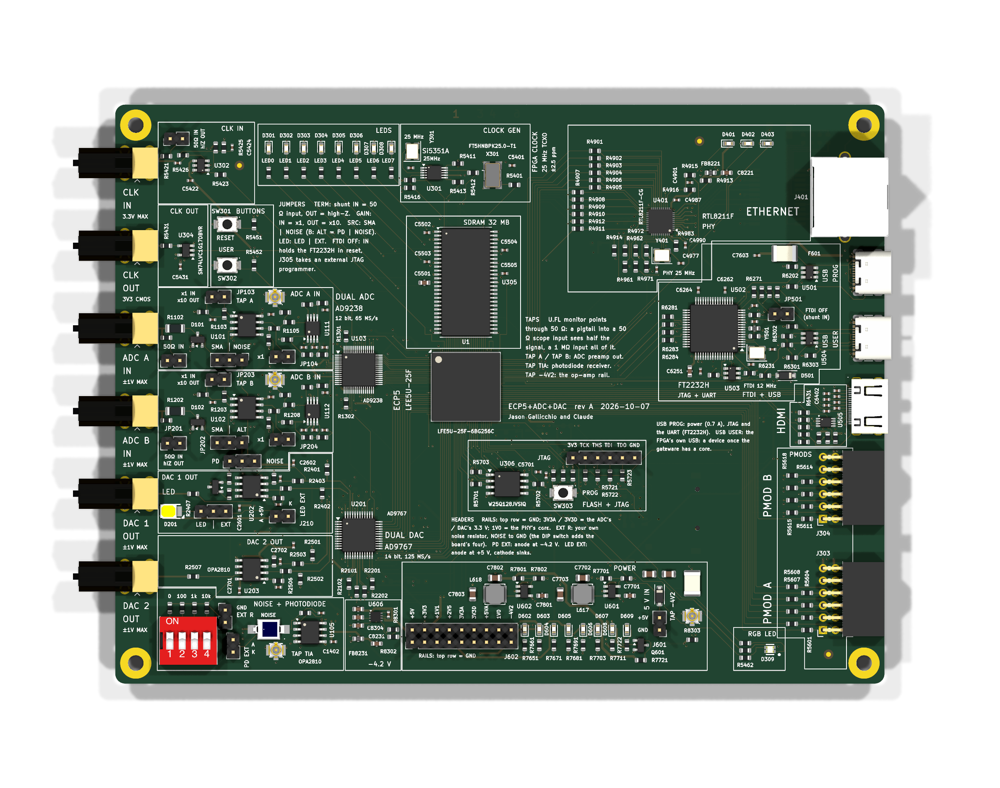
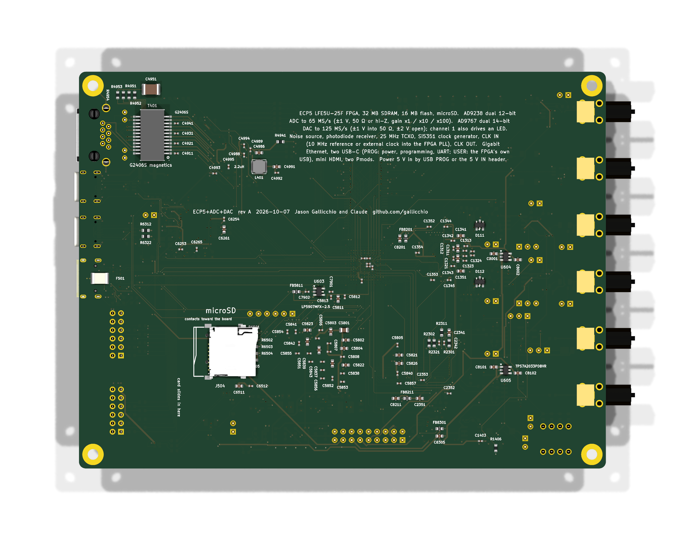

# ECP5 + 2 ADC + 2 DAC

A 158 x 119 mm, 6-layer board (M3 holes in the corners, sized to slide into a Hammond 1455Q1601 extruded enclosure): a Lattice ECP5 (LFE5U-25F, caBGA256) with 32 MB SDRAM, 16 MB QSPI flash,
gigabit Ethernet, FT2232H (JTAG and serial on one USB-C that also powers the board), a second USB-C straight
to the FPGA, mini-HDMI (GPDI), microSD, two Pmods -- and the analog part that is the point of it:
two DC-coupled 12-bit 65 MSPS ADC channels (AD9238) behind OPA1612 / THS4521 front ends, and two DC-coupled
14-bit 125 MSPS DAC channels (AD9767) behind OPA2810 output stages, all on SMAs, plus an on-board LED driver
and photodiode receiver for the optical lock-in experiments.  rev A, 2026-10-02, by Jason Gallicchio and Claude.

Everything is generated.  `python3 build.py` makes the schematic, runs ERC, writes the netlist, places the
board and lets it choose the FPGA ball for every bus bit (`pcb/pinswap.py`, then the schematic is regenerated
with the swaps), proves the pin plan in yosys/nextpnr, routes the board, runs DRC with rules at least as
strict as JLCPCB's, and writes the manufacturing release (Gerbers, BOM, CPL, cost estimate, fabrication
notes) into `mfg/release/`.  `python3 build.py --clean` removes everything it made.  Nothing downstream of
`gen/`, `pcb/`, `mfg/` is hand-edited; the KiCad files are written in KiCad 10's own format.

| what | where |
|---|---|
| the schematic (7 sheets, A1/A2/A3) | `ECP5-2ADC-2DAC.kicad_sch`, `fpga/adc/dac/ethernet/usb/power.kicad_sch`, renders in `build/sch/*.png` |
| the board | `ECP5-2ADC-2DAC.kicad_pcb` |
| manufacturing release | `mfg/release/` (`*_gerbers.zip`, `*_bom.csv`, `*_cpl.csv`, `FABRICATION_NOTES.txt`, `cost_estimate.csv`) |
| pin plan, constraints, LiteX platform | `build/fpga_pins.json`, `gateware/ecp5_2adc_2dac.lpf`, `gateware/litex/ecp5_2adc_2dac.py` |
| gateware proof (every pin, every clock) | `gateware/test/pins.v`, `gateware/test/build.sh` |
| analog simulations | `sim/*.cir`, run with `python3 sim/run.py sim/*.cir` |
| the generators | `gen/` (schematic), `pcb/` (placement, BGA escape, pin swaps, router, silkscreen, board writer), `mfg/` (release), `tools/` (JLCPCB queries) |
| decisions and questions | this file, `QUESTIONS.md` (gitignored, for Jason), `CLAUDE_CODE_CHAT.md` (the log) |

## Checks that are not DRC

* `python3 tools/trace_paths.py > docs/SIGNAL_PATHS.md` walks every signal path through the netlist (SMAs,
  headers, photodiode, oscillators, converter clocks) through each series part to its end, listing the
  shunt parts on every node.  Reading it against the datasheet pin figures is what found the swapped FDA
  outputs, the type-A numbering on the mini-HDMI, the SOIC numbering on the SOT-23 EEPROM, the reversed
  DAC port 2, the TCXO's second ground, the photodiode's pad-1-is-anode footprint and three reversed
  header labels in the first rev A.
* `tools/check_pads_kicad.py` loads the board with KiCad's own pcbnew and compares every pad position with
  what `pcb/fplib.py` assumed when placing and routing (all four rotations, both sides); it must report a
  worst disagreement of 0.
* `python3 pcb/rotscan.py` scores every rotation of the bus chips (SDRAM, ADC, DAC, PHY, FTDI, magnetics)
  by the total distance their signals have to travel.
* The big buses are not left to the router: `pcb/river.py` routes the SDRAM, the ADC, the DAC, the
  Ethernet PHY's RGMII lines (through their series resistors, anchored in columns beside the PHY) and the
  four HDMI pairs by construction, from the chip toward the FPGA, as nested rivers (inward from the pad
  rows, 45 degrees under the body, straight onto the FPGA's exit stubs of the same layer; a bundle bends
  where its exits lie around a corner), and the exit each lane lands on decides the FPGA ball --
  `pcb/pinswap.py` plans the rivers to write `build/pin_swaps.json`, the design regenerates around it,
  and `pcb/build_pcb.py` lays the same rivers before anything else is routed.  The recipes are
  `river.BUSES`; `python3 pcb/river.py` plans the SDRAM's river on the placed board, checks every
  clearance and draws it, `build/scratch/try_chip.py` does the same for any chip in the list.
* When a net does not route, look before rebuilding: `python3 pcb/route_diag2.py "<net>" ...` rebuilds the
  router's obstacle grid from the finished board, lifts that net's own copper, floods from its failed
  terminal on all four layers, retries the connection with a huge budget and draws postage stamps of the
  grid around the start and the goal (`build/scratch/diag/`); `python3 pcb/stamp.py BOARD x0 y0 x1 y1 [net ...]`
  draws one region from the real geometry, a panel per layer, with the fan-out lanes washed over it.
  Every routing rule in `pcb/router.py` and `pcb/build_pcb.py` (the lanes, the via cost inside them, where
  the stitching vias go, the placement standoff) came from reading those stamps, one failed net at a time.
* Every generated symbol's pin numbers were checked against the datasheet figure, not only its text table;
  `library/ours.pretty` holds the two footprints that had to be made (the trimmed-courtyard 0402 and the
  renumbered photodiode).
* The release refuses to build if any SMT part has no LCSC code (`mfg/make_fab.py`): build 20's release had
  none for the two converters, the six op amps, the HDMI jack and the microSD socket, because the sheets name
  parts by their short names and the LCSC table by part number (`parts.ALIASES` bridges them now), and the
  parts had silently joined the hand-solder list.  It also refuses if any ordered code's JLCPCB description
  does not carry the schematic's value and package (`make_fab.code_value_check`): build 24's table had eight
  codes typed wrong -- the DAC's 24.9 Ω loads were a 470 kΩ, the -4.4 V pump's 1.3 MΩ a 27 kΩ (a -1.3 V rail),
  the PHY's 2.49 kΩ RSET a 270 kΩ, the USB port's 27 Ω a 240 Ω, the 2.2 pF feedback capacitors a 1206
  resistor -- and every other check was green, because a code is only a name.
* The build fails if any track on the six SMA feed nets is not `RF_W` (0.35 mm, the 50 Ω width): the cloud
  review found builds 1-25 had routed them at 0.15 mm because the first routing pass never consulted the RF set.
* `python3 mfg/footprint_check.py` fetches EasyEDA's land pattern for every ordered code and lays it over the
  footprint on the board: a hole the board does not drill, a pad the board has no copper for, or a pad centre
  off its copper is reported with the number.  It is what found the 1206 resistor on the 0402 pads.  The
  release runs it (`mfg/release/FOOTPRINT_CHECK.txt`) and reads two more things off the same fit, the way the
  GPiBridge board did (`CLAUDE_PCB.md` §8): the quarter turn that laid JLCPCB's drawing on our footprint by
  pin number predicts the CPL rotation correction for every part nobody has yet read in a placement preview
  (7 of 7 corrections somebody has read agree with it), and where their drawing's origin is not KiCad's (the
  USB-Cs, 1.3 mm; the Pmod sockets) the uploaded CPL is moved to their origin, since JLCPCB places that.
  `ECP5-2ADC-2DAC_cpl.csv` is the one to upload, `_cpl_native.csv` KiCad's own numbers, and
  `PLACEMENT_CHECKS.txt` lists every predicted or moved part for the preview.  Two-pad polarised parts are
  read by the polarity mark in JLCPCB's drawing, not by pad number (they number the cathode 2).
* The CPL's bottom side: KiCad's own flip stores a footprint's pads mirrored top-to-bottom, and the mirror
  rule JLCPCB's previews taught (`jlc_rotation.BOTTOM_FLIP`) was read against such a file; `pcb/board.py`
  stores them mirrored left-to-right, which is the same placement with a stored angle 180 away, so the
  rule now turns this board's angle by 180 first (`BOTTOM_STORED_X_MIRRORED`, checked against the file every
  release).  Every bottom-side rotation in the CPLs of builds 1-27 was 180 out; the seven polarised bottom
  parts (three SOT-23-5 regulators, two BAV99, the magnetics, the microSD) are the first thing to check in
  the preview.
* The release refuses to build without filled zones in the board file or with a DRC error or unconnected
  item in `build/drc.json`.
* `build_pcb._pin1_marks` prints a dot beside pin 1 of every LCSC-pattern part whose pads are symmetric under
  a half turn and whose footprint prints no mark of its own (the RGB LED), and a cathode bar on polarised
  two-pad parts that print none; KiCad's own footprints carry their conventions.
* `mfg/end_panels.py` draws the enclosure's two end plates with every connector's cutout, 1:1, from the placed
  board (SVG and DXF in `mfg/release/`), and warns if cutouts overlap or leave the plate.
* `python3 mfg/jlc_rotation.py` re-checks the CPL rotation rule against the placement-preview readings it was
  derived from; `FABRICATION_NOTES.txt` lists the packages nobody has read in a preview yet.
* Power: about 3 W, 0.6-0.7 A at 5 V -- more than a USB 2.0 port's 0.5 A.  Power the board from a USB-C or
  USB 3 port, or from the 5 V IN header (the silkscreen legend says so).

## Monitor taps

Four Hirose U.FL jacks (C88374), each fed through 49.9 Ω, so the first board's questions are answered by
pushing a U.FL-to-SMA pigtail into a scope or an ADALM2000, not by holding a probe: **TAP A** and **TAP B**
(each ADC channel after its second preamp, before the fully differential driver), **TAP TIA** (the photodiode
receiver's output) and **TAP -4V2** (the op-amp rail after its ferrite bead).  A 50 Ω scope input sees half
the signal through the 49.9 Ω; a 1 MΩ input sees all of it (with the cable's capacitance as its load).  The
rails themselves are on the RAILS header.

## What build 26 changed (the reviews, reconciled)

The five reviews of build 25 (section 5 of `DESIGN_REVIEW_RESPONSE.md` has the table): a BAV99 anti-parallel
across each THS4521's inputs; the ADC input resistors 1206; a bead and 10 µF between the LM27761 and the op
amps, the pump at -4.15 V instead of -4.4; the Bob Smith capacitor a 1 nF 3 kV 1812 and no 1500 V claim; both
RGMII delays inside the PHY (the RXD1 strap pulled up: TXDLY = 1), so the gateware adds none; a 2.2 pF across
the DAC difference amplifier's 2 kΩ to ground, and ±0.9 V / ±1.8 V on the sheet and silkscreen instead of
±1 / ±2 V; a TLV3501 comparator for CLK IN; 100 nF on PROGRAMN and an honest power-sequencing note; the USB-C
and HDMI jacks out to the edge and end-plate cutouts that pass the plugs; `+1V0_PHY` on the RAILS header; the
four U.FL taps; and the cloud review's two code findings (a clone could not build, the SMA feeds were routed at
0.15 mm).  Not changed, with the reasons in the response: the ADC input trace asymmetry, the DAC clocks over
the In4 split, the CPL rotation table (Jason's, on the day of ordering).

Build 27 (the same day) changed no circuit.  Reading the finished silkscreen and sheets as pictures found labels
sitting on things: the TAP B jack moved to its strip's empty bottom-left corner, the one place its name fits beside
it (next to its 49.9 Ω the strip's notch left no room), the TAP -4V2 name moved under its jack, and a dozen sheet
labels that sat on symbols or wires were moved (the CLK IN note, the comparator's power unit, the RAILS header's
designator, the Bob Smith and PROGRAMN notes, the DAC's output and Vout notes, the DAC and TIA feedback
capacitors' values, the ADC gain, tap and "to JP203" notes).  `pcb/plot.py` now draws the designators that go to the fab layer (not printed) dim, so the board pictures
below show the silkscreen as it prints.

The release of 2026-10-06 (no board change) has JLCPCB fit the through-hole parts as well: the six SMA jacks,
the RJ45, the DIP switch, the 2.54 mm headers (ordered as 1x40 and 2x40 strips the assembler snaps to
length, as on the GPSDO board) and two stocked 2x6 right-angle sockets for the Pmods; nothing is left to
hand-solder.  The next build widens every silkscreen line to 0.15 mm, the thinnest JLCPCB prints (the library
outlines are 0.05 and 0.12 mm in build 27's gerbers), and carries the headers' codes in the sheets.

## Design reviews

`DESIGN_REVIEW_PROMPT.md` is the brief for reviewers (with the ground rules for working in this tree in
parallel: one `design_review_<Name>/` directory each, no git, no build).  `DESIGN_REVIEW_RESPONSE.md` is the
author's own review of build 25.  The independent reviews of build 25 are `design_review_CopilotSDK/`,
`design_review_Gemini_3.8_Flash/` and `design_review_Grok4.7/`, each with its `DESIGN_REVIEW_<Name>.md` and the
files it measured or ran; the prompt's §11 summarises them.  `docs/datasheets/txt/` and `drawings/` are the
datasheets as text and pictures for a reviewer who has only the git tree (the PDFs are not committed).

## Pictures (regenerated by every build into `docs/images/`)

`docs/images/ECP5-2ADC-2DAC_schematic.pdf` is the whole schematic; `sch_*.png` one sheet each;
`board_front.png` / `board_back.png` are the copper-and-silk plots.

## Decisions

### FPGA: LFE5U-25F-6BG256C

| part | LUTs | BRAM | DSP | I/O (caBGA256) | JLCPCB stock 2026-10-02 | price |
|---|---|---|---|---|---|---|
| LFE5U-25F-6BG256C | 24k | 1 Mbit | 28 | 197 | 81 | $14.25 |
| LFE5U-45F-6BG256C | 44k | 1.9 Mbit | 72 | 197 | 0 | $15.93 |
| LFE5U-85F-6BG256C | 84k | 3.7 Mbit | 156 | 197 | not listed | -- |

Only the 25F is in stock, which settles it for rev A.  What the bigger parts would buy: the 45F's 72 DSP
slices (vs 28) would let both ADC channels run a 16-tap FIR plus two lock-in multipliers plus an OFDM FFT
at the same time; the 25F does the lock-in and correlation experiments comfortably (a lock-in is two
multipliers and two accumulators per channel) and a VexRiscv Linux SoC with Ethernet fits in ~60% of it.
The footprint is identical, so a rev B with a 45F/85F is a BOM change.

### RAM: 32 MB SDR SDRAM

| option | size | part | stock | price | LiteX support on ECP5 -6 | risk |
|---|---|---|---|---|---|---|
| SDR SDRAM | 32 MB | W9825G6KH-6 | 8909 | $5.63 | litedram SDR PHY, used on ULX3S/Icepi Zero | low |
| DDR3L | 256 MB | MT41K128M16JT-125 | 1989 | $19.07 | litedram ECP5 DDR3 PHY, marginal at speed grade -6 | high |

32 MB holds 16 M samples (8 s of both ADCs at 65 MSPS, 2 min at 1 MSPS) and a Linux image.  DDR3 would hold
longer captures but the ECP5 -6 DDR3 PHY in litedram is the single biggest schedule risk on a one-night
board, and the BGA-96 adds a second escape problem.  Rev B candidate.

### ADC: one AD9238 (dual) rather than two AD9226 / AD9235

| option | bits / MSPS | supply | package | stock | price per board | notes |
|---|---|---|---|---|---|---|
| **AD9238BSTZ-65** | 2 x 12 / 65 | 3.3 V | LQFP-64 | 21 | $71 | two matched cores, shared reference, simultaneous sampling |
| 2 x AD9226ARSZ | 12 / 65 | 5 V | SSOP-28 | 24 | $157 | the classic; 5 V analog |
| 2 x AD9235BRUZ-65 | 12 / 65 | 3.3 V | TSSOP-28 | 33 | $75 | one AD9238 core each |
| 2 x AD9235BCPZ-40 | 12 / 40 | 3.3 V | LFCSP-32 | 134 | $51 | slower; most stock |

The correlation experiment wants the two channels to be as alike as possible: one die, one reference,
one clock tree.  The AD9238 is that part, and cheaper than two AD9226.  Its stock is thin (QUESTIONS.md 9).

### DAC: AD9767

| option | bits / MSPS | stock | price per board | notes |
|---|---|---|---|---|
| **AD9767ASTZRL** | 2 x 14 / 125 | 147 | $14 | dual, own WRT/CLK per port, interleaved I/Q mode |
| 2 x AD9744ARUZ | 14 / 210 | 762 | $50 | faster, two packages |
| 2 x DAC904E | 14 / 165 | 261 | $12 | cheapest; two packages, 5 V-capable |

Both DAC outputs are complementary current outputs into 24.9 ohm, taken differentially by an OPA2810 at
gain 4 (2 kΩ || 2.2 pF on both inputs): ±1.8 V unloaded, ±0.9 V into 50 ohm, DC coupled -- the 499 Ω inputs
load the 24.9 Ω, which is why it is not ±2 / ±1 V -- flat to 13.5 MHz, a full-scale sine clean to 10 MHz
(the OPA2810's 180 V/µs).

### Ethernet, USB, clocks, power

* RTL8211F-CG (RGMII, 87k in stock, $1.38) + G2406S discrete magnetics + a plain shielded RJ45.  The
  in-stock magjacks tie the four chip-side centre taps together; this voltage-mode PHY wants them separate.
* FT2232H: channel A is JTAG (openFPGALoader -c ft2232), channel B the console -- both at once.
* Clocks.  A 25 MHz TCXO (Fox FT5HNBPK25.0, ±2.5 ppm, the GPSDO board's proven part -- 50 MHz TCXOs of that
  grade are rarer and dearer, and the ECP5's PLL makes 50/100/125 MHz from 25 as readily as from 50) is the
  FPGA's system clock; an Si5351A on its own 25 MHz crystal gives three programmable clocks (2.5 kHz-200 MHz)
  on PCLK pins, locked to each other but not to the TCXO; the PHY and the FTDI have their own crystals
  (25 and 12 MHz).  Every sample clock is an FPGA output (the AD9238's two and the AD9767's two), so the
  gateware chooses the rate and phase.  The CLK IN SMA (50 ohm by jumper, a 10 MHz GPSDO sine of 0.3 V peak
  or more, or any 0.5-3.3 V square wave to 80 MHz, squared by a TLV3501 comparator on the ADC's quiet 3.3 V:
  +IN AC-coupled and biased to mid-rail through 10 kΩ, -IN at mid-rail, 6 mV of hysteresis inside, 4.5 ns;
  builds 1-25 had the GPSDO board's self-biased inverter, whose threshold moved with the digital rail) feeds a PCLK
  pin for the FPGA's PLL to lock to -- a lab instrument's 10 MHz REF IN, from which the ADC and DAC can run at
  different, phase-locked rates -- and the CLK OUT SMA (any FPGA clock through a buffer and 49.9 ohm, 3.3 V
  CMOS) is what the next board's CLK IN takes.
* One 5 V USB-C powers everything: two bucks (3.3 V, 1.1 V), LDOs for +2.5 V, +3V3_ADC and +3V3_DAC,
  ferrite-fed +3V3_DRV/+3V3_DAC_D/+3V3_ETH/+5VA, and an LM27761 charge pump for -4.15 V (`-4V2`; the op amps
  get it through a ferrite bead and 10 µF, so the pump's 2 MHz is not common to both noise channels; -4.15 V
  rather than -4.4 V leaves the LDO 0.45 V of headroom from a 4.75 V USB supply).  ~3 W total.

## The board

158 x 119 mm, 6 layers, JLCPCB JLC06161H-7628: F.Cu signals / In1 GND / In2 signals / In3 signals / In4 power planes / B.Cu.
In4 carries a 1.1 V patch under the core's 1.1 V balls with a corridor to its buck, the 5 V plane from the
USB-C down the right edge to both bucks' input sides, and 3.3 V under everything else (ground fills what they
leave); every rail pad over its plane has a via into it (a pad off its plane gets one at the plane's edge,
dropped again when the router joins the pad elsewhere), and the other rails are 0.4 mm traces.  The 3.3 V
VCCIO balls are joined by an island on In3 under the core, fed from the 3.3 V plane through three vias in the
ball gaps at the core's east edge; VCCAUX's two balls leave the via field on a hand-laid 0.127 mm track
(`floorplan.aux_feed`).
M3 mounting holes 4.2 mm in from each corner, tied to ground.  The long edges (top and bottom) carry no
connector and no part within 3.5 mm, so the board slides into the PCB slots of a Hammond 1455Q1601 extrusion
(125 x 51.5 x 160 mm; `datasheets/Hammond_1455Q1601.pdf`: made for a 120 mm wide board, up to 159 mm long
between its end plates, slots 2 mm apart) with the SMAs through the left end plate and every other connector
through the right one.  The size is the enclosure's: 119 mm wide fills the slots (120.5 mm slot to slot) and
158 mm long puts the SMAs' flanges at one end plate and the USB-C, HDMI and RJ45 faces at the other -- builds
up to 21 were 150 x 118 mm, which would have left 9 mm between the SMAs (7.5 mm of barrel past the edge) and
their plate.  The USB-C jacks stand 1.9 mm and the mini-HDMI 0.75 mm past the edge (as far as their rear
through-hole pads allow, 0.35 mm from the edge), and since the plate is 1.45 mm thick and the board can float
up to 2 mm between the plates, the USB-C and HDMI cutouts are sized for the plugs' overmoulds (12.8 x 6.8 and
14 x 8 mm), so a plug seats however the board sits -- a review (Gemini) found the build-25 jacks 0.3 mm inside
the edge, where a USB-C shroud could not have reached.  `mfg/end_panels.py` draws both end plates with their
cutouts (SVG and DXF, 1:1) from the placed board; the one number it cannot know is which slot the board rides
in, so measure the extrusion and set `PCB_TOP_ABOVE_FLOOR` before milling.  The east cluster (PHY, magnetics, jack, FTDI, USB, HDMI, Pmods, RGB LED,
microSD) is drawn 8 mm east of its 150 mm coordinates (`floorplan.E`):

* **left end**, 17 mm apart down the edge: CLK IN, CLK OUT, ADC A IN, ADC B IN, DAC 2 OUT, DAC 1 OUT, each
  name and its limit printed under its SMA, and each one's circuit in its own silkscreen box beside it (the
  termination jumper, series resistor (a 1206: 0.25 W, so a ±10 V source into the clamp does not open it) and
  clamp first, then the op amps with their passives in a straight run to the converter, a U.FL monitor tap on
  the second preamp's output, and a BAV99 on the back under the THS4521's input pins, anti-parallel across
  them, so that a saturated preamp cannot put more than a diode drop between them (the reviews disagreed on
  whether the amplifier would survive 2.27 V there; now it cannot see it); the two ADC strips are identical,
  and so are the two DAC strips);
* **right end**, top to bottom: RJ45 (y 19), USB-C PROG (34.5; FTDI: JTAG, serial, and the board's 5 V),
  USB-C FPGA (48; wired straight to the FPGA, a USB device once the gateware has a core), mini-HDMI (62),
  Pmod B and Pmod A 0.9 inch apart (a Digilent Pmod VGA or an icesugar PMOD-TFTLCD spans both) -- spaced
  so that spec-maximum plugs fit side by side, "USB PROG" and "USB FPGA" standing beside their jacks;
  the microSD is on the back, inboard (there is no edge left, and a card is rarely changed), its card
  sliding in from the east over a strip of blank board that the build checks (`floorplan.SD_CARD_PATH`);
* **the Ethernet line side is an isolation island**: from x 127.3 mm (under the magnetics' body, between its
  chip-side and line-side pad rows) to the right edge and from y 3 to 29 mm, a rule area on all six copper
  layers that no plane may enter, so the jack, the magnetics' line-side pads, the Bob Smith network (four
  75 Ω into a 1 nF / 3 kV 1812 capacitor, hand-laid on the back north of the magnetics) and the eight LAN
  lines have no copper of any other net under them; a DRC rule (`gen/rules.py`, the LAN class) keeps every
  other net's copper 1.5 mm from them on the same layer, and the router puts no return via inside.  The
  magnetics are the isolation (IEEE 802.3's 1500 Vrms is theirs to meet); the capacitor is the designed
  bridge across it; the gap is a bench clearance, measured on the finished board (`build/scratch/p11/moat.py`,
  numbers in the response), and the board has not been hipot-tested -- builds up to 25 had a 1206 2 kV part
  and the reviews called its 1.4 mm pad gap and the "1500 V" wording unsupported.  The jack's shell is
  grounded at its two shield legs, one into the corner mounting hole's ring, one to a ground via just outside
  the island;
* the bottom edge, left to right: the noise-resistor DIP switch and NOISE R header, the photodiode and
  PD EXT header, the photodiode receiver's U.FL tap, the -4.2 V charge pump (its bead and 10 µF on the back
  under it), the RAILS header (2 x 9: the rails in the bottom row with their names standing over the pins,
  the whole top row ground, `+1V0_PHY` since build 26, so a probe reaches every rail), the two bucks, the
  5 V IN bench header and the -4V2 U.FL tap; the top edge: the clock chains, eight white LEDs
  (LED0-LED7) and the two buttons, the Si5351 and the 25 MHz TCXO that is the FPGA's clock.  The RGB LED
  and its resistors have their own box west of Pmod A.
* The FPGA is in the middle, the SDRAM above it facing its north banks, flash and the JTAG header below it;
  the AD9238 and AD9767 on the left facing its west banks with their front ends and output stages further
  left; the PHY and FTDI on the right.  The Ethernet magnetics sit on the back directly under the RJ45.
  Every section is outlined on the silkscreen with its name set into its top edge (every line through the
  name is cut round it, so two strips can share a boundary) and every part's designator kept inside its
  section's box; every 3-pin jumper has its two choices printed under its two outer pins with a line
  through its centre pin, every 2-pin jumper what a shunt does; the headers' pins are named; the chips
  carry their names and ratings and every clock its frequency; a legend in the largest free area says
  what each jumper and header does, and a longer one on the back says what the board is.

The BGA is escaped by construction (`pcb/escape.py`): rings 7 and 8 leave on F.Cu, ring 6 on In2, ring 5 on
In3, ring 4 on whichever midline is free; every ball in rings 1-6 has a filled-and-capped via in its pad.
The 1.1 V core and 3.3 V VCCIO balls are joined by zone islands under the core on In2/In3.  The FPGA's
100 nF decoupling is on the back, directly under the package: each capacitor (a 0402 with a trimmed
courtyard, `library/ours.pretty`) spans a power ball's via and the via of an adjacent ground ball, so the
loop is the two vias and nothing else; the capacitors that cannot be paired that way sit in the band just
below the package, with the bulk capacitors.  The big buses are rivers (`pcb/river.py`: SDRAM, ADC, DAC, RGMII, HDMI, Pmods --
lanes laid by construction from the chip to the FPGA, which decide the balls), the converters' inputs and
outputs and the whole Ethernet line side are laid by hand (`floorplan.HAND`), and everything else is
routed by `pcb/router.py`, a 0.2 mm-grid A* over the four signal layers; the SMA feeds are 0.35 mm wide (50 ohm over the In1 plane); digital nets
may not cross the analog strip down the left; and every signal via gets a ground via within 1.5 mm for the
return current (`return_vias` in `pcb/build_pcb.py`).

Open `kicad-gui.sh` (not `kicad`) to look at the files: KiCad's OpenGL canvas under native Wayland
does not repaint after zoom and scroll; the script runs it through XWayland.
