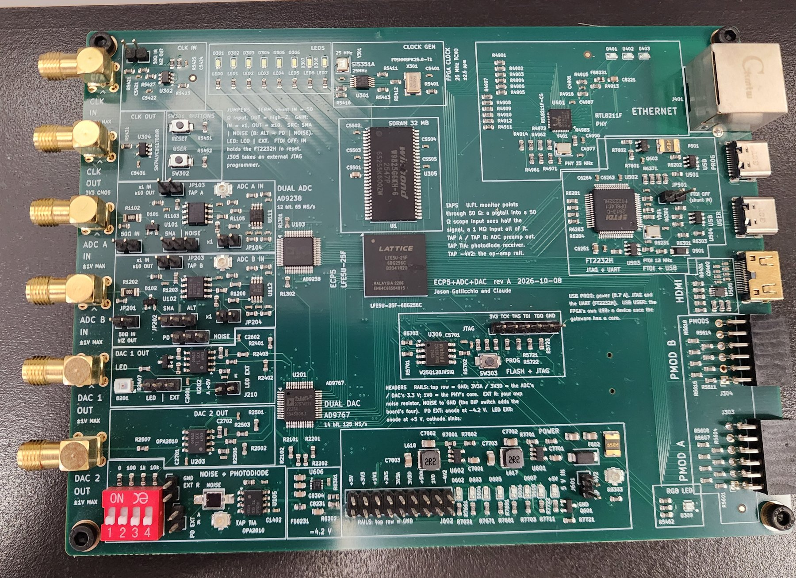
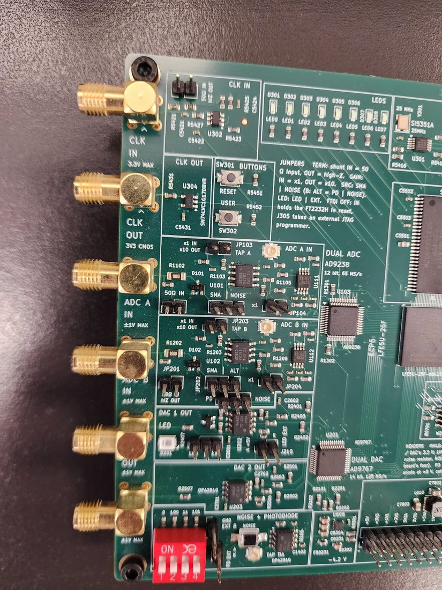
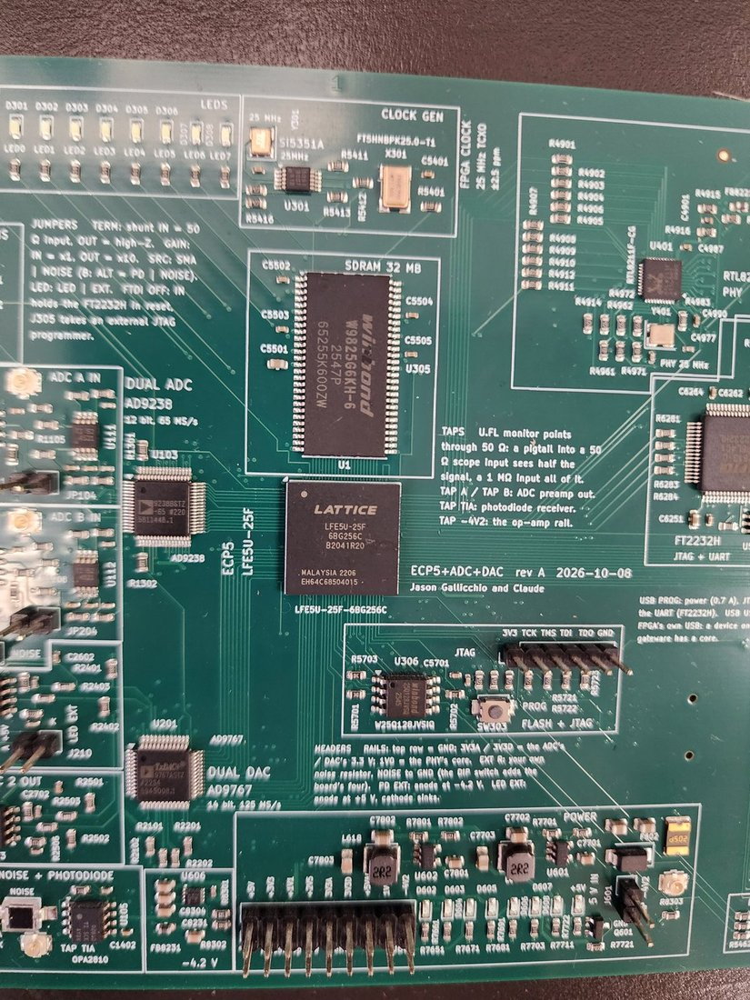
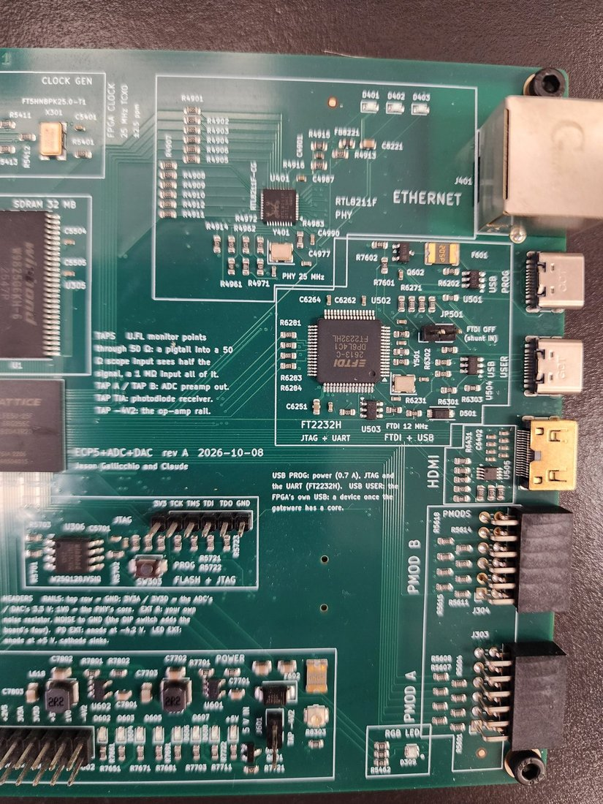
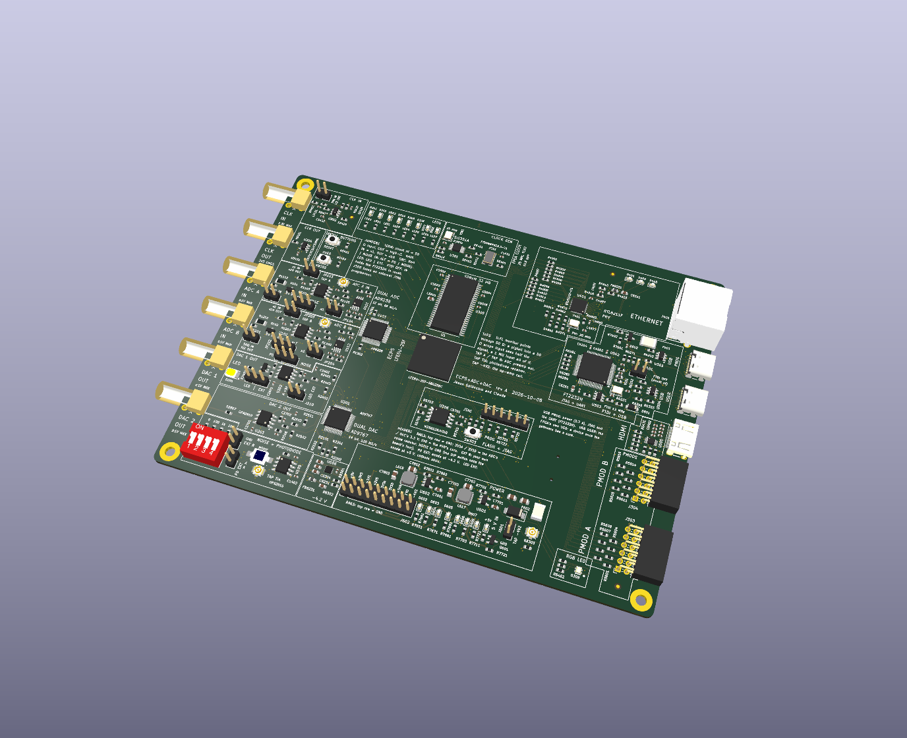
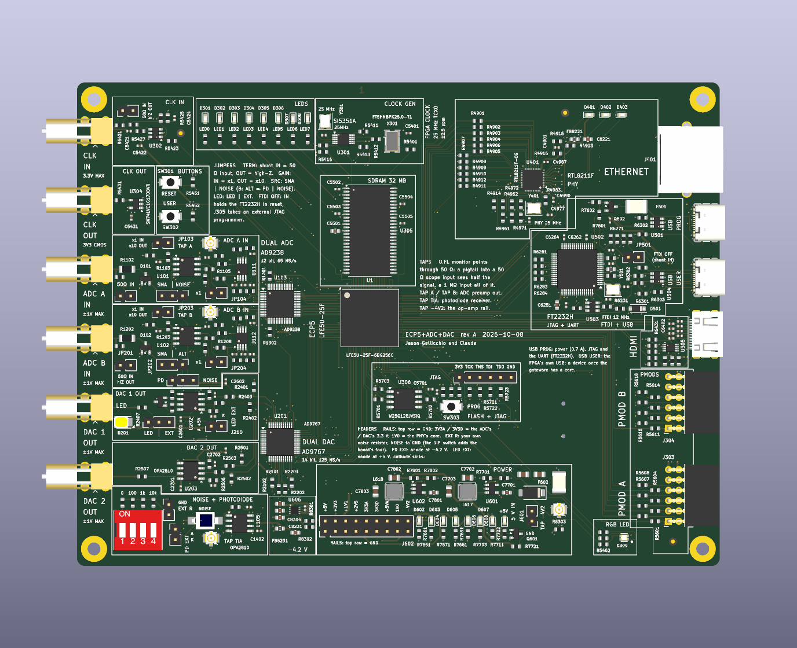
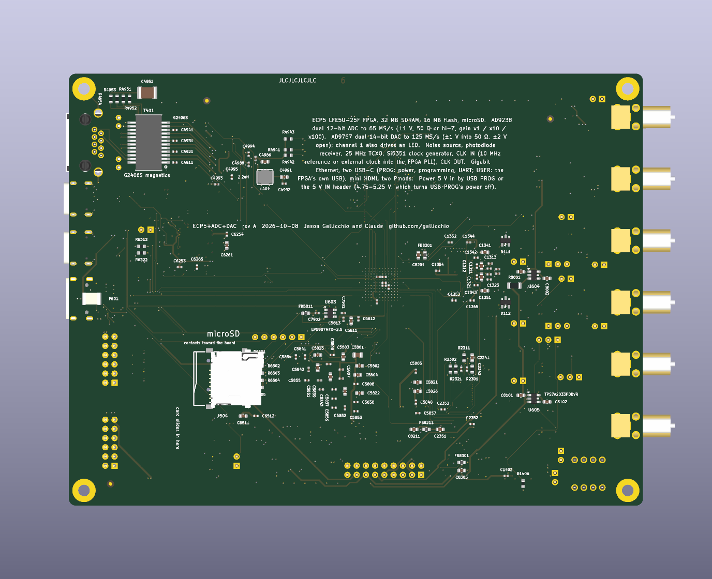
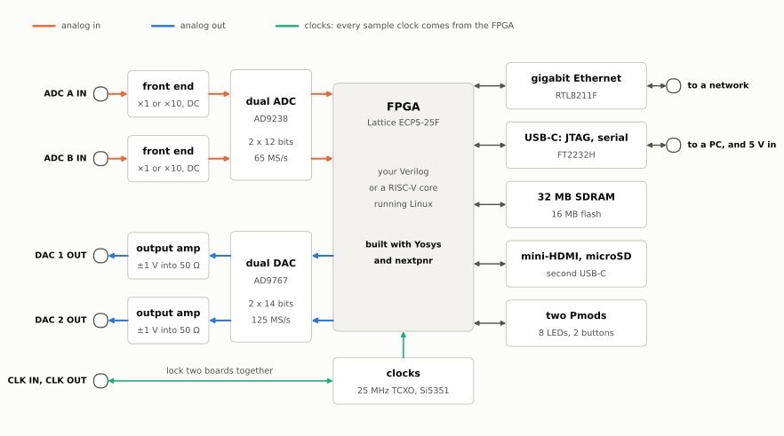
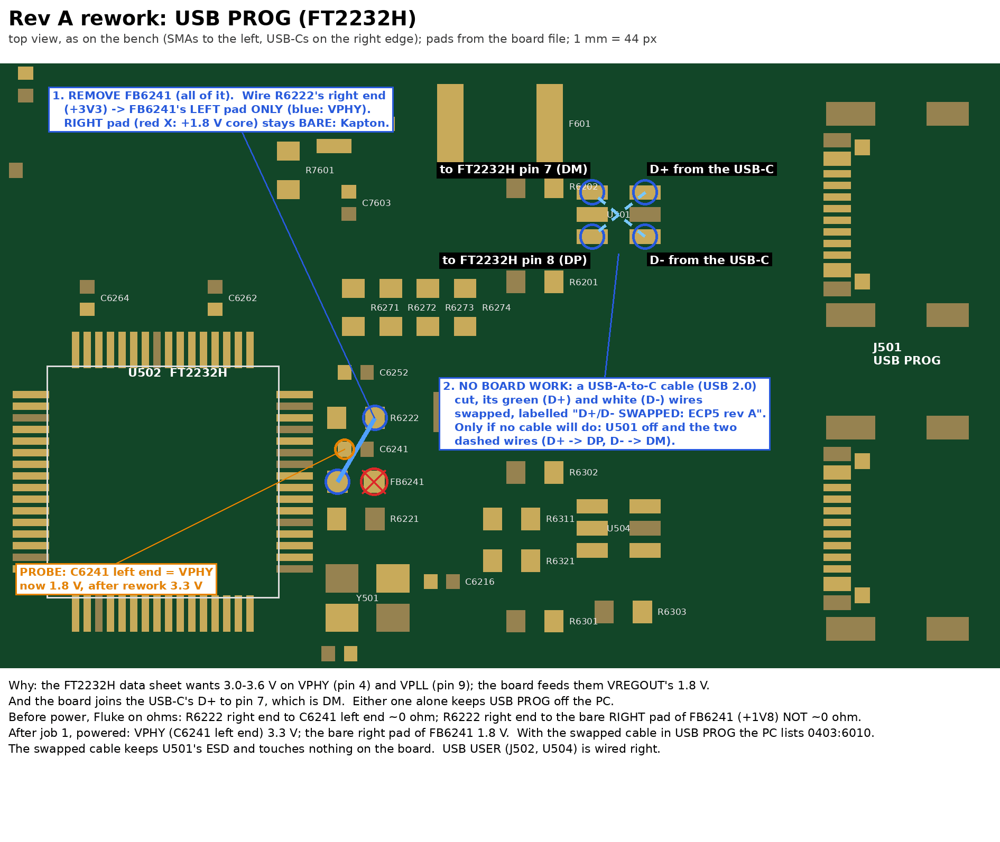

# ECP5-2ADC-2DAC

**Completely Open: Schematic, PCB, FPGA, Verilog, RISC-V processor, Linux, Ethernet, 2 ADCs, 2 DACs**

> [!WARNING]
> ## Rev A mostly works, but only after soldering work. Wait for rev B.
> **Do not order this board yet.** Rev A's programming port is dead until two things are changed with a
> soldering iron and a cut cable, and it has other faults listed below. Rev B will fix them.

  

Rev A as delivered. The back is [here](photos/20261116_084538.jpg). The same board as drawn in KiCad:

  

Click any image to open it at full size.

## What it is for

A better version of the [Icepi Zero DAC/ADC tutorials](https://github.com/gallicchio/icepi-zero-dac-adc), on a
board made for them:

- **Two synchronized channels** in and two out, for things like I/Q. One dual ADC, one dual DAC.
- **Gigabit Ethernet**, so samples stream to a laptop at hundreds of megabits a second.
- **Nothing closed** between the laptop and the converters' pins. No vendor tool, no licence, no account.

| | |
|---|---|
| FPGA | Lattice ECP5, LFE5U-25F: 24k LUTs |
| Inputs | 2 x 12 bits, 65 MS/s (AD9238), DC-coupled, ±1 V, gain 1, 10 or 100, 50 Ω or high impedance |
| Outputs | 2 x 14 bits, 125 MS/s (AD9767), DC-coupled, ±1 V into 50 Ω |
| Clocks | 25 MHz TCXO, Si5351, clock in and clock out on SMA |
| Memory | 32 MB SDRAM, 16 MB flash, microSD |
| Ports | gigabit Ethernet, USB-C (JTAG and serial), a second USB-C, mini-HDMI, two Pmods |
| Extras | an LED driver and a photodiode receiver, for optics; a noise source |
| Board | 158 x 119 mm, 6 layers, one 5 V USB-C, about 3 W |

## Status of rev A

Two boards were assembled. One has been powered, on 2026-11-16 and 17.

| | status | detail |
|---|---|---|
| Power: every rail from one USB-C | **works** | |
| USB port for programming and serial | **dead as built** | works after the two changes below |
| Boot from flash | **works** | |
| 32 MB SDRAM | **works** | with its clock inverted in the FPGA; no error over the whole memory at 62.5 MHz |
| Clocks | **work** | the Si5351 to 225 MHz |
| ADC, both channels | **works** | clean to 87.5 MS/s; about 10.5 effective bits on small signals; large signals distort above about 2 MHz |
| DAC, both channels | **works** | clean at 187.5 MS/s |
| Gigabit Ethernet | **works** | both ADCs at 25 MS/s into GNU Radio: 858 Mbit/s, no packet lost |
| RISC-V Linux | **boots** | LiteX with a VexRiscv core at 50 MHz, Linux 6.12, loaded over the network |
| Second USB-C, the FPGA's own | does not work | cause not found |
| microSD | does not answer | not diagnosed |
| Pmod sockets | wrong | mirrored against the Pmod standard |
| HDMI, LED driver, photodiode receiver | not tested yet | |
| The second assembled board | not powered yet | |

The powered board's ADC stage was then damaged by a test lead that shorted on it. It still works; signals near
full scale are compressed. The record: [`bringup/STATUS.md`](bringup/STATUS.md),
[`bringup/BRINGUP_LOG.md`](bringup/BRINGUP_LOG.md).

### What rev A needs before it works

| fault | change |
|---|---|
| Two supply pins of the USB chip (FT2232H) get 1.8 V. They need 3.3 V. | Remove ferrite bead FB6241. Solder a wire from +3V3 to its **left pad only**. |
| The USB data lines D+ and D- are swapped at the chip. | Use a USB cable with those two wires crossed. |

Either fault alone keeps the board off the PC. A wire across both pads of FB6241 puts 3.3 V on the chip's 1.8 V
core. Every fault and its fix for rev B: [`bringup/REVB.md`](bringup/REVB.md).

## What "completely open" means here

| layer | what | built with |
|---|---|---|
| Schematic, PCB | a KiCad 10 project, generated by Python in `gen/` and `pcb/` | KiCad |
| FPGA | Lattice ECP5 | Yosys, nextpnr, Project Trellis, openFPGALoader |
| Verilog | the bring-up designs in [`gateware/bringup/`](gateware/bringup/README.md) | |
| RISC-V processor | VexRiscv in a LiteX system; the board's platform file is [`gateware/litex/`](gateware/litex/) | LiteX |
| Linux | 6.12, with a driver for the converters | Buildroot |
| Ethernet | RTL8211F PHY; UDP in Verilog, or LiteEth | |

The chips themselves are ordinary closed silicon with public data sheets.

Against a Red Pitaya STEMlab 125-14:

| | Red Pitaya | this board |
|---|---|---|
| Inputs | 2 x 14 bits, 125 MS/s | 2 x 12 bits, 65 MS/s |
| Outputs | 2 x 14 bits, 125 MS/s | 2 x 14 bits, 125 MS/s |
| FPGA and its tools | Xilinx Zynq: Vivado | Lattice ECP5: Yosys and nextpnr |
| Processor | ARM cores in the Zynq | a RISC-V core you can read, in the FPGA |
| Memory | 512 MB | 32 MB |

Fewer bits in and a slower processor; nothing you cannot open.

## What is here

| path | what |
|---|---|
| `*.kicad_sch`, `ECP5-2ADC-2DAC.kicad_pcb` | the KiCad 10 project; the schematic as [PDF](docs/images/ECP5-2ADC-2DAC_schematic.pdf) |
| [`mfg/release/`](mfg/release/) | what was uploaded to JLCPCB: Gerbers, BOM, placement |
| [`gateware/`](gateware/bringup/README.md) | the pin constraints, the bring-up Verilog and its bitstreams, the LiteX platform file |
| [`bringup/`](bringup/README.md) | the bench programs, the log of every measurement, the list for rev B |
| `gen/`, `pcb/`, `mfg/`, `tools/`, `sim/` | the scripts that generate and check the design (`python3 build.py`) |
| [`docs/DESIGN.md`](docs/DESIGN.md) | the design and its reasons, build by build |
| [`design_review/`](design_review/README.md) | six reviews before the order, and [what was done about them](DESIGN_REVIEW_RESPONSE.md) |
| [`photos/`](photos/README.md) | the board as delivered |

## How it was made

Jason Gallicchio designed this with Claude (Anthropic's Fable 5.1 and Opus 5.5, in Claude Code).

| | dates | days |
|---|---|---|
| Design, to the order at JLCPCB | 2026-10-01 to 2026-10-09 | 9 |
| Boards delivered | 2026-11-05 | |
| Bring-up and debugging so far | 2026-11-16 to 2026-11-17 | 2 |

Every prompt and every response is kept: [`CLAUDE_CODE_CHAT.md`](CLAUDE_CODE_CHAT.md).

The board grew up in a private repository of the research group. Its commits are here; vendor datasheets are
not. Commit hashes quoted in the documents are the old ones: [`docs/COMMIT_MAP.tsv`](docs/COMMIT_MAP.tsv).

## Licence

Hardware under CERN-OHL-P-2.0, software under MIT: [`LICENSE`](LICENSE).
